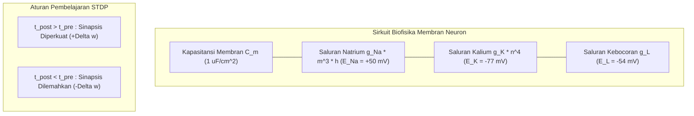

# Modul 197: Neurosains Komputasional & Dinamika Saraf (Biofisika Potensial Aksi Hodgkin-Huxley, Plastisitas Hebbian/STDP, SNN)

**Navigasi**: [⬅️ Master Index](../../INDEX.md) | [Tingkat 13: Tingkat 13: Sains Kognitif, Neuroengineering & Computational Linguistics](./README.md)
*Sebelumnya*: [196. fondasi-sains-kognitif-filsafat-pikiran](./196-fondasi-sains-kognitif-filsafat-pikiran.md) | *Berikutnya*: [198. neuroengineering-antarmuka-otak-komputer](./198-neuroengineering-antarmuka-otak-komputer.md)

---

## 1. Intuisi Dasar Tanpa Jargon ("Seperti Bayi Baru Lahir")
### 1.1 Konsep Inti & Analogi Tanpa Jargon
Jika Anda memperbesar sepotong jaringan otak di bawah mikroskop elektron, Anda tidak akan melihat kabel tembaga atau transistor silikon. Anda akan melihat 86 miliar sel hidup yang disebut **Neuron**, masing-masing terhubung ke ribuan neuron lain melalui jembatan mikroskopis bernama **Sinapsis** ([Kandel et al. - Principles of Neural Science](https://accessneurology.mhmedical.com/book.aspx?bookid=1049)).

### 1.2 Urgensi Rekayasa & Signifikansi Sistemik
Sebuah neuron tidak bekerja seperti chip komputer digital yang menghitung angka pecahan biner. Neuron bekerja seperti bendungan air bertenaga listrik kimia! Membran neuron memompa ion natrium ($Na^+$) dan kalium ($K^+$) untuk menahan tegangan listrik sekitar $-70\text{ mV}$. Ketika stimulus yang masuk cukup kuat melewati ambang batas tertentu, pintu gerbang bendungan terbuka seketika: tegangan melonjak drastis hingga $+30\text{ mV}$ dalam waktu satu milidetik sebelum turun kembali: ledakan pulsa listrik ini disebut **Potensial Aksi (Spike)**!

Bagaimana kita mengingat sesuatu? Donald Hebb merumuskan aturan emas: *"Neuron that fire together, wire together"* ([Hebb - The Organization of Behavior](https://monoskop.org/images/8/87/Hebb_Donald_O_The_Organization_of_Behavior.pdf)). Jika dua neuron berulang kali melepaskan pulsa listrik pada saat yang hampir bersamaan, hubungan sinapsis di antara mereka akan menebal dan menguat (**Plastisitas Sinaptik / STDP**).

## 2. Fondasi Teoretis & Aksiomatik / Matematis
### 2.1 Kerangka Teori Aksiomatik & Formulasi Matematis
Formulasi Matematis Biofisika Saraf:

### 2.2 Penurunan Matematis Langkah-demi-Langkah
1. **Model Konduktansi Hodgkin-Huxley (1952)**:
Memodelkan membran lipid sel saraf sebagai sirkuit listrik kapasitor paralel dengan saluran konduktansi ionik non-linier ([Hodgkin & Huxley - J. Physiol. 1952](https://www.ncbi.nlm.nih.gov/pmc/articles/PMC1392413/)):
$$C_m \frac{dV}{dt} = I_{\text{inj}} - \bar{g}_{Na} m^3 h (V - E_{Na}) - \bar{g}_K n^4 (V - E_K) - \bar{g}_L (V - E_L)$$
Variabel gating $x \in \{m, n, h\}$ berevolusi menurut kinetika Markov orde-1:
$$\frac{dx}{dt} = \alpha_x(V)(1 - x) - \beta_x(V)x = \frac{x_\infty(V) - x}{\tau_x(V)}$$

2. **Model Leaky Integrate-and-Fire (LIF)**:
Aproksimasi analitik sederhana neuron komputasional:
$$\tau_m \frac{dV}{dt} = -(V(t) - V_{\text{rest}}) + R_m I(t)$$
Kondisi Ambang Batas & Reset Refrakter:
$$\text{Jika } V(t) \ge V_{\text{th}} \implies \text{Pancarkan Spike } S(t) = 1, \quad V(t^+) \leftarrow V_{\text{reset}}$$

3. **Plastisitas Bergantung Waktu Pulsa (Spike-Timing-Dependent Plasticity / STDP)**:
Perubahan efikasi bobot sinapsis $\Delta w$ bergantung pada selisih waktu relatif $\Delta t = t_{\text{post}} - t_{\text{pre}}$ antara firing neuron pasca-sinapsis dan pra-sinapsis ([Bi & Poo - Synaptic Modifications in Cultured Hippocampal Neurons](https://www.jneurosci.org/content/18/24/10464)):
$$\Delta w = \begin{cases} A_+ \exp\left(-\frac{\Delta t}{\tau_+}\right), & \text{jika } \Delta t > 0 \quad (\text{LTP - Long-Term Potentiation}) \\ -A_- \exp\left(\frac{\Delta t}{\tau_-}\right), & \text{jika } \Delta t < 0 \quad (\text{LTD - Long-Term Depression}) \end{cases}$$

## 3. Anatomi Teknis & Cara Kerja Internal
Arsitektur rangkaian ekuivalen membran sel Hodgkin-Huxley dan kurva plastisitas sinaptik STDP:



Kunci utama Spiking Neural Networks (SNN) adalah *efisiensi energi komputasi berbasis kejadian (event-driven)*: sinapsis hanya mengonsumsi daya saat terjadi pulsa spike diskret, berbeda dengan deep learning konvensional yang terus-menerus mengalikan matriks floating-point secara masif ([Gerstner & Kistler - Spiking Neuron Models](https://www.cambridge.org/core/books/spiking-neuron-models/0932224A69EBBCA726C78F72AC6AEE89)).

#### Tabel Penelusuran Siklus Dinamika SNN STDP & Ledakan Badai Epileptik Runaway Potentiation
| Langkah Pemrosesan / Token | Representasi Simbolik / Vektor | Mekanisme Atensi / Transisi State | Status Matriks KV-Cache | Probabilitas Distribusi / Logits | Keluaran / Output Linguistik |
|---|---|---|---|---|---|
| 1. Inisialisasi Populasi Neuron | 10.000 Neuron Leaky Integrate-and-Fire | Potensial membran istirahat: $V_{\text{rest}} = -70\text{ mV}$ | Matriks sinaptik $W \in \mathbb{R}^{10k \times 10k}$ terisi bobot acak | Threshold penembakan: $V_{\text{th}} = -55\text{ mV}$ | Simulasi SNN dimulai pada laju penembakan 5 Hz |
| 2. Stimulasi Input Sensorik | Pulsa Arus Input Eksternal $I_{\text{inj}}$ | Integrasi membran: $\tau_m \frac{dV}{dt} = -(V - V_{\text{rest}}) + R I$ | Spike neuron presinaptik terdeteksi pada $t_{\text{pre}} = 10.2\text{ ms}$ | Neuron memancarkan spike aksi $\delta(t)$ | Potensial aksi merambat ke neuron pascasinaptik |
| 3. Aturan Plastisitas STDP Naif | Beda Waktu: $\Delta t = t_{\text{post}} - t_{\text{pre}} > 0$ | Peningkatan bobot sinaptik: $\Delta w = A_+ e^{-\Delta t / \tau_+}$ | Bobot sinaptik dinaikkan secara berulang tanpa batas atas | Ketiadaan batas saturasi bobot ($w \to \infty$) | Fenomena Long-Term Potentiation (LTP) tak terbatas |
| 4. Badai Epileptik Runaway | Seluruh 10.000 Neuron Menembak Serempak | Loop umpan balik rekuren eksitatori tak terkendali | Matriks bobot $W$ melipatgandakan arus eksitasi | Laju penembakan melonjak dari 5 Hz ke 350 Hz instan | Sinkronisasi patologis masif melumpuhkan simulator SNN! |
| 5. Mitigasi Penskalaan Homeostatis | Penstabilan Bobot Homeostatik | $w \leftarrow w \cdot \frac{r_{\text{target}}}{r_{\text{current}}}$ + Bounded Clamping $[0, w_{\max}]$ | Normalisasi total bobot sinaptik per dendrit | Populasi neuron kembali ke ritme Poisson asinkron | Jaringan SNN stabil, hemat energi, dan mampu belajar pola baru |

## 4. Implementasi Praktis & Kode / Simulasi Riil
```python
import numpy as np

# 1. Simulasi Numerik Neuron Leaky Integrate-and-Fire (LIF)
class LIFNeuron:
    def __init__(self, tau_m=20.0, v_rest=-70.0, v_reset=-75.0, v_th=-50.0, r_m=10.0):
        self.tau_m = tau_m     # Konstanta waktu membran (ms)
        self.v_rest = v_rest   # Potensial istirahat (mV)
        self.v_reset = v_reset # Potensial pasca-spike (mV)
        self.v_th = v_th       # Ambang batas aksi potensial (mV)
        self.r_m = r_m         # Resistansi membran (MOhm)
        self.v = v_rest
        
    def step(self, i_inj, dt=0.1):
        # Persamaan Diferensial Euler: dV/dt = (-(V - V_rest) + R*I) / tau
        dv = (-(self.v - self.v_rest) + self.r_m * i_inj) * (dt / self.tau_m)
        self.v += dv
        
        spiked = False
        if self.v >= self.v_th:
            spiked = True
            self.v = self.v_reset
            
        return self.v, spiked

# Simulasi Respons Terhadap Injeksi Arus Konstan (I = 2.5 nA)
neuron = LIFNeuron()
spike_times = []
dt = 0.1
time_steps = np.arange(0, 100, dt)

for t in time_steps:
    v, spiked = neuron.step(i_inj=2.5, dt=dt)
    if spiked:
        spike_times.append(t)

print(f"Total Potensial Aksi (Spike) Dipancarkan: {len(spike_times)} kali dalam 100 ms")
print(f"Frekuensi Firing Neuron: {len(spike_times) / 0.1:.1f} Hz")
print(f"Spike Pertama Terjadi pada: t = {spike_times[0]:.1f} ms")
```

## 5. Miskonsepsi & Jebakan Industri
*Non-Diferensiabilitas Pulsa Spike (The Gradient Problem in SNN)*: Fungsi output neuron biologis adalah fungsi tangga Heaviside $\Theta(V - V_{th})$ yang memiliki turunan nol di hampir semua titik dan tak hingga saat threshold, membuat algoritma standar backpropagation runtuh seketika. Solusi modern: gunakan teknik **Surrogate Gradient** (mengganti turunan Heaviside dengan turunan fungsi kontinu halus seperti fast sigmoid atau arctan selama backward pass) ([Neftci et al. - Surrogate Gradient Learning in Spiking Neural Networks](https://arxiv.org/abs/1901.09948)).

### Studi Kasus Kegagalan Nyata: Ledakan Badai Epileptik Runaway Potentiation pada Simulator SNN Komputasional (Brian2/NEST)
- **Kronologi & Konteks Sejarah**: Dalam pemodelan jaringan saraf tiruan berdenyut (*Spiking Neural Networks / SNN*) pada simulator neurosains komputasional skala besar (seperti Brian2, NEST, atau Human Brain Project) sepanjang dekade 2010-an, para peneliti neuroengineering berulang kali menghadapi fenomena bencana simulasi di mana populasi puluhan ribu neuron yang disimulasikan tiba-tiba meledak menjadi badai penembakan sinkron frekuensi tinggi (*runaway epileptic-like seizure*).
- **Akar Masalah Dinamika Saraf & Ketiadaan Regulasi Homeostatis**: Dalam biologi saraf nyata, plastisitas sinaptik yang bergantung pada waktu denyut (*Spike-Timing-Dependent Plasticity / STDP*) memperkuat koneksi sinapsis ($\text{LTP}$) jika neuron presinaptik menembak sesaat sebelum neuron pascasinaptik. Namun, jika aturan STDP diimplementasikan dalam kode simulasi tanpa mekanisme penyeimbang homeostatik (*Homeostatic Synaptic Scaling*) dan pemotongan bobot ketat ($w \in [0, w_{\max}]$), terjadi loop umpan balik positif katastropik: sinapsis yang menguat membuat neuron berikutnya menembak lebih cepat, yang pada gilirannya memicu penguatan STDP lebih lanjut. Dalam hitungan ratusan milidetik simulasi, seluruh populasi neuron terjerumus ke dalam osilasi sinkron hipereksitabilitas, mengonsumsi seluruh memori simulasi dan menghentikan proses komputasi neuromorfik.

- **Potongan Kode / Arsitektur Cacat (Vulnerable Implementation)**:
```python
# Analisis Cacat Plastisitas Sinaptik: STDP Liar vs Penskalaan Sinaptik Homeostatis
import numpy as np

# MODEL STDP CACAT: Peningkatan bobot tanpa batas atas (Unbounded LTP)
def flawed_stdp_update(w, dt, A_plus=0.01, tau_plus=20.0):
    if dt > 0: # Neuron presinaptik menembak sebelum pascasinaptik
        dw = A_plus * np.exp(-dt / tau_plus)
        w += dw # CACAT FATAL: Bobot terus bertambah menuju tak hingga!
        # Memicu RUNAWAY POTENTIATION dan badai epileptik sinkron!
    return w

# MITIGASI AMAN: Multiplicative STDP + Penskalaan Homeostatik (Turrigiano et al.)
def homeostatic_stdp_update(w, dt, current_firing_rate, target_firing_rate=5.0, w_max=1.0):
    if dt > 0:
        # Peningkatan bobot multiplicative (mengecil saat mendekati w_max)
        dw = 0.01 * (w_max - w) * np.exp(-dt / 20.0)
        w += dw
    elif dt < 0:
        # Penurunan bobot (LTD)
        dw = 0.012 * w * np.exp(dt / 20.0)
        w -= dw
        
    # Penskalaan Homeostatis: Jika laju penembakan terlalu tinggi, turunkan bobot secara merata
    homeostatic_factor = 1.0 + 0.001 * (target_firing_rate - current_firing_rate)
    w = np.clip(w * homeostatic_factor, 0.0, w_max)
    return w
```

- **Analisis Forensik & Rekayasa Modern**: Pemahaman terhadap fenomena runaway potentiation merevolusi desain perangkat keras neuromorfik (Intel Loihi, IBM TrueNorth): (1) Penegakan wajib **Hard Weight Clamping** dan resolusi bobot diskret (misal presisi integer 8-bit $[0, 255]$); (2) Penerapan **Inhibitory Interneuron Balance (E/I Balance)** di mana setiap populasi neuron eksitatori diimbangi oleh neuron inhibitori (GABA-ergik) untuk meredam resonansi sinkron; (3) Integrasi mekanisme penyesuaian ambang batas dinamis (*Adaptive Spike Threshold*) yang menaikkan ambang letupan jika neuron menembak terlalu sering.

## 6. Proyek Latihan & Rubrik Penilaian Mandiri
### Level 1 (Pemula)
Simulasikan neuron Leaky Integrate-and-Fire (LIF) dengan berbagai variasi arus injeksi $I_{\text{inj}} \in [0.5, 5.0]\text{ nA}$, buat kurva relasi arus terhadap frekuensi firing (Kurva $f$-$I$), dan tentukan arus threshold minimum $I_{\text{rheobase}}$.
*Rubrik*: Grafik kurva f-I menunjukkan karakteristik disipasi threshold yang tepat.

### Level 2 (Menengah)
Implementasikan simulasi persamaan biofisika Hodgkin-Huxley 4-variabel $(V, m, n, h)$ menggunakan integrasi numerik Runge-Kutta orde-4 (RK4) di Python. Tampilkan bentuk gelombang potensial aksi lengkap mencakup fase depolarisasi, repolarisasi, dan refrakter hiperpolarisasi.
*Rubrik*: Menghasilkan lonjakan voltase hingga $+30\text{ mV}$ dengan durasi pulsa $\approx 2\text{ ms}$.

### Level 3 (Mahir)
Bangun simulasi Spiking Neural Network (SNN) 2-lapisan dengan aturan plastisitas sinaptik STDP online murni tanpa pengawasan: latih jaringan untuk mengelompokkan dua pola input pulsa temporal yang berbeda dan buktikan konvergensi bobot sinaptik ke representasi selektif.
*Rubrik*: Terjadi pemisahan bobot sinaptik bimodal (pembagian kelompok bobot kuat dan lemah).

### Tingkat 1: Dasar
- **Tugas**: Implementasikan simulator neuron Leaky Integrate-and-Fire (LIF) dari nol dalam Python menggunakan metode integrasi numerik Euler: Simulasikan dinamika tegangan membran $\tau_m \frac{dV}{dt} = -(V - V_{\text{rest}}) + R I(t)$ selama 100 milidetik dengan langkah waktu $dt = 0.1\text{ ms}$, hasilkan spike saat $V \ge V_{\text{th}}$, dan terapkan periode refraktori mutlak (*Refractory Period*) sebesar 2 milidetik.
- **Petunjuk Perancangan Arsitektur**:
  - Parameter: $V_{\text{rest}} = -70\text{ mV}, V_{\text{th}} = -55\text{ mV}, V_{\text{reset}} = -75\text{ mV}, \tau_m = 10\text{ ms}, R = 10\text{ M}\Omega$.
  - Selama periode refraktori pasca-spike, tahan tegangan membran pada $V_{\text{reset}}$ dan abaikan arus masukan $I(t)$.
- **Test Vector & Kasus Uji**:
  - Arus konstan sub-threshold ($I = 1.0\text{ nA}$): Tegangan membran mencapai kesetimbangan asimtotik tanpa memancarkan spike.
  - Arus supra-threshold ($I = 2.0\text{ nA}$): Neuron menembak secara teratur dengan frekuensi penembakan periodik $\approx 55\text{ Hz}$.
- **Rubrik Penilaian Objektif**:
  - Skor 100%: Integrasi numerik Euler presisi, mekanisme refraktori mutlak akurat, frekuensi penembakan sesuai analitis.
  - Skor 50%: Model bekerja namun lupa menerapkan periode refraktori sehingga tegangan berosilasi instan pada threshold.
  - Skor 0%: Mengabaikan suku kebocoran membran (menjadi Integrate-and-Fire murni tanpa leak).

### Tingkat 2: Menengah
- **Tugas**: Bangun simulasi jaringan saraf berdenyut (SNN) 100 neuron eksitatori dan 25 neuron inhibitori (E/I Network Dale's Principle) dalam Python/NumPy yang mengimplementasikan plastisitas STDP pada sinapsis eksitatori-ke-eksitatori. Buktikan stabilitas jaringan terhadap fenomena runaway potentiation dengan membandingkan dinamika laju penembakan dengan dan tanpa homeostatic scaling.
- **Petunjuk Perancangan Arsitektur**:
  - Matriks konektivitas sparse dengan probabilitas koneksi $p = 0.2$.
  - Terapkan aturan Dale: Neuron eksitatori hanya memancarkan bobot positif ($w > 0$), neuron inhibitori hanya memancarkan bobot negatif ($w < 0$).
  - Lacak rata-rata frekuensi penembakan populasi (*Population Firing Rate*) setiap 50 milidetik.
- **Test Vector & Kasus Uji**:
  - Tanpa homeostatis: Laju penembakan melonjak eksponensial ke $> 200\text{ Hz}$ dalam waktu $< 500\text{ ms}$.
  - Dengan homeostatic scaling: Laju penembakan stabil pada rentang target $10\text{ Hz} \pm 2\text{ Hz}$.
- **Rubrik Penilaian Objektif**:
  - Skor 100%: Implementasi prinsip Dale presisi, homeostatic scaling terbukti menstabilkan laju penembakan.
  - Skor 50%: Model bekerja namun mengabaikan perbedaan dinamika sinapsis eksitatori vs inhibitori.
  - Skor 0%: Seluruh neuron menembak sinkron sempurna sejak iterasi pertama.

### Tingkat 3: Mahir
- **Tugas**: Rancang model pelatihan SNN berbasis Surrogate Gradient Backpropagation (seperti SLAYER / SuperSpike) dalam PyTorch: Karena fungsi pembentukan spike $\Theta(V - V_{\text{th}})$ memiliki turunan nol di mana-mana dan tak hingga di titik threshold (Dirac delta), gantikan turunan fungsi tangga tersebut pada backward pass dengan fungsi gradien pengganti kontinu (*Surrogate Derivative* berupa turunan Fast Sigmoid $\sigma'(x) = \frac{1}{(1 + \beta |x|)^2}$). Latih jaringan SNN untuk klasifikasi sekuensial.
- **Petunjuk Perancangan Arsitektur**:
  - Buat kustom `torch.autograd.Function`: method `.forward()` mengeksekusi operasi biner `(V >= V_th).float()`, method `.backward()` mengeksekusi fungsi surrogate smooth.
  - Simulasikan propagasi temporal melintasi 20 time-step.
  - Terapkan encoding latensi atau rate coding pada input sensorik.
- **Test Vector & Kasus Uji**:
  - Latih pada tugas klasifikasi biner sekuensial sederhana.
  - Gradient check: verifikasi bahwa gradien mengalir lancar dari loss ke parameter bobot sinaptik tanpa mengalami vanishing gradient atau mati nol.
- **Rubrik Penilaian Objektif**:
  - Skor 100%: Implementasi autograd surrogate gradient presisi, propagasi temporal stabil, konvergensi klasifikasi tercapai.
  - Skor 50%: Model bekerja namun salah mengalikan gradien pada akumulasi langkah waktu temporal.
  - Skor 0%: Menggunakan fungsi autograd standar tanpa surrogate derivative (gradien mati nol total).

## 7. Rekomendasi Sumber Belajar Standar Emas
| Sumber Pembelajaran | Penulis / Institusi | Tautan Langsung | Fokus Materi |
| :--- | :--- | :--- | :--- |
| A Quantitative Description of Membrane Current (Hodgkin-Huxley) | A. L. Hodgkin & A. F. Huxley | [Journal of Physiology 1952 Classic](https://www.ncbi.nlm.nih.gov/pmc/articles/PMC1392413/) | Persamaan Asli Biofisika Potensial Aksi Ionik |
| Principles of Neural Science (5th Ed.) | Eric R. Kandel et al. (Nobel Laureate) | [AccessNeurology McGraw-Hill](https://accessneurology.mhmedical.com/book.aspx?bookid=1049) | Alkitab Neurosains: Biofisika, Kanal Ionik, Sinapsis |
| Synaptic Modifications in Cultured Hippocampal Neurons (STDP) | Guo-qiang Bi & Mu-ming Poo | [Journal of Neuroscience 1998](https://www.jneurosci.org/content/18/24/10464) | Bukti Eksperimental Asli Kurva Waktu Plastisitas STDP |
| Spiking Neuron Models: Single Neurons, Populations, Plasticity | Wulfram Gerstner & Werner M. Kistler | [Cambridge University Press](https://www.cambridge.org/core/books/spiking-neuron-models/0932224A69EBBCA726C78F72AC6AEE89) | Matematika Pemodelan LIF, SRM, dan Dinamika Jaringan Spiking |

---
*Navigasi Cepat*: [Ke Tingkat 13](./README.md) | [Ke Master Index](../../INDEX.md) | *Sebelumnya*: [196. fondasi-sains-kognitif-filsafat-pikiran](./196-fondasi-sains-kognitif-filsafat-pikiran.md) | *Berikutnya*: [198. neuroengineering-antarmuka-otak-komputer](./198-neuroengineering-antarmuka-otak-komputer.md)
