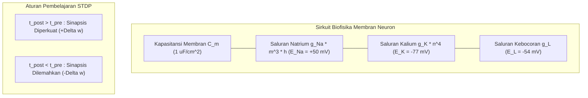

# Modul 197: Neurosains Komputasional & Dinamika Saraf (Biofisika Potensial Aksi Hodgkin-Huxley, Plastisitas Hebbian/STDP, SNN)

**Navigasi**: [⬅️ Master Index](../../INDEX.md) | [Tingkat 13: Tingkat 13: Sains Kognitif, Neuroengineering & Computational Linguistics](./README.md)
*Sebelumnya*: [196. fondasi-sains-kognitif-filsafat-pikiran](./196-fondasi-sains-kognitif-filsafat-pikiran.md) | *Berikutnya*: [198. neuroengineering-antarmuka-otak-komputer](./198-neuroengineering-antarmuka-otak-komputer.md)

---

## 1. Intuisi Dasar Tanpa Jargon ("Seperti Bayi Baru Lahir")
Jika Anda memperbesar sepotong jaringan otak di bawah mikroskop elektron, Anda tidak akan melihat kabel tembaga atau transistor silikon. Anda akan melihat 86 miliar sel hidup yang disebut **Neuron**, masing-masing terhubung ke ribuan neuron lain melalui jembatan mikroskopis bernama **Sinapsis** ([Kandel et al. - Principles of Neural Science](https://accessneurology.mhmedical.com/book.aspx?bookid=1049)).

Sebuah neuron tidak bekerja seperti chip komputer digital yang menghitung angka pecahan biner. Neuron bekerja seperti bendungan air bertenaga listrik kimia! Membran neuron memompa ion natrium ($Na^+$) dan kalium ($K^+$) untuk menahan tegangan listrik sekitar $-70\text{ mV}$. Ketika stimulus yang masuk cukup kuat melewati ambang batas tertentu, pintu gerbang bendungan terbuka seketika: tegangan melonjak drastis hingga $+30\text{ mV}$ dalam waktu satu milidetik sebelum turun kembali: ledakan pulsa listrik ini disebut **Potensial Aksi (Spike)**!

Bagaimana kita mengingat sesuatu? Donald Hebb merumuskan aturan emas: *"Neuron that fire together, wire together"* ([Hebb - The Organization of Behavior](https://monoskop.org/images/8/87/Hebb_Donald_O_The_Organization_of_Behavior.pdf)). Jika dua neuron berulang kali melepaskan pulsa listrik pada saat yang hampir bersamaan, hubungan sinapsis di antara mereka akan menebal dan menguat (**Plastisitas Sinaptik / STDP**).

## 2. Fondasi Teoretis & Aksiomatik / Matematis
Formulasi Matematis Biofisika Saraf:

1. **Model Konduktansi Hodgkin-Huxley (1952)**:
Memodelkan membran lipid sel saraf sebagai sirkuit listrik kapasitor paralel dengan saluran konduktansi ionik non-linier ([Hodgkin & Huxley - J. Physiol. 1952](https://www.ncbi.nlm.nih.gov/pmc/articles/PMC1392413/)):
$$C_m \frac{dV}{dt} = I_{\text{inj}} - \bar{g}_{Na} m^3 h (V - E_{Na}) - \bar{g}_K n^4 (V - E_K) - \bar{g}_L (V - E_L)$$
Variabel gating $x \in \{m, n, h\}$ berevolusi menurut kinetika Markov orde-1:
$$\frac{dx}{dt} = \alpha_x(V)(1 - x) - \beta_x(V)x = \frac{x_\infty(V) - x}{\tau_x(V)}$$

2. **Model Leaky Integrate-and-Fire (LIF)**:
Aproksimasi analitik sederhana neuron komputasional:
$$\tau_m \frac{dV}{dt} = -(V(t) - V_{\text{rest}}) + R_m I(t)$$
Kondisi Ambang Batas & Reset Refrakter:
$$\text{Jika } V(t) \ge V_{\text{th}} \implies \text{Pancarkan Spike } S(t) = 1, \quad V(t^+) \leftarrow V_{\text{reset}}$$

3. **Plastisitas Bergantung Waktu Pulsa (Spike-Timing-Dependent Plasticity / STDP)**:
Perubahan efikasi bobot sinapsis $\Delta w$ bergantung pada selisih waktu relatif $\Delta t = t_{\text{post}} - t_{\text{pre}}$ antara firing neuron pasca-sinapsis dan pra-sinapsis ([Bi & Poo - Synaptic Modifications in Cultured Hippocampal Neurons](https://www.jneurosci.org/content/18/24/10464)):
$$\Delta w = \begin{cases} A_+ \exp\left(-\frac{\Delta t}{\tau_+}\right), & \text{jika } \Delta t > 0 \quad (\text{LTP - Long-Term Potentiation}) \\ -A_- \exp\left(\frac{\Delta t}{\tau_-}\right), & \text{jika } \Delta t < 0 \quad (\text{LTD - Long-Term Depression}) \end{cases}$$

## 3. Anatomi Teknis & Cara Kerja Internal
Arsitektur rangkaian ekuivalen membran sel Hodgkin-Huxley dan kurva plastisitas sinaptik STDP:



Kunci utama Spiking Neural Networks (SNN) adalah *efisiensi energi komputasi berbasis kejadian (event-driven)*: sinapsis hanya mengonsumsi daya saat terjadi pulsa spike diskret, berbeda dengan deep learning konvensional yang terus-menerus mengalikan matriks floating-point secara masif ([Gerstner & Kistler - Spiking Neuron Models](https://www.cambridge.org/core/books/spiking-neuron-models/0932224A69EBBCA726C78F72AC6AEE89)).

## 4. Implementasi Praktis & Kode / Simulasi Riil
```python
import numpy as np

# 1. Simulasi Numerik Neuron Leaky Integrate-and-Fire (LIF)
class LIFNeuron:
    def __init__(self, tau_m=20.0, v_rest=-70.0, v_reset=-75.0, v_th=-50.0, r_m=10.0):
        self.tau_m = tau_m     # Konstanta waktu membran (ms)
        self.v_rest = v_rest   # Potensial istirahat (mV)
        self.v_reset = v_reset # Potensial pasca-spike (mV)
        self.v_th = v_th       # Ambang batas aksi potensial (mV)
        self.r_m = r_m         # Resistansi membran (MOhm)
        self.v = v_rest
        
    def step(self, i_inj, dt=0.1):
        # Persamaan Diferensial Euler: dV/dt = (-(V - V_rest) + R*I) / tau
        dv = (-(self.v - self.v_rest) + self.r_m * i_inj) * (dt / self.tau_m)
        self.v += dv
        
        spiked = False
        if self.v >= self.v_th:
            spiked = True
            self.v = self.v_reset
            
        return self.v, spiked

# Simulasi Respons Terhadap Injeksi Arus Konstan (I = 2.5 nA)
neuron = LIFNeuron()
spike_times = []
dt = 0.1
time_steps = np.arange(0, 100, dt)

for t in time_steps:
    v, spiked = neuron.step(i_inj=2.5, dt=dt)
    if spiked:
        spike_times.append(t)

print(f"Total Potensial Aksi (Spike) Dipancarkan: {len(spike_times)} kali dalam 100 ms")
print(f"Frekuensi Firing Neuron: {len(spike_times) / 0.1:.1f} Hz")
print(f"Spike Pertama Terjadi pada: t = {spike_times[0]:.1f} ms")
```

## 5. Miskonsepsi & Jebakan Industri
*Non-Diferensiabilitas Pulsa Spike (The Gradient Problem in SNN)*: Fungsi output neuron biologis adalah fungsi tangga Heaviside $\Theta(V - V_{th})$ yang memiliki turunan nol di hampir semua titik dan tak hingga saat threshold, membuat algoritma standar backpropagation runtuh seketika. Solusi modern: gunakan teknik **Surrogate Gradient** (mengganti turunan Heaviside dengan turunan fungsi kontinu halus seperti fast sigmoid atau arctan selama backward pass) ([Neftci et al. - Surrogate Gradient Learning in Spiking Neural Networks](https://arxiv.org/abs/1901.09948)).

## 6. Proyek Latihan & Rubrik Penilaian Mandiri
### Level 1 (Pemula)
Simulasikan neuron Leaky Integrate-and-Fire (LIF) dengan berbagai variasi arus injeksi $I_{\text{inj}} \in [0.5, 5.0]\text{ nA}$, buat kurva relasi arus terhadap frekuensi firing (Kurva $f$-$I$), dan tentukan arus threshold minimum $I_{\text{rheobase}}$.
*Rubrik*: Grafik kurva f-I menunjukkan karakteristik disipasi threshold yang tepat.

### Level 2 (Menengah)
Implementasikan simulasi persamaan biofisika Hodgkin-Huxley 4-variabel $(V, m, n, h)$ menggunakan integrasi numerik Runge-Kutta orde-4 (RK4) di Python. Tampilkan bentuk gelombang potensial aksi lengkap mencakup fase depolarisasi, repolarisasi, dan refrakter hiperpolarisasi.
*Rubrik*: Menghasilkan lonjakan voltase hingga $+30\text{ mV}$ dengan durasi pulsa $\approx 2\text{ ms}$.

### Level 3 (Mahir)
Bangun simulasi Spiking Neural Network (SNN) 2-lapisan dengan aturan plastisitas sinaptik STDP online murni tanpa pengawasan: latih jaringan untuk mengelompokkan dua pola input pulsa temporal yang berbeda dan buktikan konvergensi bobot sinaptik ke representasi selektif.
*Rubrik*: Terjadi pemisahan bobot sinaptik bimodal (pembagian kelompok bobot kuat dan lemah).

## 7. Rekomendasi Sumber Belajar Standar Emas
| Sumber Pembelajaran | Penulis / Institusi | Tautan Langsung | Fokus Materi |
| :--- | :--- | :--- | :--- |
| A Quantitative Description of Membrane Current (Hodgkin-Huxley) | A. L. Hodgkin & A. F. Huxley | [Journal of Physiology 1952 Classic](https://www.ncbi.nlm.nih.gov/pmc/articles/PMC1392413/) | Persamaan Asli Biofisika Potensial Aksi Ionik |
| Principles of Neural Science (5th Ed.) | Eric R. Kandel et al. (Nobel Laureate) | [AccessNeurology McGraw-Hill](https://accessneurology.mhmedical.com/book.aspx?bookid=1049) | Alkitab Neurosains: Biofisika, Kanal Ionik, Sinapsis |
| Synaptic Modifications in Cultured Hippocampal Neurons (STDP) | Guo-qiang Bi & Mu-ming Poo | [Journal of Neuroscience 1998](https://www.jneurosci.org/content/18/24/10464) | Bukti Eksperimental Asli Kurva Waktu Plastisitas STDP |
| Spiking Neuron Models: Single Neurons, Populations, Plasticity | Wulfram Gerstner & Werner M. Kistler | [Cambridge University Press](https://www.cambridge.org/core/books/spiking-neuron-models/0932224A69EBBCA726C78F72AC6AEE89) | Matematika Pemodelan LIF, SRM, dan Dinamika Jaringan Spiking |

---
*Navigasi Cepat*: [Ke Tingkat 13](./README.md) | [Ke Master Index](../../INDEX.md) | *Sebelumnya*: [196. fondasi-sains-kognitif-filsafat-pikiran](./196-fondasi-sains-kognitif-filsafat-pikiran.md) | *Berikutnya*: [198. neuroengineering-antarmuka-otak-komputer](./198-neuroengineering-antarmuka-otak-komputer.md)
