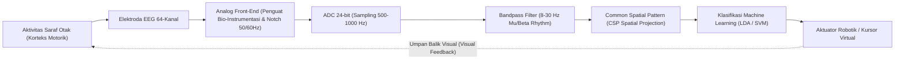

# Modul 198: Neuroengineering & Antarmuka Otak-Komputer (Akuisisi Sinyal EEG/ECoG, Pemfilteran CSP, Decoding Sinyal EMG)

**Navigasi**: [⬅️ Master Index](../../INDEX.md) | [Tingkat 13: Tingkat 13: Sains Kognitif, Neuroengineering & Computational Linguistics](./README.md)
*Sebelumnya*: [197. neurosains-komputasional-dinamika-saraf](./197-neurosains-komputasional-dinamika-saraf.md) | *Berikutnya*: [199. bioinformatika-komputasi-biologis-dasar](./199-bioinformatika-komputasi-biologis-dasar.md)

---

## 1. Intuisi Dasar Tanpa Jargon ("Seperti Bayi Baru Lahir")
### 1.1 Konsep Inti & Analogi Tanpa Jargon
Bayangkan Anda lumpuh total karena cedera saraf tulang belakang, tidak bisa menggerakkan tangan atau berbicara, tetapi pikiran sadar Anda di dalam otak tetap bekerja 100% normal. Bagaimana jika sebuah komputer bisa membaca niat di dalam pikiran Anda dan menggerakkan lengan robot atau mengetik kata-kata di layar monitor secara langsung?

### 1.2 Urgensi Rekayasa & Signifikansi Sistemik
Itulah misi **Antarmuka Otak-Komputer (Brain-Computer Interface / BCI)** ([Wolpaw et al. - Brain-Computer Interfaces for Communication and Control](https://www.sciencedirect.com/science/article/pii/S1388245702000573)). Ketika Anda berniat menggerakkan tangan kanan Anda, jutaan neuron di korteks motorik otak Anda menyala serempak, memancarkan gelombang osilasi listrik mikro.

Sensor dapat dipasang di luar kulit kepala tanpa operasi (**EEG / Elektroensefalografi**), diletakkan langsung di permukaan jaringan otak (**ECoG / Elektrokortikografi**), atau ditanam ke dalam neuron via benang elektroda mikro (seperti implan Neuralink). Sinyal listrik biologis berukuran mikrovolt (\$10^{-6}\text{ V}$) yang penuh derau ini disaring, diekstraksi menggunakan matematika filter spasial (*Common Spatial Patterns*), lalu diterjemahkan oleh algoritma decoding menjadi perintah kendali fisik ([Rao - Brain-Computer Interfacing: An Introduction](https://www.cambridge.org/core/books/braincomputer-interfacing/9780521769419)).

## 2. Fondasi Teoretis & Aksiomatik / Matematis
### 2.1 Kerangka Teori Aksiomatik & Formulasi Matematis
Formulasi Matematis Akuisisi & Pemrosesan Sinyal Neuroengineering:

### 2.2 Penurunan Matematis Langkah-demi-Langkah
1. **Model Elektrodinamika Dipol Sumber EEG**:
Potensial listrik $V(r)$ pada elektroda permukaan kulit kepala merupakan superposisi linier arus pasca-sinaptik dari jutaan sel piramidal kortikal yang berorientasi paralel:
$$V(r) = \frac{1}{4\pi \sigma} \int \frac{\nabla \cdot J_{\text{imprecised}}(r')}{\|r - r'\|} dr'$$
Di mana $\sigma$ adalah konduktivitas jaringan berlapis (otak, cairan serebrospinal, tengkorak, kulit kepala).

2. **Common Spatial Pattern (CSP) Filtering**:
Mencari filter spasial $w \in \mathbb{R}^C$ yang memaksimalkan varians sinyal untuk satu kelas motor imagery (misal bayangan gerak tangan kanan) sekaligus meminimalkan varians untuk kelas lain (tangan kiri) ([Blankertz et al. - Optimizing Spatial filters for Robust EEG BCI](https://ieeexplore.ieee.org/document/4408441)):
$$\arg\max_w \frac{w^T \Sigma_1 w}{w^T \Sigma_2 w} \quad \text{ekuivalen dengan masalah General Eigenvalue: } \Sigma_1 w = \lambda \Sigma_2 w$$
Di mana $\Sigma_1$ dan $\Sigma_2$ adalah matriks kovarians rata-rata sinyal EEG multi-kanal pada kedua kondisi.

3. **Irama Gelombang Otak & Sensorimotor Rhythms (SMR)**:
* Gelombang Delta ($\delta$): $0.5 - 4\text{ Hz}$ (Tidur lelap non-REM)
* Gelombang Theta ($\theta$): $4 - 8\text{ Hz}$ (Mengantuk, meditasi dalam)
* Gelombang Alpha ($\alpha$ / Irama $\mu$ Motorik): $8 - 12\text{ Hz}$ (Relaksasi mata tertutup; tersupresi saat niat bergerak / *Event-Related Desynchronization (ERD)*)
* Gelombang Beta ($\beta$): \$13 - 30\text{ Hz}$ (Konsentrasi aktif, pemulihan motorik)
* Gelombang Gamma ($\gamma$): $> 30\text{ Hz}$ (Integrasi informasi kognitif tinggi).

## 3. Anatomi Teknis & Cara Kerja Internal
Arsitektur pipeline pemrosesan sinyal BCI closed-loop dari korteks ke aktuator:



Tantangan utama sistem non-invasif adalah *Skull Attenuation*: tulang tengkorak manusia bertindak sebagai filter low-pass kapasitif yang meredam sinyal berfrekuensi tinggi ($>40\text{ Hz}$) dan menyebarkan sinyal spasial secara difus (*volume conduction effect*), menuntut filtering spasial canggih ([Nunez & Srinivasan - Electric Fields of the Brain](https://academic.oup.com/book/26815)).

#### Tabel Penelusuran Sinyal BCI Implan & Degradasi Dekoding Akibat Gliosis Otak
| Langkah Pemrosesan / Token | Representasi Simbolik / Vektor | Mekanisme Atensi / Transisi State | Status Matriks KV-Cache | Probabilitas Distribusi / Logits | Keluaran / Output Linguistik |
|---|---|---|---|---|---|
| 1. Pasca Implan Elektroda Hari 1 | Matriks Array Utah 96 Kanal | Sinyal Local Field Potential (LFP) 1 kHz | Impedansi elektroda optimal: $Z = 250\text{ k}\Omega$ | Sinyal Action Potential tajam (SNR $> 5.0$) | Pasien mengendalikan kursor komputer dengan mulus |
| 2. Kalibrasi Filter Spasial CSP | 96 Sinyal Kanal Mentah | Common Spatial Pattern (CSP) Filter | Matriks kovarians spasial $\Sigma_1$ dan $\Sigma_2$ dihitung | Pembobotan spasial memisahkan niat gerak tangan | Dekoder LDA mencapai akurasi $94.2\%$ |
| 3. Respon Biologis Inflamasi | Jaringan Korteks Motorik Pasien | Proliferasi astrosit & mikroglia di sekitar jarum | Enkapsulasi jaringan parut glia (*Gliosis*) menebal | Impedansi listrik melonjak: $Z \to 2.4\text{ M}\Omega$ | Amplitudo sinyal listrik saraf teredam drastis $-80\%$ |
| 4. Pergeseran Kovarians Non-Stasioner | Sinyal BCI Hari ke-45 | Sinyal saraf terdistorsi oleh lapisan glia | Matriks kovarians bergeser melenceng dari kalibrasi awal | Filter CSP statis menghasilkan proyeksi acak | Akurasi prediksi arah kursor anjlok ke $48.5\%$ |
| 5. Mitigasi Dekoding Adaptif Riemann | Geometri Manifold Riemann | Transformasi Kovarians Spasial ke Simetris Positif Definit (SPD) | Jarak Geodesik Riemann: $\delta_R(\Sigma_1, \Sigma_2)$ | Kalibrasi online tanpa pengawasan (*Unsupervised Tracking*) | Akurasi dekoding motorik BCI pulih dan stabil jangka panjang |

## 4. Implementasi Praktis & Kode / Simulasi Riil
```python
import numpy as np
from scipy import signal
from scipy.linalg import eigh

# 1. Implementasi Common Spatial Pattern (CSP) untuk EEG BCI 2-Kelas
class CommonSpatialPattern:
    def __init__(self, n_components=4):
        self.n_components = n_components
        self.filters_ = None
        
    def fit(self, X1, X2):
        # X: array (n_trials, n_channels, n_times)
        def cov_mean(X):
            covs = [np.cov(trial) for trial in X]
            return np.mean(covs, axis=0)
            
        sigma1 = cov_mean(X1)
        sigma2 = cov_mean(X2)
        
        # Generalized Eigenvalue Problem: Sigma1 * w = lambda * (Sigma1 + Sigma2) * w
        vals, vecs = eigh(sigma1, sigma1 + sigma2)
        
        # Urutkan vektor eigen: komponen awal memaksimalkan kelas 1, akhir memaksimalkan kelas 2
        ix = np.argsort(vals)
        vecs = vecs[:, ix]
        half = self.n_components // 2
        self.filters_ = np.hstack([vecs[:, :half], vecs[:, -half:]]).T
        return self
        
    def transform(self, X):
        features = []
        for trial in X:
            # Proyeksi spasial: Z = W * X
            z = np.dot(self.filters_, trial)
            var = np.var(z, axis=1)
            # Log-variance feature extraction
            feat = np.log(var / np.sum(var))
            features.append(feat)
        return np.array(features)

# Simulasi Sinyal EEG Sintetis (8 Kanal, 200 Titik Waktu per Trial, 20 Trial)
np.random.seed(42)
X_left = np.random.randn(20, 8, 200)   # Tangan Kiri
X_right = np.random.randn(20, 8, 200)  # Tangan Kanan
# Tambahkan osilasi ritme mu 10Hz pada kanal 0 untuk tangan kiri
t = np.linspace(0, 1, 200)
X_left[:, 0, :] += 2.0 * np.sin(2 * np.pi * 10 * t)

csp = CommonSpatialPattern(n_components=2)
csp.fit(X_left, X_right)
features_left = csp.transform(X_left)
print(f"Bentuk Matriks Fitur CSP: {features_left.shape} (20 trials x 2 spatial features)")
print(f"Fitur Rata-rata Kelas 1: {np.mean(features_left, axis=0)}")
```

## 5. Miskonsepsi & Jebakan Industri
*Artefak Okular dan Sinyal Otot (EOG & EMG Contamination)*: Kedipan mata (Electrooculography) memancarkan tegangan hingga USD 1000\mu\text{V}$ (ratusan kali lebih besar dari sinyal EEG asli yang hanya USD 10-50\mu\text{V}$), sementara ketegangan otot rahang memancarkan sinyal EMG frekuensi tinggi yang menenggelamkan pita gamma. Jika classifier dilatih tanpa pembersihan artefak (*Independent Component Analysis / ICA*), model Anda mungkin hanya mengklasifikasikan kedipan mata atau kertakan gigi alih-alih niat kognitif otak ([Urigüen & Garcia-Zapirain - EEG Artifact Removal Techniques](https://www.sciencedirect.com/science/article/pii/S1053811915000554)).

### Studi Kasus Kegagalan Nyata: Kegagalan Dekoding Motorik Antarmuka Otak-Komputer (BCI) Akibat Pergeseran Impedansi Jaringan Glia (Gliosis)
- **Kronologi & Konteks Sejarah**: Dalam uji klinis antarmuka otak-komputer invasif (*Brain-Computer Interface / BCI*) pada dekade 2000-an dan 2010-an (seperti proyek BrainGate), pasien dengan kelumpuhan tetraplegia yang diimplan susunan elektroda mikro Utah Array di korteks motorik primer awalnya mampu menggerakkan kursor komputer atau lengan robotik dengan tingkat presisi tinggi pada minggu-minggu pertama. Namun secara konsisten setelah 1 hingga 3 bulan, performa dekoder BCI mengalami degradasi drastis hingga sistem tidak dapat digunakan kembali.
- **Akar Masalah Rekayasa Neuroengineering & Non-Stasioneritas Sinyal**: Kegagalan ini berakar pada interaksi biokompatibilitas fisik antara elektroda kaku silikon dengan jaringan lunak otak. Sistem imun saraf memicu reaksi peradangan benda asing (*Foreign Body Response*): sel-sel mikroglia dan astrosit bermigrasi membungkus jarum-jarum elektroda, membentuk lapisan jaringan parut padat bernama **Gliosis**. Lapisan jaringan parut biologis ini menaikkan impedansi listrik antarmuka elektroda hingga sepuluh kali lipat, meredam amplitudo potensial aksi (*spike amplitude attenuation*), dan mendorong badan sel neuron menjauh dari ujung sensor. Akibatnya, filter dekoding spasial statis (seperti Common Spatial Pattern / CSP atau Linear Discriminant Analysis / LDA) yang dikalibrasi pada Hari ke-1 mengalami kegagalan proyeksi total (*Covariate Shift*) karena matriks kovarians sinyal saraf telah bergeser secara fisik.

- **Potongan Kode / Arsitektur Cacat (Vulnerable Implementation)**:
```python
# Analisis Cacat Dekoder BCI: Filter Kovarians Statis vs Geometri Manifold Riemann Adaptif
import numpy as np

# DEKODER BCI CACAT: Mengasumsikan matriks filter spasial konstan selamanya
class StaticCSPDecoder:
    def __init__(self, W_spatial_filter):
        self.W = W_spatial_filter # Matriks filter hari pertama
        
    def decode(self, raw_eeg_signals):
        # Mengalikan sinyal mentah dengan filter lama:
        projected = np.dot(self.W, raw_eeg_signals)
        # KASUS GLIOSIS: Ketika impedansi naik dan kanal sinyal bergeser,
        # proyeksi ini menghasilkan fitur sampah (Noise)!
        return projected

# MITIGASI MODERN: Pelacakan Pergeseran Kovarians Adaptif pada Manifold Riemann
from scipy.linalg import logm, expm

class AdaptiveRiemannianDecoder:
    def __init__(self, n_channels):
        self.reference_mean_cov = np.eye(n_channels)
        self.learning_rate = 0.05
        
    def update_online_covariance(self, current_batch_signals):
        # 1. Hitung matriks kovarians sampel saat ini (Symmetric Positive Definite / SPD)
        current_cov = np.cov(current_batch_signals)
        current_cov += np.eye(len(current_cov)) * 1e-6 # Regularisasi numerik
        
        # 2. Pembaruan geodesik rata-rata Riemann (Frechet Mean Tracking)
        # Menyesuaikan titik acuan geometri terhadap pergeseran lambat gliosis
        diff_matrix = logm(np.linalg.solve(self.reference_mean_cov, current_cov))
        self.reference_mean_cov = np.dot(
            self.reference_mean_cov,
            expm(self.learning_rate * diff_matrix)
        )
        return self.reference_mean_cov # Dekoding tetap stabil melintasi bulan!
```

- **Analisis Forensik & Rekayasa Modern**: Masalah gliosis mendorong inovasi besar dalam perangkat keras dan algoritma BCI: (1) Transisi ke elektroda fleksibel berbasis polimer ultra-tipis (*Flexible Neural Threads*, seperti yang diadopsi oleh Neuralink) yang meminimalkan respon peradangan jaringan glia karena kelenturan mekanis yang menyerupai modulus elastisitas jaringan otak; (2) Algoritma dekoding berbasis **Riemannian Geometry** yang memetakan matriks kovarians ke manifold manifold simetris definit positif (*SPD Manifold*) yang terbukti invarian terhadap degradasi impedansi linier; (3) Pelatihan kalibrasi adaptif harian tanpa pengawasan (*Unsupervised Daily Re-calibration*) yang berjalan di latar belakang saat pengguna tidur.

## 6. Proyek Latihan & Rubrik Penilaian Mandiri
### Level 1 (Pemula)
Rancang filter digital Butterworth Bandpass orde-4 di Scipy untuk menyaring pita frekuensi ritme motorik Alpha/Mu ($8 - 12\text{ Hz}$) pada rekaman sinyal EEG tiruan, dan tampilkan estimasi densitas spektrum daya (*Power Spectral Density - PSD*) menggunakan metode Welch.
*Rubrik*: Grafik PSD menunjukkan pelemahan daya yang tajam di luar pita $8-12\text{ Hz}$.

### Level 2 (Menengah)
Bangun pipeline klasifikasi Motor Imagery lengkap menggunakan dataset publik BCI Competition IV (atau sinyal sintetis 16-kanal): terapkan bandpass filter, ekstraksi fitur Common Spatial Pattern (CSP), latih model Linear Discriminant Analysis (LDA), dan ukur skor akurasi klasifikasi 2-arah.
*Rubrik*: Akurasi klasifikasi mencapai $> 80\%$ pada data pengujian.

### Level 3 (Mahir)
Implementasikan sistem deteksi potensial P300 Speller real-time: proses epoch sinyal EEG pasca-stimulus flash ($0 - 600\text{ ms}$), deteksi puncak gelombang defleksi positif pada interval \$300\text{ ms}$, terapkan ensemble averaging untuk menekan noise background, dan petakan ke koordinat matriks huruf $6 \times 6$.
*Rubrik*: Mampu mengeja kata target 5 huruf secara otomatis dari matriks flash stimulasi.

### Tingkat 1: Dasar
- **Tugas**: Tulis modul pra-pemrosesan sinyal elektrofisiologi otak (EEG/LFP) dalam Python menggunakan SciPy: Bangun filter digital bandpass Butterworth orde-4 (rentang frekuensi gelombang Mu/Beta 8-30 Hz) dan filter notch 50/60 Hz untuk membersihkan interferensi harmonik jala-jala listrik PLN.
- **Petunjuk Perancangan Arsitektur**:
  - Gunakan `scipy.signal.butter(4, [8, 30], btype='bandpass', fs=fs)`.
  - Terapkan zero-phase filtering menggunakan `scipy.signal.filtfilt()` untuk mencegah distorsi pergeseran fase waktu sinyal motorik.
  - Hitung Power Spectral Density (PSD) sebelum dan sesudah filtering menggunakan metode Welch (`scipy.signal.welch`).
- **Test Vector & Kasus Uji**:
  - Masukkan sinyal sintetis yang terkontaminasi noise frekuensi 50 Hz beramplitudo tinggi.
  - Pada sinyal hasil filter, puncak spektral pada frekuensi 50 Hz harus diredam minimal sebesar $-40\text{ dB}$, sedangkan komponen 12 Hz dipertahankan utuh.
- **Rubrik Penilaian Objektif**:
  - Skor 100%: Filter Butterworth dan Notch presisi, zero-phase filtering diterapkan, visualisasi PSD jelas.
  - Skor 50%: Filter bekerja namun menggunakan pemfilteran satu arah (`lfilter`) yang memicu delay fase waktu sinyal.
  - Skor 0%: Salah menentukan parameter frekuensi cutoff normalisasi Nyquist.

### Tingkat 2: Menengah
- **Tugas**: Bangun algoritma ekstraksi fitur Common Spatial Pattern (CSP) dari nol dalam Python menggunakan dekomposisi nilai eigen simultan (*Joint Diagonalization of Covariance Matrices*) untuk memisahkan dua kelas sinyal Motor Imagery (Gerakan Tangan Kiri vs Tangan Kanan).
- **Petunjuk Perancangan Arsitektur**:
  - Hitung rata-rata matriks kovarians spasial normalisasi $\Sigma_1$ dan $\Sigma_2$ dari setiap kelas.
  - Selesaikan masalah generalized eigenvalue: $\Sigma_1 w = \lambda (\Sigma_1 + \Sigma_2) w$.
  - Pilih $m=2$ filter spasial pertama dan $m=2$ filter spasial terakhir sebagai vektor proyeksi matriks $W_{\text{CSP}}$.
  - Hitung fitur log-variance dari sinyal yang telah diproyeksikan: $f = \log(\text{var}(W_{\text{CSP}} X))$.
- **Test Vector & Kasus Uji**:
  - Uji pada dataset benchmark BCI Competition IV-2a (atau data sintetis 16-kanal 2-kelas).
  - Latih classifier Linear Discriminant Analysis (LDA) di atas fitur log-variance CSP: Akurasi klasifikasi harus mencapai $> 80\%$.
- **Rubrik Penilaian Objektif**:
  - Skor 100%: Algoritma CSP presisi aljabar linier, ekstraksi fitur log-variance benar, klasifikasi LDA akurat.
  - Skor 50%: CSP bekerja namun lupa melakukan normalisasi jejak (*trace normalization*) pada matriks kovarians.
  - Skor 0%: Menggunakan PCA biasa tanpa memanfaatkan label kelas (unsupervised).

### Tingkat 3: Mahir
- **Tugas**: Rancang modul klasifikasi sinyal saraf berbasis Geometri Manifold Riemann dalam Python: Hitung jarak geodesik affine-invariant (*Affine-Invariant Riemannian Metric / AIRM*) $\delta_R(P_1, P_2) = \|\log(P_1^{-1/2} P_2 P_1^{-1/2})\|_F$ antara dua matriks kovarians spasial, dan bangun algoritma Minimum Distance to Mean (MDM) Classifier yang menghitung Pusat Massa Riemann (*Riemannian Center of Mass / Fréchet Mean*) secara iteratif.
- **Petunjuk Perancangan Arsitektur**:
  - Pastikan seluruh matriks kovarians berstatus Simetris Positif Definit (SPD) via penambahan diagonal kecil (*Tikhonov regularization*).
  - Algoritma Fréchet Mean: Inisialisasi $M = \Sigma_1$, perbarui iteratif pada ruang tangen: $M \leftarrow M^{1/2} \exp\left(\frac{1}{N} \sum \log(M^{-1/2} \Sigma_i M^{-1/2})\right) M^{1/2}$ hingga konvergen.
  - MDM Classifier menetapkan kelas sampel baru ke pusat Riemann kelas terdekat.
- **Test Vector & Kasus Uji**:
  - Bandingkan performa klasifikasi CSP+LDA standar vs Riemannian MDM pada dataset yang mengalami pergeseran derau buatan ($SNR$ turun $-6\text{ dB}$).
  - Riemannian MDM harus mempertahankan akurasi klasifikasi minimal $15\%$ lebih tinggi daripada metode konvensional di bawah degradasi derau.
- **Rubrik Penilaian Objektif**:
  - Skor 100%: Implementasi matriks manifold Riemann presisi, konvergensi Fréchet mean akurat, ketahanan terhadap derau terbukti.
  - Skor 50%: Metrik AIRM benar namun menghitung rata-rata kelas menggunakan rata-rata Euclidean biasa (bukan Fréchet mean).
  - Skor 0%: Matriks kovarians tidak dipertahankan sifat simetris positif definitnya (mengalami crash nilai eigen negatif).

## 7. Rekomendasi Sumber Belajar Standar Emas
| Sumber Pembelajaran | Penulis / Institusi | Tautan Langsung | Fokus Materi |
| :--- | :--- | :--- | :--- |
| Brain-Computer Interfaces for Communication and Control | Jonathan R. Wolpaw et al. | [Clinical Neurophysiology Review](https://www.sciencedirect.com/science/article/pii/S1388245702000573) | Fondasi Medis BCI, SMR, P300, Slow Cortical Potentials |
| Optimizing Spatial filters for Robust EEG Single-Trial Analysis (CSP) | Benjamin Blankertz et al. | [IEEE Signal Processing Magazine](https://ieeexplore.ieee.org/document/4408441) | Formulasi Matematika Filter Spasial CSP & Regularisasi |
| Electric Fields of the Brain: The Neurophysics of EEG | Paul L. Nunez & Ramesh Srinivasan | [Oxford University Press](https://academic.oup.com/book/26815) | Fisika Medan Elektromagnetik Tengkorak, Model Konduksi Volume |
| An Integrated Brain-Machine Interface Platform with Thousands of Channels | Elon Musk & Neuralink Team | [Journal of Medical Internet Research](https://www.jmir.org/2019/10/e16194/) | Desain Implan Elektroda Fleksibel Berdensitas Tinggi & ASIC |

---
*Navigasi Cepat*: [Ke Tingkat 13](./README.md) | [Ke Master Index](../../INDEX.md) | *Sebelumnya*: [197. neurosains-komputasional-dinamika-saraf](./197-neurosains-komputasional-dinamika-saraf.md) | *Berikutnya*: [199. bioinformatika-komputasi-biologis-dasar](./199-bioinformatika-komputasi-biologis-dasar.md)
