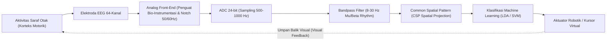

# Modul 198: Neuroengineering & Antarmuka Otak-Komputer (Akuisisi Sinyal EEG/ECoG, Pemfilteran CSP, Decoding Sinyal EMG)

**Navigasi**: [⬅️ Master Index](../../INDEX.md) | [Tingkat 13: Tingkat 13: Sains Kognitif, Neuroengineering & Computational Linguistics](./README.md)
*Sebelumnya*: [197. neurosains-komputasional-dinamika-saraf](./197-neurosains-komputasional-dinamika-saraf.md) | *Berikutnya*: [199. bioinformatika-komputasi-biologis-dasar](./199-bioinformatika-komputasi-biologis-dasar.md)

---

## 1. Intuisi Dasar Tanpa Jargon ("Seperti Bayi Baru Lahir")
Bayangkan Anda lumpuh total karena cedera saraf tulang belakang, tidak bisa menggerakkan tangan atau berbicara, tetapi pikiran sadar Anda di dalam otak tetap bekerja 100% normal. Bagaimana jika sebuah komputer bisa membaca niat di dalam pikiran Anda dan menggerakkan lengan robot atau mengetik kata-kata di layar monitor secara langsung?

Itulah misi **Antarmuka Otak-Komputer (Brain-Computer Interface / BCI)** ([Wolpaw et al. - Brain-Computer Interfaces for Communication and Control](https://www.sciencedirect.com/science/article/pii/S1388245702000573)). Ketika Anda berniat menggerakkan tangan kanan Anda, jutaan neuron di korteks motorik otak Anda menyala serempak, memancarkan gelombang osilasi listrik mikro.

Sensor dapat dipasang di luar kulit kepala tanpa operasi (**EEG / Elektroensefalografi**), diletakkan langsung di permukaan jaringan otak (**ECoG / Elektrokortikografi**), atau ditanam ke dalam neuron via benang elektroda mikro (seperti implan Neuralink). Sinyal listrik biologis berukuran mikrovolt ($10^{-6}\text{ V}$) yang penuh derau ini disaring, diekstraksi menggunakan matematika filter spasial (*Common Spatial Patterns*), lalu diterjemahkan oleh algoritma decoding menjadi perintah kendali fisik ([Rao - Brain-Computer Interfacing: An Introduction](https://www.cambridge.org/core/books/braincomputer-interfacing/9780521769419)).

## 2. Fondasi Teoretis & Aksiomatik / Matematis
Formulasi Matematis Akuisisi & Pemrosesan Sinyal Neuroengineering:

1. **Model Elektrodinamika Dipol Sumber EEG**:
Potensial listrik $V(r)$ pada elektroda permukaan kulit kepala merupakan superposisi linier arus pasca-sinaptik dari jutaan sel piramidal kortikal yang berorientasi paralel:
$$V(r) = \frac{1}{4\pi \sigma} \int \frac{\nabla \cdot J_{\text{imprecised}}(r')}{\|r - r'\|} dr'$$
Di mana $\sigma$ adalah konduktivitas jaringan berlapis (otak, cairan serebrospinal, tengkorak, kulit kepala).

2. **Common Spatial Pattern (CSP) Filtering**:
Mencari filter spasial $w \in \mathbb{R}^C$ yang memaksimalkan varians sinyal untuk satu kelas motor imagery (misal bayangan gerak tangan kanan) sekaligus meminimalkan varians untuk kelas lain (tangan kiri) ([Blankertz et al. - Optimizing Spatial filters for Robust EEG BCI](https://ieeexplore.ieee.org/document/4408441)):
$$\arg\max_w \frac{w^T \Sigma_1 w}{w^T \Sigma_2 w} \quad \text{ekuivalen dengan masalah General Eigenvalue: } \Sigma_1 w = \lambda \Sigma_2 w$$
Di mana $\Sigma_1$ dan $\Sigma_2$ adalah matriks kovarians rata-rata sinyal EEG multi-kanal pada kedua kondisi.

3. **Irama Gelombang Otak & Sensorimotor Rhythms (SMR)**:
* Gelombang Delta ($\delta$): $0.5 - 4\text{ Hz}$ (Tidur lelap non-REM)
* Gelombang Theta ($\theta$): $4 - 8\text{ Hz}$ (Mengantuk, meditasi dalam)
* Gelombang Alpha ($\alpha$ / Irama $\mu$ Motorik): $8 - 12\text{ Hz}$ (Relaksasi mata tertutup; tersupresi saat niat bergerak / *Event-Related Desynchronization (ERD)*)
* Gelombang Beta ($\beta$): $13 - 30\text{ Hz}$ (Konsentrasi aktif, pemulihan motorik)
* Gelombang Gamma ($\gamma$): $> 30\text{ Hz}$ (Integrasi informasi kognitif tinggi).

## 3. Anatomi Teknis & Cara Kerja Internal
Arsitektur pipeline pemrosesan sinyal BCI closed-loop dari korteks ke aktuator:



Tantangan utama sistem non-invasif adalah *Skull Attenuation*: tulang tengkorak manusia bertindak sebagai filter low-pass kapasitif yang meredam sinyal berfrekuensi tinggi ($>40\text{ Hz}$) dan menyebarkan sinyal spasial secara difus (*volume conduction effect*), menuntut filtering spasial canggih ([Nunez & Srinivasan - Electric Fields of the Brain](https://academic.oup.com/book/26815)).

## 4. Implementasi Praktis & Kode / Simulasi Riil
```python
import numpy as np
from scipy import signal
from scipy.linalg import eigh

# 1. Implementasi Common Spatial Pattern (CSP) untuk EEG BCI 2-Kelas
class CommonSpatialPattern:
    def __init__(self, n_components=4):
        self.n_components = n_components
        self.filters_ = None
        
    def fit(self, X1, X2):
        # X: array (n_trials, n_channels, n_times)
        def cov_mean(X):
            covs = [np.cov(trial) for trial in X]
            return np.mean(covs, axis=0)
            
        sigma1 = cov_mean(X1)
        sigma2 = cov_mean(X2)
        
        # Generalized Eigenvalue Problem: Sigma1 * w = lambda * (Sigma1 + Sigma2) * w
        vals, vecs = eigh(sigma1, sigma1 + sigma2)
        
        # Urutkan vektor eigen: komponen awal memaksimalkan kelas 1, akhir memaksimalkan kelas 2
        ix = np.argsort(vals)
        vecs = vecs[:, ix]
        half = self.n_components // 2
        self.filters_ = np.hstack([vecs[:, :half], vecs[:, -half:]]).T
        return self
        
    def transform(self, X):
        features = []
        for trial in X:
            # Proyeksi spasial: Z = W * X
            z = np.dot(self.filters_, trial)
            var = np.var(z, axis=1)
            # Log-variance feature extraction
            feat = np.log(var / np.sum(var))
            features.append(feat)
        return np.array(features)

# Simulasi Sinyal EEG Sintetis (8 Kanal, 200 Titik Waktu per Trial, 20 Trial)
np.random.seed(42)
X_left = np.random.randn(20, 8, 200)   # Tangan Kiri
X_right = np.random.randn(20, 8, 200)  # Tangan Kanan
# Tambahkan osilasi ritme mu 10Hz pada kanal 0 untuk tangan kiri
t = np.linspace(0, 1, 200)
X_left[:, 0, :] += 2.0 * np.sin(2 * np.pi * 10 * t)

csp = CommonSpatialPattern(n_components=2)
csp.fit(X_left, X_right)
features_left = csp.transform(X_left)
print(f"Bentuk Matriks Fitur CSP: {features_left.shape} (20 trials x 2 spatial features)")
print(f"Fitur Rata-rata Kelas 1: {np.mean(features_left, axis=0)}")
```

## 5. Miskonsepsi & Jebakan Industri
*Artefak Okular dan Sinyal Otot (EOG & EMG Contamination)*: Kedipan mata (Electrooculography) memancarkan tegangan hingga $1000\mu\text{V}$ (ratusan kali lebih besar dari sinyal EEG asli yang hanya $10-50\mu\text{V}$), sementara ketegangan otot rahang memancarkan sinyal EMG frekuensi tinggi yang menenggelamkan pita gamma. Jika classifier dilatih tanpa pembersihan artefak (*Independent Component Analysis / ICA*), model Anda mungkin hanya mengklasifikasikan kedipan mata atau kertakan gigi alih-alih niat kognitif otak ([Urigüen & Garcia-Zapirain - EEG Artifact Removal Techniques](https://www.sciencedirect.com/science/article/pii/S1053811915000554)).

## 6. Proyek Latihan & Rubrik Penilaian Mandiri
### Level 1 (Pemula)
Rancang filter digital Butterworth Bandpass orde-4 di Scipy untuk menyaring pita frekuensi ritme motorik Alpha/Mu ($8 - 12\text{ Hz}$) pada rekaman sinyal EEG tiruan, dan tampilkan estimasi densitas spektrum daya (*Power Spectral Density - PSD*) menggunakan metode Welch.
*Rubrik*: Grafik PSD menunjukkan pelemahan daya yang tajam di luar pita $8-12\text{ Hz}$.

### Level 2 (Menengah)
Bangun pipeline klasifikasi Motor Imagery lengkap menggunakan dataset publik BCI Competition IV (atau sinyal sintetis 16-kanal): terapkan bandpass filter, ekstraksi fitur Common Spatial Pattern (CSP), latih model Linear Discriminant Analysis (LDA), dan ukur skor akurasi klasifikasi 2-arah.
*Rubrik*: Akurasi klasifikasi mencapai $> 80\%$ pada data pengujian.

### Level 3 (Mahir)
Implementasikan sistem deteksi potensial P300 Speller real-time: proses epoch sinyal EEG pasca-stimulus flash ($0 - 600\text{ ms}$), deteksi puncak gelombang defleksi positif pada interval $300\text{ ms}$, terapkan ensemble averaging untuk menekan noise background, dan petakan ke koordinat matriks huruf $6 \times 6$.
*Rubrik*: Mampu mengeja kata target 5 huruf secara otomatis dari matriks flash stimulasi.

## 7. Rekomendasi Sumber Belajar Standar Emas
| Sumber Pembelajaran | Penulis / Institusi | Tautan Langsung | Fokus Materi |
| :--- | :--- | :--- | :--- |
| Brain-Computer Interfaces for Communication and Control | Jonathan R. Wolpaw et al. | [Clinical Neurophysiology Review](https://www.sciencedirect.com/science/article/pii/S1388245702000573) | Fondasi Medis BCI, SMR, P300, Slow Cortical Potentials |
| Optimizing Spatial filters for Robust EEG Single-Trial Analysis (CSP) | Benjamin Blankertz et al. | [IEEE Signal Processing Magazine](https://ieeexplore.ieee.org/document/4408441) | Formulasi Matematika Filter Spasial CSP & Regularisasi |
| Electric Fields of the Brain: The Neurophysics of EEG | Paul L. Nunez & Ramesh Srinivasan | [Oxford University Press](https://academic.oup.com/book/26815) | Fisika Medan Elektromagnetik Tengkorak, Model Konduksi Volume |
| An Integrated Brain-Machine Interface Platform with Thousands of Channels | Elon Musk & Neuralink Team | [Journal of Medical Internet Research](https://www.jmir.org/2019/10/e16194/) | Desain Implan Elektroda Fleksibel Berdensitas Tinggi & ASIC |

---
*Navigasi Cepat*: [Ke Tingkat 13](./README.md) | [Ke Master Index](../../INDEX.md) | *Sebelumnya*: [197. neurosains-komputasional-dinamika-saraf](./197-neurosains-komputasional-dinamika-saraf.md) | *Berikutnya*: [199. bioinformatika-komputasi-biologis-dasar](./199-bioinformatika-komputasi-biologis-dasar.md)
