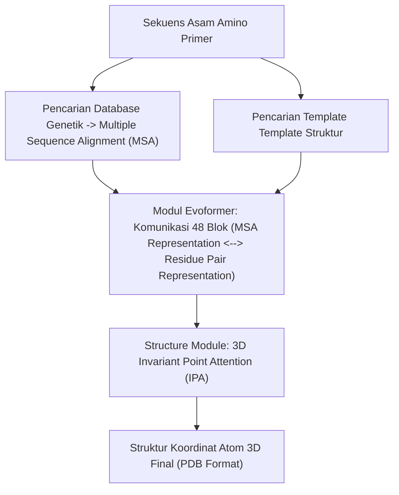

# Modul 199: Bioinformatika & Komputasi Biologis Dasar (Penyejajaran Sekuens Genomik Smith-Waterman, BLAST, Prediksi AlphaFold)

**Navigasi**: [⬅️ Master Index](../../INDEX.md) | [Tingkat 13: Tingkat 13: Sains Kognitif, Neuroengineering & Computational Linguistics](./README.md)
*Sebelumnya*: [198. neuroengineering-antarmuka-otak-komputer](./198-neuroengineering-antarmuka-otak-komputer.md) | *Berikutnya*: [200. psikologi-kognitif-arsitektur-pikiran](./200-psikologi-kognitif-arsitektur-pikiran.md)

---

## 1. Intuisi Dasar Tanpa Jargon ("Seperti Bayi Baru Lahir")
Tubuh setiap makhluk hidup di bumi dikendalikan oleh kode perangkat lunak biologis yang ditulis dalam bentuk molekul asam deoksiribonukleat (**DNA**). DNA tersusun dari 4 huruf alfabet kimia sederhana: **A** (Adenin), **C** (Sitosin), **G** (Guanin), dan **T** (Timin) ([Watson & Crick - Nature 1953](https://www.nature.com/articles/171737a0)).

Genom manusia memiliki 3 miliar huruf DNA. Jika kita ingin menemukan apakah seorang pasien memiliki mutasi virus baru atau mutasi kanker tertentu, bagaimana kita mencari kecocokan urutan huruf di antara miliaran kode tersebut tanpa tersesat oleh mutasi acak?

Itulah ranah **Bioinformatika**: perpaduan antara ilmu biologi molekuler, struktur data string tingkat tinggi, dan kecerdasan buatan. Dari algoritma penyejajaran sekuens dinamis klasik (**Smith-Waterman & BLAST**) yang mencocokkan huruf DNA seperti fitur diff pada git, hingga terobosan revolusioner **AlphaFold** yang berhasil memecahkan teka-teki 50 tahun tentang bagaimana rantai kode protein melipat dirinya menjadi struktur fisik 3D berpresisi tingkat atom ([Jumper et al. - Highly Accurate Protein Structure Prediction with AlphaFold](https://www.nature.com/articles/s41586-021-03819-2)).

## 2. Fondasi Teoretis & Aksiomatik / Matematis
Formulasi Matematis Penyejajaran Sekuens & Pemodelan Protein:

1. **Algoritma Penyejajaran Lokal Smith-Waterman**:
Memaksimalkan skor kemiripan lokal antara sekuens $A$ panjang $n$ dan sekuens $B$ panjang $m$ via pemrograman dinamis ([Smith & Waterman - J. Mol. Biol. 1981](https://www.sciencedirect.com/science/article/pii/0022283681900875)):
$$H(i, j) = \max \begin{cases} 0 \\ H(i-1, j-1) + s(A_i, B_j) & \text{(Match / Mismatch)} \\ H(i-1, j) - W_g & \text{(Deletion / Gap di B)} \\ H(i, j-1) - W_g & \text{(Insertion / Gap di A)} \end{cases}$$
Di mana $s(a, b)$ adalah matriks substitusi asam amino (seperti BLOSUM62 atau PAM250), dan penelusuran balik (*backtracking*) dimulai dari nilai maksimum global $\max_{i, j} H(i, j)$ hingga mencapai sel bernilai 0.

2. **Heuristik BLAST (Basic Local Alignment Search Tool)**:
Mempercepat pencarian database genomik dari $\mathcal{O}(NM)$ menjadi sub-linier melalui pencocokan kata pendek (*k-tuples* / $W$-mers panjang 3 untuk protein, 11 untuk DNA) berbobot tinggi di atas threshold $T$, kemudian memperluas segmen tanpa gap (*High-scoring Segment Pairs / HSP*) ([Altschul et al. - Basic Local Alignment Search Tool](https://www.sciencedirect.com/science/article/pii/S0022283605803602)).

3. **Arsitektur AlphaFold Evoformer & Frame Representation**:
AlphaFold memodelkan rantai residu protein sebagai koordinat kerangka kaku spasial (Rigid Body Frames) $T_i = (R_i, \vec{x}_i) \in SE(3)$ yang mewakili orientasi grup peptida di ruang 3D ([Jumper et al. Nature 2021](https://www.nature.com/articles/s41586-021-03819-2)):
$$\mathcal{L}_{\text{FAPE}} = \frac{1}{N_{\text{frames}} N_{\text{atoms}}} \sum_{i, j} \min\left( d_{\text{clamp}}, \| T_i^{-1} \vec{x}_j - (T_i^{\text{true}})^{-1} \vec{x}_j^{\text{true}} \| \right)$$
Fungsi Frame Aligned Point Error (FAPE) invariant terhadap rotasi dan translasi global sistem koordinat Euclidean.

## 3. Anatomi Teknis & Cara Kerja Internal
Aliran arsitektur komputasi prediksi struktur 3D protein dari sekuens mentah pada AlphaFold:



Evoformer memanfaatkan ko-evolusi spasial: jika dua residu asam amino saling berdekatan dalam lipatan 3D fisik, mutasi pada satu residu akan disertai oleh mutasi kompensasi pada residu pasangannya di sepanjang sejarah evolusi spesies ([AlphaFold Technical Method](https://www.nature.com/articles/s41586-021-03819-2)).

## 4. Implementasi Praktis & Kode / Simulasi Riil
```python
import numpy as np

# 1. Implementasi Algoritma Smith-Waterman untuk Penyejajaran Sekuens Genomik Lokal
def smith_waterman(seq1, seq2, match=2, mismatch=-1, gap=-2):
    n, m = len(seq1), len(seq2)
    H = np.zeros((n + 1, m + 1), dtype=int)
    
    max_score = 0
    max_pos = (0, 0)
    
    # Isi Matriks Skor Pemrograman Dinamis
    for i in range(1, n + 1):
        for j in range(1, m + 1):
            score_diag = H[i-1, j-1] + (match if seq1[i-1] == seq2[j-1] else mismatch)
            score_up = H[i-1, j] + gap
            score_left = H[i, j-1] + gap
            H[i, j] = max(0, score_diag, score_up, score_left)
            
            if H[i, j] > max_score:
                max_score = H[i, j]
                max_pos = (i, j)
                
    # Backtracking dari Sel Bernilai Maksimum
    aligned1, aligned2 = [], []
    curr_i, curr_j = max_pos
    
    while curr_i > 0 and curr_j > 0 and H[curr_i, curr_j] > 0:
        val = H[curr_i, curr_j]
        diag = H[curr_i - 1, curr_j - 1]
        left = H[curr_i, curr_j - 1]
        up = H[curr_i - 1, curr_j]
        
        score_diff = match if seq1[curr_i - 1] == seq2[curr_j - 1] else mismatch
        if val == diag + score_diff:
            aligned1.append(seq1[curr_i - 1])
            aligned2.append(seq2[curr_j - 1])
            curr_i -= 1
            curr_j -= 1
        elif val == up + gap:
            aligned1.append(seq1[curr_i - 1])
            aligned2.append('-')
            curr_i -= 1
        else:
            aligned1.append('-')
            aligned2.append(seq2[curr_j - 1])
            curr_j -= 1
            
    return "".join(reversed(aligned1)), "".join(reversed(aligned2)), max_score

# Uji Coba Penyejajaran Dua Fragmen DNA
dna_a = "TGTTACGG"
dna_b = "GGTTGACTA"
aln_a, aln_b, score = smith_waterman(dna_a, dna_b)

print(f"Skor Alignment Lokal Terbaik: {score}")
print(f"Sekuens A Terjajar : {aln_a}")
print(f"Sekuens B Terjajar : {aln_b}")
```

## 5. Miskonsepsi & Jebakan Industri
*Over-reliance pada pLDDT Score Tanpa Memperhatikan PDB PAE Matrix*: Pada AlphaFold, skor pLDDT (Predicted Local Distance Difference Test, rentang 0-100) hanya mengukur kepercayaan konformasi lokal setiap residu residu individual. Residu dengan skor pLDDT tinggi ($>80$) tetap bisa memiliki kesalahan orientasi spasial relatif yang masif terhadap domain lain. Selalu validasi matriks Predicted Aligned Error (PAE) untuk mengukur ketidakpastian posisi relatif antar domain protein ([Varadi et al. - AlphaFold Protein Structure Database](https://academic.oup.com/nar/article/50/D1/D439/6430488)).

## 6. Proyek Latihan & Rubrik Penilaian Mandiri
### Level 1 (Pemula)
Tulis skrip Python untuk menghitung persentase kandungan GC-content ($(\#G + \#C) / \text{Length} \times 100$) dan mencari open reading frames (ORF) yang diawali oleh kodon start `ATG` dan diakhiri oleh kodon stop (`TAA`, `TAG`, `TGA`) pada string DNA.
*Rubrik*: Output mencetak panjang sequence, kandungan GC, dan kandidat rantai polipeptida.

### Level 2 (Menengah)
Implementasikan algoritma penyejajaran global Needleman-Wunsch dengan model penalti *Affine Gap Penalty* ($W(k) = \text{Gap}_{\text{open}} + k \cdot \text{Gap}_{\text{extend}}$) menggunakan 3 matriks pemrograman dinamis ($M, I_x, I_y$).
*Rubrik*: Kode membedakan pembukaan gap baru dengan perpanjangan gap yang sudah ada secara matematis.

### Level 3 (Mahir)
Bangun modul komputasi metrik RMSD (Root-Mean-Square Deviation) dan FAPE (Frame Aligned Point Error) 3D dari nol untuk membandingkan dua file struktur protein format PDB: implementasikan algoritma rotasi optimal Kabsch (menggunakan dekomposisi SVD) untuk menyelaraskan dua awan koordinat atom secara absolut.
*Rubrik*: Menghitung nilai RMSD yang identik dengan perangkat lunak standar BioPython / PyMOL.

## 7. Rekomendasi Sumber Belajar Standar Emas
| Sumber Pembelajaran | Penulis / Institusi | Tautan Langsung | Fokus Materi |
| :--- | :--- | :--- | :--- |
| Highly Accurate Protein Structure Prediction with AlphaFold | John Jumper et al. (Google DeepMind) | [Nature 2021 Article](https://www.nature.com/articles/s41586-021-03819-2) | Arsitektur Lengkap Evoformer, Invariant Point Attention, Loss FAPE |
| Identification of Common Molecular Subsequences (Smith-Waterman) | T. F. Smith & M. S. Waterman | [Journal of Molecular Biology 1981](https://www.sciencedirect.com/science/article/pii/0022283681900875) | Algoritma Asli Pemrograman Dinamis Penyejajaran Lokal |
| Basic Local Alignment Search Tool (BLAST) | Stephen F. Altschul et al. (NIH NCBI) | [Journal of Molecular Biology 1990](https://www.sciencedirect.com/science/article/pii/S0022283605803602) | Heuristik Pencarian Database Genom Skala Besar Sub-Linier |
| Biological Sequence Analysis: Probabilistic Models of Proteins and Nucleic Acids | R. Durbin, S. Eddy, A. Krogh, G. Mitchison | [Cambridge University Press](https://www.cambridge.org/core/books/biological-sequence-analysis/AA56B5D71C1720FEFFCA64700FE4B127) | Model Markov Tersembunyi (HMM) Profil Genomik, Matriks BLOSUM |

---
*Navigasi Cepat*: [Ke Tingkat 13](./README.md) | [Ke Master Index](../../INDEX.md) | *Sebelumnya*: [198. neuroengineering-antarmuka-otak-komputer](./198-neuroengineering-antarmuka-otak-komputer.md) | *Berikutnya*: [200. psikologi-kognitif-arsitektur-pikiran](./200-psikologi-kognitif-arsitektur-pikiran.md)
