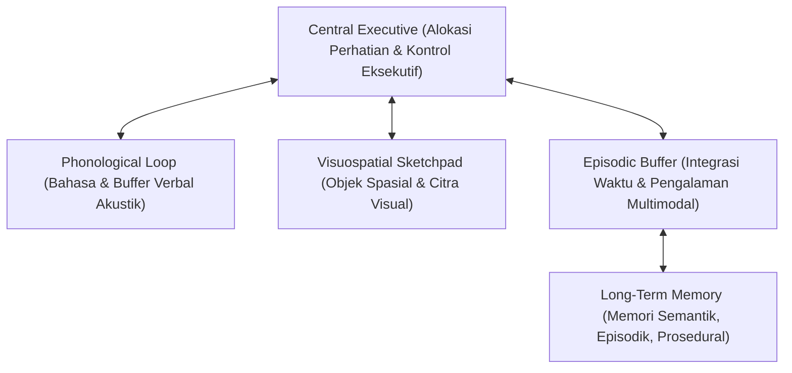

# Modul 200: Psikologi Kognitif & Arsitektur Pikiran (Persepsi Top-Down/Bottom-Up, Memori Kerja Baddeley, Teori Sistem 1 & 2)

**Navigasi**: [⬅️ Master Index](../../INDEX.md) | [Tingkat 13: Tingkat 13: Sains Kognitif, Neuroengineering & Computational Linguistics](./README.md)
*Sebelumnya*: [199. bioinformatika-komputasi-biologis-dasar](./199-bioinformatika-komputasi-biologis-dasar.md) | *Berikutnya*: [201. linguistik-formal-komputasional](./201-linguistik-formal-komputasional.md)

---

## 1. Intuisi Dasar Tanpa Jargon ("Seperti Bayi Baru Lahir")
Pernahkah Anda berjalan pulang ke rumah sambil melamun memikirkan pekerjaan, tetapi kaki Anda bisa melangkah dengan sempurna, belok di gang yang tepat, dan sampai di depan pintu tanpa Anda sadari? Namun, ketika tiba-tiba ada teka-teki rumit seperti mengalikan $17 \times 24$ di kepala Anda, langkah kaki Anda melambat, pupil mata Anda melebar, dan seluruh fokus Anda tersedot habis.

Psikolog Daniel Kahneman merumuskan arsitektur ini sebagai **Teori Dua Sistem Pikiran (Dual-Process Theory)** ([Kahneman - Thinking, Fast and Slow](https://us.macmillan.com/books/9780374533557/thinkingfastandslow)):
* **Sistem 1 (Fast, Otomatis, Intuitif)**: Bekerja instan tanpa usaha sadar, mengandalkan asosiasi pola masa lalu (seperti refleks menghindar dari bola yang melayang ke arah muka).
* **Sistem 2 (Slow, Sadar, Analitis)**: Mesin penalaran logika berkecepatan lambat yang membutuhkan konsentrasi penuh dan mengonsumsi energi mental tinggi.

Bagaimana otak mengingat hal yang sedang dipikirkan? Alan Baddeley memodelkannya sebagai **Memori Kerja (Working Memory)**: papan tulis mental sementara berkapasitas sangat terbatas yang dapat menampung informasi saat kita memecahkan masalah ([Baddeley - Working Memory](https://academic.oup.com/book/25442)).

## 2. Fondasi Teoretis & Aksiomatik / Matematis
Formulasi Formal Psikologi Kognitif & Arsitektur Pikiran:

1. **Model Memori Kerja Multi-Komponen Baddeley & Hitch (1974/2000)**:
Terdiri dari 4 subsistem koordinasi kognitif:
* **Central Executive**: Pengendali perhatian fokus utama, mengalokasikan sumber daya mental dan menekan gangguan (*inhibition*).
* **Phonological Loop**: Buffer penampung informasi berbasis bahasa dan akustik dengan loop artikulatoris verbal (kapasitas $\approx 2$ detik pengucapan vokal).
* **Visuospatial Sketchpad**: Buffer visual untuk memanipulasi citra spasial 2D/3D di dalam benak.
* **Episodic Buffer**: Integrator multimodal yang menggabungkan informasi visual, spasial, dan verbal dengan stempel waktu memori jangka panjang (*Long-Term Memory*).

2. **Persepsi Top-Down vs Bottom-Up (Pemodelan Bayesian)**:
Persepsi sadar $\hat{S}$ adalah estimasi Maximum A Posteriori (MAP) yang mengintegrasikan sinyal stimulus sensori fisik dari lingkungan luar (*bottom-up evidence* $p(E \mid S)$) dengan ekspektasi pengetahuan dan konteks masa lalu (*top-down prior* $p(S)$):
$$\hat{S} = \arg\max_S p(S \mid E) = \arg\max_S \frac{p(E \mid S) p(S)}{p(E)}$$
Jika stimulus sensori terdegradasi (misal kabut atau tulisan kabur), sistem kognitif bergantung penuh pada prior top-down ([Gregory - Perceptions as Hypotheses](https://royalsocietypublishing.org/doi/10.1098/rstb.1980.0090)).

3. **Batas Kapasitas Memori Kerja George Miller (The Magical Number 7 $\pm$ 2)**:
Kapasitas kanal manusia memproses informasi unidimensional dibatasi oleh kapasitas chunking diskret: $7 \pm 2$ chunks informasi, yang kemudian direvisi oleh Cowan (2001) menjadi sekitar $4 \pm 1$ chunks aktif dalam ketiadaan latihan rehearsal ([Cowan - The Magical Mystery Four](https://www.cambridge.org/core/journals/behavioral-and-brain-sciences/article/magical-number-4-in-shortterm-memory-a-reconsideration-of-mental-storage-capacity/36E56BFBA69D0445ECBF33FBE809EF44)).

## 3. Anatomi Teknis & Cara Kerja Internal
Arsitektur interaksi modul Memori Kerja Baddeley dengan Long-Term Memory:



Sistem 1 pada manusia beroperasi seperti deep neural network feedforward (pencocokan pola embedding cepat), sedangkan Sistem 2 beroperasi seperti algoritma pencarian pohon Monte Carlo / Chain-of-Thought (penalaran bertahap dengan verifikasi kendala) ([Kahneman Nobel Lecture](https://www.nobelprize.org/prizes/economic-sciences/2002/kahneman/lecture/)).

## 4. Implementasi Praktis & Kode / Simulasi Riil
```python
import time

# 1. Simulasi Kognitif Sederhana: Efek Stroop (Stroop Effect Simulation)
# Mengukur konflik kompetisi antara Sistem 1 (Membaca Teks Otomatis) vs Sistem 2 (Menyebut Warna Tinta)

stimuli = [
    {"word": "MERAH", "color": "MERAH", "congruent": True},
    {"word": "HIJAU", "color": "HIJAU", "congruent": True},
    {"word": "BIRU",  "color": "MERAH", "congruent": False}, # Konflik Sistem 1 vs 2!
    {"word": "KUNING", "color": "HIJAU", "congruent": False} # Konflik Sistem 1 vs 2!
]

def simulate_reaction_time(stimulus):
    # Base processing time Sistem 1 persepsi warna
    base_rt = 300.0 # ms
    if not stimulus["congruent"]:
        # Penalti interferensi inhibisi kognitif Central Executive Sistem 2
        inhibition_cost = 220.0 # ms
        return base_rt + inhibition_cost
    return base_rt

congruent_rts = [simulate_reaction_time(s) for s in stimuli if s["congruent"]]
incongruent_rts = [simulate_reaction_time(s) for s in stimuli if not s["congruent"]]

print("Simulasi Kognitif Efek Stroop:")
print(f"Rata-rata Reaksi Kongruen  (Tanpa Konflik) : {sum(congruent_rts)/len(congruent_rts):.1f} ms")
print(f"Rata-rata Reaksi Inkongruen (Dengan Konflik): {sum(incongruent_rts)/len(incongruent_rts):.1f} ms")
print(f"Biaya Interferensi Kognitif (Stroop Interference Cost): {(sum(incongruent_rts) - sum(congruent_rts))/2:.1f} ms")
```

## 5. Miskonsepsi & Jebakan Industri
*Bias Konfirmasi dan Anchoring Heuristic pada Sistem 1*: Ketergantungan berlebihan pada heuristik ketersediaan (*availability heuristic*) membuat manusia secara sistematis menempel pada angka acak pertama yang dilihat (*anchoring effect*) atau hanya mencari informasi yang membenarkan hipotesis awal mereka (*confirmation bias*). Dalam perancangan sistem interaksi manusia-komputer dan AI, antarmuka harus dirancang secara sengaja untuk memicu refleksi kritis Sistem 2 pada keputusan-keputusan berisiko tinggi ([Tversky & Kahneman - Judgment under Uncertainty](https://www.science.org/doi/10.1126/science.185.4157.1124)).

## 6. Proyek Latihan & Rubrik Penilaian Mandiri
### Level 1 (Pemula)
Rancang eksperimen pengukuran memori kerja menggunakan tugas *Digit Span Test* (maju dan mundur): catat kapasitas retensi maksimum subjek manusia atau partisipan uji coba, dan analisis apakah hasilnya memvalidasi hukum Miller $7 \pm 2$.
*Rubrik*: Laporan data eksperimen menyajikan rata-rata digit span dan deviasi standar.

### Level 2 (Menengah)
Bangun model komputasional *Drift-Diffusion Model (DDM)* untuk keputusan biner 2-pilihan:
$$dx = v \cdot dt + \sigma \cdot dW$$
Simulasikan akumulasi bukti sensori dari waktu ke waktu hingga menyentuh batas keputusan atas ($+a$) atau bawah ($-a$). Plot distribusi waktu reaksi (*reaction time distribution*) yang dihasilkan.
*Rubrik*: Bentuk kurva waktu reaksi terdistribusi miring ke kanan (*right-skewed Wald distribution*).

### Level 3 (Mahir)
Implementasikan simulasi komputasional arsitektur kognitif modular ACT-R atau SOAR mini di Python: rancang modul declarative memory (pencarian fakta berbasis spreading activation), modul procedural memory (aturan produksi IF-THEN dengan resolusi konflik utilitas), dan buktikan kemampuan model memecahkan tugas navigasi labirin bertingkat.
*Rubrik*: Model mengeksekusi siklus kognitif lengkap (Goal -> Match -> Resolve -> Fire).

## 7. Rekomendasi Sumber Belajar Standar Emas
| Sumber Pembelajaran | Penulis / Institusi | Tautan Langsung | Fokus Materi |
| :--- | :--- | :--- | :--- |
| Thinking, Fast and Slow | Daniel Kahneman (Nobel Laureate) | [Farrar, Straus and Giroux](https://us.macmillan.com/books/9780374533557/thinkingfastandslow) | Teori Sistem 1 vs Sistem 2, Heuristik Kognitif & Bias |
| Working Memory (Oxford Psychology Series) | Alan Baddeley | [Oxford University Press](https://academic.oup.com/book/25442) | Model Multi-Komponen Memori Kerja, Central Executive |
| Judgment under Uncertainty: Heuristics and Biases | Amos Tversky & Daniel Kahneman | [Science 1974 Classic](https://www.science.org/doi/10.1126/science.185.4157.1124) | Landasan Asli Sains Pengambilan Keputusan Manusia |
| The Magical Number Seven, Plus or Minus Two | George A. Miller (Harvard University) | [Psychological Review 1956](https://psycnet.apa.org/record/1957-02914-001) | Batas Kapasitas Pemrosesan Informasi Pikiran Manusia |

---
*Navigasi Cepat*: [Ke Tingkat 13](./README.md) | [Ke Master Index](../../INDEX.md) | *Sebelumnya*: [199. bioinformatika-komputasi-biologis-dasar](./199-bioinformatika-komputasi-biologis-dasar.md) | *Berikutnya*: [201. linguistik-formal-komputasional](./201-linguistik-formal-komputasional.md)
