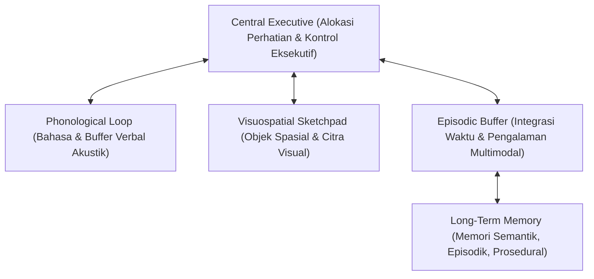

# Modul 200: Psikologi Kognitif & Arsitektur Pikiran (Persepsi Top-Down/Bottom-Up, Memori Kerja Baddeley, Teori Sistem 1 & 2)

**Navigasi**: [⬅️ Master Index](../../INDEX.md) | [Tingkat 13: Tingkat 13: Sains Kognitif, Neuroengineering & Computational Linguistics](./README.md)
*Sebelumnya*: [199. bioinformatika-komputasi-biologis-dasar](./199-bioinformatika-komputasi-biologis-dasar.md) | *Berikutnya*: [201. linguistik-formal-komputasional](./201-linguistik-formal-komputasional.md)

---

## 1. Intuisi Dasar Tanpa Jargon ("Seperti Bayi Baru Lahir")
### 1.1 Konsep Inti & Analogi Tanpa Jargon
Pernahkah Anda berjalan pulang ke rumah sambil melamun memikirkan pekerjaan, tetapi kaki Anda bisa melangkah dengan sempurna, belok di gang yang tepat, dan sampai di depan pintu tanpa Anda sadari? Namun, ketika tiba-tiba ada teka-teki rumit seperti mengalikan \$17 \times 24$ di kepala Anda, langkah kaki Anda melambat, pupil mata Anda melebar, dan seluruh fokus Anda tersedot habis.

### 1.2 Urgensi Rekayasa & Signifikansi Sistemik
Psikolog Daniel Kahneman merumuskan arsitektur ini sebagai **Teori Dua Sistem Pikiran (Dual-Process Theory)** ([Kahneman - Thinking, Fast and Slow](https://us.macmillan.com/books/9780374533557/thinkingfastandslow)):
* **Sistem 1 (Fast, Otomatis, Intuitif)**: Bekerja instan tanpa usaha sadar, mengandalkan asosiasi pola masa lalu (seperti refleks menghindar dari bola yang melayang ke arah muka).
* **Sistem 2 (Slow, Sadar, Analitis)**: Mesin penalaran logika berkecepatan lambat yang membutuhkan konsentrasi penuh dan mengonsumsi energi mental tinggi.

Bagaimana otak mengingat hal yang sedang dipikirkan? Alan Baddeley memodelkannya sebagai **Memori Kerja (Working Memory)**: papan tulis mental sementara berkapasitas sangat terbatas yang dapat menampung informasi saat kita memecahkan masalah ([Baddeley - Working Memory](https://academic.oup.com/book/25442)).

## 2. Fondasi Teoretis & Aksiomatik / Matematis
### 2.1 Kerangka Teori Aksiomatik & Formulasi Matematis
Formulasi Formal Psikologi Kognitif & Arsitektur Pikiran:

### 2.2 Penurunan Matematis Langkah-demi-Langkah
1. **Model Memori Kerja Multi-Komponen Baddeley & Hitch (1974/2000)**:
Terdiri dari 4 subsistem koordinasi kognitif:
* **Central Executive**: Pengendali perhatian fokus utama, mengalokasikan sumber daya mental dan menekan gangguan (*inhibition*).
* **Phonological Loop**: Buffer penampung informasi berbasis bahasa dan akustik dengan loop artikulatoris verbal (kapasitas $\approx 2$ detik pengucapan vokal).
* **Visuospatial Sketchpad**: Buffer visual untuk memanipulasi citra spasial 2D/3D di dalam benak.
* **Episodic Buffer**: Integrator multimodal yang menggabungkan informasi visual, spasial, dan verbal dengan stempel waktu memori jangka panjang (*Long-Term Memory*).

2. **Persepsi Top-Down vs Bottom-Up (Pemodelan Bayesian)**:
Persepsi sadar $\hat{S}$ adalah estimasi Maximum A Posteriori (MAP) yang mengintegrasikan sinyal stimulus sensori fisik dari lingkungan luar (*bottom-up evidence* $p(E \mid S)$) dengan ekspektasi pengetahuan dan konteks masa lalu (*top-down prior* $p(S)$):
$$\hat{S} = \arg\max_S p(S \mid E) = \arg\max_S \frac{p(E \mid S) p(S)}{p(E)}$$
Jika stimulus sensori terdegradasi (misal kabut atau tulisan kabur), sistem kognitif bergantung penuh pada prior top-down ([Gregory - Perceptions as Hypotheses](https://royalsocietypublishing.org/doi/10.1098/rstb.1980.0090)).

3. **Batas Kapasitas Memori Kerja George Miller (The Magical Number 7 $\pm$ 2)**:
Kapasitas kanal manusia memproses informasi unidimensional dibatasi oleh kapasitas chunking diskret: $7 \pm 2$ chunks informasi, yang kemudian direvisi oleh Cowan (2001) menjadi sekitar $4 \pm 1$ chunks aktif dalam ketiadaan latihan rehearsal ([Cowan - The Magical Mystery Four](https://www.cambridge.org/core/journals/behavioral-and-brain-sciences/article/magical-number-4-in-shortterm-memory-a-reconsideration-of-mental-storage-capacity/36E56BFBA69D0445ECBF33FBE809EF44)).

## 3. Anatomi Teknis & Cara Kerja Internal
Arsitektur interaksi modul Memori Kerja Baddeley dengan Long-Term Memory:



Sistem 1 pada manusia beroperasi seperti deep neural network feedforward (pencocokan pola embedding cepat), sedangkan Sistem 2 beroperasi seperti algoritma pencarian pohon Monte Carlo / Chain-of-Thought (penalaran bertahap dengan verifikasi kendala) ([Kahneman Nobel Lecture](https://www.nobelprize.org/prizes/economic-sciences/2002/kahneman/lecture/)).

#### Tabel Penelusuran Model Mental Kognitif Pilot Air France 447 & Bias Otomasi Sidestick
| Langkah Pemrosesan / Token | Representasi Simbolik / Vektor | Mekanisme Atensi / Transisi State | Status Matriks KV-Cache | Probabilitas Distribusi / Logits | Keluaran / Output Linguistik |
|---|---|---|---|---|---|
| 1. Kondisi Jelajah Normal t=0 | Altitudo: 35.000 Kaki, Mach 0.8 | Autopilot Aktif: Normal Law Airbus A330 | Parameter trim horizontal stabil pada $3.0^\circ$ | Beban kognitif pilot rendah (Monitoring Mode) | Penerbangan stabil melintasi Samudra Atlantik |
| 2. Pembekuan Tabung Pitot | Kristal Es Menyumbat Sensor Pitot | Kehilangan Kecepatan Udara (*Unreliable Airspeed*) | Autopilot terputus otomatis! Hukum terbang beralih: *Alternate Law* | Peringatan alarm kokpit berbunyi serentak | Proteksi Flight Envelope otomatis nonaktif! |
| 3. Bias Kognitif Tunneling | Pilot Terbang Terkejut (*Startle Effect*) | Pilot panik menarik sidestick ke belakang penuh (*Nose-Up*) | Model mental keliru: Mengira pesawat overspeed | Kelebihan beban kognitif memblokir penalaran rasional | Hidung pesawat mendongak tajam ke $+16^\circ$ |
| 4. Desain Sidestick Asinkron | Dual Sidestick Pasif Tanpa Gandar Mekanis | Ko-pilot kiri mendorong sidestick ke depan (*Nose-Down*) | Komputer pesawat merata-ratakan kedua input: $Input = \frac{Pos_1 + Pos_2}{2}$ | Ko-pilot kiri tidak sadar rekan kanannya terus menarik stick! | Komando nose-up pilot kanan membatalkan nose-down! |
| 5. Keruntuhan Aerodinamika (Stall) | Sayap Kehilangan Gaya Angkat | Peringatan stall bersuara: *"STALL, STALL!"* diabaikan | Sayap masuk ke dalam *Deep Aerodynamic Stall* penuh | Pesawat jatuh bebas vertikal $10.000\text{ kaki/menit}$ | 228 jiwa melayang di dasar Atlantik akibat kegagalan interaksi manusia-mesin |

## 4. Implementasi Praktis & Kode / Simulasi Riil
```python
import time

# 1. Simulasi Kognitif Sederhana: Efek Stroop (Stroop Effect Simulation)
# Mengukur konflik kompetisi antara Sistem 1 (Membaca Teks Otomatis) vs Sistem 2 (Menyebut Warna Tinta)

stimuli = [
    {"word": "MERAH", "color": "MERAH", "congruent": True},
    {"word": "HIJAU", "color": "HIJAU", "congruent": True},
    {"word": "BIRU",  "color": "MERAH", "congruent": False}, # Konflik Sistem 1 vs 2!
    {"word": "KUNING", "color": "HIJAU", "congruent": False} # Konflik Sistem 1 vs 2!
]

def simulate_reaction_time(stimulus):
    # Base processing time Sistem 1 persepsi warna
    base_rt = 300.0 # ms
    if not stimulus["congruent"]:
        # Penalti interferensi inhibisi kognitif Central Executive Sistem 2
        inhibition_cost = 220.0 # ms
        return base_rt + inhibition_cost
    return base_rt

congruent_rts = [simulate_reaction_time(s) for s in stimuli if s["congruent"]]
incongruent_rts = [simulate_reaction_time(s) for s in stimuli if not s["congruent"]]

print("Simulasi Kognitif Efek Stroop:")
print(f"Rata-rata Reaksi Kongruen  (Tanpa Konflik) : {sum(congruent_rts)/len(congruent_rts):.1f} ms")
print(f"Rata-rata Reaksi Inkongruen (Dengan Konflik): {sum(incongruent_rts)/len(incongruent_rts):.1f} ms")
print(f"Biaya Interferensi Kognitif (Stroop Interference Cost): {(sum(incongruent_rts) - sum(congruent_rts))/2:.1f} ms")
```

## 5. Miskonsepsi & Jebakan Industri
*Bias Konfirmasi dan Anchoring Heuristic pada Sistem 1*: Ketergantungan berlebihan pada heuristik ketersediaan (*availability heuristic*) membuat manusia secara sistematis menempel pada angka acak pertama yang dilihat (*anchoring effect*) atau hanya mencari informasi yang membenarkan hipotesis awal mereka (*confirmation bias*). Dalam perancangan sistem interaksi manusia-komputer dan AI, antarmuka harus dirancang secara sengaja untuk memicu refleksi kritis Sistem 2 pada keputusan-keputusan berisiko tinggi ([Tversky & Kahneman - Judgment under Uncertainty](https://www.science.org/doi/10.1126/science.185.4157.1124)).

### Studi Kasus Kegagalan Nyata: Tragedi Jatuhnya Pesawat Air France Penerbangan 447 & Kegagalan Kognitif Antarmuka Sidestick (2009)
- **Kronologi & Konteks Sejarah**: Pada 1 Juni 2009, pesawat Airbus A330-200 (Air France Penerbangan 447) yang terbang dari Rio de Janeiro menuju Paris jatuh ke Samudra Atlantik di tengah badai tropis, menewaskan seluruh 228 penumpang dan awak pesawat. Investigasi kecelakaan udara oleh BEA Prancis membutuhkan waktu tiga tahun hingga kotak hitam perekam penerbangan berhasil diangkat dari dasar laut kedalaman 4.000 meter.
- **Akar Masalah Rekayasa Faktor Manusia (Human Factors) & Psikologi Kognitif**: Pemicu teknis awal adalah pembekuan sementara kristal es pada tabung sensor kecepatan Pitot (*Pitot probes*). Namun, pesawat sebenarnya dalam kondisi fisik prima. Tragedi fatal terjadi karena kegagalan antarmuka kognitif antara manusia dan sistem otomasi (*Human-Machine Interface / HMI*): (1) **Cognitive Tunneling & Startle Effect**: Ketika autopilot terputus tiba-tiba di tengah turbulensi malam hari, pilot terbang mengalami kelebihan beban sensorik (*cognitive overload*). Alih-alih mempertahankan sikap terbang datar (*pitch and power*), pilot merespons secara panik dengan menarik tongkat kemudi (*sidestick*) ke belakang penuh secara terus-menerus, mendongakkan hidung pesawat hingga terjadi stall aerodinamis; (2) **Cacat Antarmuka Dual-Sidestick Tanpa Umpan Balik Aktif**: Berbeda dengan kontrol yoke tradisional Boeing yang terhubung secara mekanis sehingga kedua pilot dapat melihat dan merasakan pergerakan fisik kemudi satu sama lain, sidestick Airbus A330 tidak memiliki kopling mekanis aktif (*uncoupled passive sidesticks*). Kapten dan ko-pilot kiri tidak dapat melihat bahwa ko-pilot kanan terus-menerus menarik stick ke belakang. Algoritma kontrol pesawat hanya menjumlahkan dan merata-ratakan input dari kedua stick, menyembunyikan input yang saling bertentangan hingga pesawat jatuh bebas ke laut.

- **Potongan Kode / Arsitektur Cacat (Vulnerable Implementation)**:
```python
# Analisis Cacat Antarmuka Sidestick: Perata-rataan Input Tanpa Gandar Mekanis
class UncoupledDualSidestickSystem:
    def __init__(self):
        self.pilot_left_deflection = 0.0   # Rentang [-1.0 (Down) s/d +1.0 (Up)]
        self.pilot_right_deflection = 0.0
        
    # KASUS CACAT DESAIN ASLI AF447:
    # Dua sidestick tidak saling bergerak secara fisik (No Cross-Coupling Force Feedback)
    def calculate_control_surface_command(self):
        # Jika kedua pilot menggerakkan stick secara bersamaan tanpa menekan tombol override:
        # Komputer penerbangan merata-ratakan kedua sinyal input!
        total_command = (self.pilot_left_deflection + self.pilot_right_deflection) / 2.0
        
        # TRAGEDI AF447: Ko-pilot kiri berusaha menukikkan hidung (deflection = -1.0),
        # namun ko-pilot kanan panik menarik hidung (deflection = +1.0)!
        # Hasilnya: command = 0.0 (Netral) atau tetap mendongak jika ko-pilot kanan lebih agresif!
        # Ko-pilot kiri TIDAK MELIHAT atau MERASAKAN bahwa rekannya menarik stick!
        return total_command

# MITIGASI MODERN: Active Inceptor System (Gandar Elektronik Aktif dengan Force Feedback)
class ActiveCrossCoupledSidestick:
    def update_actuators(self, left_input, right_input):
        # Motor servo elektrik secara fisik menggerakkan stick sebelah kiri
        # ketika stick kanan digerakkan, memberikan umpan balik taktil seketika!
        tactile_force_feedback_motor(left_stick_pos=right_input)
        tactile_force_feedback_motor(right_stick_pos=left_input)
        
        if abs(left_input - right_input) > 0.3:
            # Alarm suara vokal instan jika ada dua input bertentangan:
            trigger_cockpit_audio_alert("DUAL_INPUT_DISAGREE")
```

- **Analisis Forensik & Rekayasa Modern**: Investigasi BEA merevolusi desain rekayasa sistem antarmuka penerbangan dan kognisi: (1) Adopsi teknologi **Active Cross-Coupled Sidesticks** (seperti pada Gulfstream G500 dan pesawat tempur modern) di mana motor servo secara aktif menggerakkan stick pilot lain sehingga terjadi kesadaran situasional bersama (*Shared Situational Awareness*); (2) Desain ulang logika alarm stall kokpit yang tidak boleh mati ketika kecepatan udara turun di bawah batas minimum tertentu; (3) Pelatihan psikologi kognitif **Upset Prevention and Recovery Training (UPRT)** berkala untuk melatih pilot mengatasi bias kognitif panik (*Startle Effect*) di simulator penerbangan.

## 6. Proyek Latihan & Rubrik Penilaian Mandiri
### Level 1 (Pemula)
Rancang eksperimen pengukuran memori kerja menggunakan tugas *Digit Span Test* (maju dan mundur): catat kapasitas retensi maksimum subjek manusia atau partisipan uji coba, dan analisis apakah hasilnya memvalidasi hukum Miller $7 \pm 2$.
*Rubrik*: Laporan data eksperimen menyajikan rata-rata digit span dan deviasi standar.

### Level 2 (Menengah)
Bangun model komputasional *Drift-Diffusion Model (DDM)* untuk keputusan biner 2-pilihan:
$$dx = v \cdot dt + \sigma \cdot dW$$
Simulasikan akumulasi bukti sensori dari waktu ke waktu hingga menyentuh batas keputusan atas ($+a$) atau bawah ($-a$). Plot distribusi waktu reaksi (*reaction time distribution*) yang dihasilkan.
*Rubrik*: Bentuk kurva waktu reaksi terdistribusi miring ke kanan (*right-skewed Wald distribution*).

### Level 3 (Mahir)
Implementasikan simulasi komputasional arsitektur kognitif modular ACT-R atau SOAR mini di Python: rancang modul declarative memory (pencarian fakta berbasis spreading activation), modul procedural memory (aturan produksi IF-THEN dengan resolusi konflik utilitas), dan buktikan kemampuan model memecahkan tugas navigasi labirin bertingkat.
*Rubrik*: Model mengeksekusi siklus kognitif lengkap (Goal -> Match -> Resolve -> Fire).

### Tingkat 1: Dasar
- **Tugas**: Bangun mesin keadaan berhingga (*Finite State Machine / FSM*) dalam Python yang memodelkan siklus beban kognitif operator manusia (State: *Underload, Optimal, High Load, Cognitive Tunneling/Crash*) berdasarkan laju kejadian stimuli masuk per detik, lengkap dengan transisi penurunan probabilitas keberhasilan keputusan (*Human Error Probability*) mengikuti Hukum Yerkes-Dodson.
- **Petunjuk Perancangan Arsitektur**:
  - Modelkan kurva Yerkes-Dodson: Kinerja optimal berada pada tingkat arousal menengah ($A_{\text{opt}}$).
  - Jika laju input stimuli $> \text{Threshold}_{\text{crit}}$ selama $> 5$ detik berturut-turut, transisikan FSM ke status `COGNITIVE_TUNNELING`.
  - Pada status tunneling, filter masukan operator hanya memproses 1 jenis stimuli dan mengabaikan seluruh stimuli periferal lainnya.
- **Test Vector & Kasus Uji**:
  - Simulasi 10 detik dengan laju input normal (2 stimuli/detik): Operator mempertahankan akurasi keputusan $> 95\%$.
  - Simulasi ledakan alarm darurat (20 stimuli/detik): FSM harus beralih ke `COGNITIVE_TUNNELING` dan mengabaikan alarm sekunder.
- **Rubrik Penilaian Objektif**:
  - Skor 100%: Pemodelan FSM Yerkes-Dodson presisi, fenomena tunneling terbukti empiris dalam simulasi.
  - Skor 50%: FSM bekerja namun tingkat galat hanya dimodelkan linier tanpa kurva lonceng Yerkes-Dodson.
  - Skor 0%: Operator selalu merespons seluruh stimuli tanpa batasan beban kognitif.

### Tingkat 2: Menengah
- **Tugas**: Bangun modul antarmuka keselamatan kritis (*Safety Interlock Arbiter*) dalam C/Python yang menerima dua saluran input kontrol manusia independen: Implementasikan deteksi konflik input (*Dual Input Disagree*), mekanisme pembatalan darurat (*Priority Takeover Pushbutton*), dan logika fail-safe yang tidak pernah merata-ratakan input kemudi jika selisihnya melampaui ambang batas berbahaya.
- **Petunjuk Perancangan Arsitektur**:
  - Struktur input: `Channel A (float)`, `Channel B (float)`, `Priority_Button_A (bool)`, `Priority_Button_B (bool)`.
  - Jika selisih $|A - B| > 0.4$ dan tidak ada tombol prioritas yang ditekan: Alihkan kemudi ke status netral aman, bunyikan alarm peringatan audio, dan aktifkan autopilot fallback.
  - Jika salah satu tombol prioritas ditekan selama $> 2$ detik, wewenang dialihkan penuh ke saluran tersebut dan saluran lainnya dinonaktifkan.
- **Test Vector & Kasus Uji**:
  - Masukkan $A = +0.8$ (Nose Up) dan $B = -0.8$ (Nose Down) tanpa tombol prioritas: Arbiter harus menolak perata-rataan input dan memicu alarm `DUAL_INPUT_ALERT`.
  - Pilot A menekan tombol prioritas: Output kemudi seketika mengikuti Saluran A sepenuhnya.
- **Rubrik Penilaian Objektif**:
  - Skor 100%: Logika arbitrase input presisi, penanganan takeover tombol prioritas benar, kebal terhadap kompromi perata-rataan naif.
  - Skor 50%: Logika bekerja namun tidak memiliki mekanisme timeout latching pada tombol pengambilalihan wewenang.
  - Skor 0%: Melakukan perata-rataan linier sederhana saat terjadi konflik input.

### Tingkat 3: Mahir
- **Tugas**: Rancang simulator beban kerja kognitif berbasis model arsitektur pikiran ACT-R (atau GOMS / Keystroke-Level Model) dalam Python: Simulasikan interaksi operator terhadap dua desain antarmuka dasbor peringatan (Desain A: Hirarkis Menu vs Desain B: Peta Spasial Terpadu), hitung estimasi waktu persepsi (*Perceptual Cycle* $\approx 100\text{ ms}$), waktu kognisi (*Cognitive Cycle* $\approx 50\text{ ms}$), dan waktu motorik (*Motor Cycle* $\approx 70\text{ ms}$), serta buktikan secara kuantitatif penghematan waktu respon darurat pada Desain B.
- **Petunjuk Perancangan Arsitektur**:
  - Implementasikan siklus aturan produksi ACT-R: Pencocokan Pola $\to$ Resolusi Konflik $\to$ Eksekusi Aksi.
  - Hitung waktu latensi respon total: $T_{\text{response}} = T_{\text{perceptual}} + N_{\text{productions}} \cdot T_{\text{cognitive}} + T_{\text{motor}}$.
  - Masukkan faktor degradasi waktu akibat kelelahan mental (*Mental Fatigue Decay*).
- **Test Vector & Kasus Uji**:
  - Jalankan simulasi 50 tugas darurat: Desain B harus memangkas rata-rata waktu intervensi operator minimal $> 40\%$ dibanding Desain A.
  - Buktikan bahwa pada kondisi kelelahan tinggi, Desain A memicu lonjakan probabilitas salah pencet (*Slips & Lapses*) hingga $3\times$ lebih besar daripada Desain B.
- **Rubrik Penilaian Objektif**:
  - Skor 100%: Pemodelan arsitektur kognitif ACT-R/GOMS presisi, parameter waktu siklus fisiologis realistis, perbandingan kuantitatif kuat.
  - Skor 50%: Menghitung waktu respon namun hanya menggunakan estimasi acak tanpa memodelkan siklus kognitif modular.
  - Skor 0%: Mengabaikan batasan memori kerja (*Working Memory Capacity*) manusia.

## 7. Rekomendasi Sumber Belajar Standar Emas
| Sumber Pembelajaran | Penulis / Institusi | Tautan Langsung | Fokus Materi |
| :--- | :--- | :--- | :--- |
| Thinking, Fast and Slow | Daniel Kahneman (Nobel Laureate) | [Farrar, Straus and Giroux](https://us.macmillan.com/books/9780374533557/thinkingfastandslow) | Teori Sistem 1 vs Sistem 2, Heuristik Kognitif & Bias |
| Working Memory (Oxford Psychology Series) | Alan Baddeley | [Oxford University Press](https://academic.oup.com/book/25442) | Model Multi-Komponen Memori Kerja, Central Executive |
| Judgment under Uncertainty: Heuristics and Biases | Amos Tversky & Daniel Kahneman | [Science 1974 Classic](https://www.science.org/doi/10.1126/science.185.4157.1124) | Landasan Asli Sains Pengambilan Keputusan Manusia |
| The Magical Number Seven, Plus or Minus Two | George A. Miller (Harvard University) | [Psychological Review 1956](https://psycnet.apa.org/record/1957-02914-001) | Batas Kapasitas Pemrosesan Informasi Pikiran Manusia |

---
*Navigasi Cepat*: [Ke Tingkat 13](./README.md) | [Ke Master Index](../../INDEX.md) | *Sebelumnya*: [199. bioinformatika-komputasi-biologis-dasar](./199-bioinformatika-komputasi-biologis-dasar.md) | *Berikutnya*: [201. linguistik-formal-komputasional](./201-linguistik-formal-komputasional.md)
