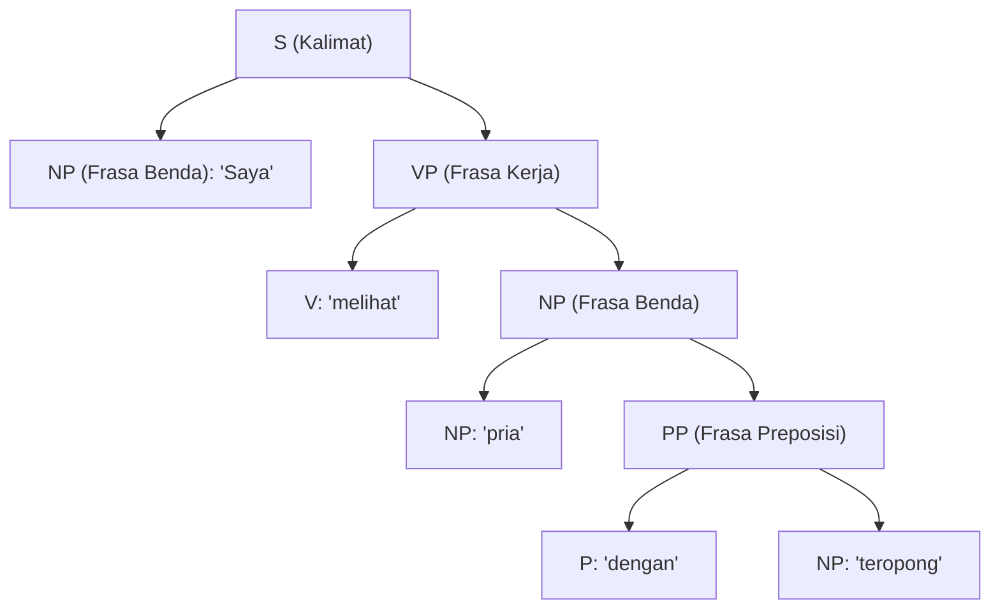

# Modul 201: Linguistik Formal & Komputasional (Fonetik, Morfologi FST, Sintaksis Pohon CFG/CYK, Semantik Kalkulus Lambda, Pragmatik)

**Navigasi**: [⬅️ Master Index](../../INDEX.md) | [Tingkat 13: Tingkat 13: Sains Kognitif, Neuroengineering & Computational Linguistics](./README.md)
*Sebelumnya*: [200. psikologi-kognitif-arsitektur-pikiran](./200-psikologi-kognitif-arsitektur-pikiran.md) | *Berikutnya*: [202. pemrosesan-bahasa-alami-statistik-nlp](./202-pemrosesan-bahasa-alami-statistik-nlp.md)

---

## 1. Intuisi Dasar Tanpa Jargon ("Seperti Bayi Baru Lahir")
Mengapa sebuah kalimat seperti *"Kucing mengejar tikus hitam"* terdengar alami dan benar, sedangkan *"Hitam tikus kucing mengejar"* terdengar berantakan seperti sampah kata? Dan bagaimana sebuah komputer bisa membedakan makna ganda dari kalimat *"Saya melihat pria dengan teropong"* (apakah saya yang memakai teropong, atau pria itu yang sedang memegang teropong)?

Bahasa manusia bukanlah sekadar deretan kata yang dijejerkan seperti gerbong kereta. Bahasa manusia memiliki struktur pohon hierarki yang sangat rapi dan berulang tanpa henti (**Rekursi**) ([Chomsky - Syntactic Structures](https://www.degruyter.com/document/doi/10.1515/9783112316009/html)).

**Linguistik Formal & Komputasional** adalah ilmu membedah anatomi bahasa manusia menggunakan matematika dan logika simbolik:
1. **Fonetik & Fonologi**: Ilmu tentang gelombang fisik suara dan pengucapan fonem.
2. **Morfologi**: Ilmu tentang bagaimana kata dasar dirangkai dengan imbuhan (misal: *ajar* $\to$ *belajar*, *pengajaran*).
3. **Sintaksis**: Aturan tata bahasa formal yang menyusun kata menjadi pohon frasa (**Context-Free Grammar / CFG**).
4. **Semantik & Pragmatik**: Logika makna hakiki dari sebuah proposisi dan bagaimana konteks situasi sosial mengubah arti kalimat tersebut ([Jurafsky & Martin - Speech and Language Processing](https://web.stanford.edu/~jurafsky/slp3/)).

## 2. Fondasi Teoretis & Aksiomatik / Matematis
Formulasi Matematis Tata Bahasa Formal & Semantik:

1. **Hierarki Tata Bahasa Noam Chomsky**:
Tata Bahasa Formal didefinisikan sebagai tuple $G = \langle V, \Sigma, R, S \rangle$:
* **Tipe 3 (Reguler)**: $A \to aB$ atau $A \to a$ (Dikenali oleh *Finite State Automata* / Regex).
* **Tipe 2 (Context-Free Grammar / CFG)**: $A \to \alpha$ di mana $A \in V$ dan $\alpha \in (V \cup \Sigma)^*$ (Dikenali oleh *Pushdown Automata*, memodelkan struktur pohon sintaksis bahasa manusia).
* **Tipe 1 (Context-Sensitive Grammar)**: $\alpha A \beta \to \alpha \gamma \beta$.
* **Tipe 0 (Turing Unrestricted)**: Mesin Turing universal ([Hopcroft, Motwani, Ullman - Automata Theory](https://www.pearson.com/en-us/subject-catalog/p/introduction-to-automata-theory-languages-and-computation/P200000003348)).

2. **Algoritma Parsing Cocke-Younger-Kasami (CYK)**:
Mem-parsing kalimat panjang $n$ di bawah CFG dalam bentuk normal Chomsky (*Chomsky Normal Form / CNF* di mana semua aturan berupa $A \to BC$ atau $A \to a$) via Dynamic Programming matriks segitiga:
$$P[i, j, A] = \bigvee_{k=1}^{j-1} \bigvee_{A \to B C} \left( P[i, k, B] \land P[i+k, j-k, C] \right)$$
Kompleksitas komputasi eksak $\mathcal{O}(n^3 |R|)$, menjamin pencarian pohon sintaksis parsing bebas galat.

3. **Semantik Komposisional Formal Montague**:
Prinsip Gottlob Frege: Arti dari keseluruhan kalimat adalah fungsi matematis dari arti bagian-bagian komponennya. Menggunakan Kalkulus Lambda bertipe ($\lambda$-Calculus):
$$\text{"mengejar"} = \lambda y. \lambda x. \text{Chases}(x, y)$$
$$\text{"tikus"} = \text{Mouse}, \quad \text{"mengejar tikus"} = (\lambda y. \lambda x. \text{Chases}(x, y))(\text{Mouse}) = \lambda x. \text{Chases}(x, \text{Mouse})$$
$$\text{"kucing"} = \text{Cat}, \quad \text{"kucing mengejar tikus"} = (\lambda x. \text{Chases}(x, \text{Mouse}))(\text{Cat}) = \text{Chases}(\text{Cat}, \text{Mouse})$$

## 3. Anatomi Teknis & Cara Kerja Internal
Struktur internal pohon parsing sintaksis Context-Free Grammar (Parse Tree) untuk kalimat ambigu:



Ketika struktur pohon parsing dibangun, ambiguitas semantik dapat diselesaikan secara komputasional dengan membandingkan probabilitas probilistik CFG (*PCFG*) dari kedua variasi pohon yang terbentuk ([Manning & Schütze - Foundations of Statistical NLP](https://nlp.stanford.edu/fsnlp/)).

## 4. Implementasi Praktis & Kode / Simulasi Riil
```python
# Implementasi Algoritma Parsing CYK (Cocke-Younger-Kasami) Sederhana
def cyk_parse(words, grammar):
    n = len(words)
    # Tabel DP segitiga: table[i][j] berisi set simbol non-terminal yang mencakup kata i s/d i+j
    table = [[set() for _ in range(n + 1)] for _ in range(n + 1)]
    
    # 1. Base Case: Aturan Terminal (A -> kata)
    for i in range(1, n + 1):
        word = words[i - 1]
        for lhs, rhs_list in grammar.items():
            for rhs in rhs_list:
                if len(rhs) == 1 and rhs[0] == word:
                    table[i][1].add(lhs)
                    
    # 2. Dynamic Programming: Gabungkan span panjang l dari 2 s/d n
    for l in range(2, n + 1): # Panjang span
        for i in range(1, n - l + 2): # Titik mulai span
            for k in range(1, l): # Titik pembagian span
                # Cek kombinasi table[i][k] dan table[i+k][l-k]
                left_symbols = table[i][k]
                right_symbols = table[i + k][l - k]
                
                for lhs, rhs_list in grammar.items():
                    for rhs in rhs_list:
                        if len(rhs) == 2:
                            B, C = rhs[0], rhs[1]
                            if B in left_symbols and C in right_symbols:
                                table[i][l].add(lhs)
                                
    # Kalimat valid jika simbol awal 'S' ada di table[1][n]
    return 'S' in table[1][n]

# Tata Bahasa Sederhana dalam Bentuk Normal Chomsky (CNF)
grammar = {
    'S':  [['NP', 'VP']],
    'VP': [['V', 'NP']],
    'NP': [['Det', 'N'], ['saya']],
    'V':  [['makan']],
    'Det':[['sebuah']],
    'N':  [['apel']]
}

sentence = ["saya", "makan", "sebuah", "apel"]
is_valid = cyk_parse(sentence, grammar)
print(f"Kalimat: '{' '.join(sentence)}'")
print(f"Hasil Parsing Formal CYK: {'VALID (Gramatikal)' if is_valid else 'TIDAK VALID'}")
```

## 5. Miskonsepsi & Jebakan Industri
*Ledakan Kombinatorial Ambiguitas Parsing (Combinatorial Ambiguity)*: Pada kalimat panjang di dunia nyata dengan banyak frasa preposisi bertumpuk (seperti *"Dia meletakkan buku di atas meja di samping lampu di dekat jendela"*), jumlah kemungkinan pohon parsing yang valid secara gramatikal tumbuh secara eksponensial mengikuti bilangan Catalan $C_n = \frac{1}{n+1}\binom{2n}{n}$. Parsing berbasis aturan kaku murni runtuh; parser modern harus menggunakan bobot probabilitas (PCFG) atau transformer neural parser ([Jurafsky & Martin Chapter 13](https://web.stanford.edu/~jurafsky/slp3/)).

## 6. Proyek Latihan & Rubrik Penilaian Mandiri
### Level 1 (Pemula)
Tulis mesin Transduser Keadaan Terbatas (*Finite State Transducer / FST*) sederhana di Python untuk memodelkan proses morfologi pembentukan kata kerja bahasa Indonesia: aturan prefiks *meN-* (*tulis* $\to$ *menulis*, *baca* $\to$ *membaca*, *sapu* $\to$ *menyapu*).
*Rubrik*: FST menangani fenomena peleburan fonem huruf k, p, t, s dengan benar.

### Level 2 (Menengah)
Bangun implementasi Probabilistic Context-Free Grammar (PCFG) Parser menggunakan algoritma Viterbi-CYK: berikan bobot probabilitas $\log P(A \to BC)$ pada setiap aturan tata bahasa, dan temukan pohon parsing sintaksis tunggal yang memiliki probabilitas maksimum untuk kalimat ambigu.
*Rubrik*: Output mengembalikan struktur pohon parsing berprobabilitas tertinggi secara deterministik.

### Level 3 (Mahir)
Implementasikan sistem Semantik Komposisional berbasis evaluasi ekspresi $\lambda$-Kalkulus murni di Python: representasikan kata benda sebagai konstanta entitas, kata sifat sebagai fungsi predikat biner, dan lakukan reduksi $\beta$ (*beta-reduction*) langkah demi langkah hingga menghasilkan ekspresi logika orde pertama (First-Order Logic) yang dapat dievaluasi kebenarannya terhadap basis data fakta dunia miniatur.
*Rubrik*: Berhasil memproses kalimat seperti "Semua anjing menggonggong" menjadi $\forall x (\text{Dog}(x) \to \text{Barks}(x))$.

## 7. Rekomendasi Sumber Belajar Standar Emas
| Sumber Pembelajaran | Penulis / Institusi | Tautan Langsung | Fokus Materi |
| :--- | :--- | :--- | :--- |
| Speech and Language Processing (3rd Ed. Draft) | Dan Jurafsky & James H. Martin (Stanford) | [Jurafsky SLP3 Textbook](https://web.stanford.edu/~jurafsky/slp3/) | Alkitab Pemrosesan Bahasa Alami: CFG, Parsing CYK, Semantik |
| Syntactic Structures | Noam Chomsky (MIT) | [De Gruyter Mouton Classic](https://www.degruyter.com/document/doi/10.1515/9783112316009/html) | Teori Tata Bahasa Generatif Transformasional Asli |
| Introduction to Automata Theory, Languages, and Computation | John E. Hopcroft, Rajeev Motwani, Jeffrey D. Ullman | [Pearson Education](https://www.pearson.com/en-us/subject-catalog/p/introduction-to-automata-theory-languages-and-computation/P200000003348) | Hierarki Chomsky, Teori Otomata, Gramatika Bebas Konteks |
| Foundations of Statistical Natural Language Processing | Christopher D. Manning & Hinrich Schütze | [MIT Press NLP Book](https://nlp.stanford.edu/fsnlp/) | Pendekatan Statistik Parsing Sintaksis, N-gram, Model PCFG |

---
*Navigasi Cepat*: [Ke Tingkat 13](./README.md) | [Ke Master Index](../../INDEX.md) | *Sebelumnya*: [200. psikologi-kognitif-arsitektur-pikiran](./200-psikologi-kognitif-arsitektur-pikiran.md) | *Berikutnya*: [202. pemrosesan-bahasa-alami-statistik-nlp](./202-pemrosesan-bahasa-alami-statistik-nlp.md)
