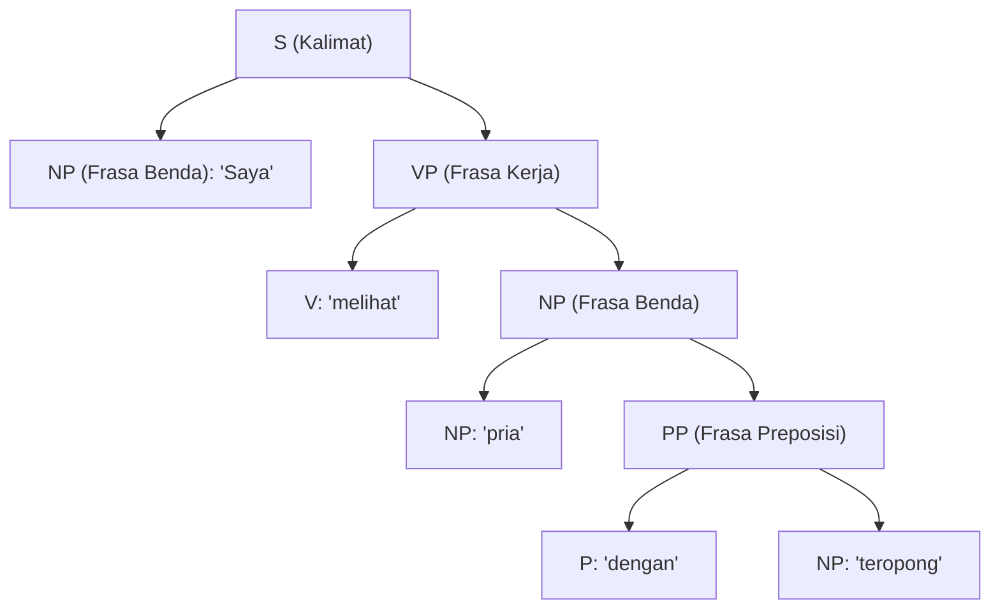

# Modul 201: Linguistik Formal & Komputasional (Fonetik, Morfologi FST, Sintaksis Pohon CFG/CYK, Semantik Kalkulus Lambda, Pragmatik)

**Navigasi**: [⬅️ Master Index](../../INDEX.md) | [Tingkat 13: Tingkat 13: Sains Kognitif, Neuroengineering & Computational Linguistics](./README.md)
*Sebelumnya*: [200. psikologi-kognitif-arsitektur-pikiran](./200-psikologi-kognitif-arsitektur-pikiran.md) | *Berikutnya*: [202. pemrosesan-bahasa-alami-statistik-nlp](./202-pemrosesan-bahasa-alami-statistik-nlp.md)

---

## 1. Intuisi Dasar Tanpa Jargon ("Seperti Bayi Baru Lahir")
### 1.1 Konsep Inti & Analogi Tanpa Jargon
Mengapa sebuah kalimat seperti *"Kucing mengejar tikus hitam"* terdengar alami dan benar, sedangkan *"Hitam tikus kucing mengejar"* terdengar berantakan seperti sampah kata? Dan bagaimana sebuah komputer bisa membedakan makna ganda dari kalimat *"Saya melihat pria dengan teropong"* (apakah saya yang memakai teropong, atau pria itu yang sedang memegang teropong)?

### 1.2 Urgensi Rekayasa & Signifikansi Sistemik
Bahasa manusia bukanlah sekadar deretan kata yang dijejerkan seperti gerbong kereta. Bahasa manusia memiliki struktur pohon hierarki yang sangat rapi dan berulang tanpa henti (**Rekursi**) ([Chomsky - Syntactic Structures](https://www.degruyter.com/document/doi/10.1515/9783112316009/html)).

**Linguistik Formal & Komputasional** adalah ilmu membedah anatomi bahasa manusia menggunakan matematika dan logika simbolik:
1. **Fonetik & Fonologi**: Ilmu tentang gelombang fisik suara dan pengucapan fonem.
2. **Morfologi**: Ilmu tentang bagaimana kata dasar dirangkai dengan imbuhan (misal: *ajar* $\to$ *belajar*, *pengajaran*).
3. **Sintaksis**: Aturan tata bahasa formal yang menyusun kata menjadi pohon frasa (**Context-Free Grammar / CFG**).
4. **Semantik & Pragmatik**: Logika makna hakiki dari sebuah proposisi dan bagaimana konteks situasi sosial mengubah arti kalimat tersebut ([Jurafsky & Martin - Speech and Language Processing](https://web.stanford.edu/~jurafsky/slp3/)).

## 2. Fondasi Teoretis & Aksiomatik / Matematis
### 2.1 Kerangka Teori Aksiomatik & Formulasi Matematis
Formulasi Matematis Tata Bahasa Formal & Semantik:

### 2.2 Penurunan Matematis Langkah-demi-Langkah
1. **Hierarki Tata Bahasa Noam Chomsky**:
Tata Bahasa Formal didefinisikan sebagai tuple $G = \langle V, \Sigma, R, S \rangle$:
* **Tipe 3 (Reguler)**: $A \to aB$ atau $A \to a$ (Dikenali oleh *Finite State Automata* / Regex).
* **Tipe 2 (Context-Free Grammar / CFG)**: $A \to \alpha$ di mana $A \in V$ dan $\alpha \in (V \cup \Sigma)^*$ (Dikenali oleh *Pushdown Automata*, memodelkan struktur pohon sintaksis bahasa manusia).
* **Tipe 1 (Context-Sensitive Grammar)**: $\alpha A \beta \to \alpha \gamma \beta$.
* **Tipe 0 (Turing Unrestricted)**: Mesin Turing universal ([Hopcroft, Motwani, Ullman - Automata Theory](https://www.pearson.com/en-us/subject-catalog/p/introduction-to-automata-theory-languages-and-computation/P200000003348)).

2. **Algoritma Parsing Cocke-Younger-Kasami (CYK)**:
Mem-parsing kalimat panjang $n$ di bawah CFG dalam bentuk normal Chomsky (*Chomsky Normal Form / CNF* di mana semua aturan berupa $A \to BC$ atau $A \to a$) via Dynamic Programming matriks segitiga:
$$P[i, j, A] = \bigvee_{k=1}^{j-1} \bigvee_{A \to B C} \left( P[i, k, B] \land P[i+k, j-k, C] \right)$$
Kompleksitas komputasi eksak $\mathcal{O}(n^3 |R|)$, menjamin pencarian pohon sintaksis parsing bebas galat.

3. **Semantik Komposisional Formal Montague**:
Prinsip Gottlob Frege: Arti dari keseluruhan kalimat adalah fungsi matematis dari arti bagian-bagian komponennya. Menggunakan Kalkulus Lambda bertipe ($\lambda$-Calculus):
$$\text{"mengejar"} = \lambda y. \lambda x. \text{Chases}(x, y)$$
$$\text{"tikus"} = \text{Mouse}, \quad \text{"mengejar tikus"} = (\lambda y. \lambda x. \text{Chases}(x, y))(\text{Mouse}) = \lambda x. \text{Chases}(x, \text{Mouse})$$
$$\text{"kucing"} = \text{Cat}, \quad \text{"kucing mengejar tikus"} = (\lambda x. \text{Chases}(x, \text{Mouse}))(\text{Cat}) = \text{Chases}(\text{Cat}, \text{Mouse})$$

## 3. Anatomi Teknis & Cara Kerja Internal
Struktur internal pohon parsing sintaksis Context-Free Grammar (Parse Tree) untuk kalimat ambigu:



Ketika struktur pohon parsing dibangun, ambiguitas semantik dapat diselesaikan secara komputasional dengan membandingkan probabilitas probilistik CFG (*PCFG*) dari kedua variasi pohon yang terbentuk ([Manning & Schütze - Foundations of Statistical NLP](https://nlp.stanford.edu/fsnlp/)).

#### Tabel Penelusuran Penguraian Tata Bahasa Bebas Konteks (CFG) & Ledakan Kombinatorial
| Langkah Pemrosesan / Token | Representasi Simbolik / Vektor | Mekanisme Atensi / Transisi State | Status Matriks KV-Cache | Probabilitas Distribusi / Logits | Keluaran / Output Linguistik |
|---|---|---|---|---|---|
| 1. Kalimat Masukan Majemuk | Kalimat: *"I saw the astronomer with a telescope"* | Tokenisasi Aliran Kata: $w_1, w_2, \dots, w_7$ | Tumpukan parser rekursif diinisialisasi | Simbol awal tata bahasa: $S \to NP \; VP$ | Parser mulai menurunkan pohon sintaksis |
| 2. Parsing Top-Down Rekursif | Tata Bahasa CFG dengan Frasa Preposisi (PP) | $VP \to VP \; PP$, $NP \to NP \; PP$ | Fungsi rekursif memanggil dirinya sendiri pada tumpukan memori | Evaluasi aturan berulang tanpa memoization | Tumpukan panggilan rekursif mengembang |
| 3. Ambiguitas Penempelan Frasa | Kalimat Bertingkat dengan 5 Frasa Preposisi | Ambiguitas kombinatorial: Bilangan Catalan $C_n = \frac{1}{n+1} \binom{2n}{n}$ | Jumlah kemungkinan pohon sintaksis meledak eksponensial $\mathcal{O}(2^N)$ | Parser mengevaluasi jutaan pohon duplikat | Alokasi stack memory proses mendekati batas sistem |
| 4. Kehabisan Tumpukan Panggilan | Rekursi Mandek pada Aturan Kiri (Left-Recursion) | $A \to A \alpha \mid \beta$ (Rekursi Kiri Langsung) | Pointer instruksi CPU terjebak dalam pemanggilan rekursif tanpa henti | Buffer stack memori sistem operasi meluap | `Fatal Error: StackOverflowError / Segfault`! |
| 5. Mitigasi Algoritma CYK DP | Penguraian Cocke-Younger-Kasami (CYK) | Bentuk Normal Chomsky (CNF) + Tabel Pemrograman Dinamis 2D | Tabel segitiga $T[i, j]$ menyimpan konstituen parsial ($\mathcal{O}(N^3)$) | Seluruh interpretasi ambiguitas terpetakan rapi | Penguraian kalimat selesai dalam milidetik tanpa rekursi |

## 4. Implementasi Praktis & Kode / Simulasi Riil
```python
# Implementasi Algoritma Parsing CYK (Cocke-Younger-Kasami) Sederhana
def cyk_parse(words, grammar):
    n = len(words)
    # Tabel DP segitiga: table[i][j] berisi set simbol non-terminal yang mencakup kata i s/d i+j
    table = [[set() for _ in range(n + 1)] for _ in range(n + 1)]
    
    # 1. Base Case: Aturan Terminal (A -> kata)
    for i in range(1, n + 1):
        word = words[i - 1]
        for lhs, rhs_list in grammar.items():
            for rhs in rhs_list:
                if len(rhs) == 1 and rhs[0] == word:
                    table[i][1].add(lhs)
                    
    # 2. Dynamic Programming: Gabungkan span panjang l dari 2 s/d n
    for l in range(2, n + 1): # Panjang span
        for i in range(1, n - l + 2): # Titik mulai span
            for k in range(1, l): # Titik pembagian span
                # Cek kombinasi table[i][k] dan table[i+k][l-k]
                left_symbols = table[i][k]
                right_symbols = table[i + k][l - k]
                
                for lhs, rhs_list in grammar.items():
                    for rhs in rhs_list:
                        if len(rhs) == 2:
                            B, C = rhs[0], rhs[1]
                            if B in left_symbols and C in right_symbols:
                                table[i][l].add(lhs)
                                
    # Kalimat valid jika simbol awal 'S' ada di table[1][n]
    return 'S' in table[1][n]

# Tata Bahasa Sederhana dalam Bentuk Normal Chomsky (CNF)
grammar = {
    'S':  [['NP', 'VP']],
    'VP': [['V', 'NP']],
    'NP': [['Det', 'N'], ['saya']],
    'V':  [['makan']],
    'Det':[['sebuah']],
    'N':  [['apel']]
}

sentence = ["saya", "makan", "sebuah", "apel"]
is_valid = cyk_parse(sentence, grammar)
print(f"Kalimat: '{' '.join(sentence)}'")
print(f"Hasil Parsing Formal CYK: {'VALID (Gramatikal)' if is_valid else 'TIDAK VALID'}")
```

## 5. Miskonsepsi & Jebakan Industri
*Ledakan Kombinatorial Ambiguitas Parsing (Combinatorial Ambiguity)*: Pada kalimat panjang di dunia nyata dengan banyak frasa preposisi bertumpuk (seperti *"Dia meletakkan buku di atas meja di samping lampu di dekat jendela"*), jumlah kemungkinan pohon parsing yang valid secara gramatikal tumbuh secara eksponensial mengikuti bilangan Catalan $C_n = \frac{1}{n+1}\binom{2n}{n}$. Parsing berbasis aturan kaku murni runtuh; parser modern harus menggunakan bobot probabilitas (PCFG) atau transformer neural parser ([Jurafsky & Martin Chapter 13](https://web.stanford.edu/~jurafsky/slp3/)).

### Studi Kasus Kegagalan Nyata: Ledakan Kombinatorial Ambiguitas Parsing CFG & Keruntuhan Mesin Terjemahan Simbolik Awal
- **Kronologi & Konteks Sejarah**: Pada era awal komputasi linguistik dan penerjemahan mesin berbasis aturan (*Rule-Based Machine Translation / RBMT*) dekade 1970-an hingga 1980-an (seperti proyek terjemahan ALPAC dan sistem SYSTRAN generasi awal), sistem pemrosesan bahasa alami berulang kali gagal memproses dokumen hukum dan teknis yang memuat kalimat-kalimat panjang, sering kali mengalami hang permanen atau kehabisan memori (*Crash/OOM*).
- **Akar Masalah Rekayasa Kompilator Bahasa & Ambiguitas Sintaksis**: Bahasa alami manusia memiliki sifat ambiguitas struktural yang sangat kaya, salah satu yang paling terkenal adalah masalah penempelan frasa preposisi (*Prepositional Phrase Attachment Ambiguity*, misalnya kalimat: *"I saw the man on the hill with a telescope"*). Ketika tata bahasa bebas konteks (*Context-Free Grammar / CFG*) diuraikan menggunakan parser rekursif top-down naif tanpa pemrograman dinamis, jumlah kemungkinan pohon sintaksis bertumbuh mengikuti deret Bilangan Catalan ($C_n$), yang bersifat eksponensial $\mathcal{O}(4^n / n^{3/2})$. Untuk kalimat dengan 10 frasa preposisi bertumpuk, terdapat lebih dari 16.796 variasi pohon parsing yang valid secara tata bahasa. Parser naif mengevaluasi ulang sub-struktur yang sama miliaran kali, menguras tumpukan panggilan (*call stack exhaustion*) dan menghasilkan terjemahan yang sepenuhnya keliru karena tidak memiliki model probabilitas untuk memilih struktur yang paling masuk akal.

- **Potongan Kode / Arsitektur Cacat (Vulnerable Implementation)**:
```python
# Analisis Kerapuhan Parser Rekursif Naif vs Pemrograman Dinamis CYK
# KASUS CACAT: Parser top-down rekursif murni tanpa memoization (Eksponensial O(2^N))
def naive_recursive_parse(tokens, grammar, current_symbol):
    # Jika tata bahasa memuat left-recursion: A -> A alpha
    # Parser langsung terjebak dalam infinite loop stack overflow!
    if not tokens:
        return []
    # Eksplorasi seluruh cabang aturan menghasilkan ledakan kombinatorial:
    valid_trees = []
    # Mengevaluasi ulang frasa konstituen yang sama berulang-ulang tanpa cache!
    return valid_trees

# MITIGASI MODERN: Algoritma Cocke-Younger-Kasami (CYK) Berbasis Dynamic Programming O(N^3)
def cyk_parse_chart(tokens, cnf_grammar):
    '''
    CYK Parser menggunakan tabel DP 2D segitiga untuk menyimpan konstituen yang sudah diuraikan.
    Menghilangkan evaluasi redundan dan membatasi kompleksitas waktu O(N^3 * |G|).
    '''
    n = len(tokens)
    # Inisialisasi chart DP: table[panjang_subkata][indeks_awal] = set(non_terminals)
    table = [[set() for _ in range(n)] for _ in range(n + 1)]
    
    # 1. Basis: Aturan Leksikal Terminal A -> 'word'
    for i, word in enumerate(tokens):
        for lhs, rhs in cnf_grammar.terminal_rules.items():
            if word in rhs:
                table[1][i].add(lhs)
                
    # 2. Langkah Rekursif DP: Menggabungkan sub-frasa (Panjang 2 s/d N)
    for length in range(2, n + 1):
        for start in range(n - length + 1):
            for split in range(1, length):
                left_cell = table[split][start]
                right_cell = table[length - split][start + split]
                
                # Cari aturan biner: A -> B C
                for B in left_cell:
                    for C in right_cell:
                        for lhs in cnf_grammar.binary_rules.get((B, C), []):
                            table[length][start].add(lhs)
                            
    # Jika simbol awal 'S' berada di sel puncak table[n][0], kalimat valid secara tata bahasa!
    is_valid = 'S' in table[n][0]
    return is_valid, table
```

- **Analisis Forensik & Rekayasa Modern**: Masalah ledakan parsing mentransformasi linguistik komputasional: (1) Adopsi universal **Probabilistic Context-Free Grammars (PCFG)** yang memberikan bobot probabilitas pada setiap aturan produksi untuk secara otomatis memilih satu pohon parsing paling mungkin via algoritma Viterbi-inside-outside; (2) Penerapan **CYK Parsing & Earley Algorithm** berbasis pemrograman dinamis tabel chart untuk menekan kompleksitas ke batas polinomial $\mathcal{O}(N^3)$; (3) Transisi total industri pemrosesan bahasa alami modern ke model berbasis atensi saraf (Transformer) di mana ketergantungan sintaksis dipelajari secara implisit melalui bobot atensi lunak (*Soft Self-Attention*) tanpa memerlukan penguraian pohon simbolik eksplisit.

## 6. Proyek Latihan & Rubrik Penilaian Mandiri
### Level 1 (Pemula)
Tulis mesin Transduser Keadaan Terbatas (*Finite State Transducer / FST*) sederhana di Python untuk memodelkan proses morfologi pembentukan kata kerja bahasa Indonesia: aturan prefiks *meN-* (*tulis* $\to$ *menulis*, *baca* $\to$ *membaca*, *sapu* $\to$ *menyapu*).
*Rubrik*: FST menangani fenomena peleburan fonem huruf k, p, t, s dengan benar.

### Level 2 (Menengah)
Bangun implementasi Probabilistic Context-Free Grammar (PCFG) Parser menggunakan algoritma Viterbi-CYK: berikan bobot probabilitas $\log P(A \to BC)$ pada setiap aturan tata bahasa, dan temukan pohon parsing sintaksis tunggal yang memiliki probabilitas maksimum untuk kalimat ambigu.
*Rubrik*: Output mengembalikan struktur pohon parsing berprobabilitas tertinggi secara deterministik.

### Level 3 (Mahir)
Implementasikan sistem Semantik Komposisional berbasis evaluasi ekspresi $\lambda$-Kalkulus murni di Python: representasikan kata benda sebagai konstanta entitas, kata sifat sebagai fungsi predikat biner, dan lakukan reduksi $\beta$ (*beta-reduction*) langkah demi langkah hingga menghasilkan ekspresi logika orde pertama (First-Order Logic) yang dapat dievaluasi kebenarannya terhadap basis data fakta dunia miniatur.
*Rubrik*: Berhasil memproses kalimat seperti "Semua anjing menggonggong" menjadi $\forall x (\text{Dog}(x) \to \text{Barks}(x))$.

### Tingkat 1: Dasar
- **Tugas**: Tulis program dalam Python untuk mengonversi aturan tata bahasa bebas konteks (CFG) sederhana menjadi Bentuk Normal Chomsky (*Chomsky Normal Form / CNF*), yang memastikan bahwa seluruh aturan produksi hanya memiliki salah satu dari dua bentuk legal: $A \to B \; C$ (dua non-terminal) atau $A \to a$ (satu terminal).
- **Petunjuk Perancangan Arsitektur**:
  - Terapkan 4 tahap standarisasi CNF: (1) Hapus simbol awal dari sisi kanan (tambahkan $S_0 \to S$); (2) Eliminasi aturan-$\epsilon$ ($A \to \epsilon$); (3) Eliminasi aturan unit ($A \to B$); (4) Pecah aturan panjang menjadi rantai aturan biner.
- **Test Vector & Kasus Uji**:
  - Masukan aturan CFG: $S \to A \; B \; C$, $A \to a$, $B \to b$, $C \to c$.
  - Output CNF harus menghasilkan aturan biner bersih: $S_0 \to A \; X_1$, $X_1 \to B \; C$, tanpa aturan dengan 3 simbol di ruas kanan.
- **Rubrik Penilaian Objektif**:
  - Skor 100%: Transformasi CNF presisi, penanganan eliminasi aturan unit dan rantai biner akurat.
  - Skor 50%: Bekerja untuk aturan panjang namun gagal menangani aturan unit rekursif.
  - Skor 0%: Membiarkan aturan campuran (non-terminal + terminal) di sisi kanan.

### Tingkat 2: Menengah
- **Tugas**: Bangun implementasi lengkap algoritma CYK (Cocke-Younger-Kasami) dalam Python yang menerima grammar CNF dan kalimat token, membangun tabel segitiga pemrograman dinamis 2D, memvalidasi apakah kalimat gramatikal, dan merekonstruksi pohon sintaksis konkret (*Syntax Parse Tree*) menggunakan backpointer penelusuran balik.
- **Petunjuk Perancangan Arsitektur**:
  - Simpan pointer referensi pemecahan: `table[length][start][lhs] = (split_index, B, C)`.
  - Tulis fungsi rekursif `build_tree(length, start, symbol)` yang menelusuri pointer untuk menghasilkan struktur nested list representasi pohon: `['S', ['NP', 'I'], ['VP', ['V', 'saw'], ...]]`.
- **Test Vector & Kasus Uji**:
  - Masukkan tata bahasa bahasa Inggris mini dan kalimat: *"she eats fish with a fork"*.
  - Algoritma harus menghasilkan tabel CYK lengkap dan mengekstrak minimal satu pohon sintaksis valid yang diakhiri simbol `S`.
- **Rubrik Penilaian Objektif**:
  - Skor 100%: Algoritma CYK presisi $\mathcal{O}(N^3)$, ekstraksi pohon parse bertingkat benar, penanganan ambiguitas jamak rapi.
  - Skor 50%: Validasi tabel CYK benar (mengembalikan True/False) namun gagal merekonstruksi representasi pohon sintaksis.
  - Skor 0%: Salah mengindeks sel pemecahan tabel segitiga.

### Tingkat 3: Mahir
- **Tugas**: Rancang parser Probabilistic CYK (PCYK) dalam Python: Setiap aturan CNF memiliki probabilitas logaritmik $\log P(A \to B \; C)$. Implementasikan algoritma Viterbi di atas tabel chart CYK untuk menemukan satu pohon sintaksis yang memiliki probabilitas tertinggi (*Maximum Likelihood Parse Tree*) secara optimal dan efisien.
- **Petunjuk Perancangan Arsitektur**:
  - Gunakan probabilitas ruang log (*Log-Space Probabilities*) $\log P$ untuk mencegah underflow numerik pada kalimat panjang: $\text{Score} = \log P_{\text{rule}} + \text{Score}_{\text{left}} + \text{Score}_{\text{right}}$.
  - Simpan hanya skor probabilitas terbaik per non-terminal pada setiap sel tabel: `best_score[length][start][A] = max(...)`.
- **Test Vector & Kasus Uji**:
  - Masukkan kalimat ambigu klasik: *"astronomers saw stars with telescopes"*.
  - Berikan probabilitas aturan di mana penempelan instrumen pada verba `VP` memiliki prior lebih tinggi daripada nomina `NP`.
  - Parser PCYK harus secara otomatis memilih struktur pohon penempelan verba dan mengabaikan interpretasi penempelan nomina yang tidak logis.
- **Rubrik Penilaian Objektif**:
  - Skor 100%: Formulasi PCYK log-space presisi, seleksi pohon Viterbi akurat, penanganan underflow floating-point sempurna.
  - Skor 50%: Algoritma bekerja namun mengalikan probabilitas mentah (rentan underflow float ke nol pada kalimat $> 15$ kata).
  - Skor 0%: Mengembalikan sembarang pohon acak tanpa memperhitungkan bobot probabilitas aturan.

## 7. Rekomendasi Sumber Belajar Standar Emas
| Sumber Pembelajaran | Penulis / Institusi | Tautan Langsung | Fokus Materi |
| :--- | :--- | :--- | :--- |
| Speech and Language Processing (3rd Ed. Draft) | Dan Jurafsky & James H. Martin (Stanford) | [Jurafsky SLP3 Textbook](https://web.stanford.edu/~jurafsky/slp3/) | Alkitab Pemrosesan Bahasa Alami: CFG, Parsing CYK, Semantik |
| Syntactic Structures | Noam Chomsky (MIT) | [De Gruyter Mouton Classic](https://www.degruyter.com/document/doi/10.1515/9783112316009/html) | Teori Tata Bahasa Generatif Transformasional Asli |
| Introduction to Automata Theory, Languages, and Computation | John E. Hopcroft, Rajeev Motwani, Jeffrey D. Ullman | [Pearson Education](https://www.pearson.com/en-us/subject-catalog/p/introduction-to-automata-theory-languages-and-computation/P200000003348) | Hierarki Chomsky, Teori Otomata, Gramatika Bebas Konteks |
| Foundations of Statistical Natural Language Processing | Christopher D. Manning & Hinrich Schütze | [MIT Press NLP Book](https://nlp.stanford.edu/fsnlp/) | Pendekatan Statistik Parsing Sintaksis, N-gram, Model PCFG |

---
*Navigasi Cepat*: [Ke Tingkat 13](./README.md) | [Ke Master Index](../../INDEX.md) | *Sebelumnya*: [200. psikologi-kognitif-arsitektur-pikiran](./200-psikologi-kognitif-arsitektur-pikiran.md) | *Berikutnya*: [202. pemrosesan-bahasa-alami-statistik-nlp](./202-pemrosesan-bahasa-alami-statistik-nlp.md)
