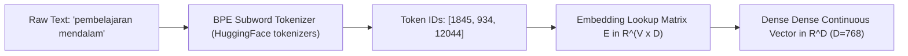

# Modul 202: Pemrosesan Bahasa Alami Statistik / NLP (Model Bahasa N-Gram, Tokenisasi BPE/WordPiece, Word2Vec, GloVe, CRF)

**Navigasi**: [⬅️ Master Index](../../INDEX.md) | [Tingkat 13: Tingkat 13: Sains Kognitif, Neuroengineering & Computational Linguistics](./README.md)
*Sebelumnya*: [201. linguistik-formal-komputasional](./201-linguistik-formal-komputasional.md) | *Berikutnya*: [203. arsitektur-transformer-mekanisme-atensi](./203-arsitektur-transformer-mekanisme-atensi.md)

---

## 1. Intuisi Dasar Tanpa Jargon ("Seperti Bayi Baru Lahir")
Bagaimana komputer bisa mengerti kata-kata manusia? Bagi komputer, sebuah kata hanyalah deretan karakter biner tanpa jiwa. Jika Anda merepresentasikan kata sebagai angka ID alfabet biasa (misal: "Kucing" = 1, "Anjing" = 2, "Pesawat" = 3), komputer tidak tahu bahwa kucing dan anjing memiliki banyak kesamaan (keduanya hewan berkaki empat berbulu), sedangkan pesawat adalah mesin terbang ([Mikolov et al. - Efficient Estimation of Word Representations in Vector Space](https://arxiv.org/abs/1301.3781)).

Linguis J. R. Firth (1957) merumuskan hipotesis terkenal: *"You shall know a word by the company it keeps"* (Anda akan mengenali arti suatu kata dari teman-teman kata yang sering muncul di sampingnya) ([Firth - A Synopsis of Linguistic Theory 1930-1955](https://www.jstor.org/stable/410886)).

Inilah fondasi **Word Embedding (seperti Word2Vec dan GloVe)**: memetakan setiap kata menjadi panah vektor dalam ruang geometri berdimensi 300 ([Pennington et al. - GloVe: Global Vectors for Word Representation](https://nlp.stanford.edu/pubs/glove.pdf)). Dalam ruang ini, kata-kata yang bermakna mirip akan mengelompok bersama secara otomatis, dan yang menakjubkan, kita bisa melakukan perhitungan aljabar matematika pada makna konsep kata:
$$\vec{v}_{\text{Raja}} - \vec{v}_{\text{Pria}} + \vec{v}_{\text{Wanita}} \approx \vec{v}_{\text{Ratu}}$$
Sebelum kata bisa dipetakan ke vektor, teks harus dipotong menjadi sub-kata menggunakan algoritma **Byte Pair Encoding (BPE)** agar komputer tidak pernah bingung saat menghadapi kata baru yang belum pernah dilihat sebelumnya ([Sennrich et al. - Neural Machine Translation of Rare Words with Subword Units](https://arxiv.org/abs/1508.07909)).

## 2. Fondasi Teoretis & Aksiomatik / Matematis
Formulasi Matematis NLP Statistik & Representasi Vektor:

1. **Pemodelan Bahasa N-Gram & Smoothing Kneser-Ney**:
Probabilitas sekuens kata di bawah asumsi rantai Markov orde $(n-1)$:
$$P(w_1, \dots, w_T) = \prod_{t=1}^T P(w_t \mid w_{t-n+1}, \dots, w_{t-1})$$
Kneser-Ney Smoothing menyisipkan probabilitas kelanjutan (*continuation probability*) $P_{KN}$:
$$P_{KN}(w_i \mid w_{i-1}) = \frac{\max(C(w_{i-1}, w_i) - d, 0)}{C(w_{i-1})} + \lambda(w_{i-1}) \frac{|\{w' : C(w', w_i) > 0\}|}{\sum_{w} |\{w' : C(w', w) > 0\}|}$$

2. **Algoritma Tokenisasi Byte Pair Encoding (BPE)**:
Dimulai dari kosakata karakter dasar. Secara iteratif menghitung pasangan byte/simbol berdekatan yang memiliki frekuensi kemunculan tertinggi $p^* = \arg\max_p \text{Count}(p)$ dan menggabungkannya (*merge*) menjadi satu token baru hingga mencapai ukuran kosakata target $V$ ([Gage - A New Algorithm for Data Compression](https://www.drdobbs.com/a-new-algorithm-for-data-compression/184402829)).

3. **Word2Vec Skip-Gram dengan Negative Sampling (SGNS)**:
Memaksimalkan probabilitas kata konteks $w_c$ diberikan kata target $w_t$ sambil meminimalkan probabilitas $k$ kata derau acak $w_{n_j} \sim P_n(w)$ ([Mikolov et al. NeurIPS 2013](https://arxiv.org/abs/1310.4546)):
$$\mathcal{L}_{\text{SGNS}} = \sum_{t=1}^T \sum_{-c \le j \le c, j \neq 0} \left[ \ln \sigma(v'_{w_{t+j}}^T v_{w_t}) + \sum_{i=1}^k \mathbb{E}_{w_{n_i} \sim P_n(w)} \left[ \ln \sigma(-v'_{w_{n_i}}^T v_{w_t}) \right] \right]$$

4. **Global Vectors for Word Representation (GloVe)**:
Memfaktorkan matriks ko-okurensi logaritmik global $X_{ij}$:
$$J = \sum_{i, j=1}^V f(X_{ij}) \left( w_i^T \tilde{w}_j + b_i + \tilde{b}_j - \ln X_{ij} \right)^2, \quad f(x) = \min\left(1, \left(\frac{x}{x_{\max}}\right)^\alpha\right)$$

## 3. Anatomi Teknis & Cara Kerja Internal
Arsitektur pipeline tokenisasi BPE dan komputasi embedding Skip-Gram Word2Vec:



Dengan tokenisasi sub-kata BPE, representasi kosakata tertutup rapat: kata-kata langka atau typo didekonstruksi menjadi potongan suku kata dasar tanpa pernah menghasilkan token *Out-Of-Vocabulary (OOV)* ([Sennrich et al. BPE Paper](https://arxiv.org/abs/1508.07909)).

## 4. Implementasi Praktis & Kode / Simulasi Riil
```python
import collections

# 1. Implementasi Algoritma Byte Pair Encoding (BPE) Mini dari Nol
def train_bpe(corpus, num_merges=10):
    # Inisialisasi korpus menjadi karakter terpisah dengan simbol akhir kata '</w>'
    vocab = collections.defaultdict(int)
    for word, freq in corpus.items():
        tokens = " ".join(list(word)) + " </w>"
        vocab[tokens] = freq
        
    merges = []
    for step in range(num_merges):
        pairs = collections.defaultdict(int)
        for word_str, freq in vocab.items():
            symbols = word_str.split()
            for i in range(len(symbols) - 1):
                pairs[(symbols[i], symbols[i+1])] += freq
                
        if not pairs:
            break
            
        best_pair = max(pairs, key=pairs.get)
        merges.append(best_pair)
        
        # Gabungkan pasangan terbaik di seluruh kosakata
        new_vocab = {}
        bigram = " ".join(best_pair)
        replacement = "".join(best_pair)
        for word_str, freq in vocab.items():
            new_word = word_str.replace(bigram, replacement)
            new_vocab[new_word] = freq
        vocab = new_vocab
        
    return merges, vocab

# Korpus Contoh Teks Bahasa Indonesia
raw_corpus = {"kucing": 5, "kucingku": 3, "anjing": 4, "anjingku": 2, "kucingan": 1}
bpe_merges, final_vocab = train_bpe(raw_corpus, num_merges=6)

print("Aturan Penggabungan BPE (Merges Teratas):")
for idx, pair in enumerate(bpe_merges, start=1):
    print(f"Merge #{idx}: {pair[0]} + {pair[1]} -> {''.join(pair)}")

print("\nKosakata Akhir Terbina:")
for tokenized_word in final_vocab.keys():
    print(f" - {tokenized_word}")
```

## 5. Miskonsepsi & Jebakan Industri
*Ambiguitas Polisemi pada Static Word Embeddings*: Model seperti Word2Vec atau GloVe menetapkan tepat satu vektor statis untuk setiap kata. Kata seperti "bisa" (racun ular vs mampu melakukan sesuatu) atau "apel" (buah vs upacara militer) dipaksa berbagi satu titik koordinat yang sama, mencampuradukkan makna semantiknya. Keterbatasan inilah yang memicu lahirnya *Contextual Word Embeddings* (BERT, GPT, dan Transformers) di mana representasi vektor kata berubah secara dinamis sesuai konteks kalimatnya ([Peters et al. - Deep Contextualized Word Representations / ELMo](https://arxiv.org/abs/1802.05365)).

## 6. Proyek Latihan & Rubrik Penilaian Mandiri
### Level 1 (Pemula)
Bangun model bahasa Bi-Gram dan Tri-Gram sederhana dengan Laplace Add-1 Smoothing di Python, dan hitung nilai perplexity model pada kalimat uji baru.
*Rubrik*: Perplexity terhitung secara matematis $PP(W) = \exp\left(-\frac{1}{N}\sum \ln P(w_i \mid w_{i-1})\right)$.

### Level 2 (Menengah)
Implementasikan arsitektur Continuous Bag-of-Words (CBOW) Word2Vec sederhana di PyTorch: rancang lapisan embedding input dan output, latih menggunakan Negative Sampling loss pada korpus teks mini, dan buktikan kata-kata yang sering muncul bersamaan memiliki nilai kemiripan kosinus (*Cosine Similarity*) $> 0.7$.
*Rubrik*: Menghasilkan matriks embedding berdimensi 50 dan fungsi pencarian k-tetangga terdekat.

### Level 3 (Mahir)
Implementasikan algoritma penandaan urutan *Linear-Chain Conditional Random Field (CRF)* untuk Named Entity Recognition (NER) dari awal: turunkan algoritma Forward-Backward untuk menghitung fungsi partisi normalisasi $Z(x)$, implementasikan Viterbi decoding untuk inferensi urutan label optimal, dan bandingkan performa terhadap model klasifikasi independen token.
*Rubrik*: Mengeliminasi prediksi transisi status yang tidak valid (misal: token `I-PER` tanpa diawali `B-PER`).

## 7. Rekomendasi Sumber Belajar Standar Emas
| Sumber Pembelajaran | Penulis / Institusi | Tautan Langsung | Fokus Materi |
| :--- | :--- | :--- | :--- |
| Efficient Estimation of Word Representations in Vector Space (Word2Vec) | Tomas Mikolov et al. (Google) | [arXiv Word2Vec Paper](https://arxiv.org/abs/1301.3781) | Algoritma Skip-Gram, Continuous Bag-of-Words, Neg-Sampling |
| GloVe: Global Vectors for Word Representation | Jeffrey Pennington, Richard Socher, Christopher D. Manning | [Stanford NLP Paper](https://nlp.stanford.edu/pubs/glove.pdf) | Faktorisasi Matriks Ko-Okurensi Logaritmik Global |
| Neural Machine Translation of Rare Words with Subword Units (BPE) | Rico Sennrich, Barry Haddow, Alexandra Birch | [arXiv BPE Paper](https://arxiv.org/abs/1508.07909) | Standar Baku Industri Tokenisasi Sub-Kata pada LLM |
| Speech and Language Processing (Chapter 6: Vector Semantics) | Dan Jurafsky & James H. Martin | [Jurafsky SLP3 Chapter 6](https://web.stanford.edu/~jurafsky/slp3/6.pdf) | Teori Semantik Vektor, Cosine Similarity, Evaluasi Analogi |

---
*Navigasi Cepat*: [Ke Tingkat 13](./README.md) | [Ke Master Index](../../INDEX.md) | *Sebelumnya*: [201. linguistik-formal-komputasional](./201-linguistik-formal-komputasional.md) | *Berikutnya*: [203. arsitektur-transformer-mekanisme-atensi](./203-arsitektur-transformer-mekanisme-atensi.md)
