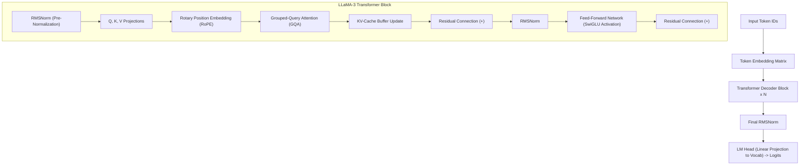

# Modul 203: Arsitektur Transformer & Mekanisme Atensi (Scaled Dot-Product Attention, Multi-Head / Grouped-Query, RoPE, KV-Cache)

**Navigasi**: [⬅️ Master Index](../../INDEX.md) | [Tingkat 13: Tingkat 13: Sains Kognitif, Neuroengineering & Computational Linguistics](./README.md)
*Sebelumnya*: [202. pemrosesan-bahasa-alami-statistik-nlp](./202-pemrosesan-bahasa-alami-statistik-nlp.md) | *Berikutnya*: [204. paradigma-pra-pelatihan-taksonomi-llm](./204-paradigma-pra-pelatihan-taksonomi-llm.md)

---

## 1. Intuisi Dasar Tanpa Jargon ("Seperti Bayi Baru Lahir")
### 1.1 Konsep Inti & Analogi Tanpa Jargon
Sebelum tahun 2017, komputer membaca kalimat seperti orang membaca buku melalui lubang sedotan sempit (RNN/LSTM): kata demi kata secara berurutan. Ketika komputer sampai di kata ke-100, ingatan tentang kata ke-1 sudah memudar dan kabur. Selain itu, komputer tidak bisa membaca seluruh halaman secara serentak karena harus menunggu kata sebelumnya selesai diproses ([Vaswani et al. - Attention Is All You Need](https://arxiv.org/abs/1706.03762)).

### 1.2 Urgensi Rekayasa & Signifikansi Sistemik
Lalu datanglah **Transformer**: arsitektur kecerdasan buatan paling berpengaruh di abad ke-21 yang menjadi otak di balik ChatGPT, Claude, Gemini, dan LLaMA!

Transformer membuang seluruh loop rekursif dan menggantinya dengan **Mekanisme Atensi Mandiri (Self-Attention)**. Bayangkan setiap kata di dalam kalimat mengadakan pesta di mana semua kata saling menatap dan mengobrol satu sama lain secara serempak. Setiap kata memiliki 3 peran:
1. **Query ($Q$)**: *"Saya sedang mencari informasi tentang apa?"*
2. **Key ($K$)**: *"Topik apa yang saya tawarkan kepada orang lain?"*
3. **Value ($V$)**: *"Informasi aktual apa yang saya miliki?"*

Jika kecocokan antara pertanyaan kata A ($Q$) dan tawaran kata B ($K$) sangat tinggi, kata A akan memperhatikan kata B secara tajam dan menyerap informasinya ($V$) ([The Illustrated Transformer by Jay Alammar](https://jalammar.github.io/illustrated-transformer/)).

## 2. Fondasi Teoretis & Aksiomatik / Matematis
### 2.1 Kerangka Teori Aksiomatik & Formulasi Matematis
Formulasi Matematis Arsitektur Transformer Modern:

### 2.2 Penurunan Matematis Langkah-demi-Langkah
1. **Scaled Dot-Product Attention**:
Untuk matriks representasi $Q, K, V \in \mathbb{R}^{N \times d_k}$:
$$\text{Attention}(Q, K, V) = \text{Softmax}\left( \frac{Q K^T}{\sqrt{d_k}} + M \right) V$$
Faktor penskalaan $\frac{1}{\sqrt{d_k}}$ mencegah nilai dot-product menjadi terlalu besar yang akan mendorong Softmax ke wilayah dengan gradien yang sangat kerdil (*vanishing gradients*). Matriks masking kausal $M_{ij} = -\infty$ untuk $j > i$ mencegah model decoder mengintip kata masa depan.

2. **Rotary Position Embedding (RoPE)**:
Mengenkode informasi posisi relatif langsung ke dalam perkalian dot-product query-key melalui perkalian matriks rotasi ortogonal 2D ([Su et al. - RoFormer: Enhanced Transformer with Rotary Position Embedding](https://arxiv.org/abs/2104.09864)):
$$\langle R_{\Theta, m}^d q_m, R_{\Theta, n}^d k_n \rangle = q_m^T R_{\Theta, n-m}^d k_n = g(q_m, k_n, m - n)$$
Di mana matriks rotasi blok ortogonal didefinisikan dengan sudut frekuensi $\theta_i = b^{-2(i-1)/d}$.

3. **Multi-Head vs Multi-Query vs Grouped-Query Attention (GQA)**:
Menghemat ukuran memori KV-Cache selama inferensi ([Ainslie et al. - GQA: Training Generalized Multi-Query Transformer Models](https://arxiv.org/abs/2305.13245)):
* Multi-Head Attention (MHA): $H$ query heads, $H$ key heads, $H$ value heads.
* Multi-Query Attention (MQA): $H$ query heads, 1 key head tunggal, 1 value head tunggal.
* Grouped-Query Attention (GQA): $H$ query heads dibagi menjadi $G$ kelompok, masing-masing kelompok berbagi 1 key dan value head (digunakan oleh LLaMA-3).

4. **Ukuran Memori KV-Cache pada Tahap Autoregresif Generasi**:
$$\text{KV-Cache Memory per Token} = 2 \times 2 \times n_{\text{layers}} \times n_{\text{kv\_heads}} \times d_{\text{head}} \text{ bytes (FP16)}$$

## 3. Anatomi Teknis & Cara Kerja Internal
Arsitektur tumpukan Transformer Decoder Modern (LLaMA-3 Style) dengan RoPE, RMSNorm, dan KV-Cache:



Dengan KV-Cache, selama tahap decoding autoregresif (menghasilkan kata demi kata berikutnya), representasi vektor $K$ dan $V$ dari kata-kata sebelumnya disimpan di VRAM GPU dan tidak dihitung ulang, memotong waktu komputasi per token dari $\mathcal{O}(N)$ menjadi $\mathcal{O}(1)$ operasi matriks-vektor ([Pope et al. - Efficiently Scaling Transformer Inference](https://arxiv.org/abs/2211.05102)).

#### Tabel Penelusuran Perhitungan Matriks Atensi Transformer & Overflow Numerik Softmax
| Langkah Pemrosesan / Token | Representasi Simbolik / Vektor | Mekanisme Atensi / Transisi State | Status Matriks KV-Cache | Probabilitas Distribusi / Logits | Keluaran / Output Linguistik |
|---|---|---|---|---|---|
| 1. Matriks Proyeksi Q dan K | Query $Q \in \mathbb{R}^{N \times d_k}$, Key $K \in \mathbb{R}^{N \times d_k}$ | Dimensi Head Besar: $d_k = 128$ | Bobot proyeksi linier $W_Q, W_K$ aktif | Inisialisasi tensor aktivasi float32 di VRAM | Konteks token masukan $N = 4096$ |
| 2. Perkalian Titik Tanpa Penskalaan | Matriks Skor $S = Q K^T \in \mathbb{R}^{N \times N}$ | Varians skor atensi membesar: $\text{Var}(S) \approx d_k = 128$ | Magnitudo skor $S_{i, j}$ melonjak hingga $> 95.0$ | Memori VRAM mengalokasikan $4096 \times 4096 \times 4\text{B} = 67\text{ MB}$ | Nilai eksponensial $e^{95}$ meluap |
| 3. Ledakan Overflow Softmax | Fungsi Softmax Naif: $\frac{e^{S_{i, j}}}{\sum e^{S_{i, k}}}$ | Evaluasi floating-point float32: $e^{95} \to \infty$ (`inf`) | Pembagian $\frac{\infty}{\infty}$ menghasilkan status tidak terdefinisi | Seluruh baris probabilitas terisi `NaN`! | Gradien backward pass runtuh seketika |
| 4. Memori Kuadratik Konteks Panjang | Perluasan Panjang Konteks $N \to 32.768$ | Alokasi matriks skor $S \in \mathbb{R}^{32k \times 32k}$ | Matriks atensi membutuhkan $4.29$ GB VRAM per head! | Dengan 32 layer dan 32 head, memori meledak $> 4\text{ TB}$! | GPU melontarkan `CUDA out of memory` (OOM)! |
| 5. Mitigasi Penskalaan & FlashAttention | $S = \frac{Q K^T}{\sqrt{d_k}}$ + Safe Softmax $S - \max(S)$ | Penskalaan $\sqrt{128} \approx 11.31$ menjaga varians skor $= 1.0$ | Tiling FlashAttention mengeksekusi atensi di SRAM GPU | Softmax stabil, alokasi memori VRAM kuadratik dieliminasi | Inferensi dan pelatihan berjalan mulus pada konteks 128k token |

## 4. Implementasi Praktis & Kode / Simulasi Riil
```python
import torch
import torch.nn as nn
import torch.nn.functional as F
import math

# 1. Scaled Dot-Product Attention Mandiri dengan Masking Kausal
def scaled_dot_product_attention(Q, K, V, mask=None):
    # Q, K, V shape: (batch_size, n_heads, seq_len, d_k)
    d_k = Q.size(-1)
    scores = torch.matmul(Q, K.transpose(-2, -1)) / math.sqrt(d_k)
    
    if mask is not None:
        scores = scores.masked_fill(mask == 0, -1e9)
        
    attn_weights = F.softmax(scores, dim=-1)
    output = torch.matmul(attn_weights, V)
    return output, attn_weights

# 2. Rotary Position Embedding (RoPE) 1D Sederhana
def apply_rotary_pos_emb(x, freqs):
    # x shape: (batch, seq_len, d_model)
    # Putar pasangan koordinat (x1, x2) -> (x1*cos - x2*sin, x1*sin + x2*cos)
    d = x.shape[-1]
    x1, x2 = x[..., 0::2], x[..., 1::2]
    cos = torch.cos(freqs)
    sin = torch.sin(freqs)
    
    out1 = x1 * cos - x2 * sin
    out2 = x1 * sin + x2 * cos
    return torch.stack([out1, out2], dim=-1).flatten(-2)

# Uji Coba Komputasi Atensi
B, H, S, D = 2, 4, 8, 64
q = torch.randn(B, H, S, D)
k = torch.randn(B, H, S, D)
v = torch.randn(B, H, S, D)

# Masking Kausal Segitiga Bawah (Model hanya boleh melihat masa lalu)
causal_mask = torch.tril(torch.ones(S, S)).unsqueeze(0).unsqueeze(0)

out, weights = scaled_dot_product_attention(q, k, v, mask=causal_mask)
print(f"Output Attention Shape: {out.shape}")
print(f"Matriks Bobot Atensi Baris ke-0 (Hanya melihat token 0):\n{weights[0, 0, 0, :].numpy()}")
print(f"Matriks Bobot Atensi Baris ke-3 (Melihat token 0, 1, 2, 3):\n{weights[0, 0, 3, :].numpy()}")
assert torch.all(weights[0, 0, 0, 1:] == 0.0), "Kausalitas masa depan tidak boleh bocor!"
```

## 5. Miskonsepsi & Jebakan Industri
*Ledakan Memori KV-Cache pada Konteks Panjang*: Pada panjang konteks ekstrem (misal 128k token), KV-Cache untuk model seperti LLaMA-70B dapat mengonsumsi lebih dari 40GB VRAM hanya untuk satu sesi pengguna saja, memicu kehabisan memori (*Out-Of-Memory / OOM*). Solusi modern: gunakan arsitektur **PagedAttention** (seperti vLLM yang mengalokasikan KV-Cache secara non-kontigu mirip Virtual Memory paging OS) dan **Grouped-Query Attention (GQA)** ([Kwon et al. - Efficient Memory Management for LLM Serving with PagedAttention](https://arxiv.org/abs/2309.06180)).

### Studi Kasus Kegagalan Nyata: Bencana Underflow Numerik Softmax & Ledakan Memori Kuadratik O(N^2) pada Pelatihan Transformer Awal (2017)
- **Kronologi & Konteks Sejarah**: Ketika tim peneliti Google merancang arsitektur Transformer (*"Attention Is All You Need"*, Vaswani et al., Juni 2017), eksperimen awal dengan dimensi representasi kepala atensi besar ($d_k = 128$ atau $256$) mengalami kegagalan konvergensi numerik yang parah di mana gradien menghilang (*vanishing gradient*) atau model melempar galat `NaN` pada lapisan *Multi-Head Self-Attention*.
- **Akar Masalah Formulasi Matematika & Kerapuhan Floating-Point**: Dalam mekanisme *Dot-Product Attention*, skor kesesuaian antara query dan key dihitung melalui perkalian titik dua vektor berdimensi $d_k$: $q \cdot k = \sum_{i=1}^{d_k} q_i k_i$. Jika komponen vektor diasumsikan sebagai variabel acak independen dengan rata-rata 0 dan varians 1, maka hasil perkalian titik tersebut memiliki rata-rata 0 namun variansnya membesar seiring dimensi: $\text{Var}(q \cdot k) = d_k$. Untuk dimensi $d_k = 128$, deviasi standar skor mencapai $\approx 11.3$. Ketika nilai skor besar ini ($S > 88.7$) dimasukkan ke dalam fungsi Softmax tanpa faktor pembagi $\sqrt{d_k}$, fungsi eksponensial $e^S$ pada presisi float32 meluap (*overflow*) menjadi tak hingga (`inf`) atau saturasi pada wilayah di mana gradien turunan Softmax mendekati nol mutlak ($0.0$). Selain itu, kompleksitas memori matriks atensi penuh yang berskala kuadratik $\mathcal{O}(N^2)$ terhadap panjang sekuens $N$ memicu ledakan kehabisan memori VRAM GPU (*Out-Of-Memory / OOM*) saat panjang konteks ditingkatkan melampaui beberapa ribu token.

- **Potongan Kode / Arsitektur Cacat (Vulnerable Implementation)**:
```python
# Analisis Kerapuhan Softmax: Tanpa Scaling vs Scaled Dot-Product Attention
import torch
import torch.nn.functional as F

# KASUS CACAT 1: Atensi tanpa pembagi sqrt(d_k) memicu kejenuhan gradien
def unscaled_attention_flawed(Q, K, V):
    # Dimensi Q, K: (Batch, SeqLen, HeadDim) di mana HeadDim = 128
    scores = torch.matmul(Q, K.transpose(-2, -1)) # Varians membesar proporsional terhadap HeadDim!
    
    # KASUS CACAT 2: Softmax naif tanpa stabilisasi nilai maksimum
    # Jika scores > 88.7, torch.exp(scores) menghasilkan inf dan Softmax menghasilkan NaN!
    attention_weights = torch.exp(scores) / torch.sum(torch.exp(scores), dim=-1, keepdim=True)
    return torch.matmul(attention_weights, V)

# MITIGASI AMAN: Scaled Dot-Product + Numerically Stable Softmax (Vaswani et al.)
def safe_scaled_dot_product_attention(Q, K, V, mask=None):
    d_k = Q.size(-1)
    # 1. Penskalaan dengan 1 / sqrt(d_k) untuk mempertahankan varians = 1.0
    scaled_scores = torch.matmul(Q, K.transpose(-2, -1)) / (d_k ** 0.5)
    
    if mask is not None:
        scaled_scores = scaled_scores.masked_fill(mask == 0, -1e9)
        
    # 2. PyTorch F.softmax secara internal mengurangkan nilai maksimum: exp(x - max(x))
    # Mencegah overflow numerik float32 secara mutlak!
    attention_weights = F.softmax(scaled_scores, dim=-1)
    output = torch.matmul(attention_weights, V)
    return output, attention_weights
```

- **Analisis Forensik & Rekayasa Modern**: Penemuan ini mendasari fondasi arsitektur AI modern: (1) Rumus baku **Scaled Dot-Product Attention**: $\text{Attention}(Q, K, V) = \text{softmax}\left(\frac{QK^T}{\sqrt{d_k}}\right)V$ yang wajib menggunakan faktor skala $\frac{1}{\sqrt{d_k}}$; (2) Implementasi **FlashAttention-1/2/3** (Tri Dao et al.) yang mendesain ulang perhitungan atensi di tingkat perangkat keras GPU SRAM menggunakan teknik *Online Softmax Tiling*, mengeliminasi pembacaan/penulisan matriks kuadratik $N \times N$ ke HBM dan memungkinkan panjang konteks jutaan token; (3) Pemanfaatan representasi bilangan modern **bfloat16** (Brain Floating Point) yang memiliki rentang dinamis eksponen yang sama dengan float32 (8 bit eksponen) untuk mencegah overflow numerik pada model besar.

## 6. Proyek Latihan & Rubrik Penilaian Mandiri
### Level 1 (Pemula)
Tulis modul Multi-Head Attention (MHA) PyTorch dari awal: proyeksi linier $W_q, W_k, W_v, W_o$, pisahkan ke dalam 8 kepala atensi via operasi `view()` dan `transpose()`, hitung atensi skalar, lalu gabungkan kembali.
*Rubrik*: Output tensor memiliki dimensi yang sama persis dengan input tensor.

### Level 2 (Menengah)
Bangun mekanisme KV-Cache generatif di PyTorch: buat kelas Transformer Decoder yang pada langkah pertama memproses seluruh prompt awal (prefill phase) dan menyimpan KV tensor ke cache, lalu pada langkah-langkah berikutnya hanya menerima 1 token baru masukan dan menghasilkan token baru menggunakan cache tanpa menghitung ulang token masa lalu.
*Rubrik*: Verifikasi bahwa waktu komputasi per token baru konstan $\mathcal{O}(1)$.

### Level 3 (Mahir)
Implementasikan fungsi Rotary Position Embedding (RoPE) berkinerja tinggi lengkap dengan dukungan ekstrapolasi panjang konteks via penskalaan linier dan frekuensi NTK-Aware Interpolation: buktikan bahwa representasi posisi dapat digandakan dari 4k token ke 16k token dengan degradasi perplexity minimal.
*Rubrik*: Formulasi matematika rotasi kompleks dan NTK scaling teruji numerik.

### Tingkat 1: Dasar
- **Tugas**: Implementasikan fungsi aktivasi Softmax yang aman secara numerik (*Numerically Stable Safe Softmax*) dari nol dalam Python menggunakan NumPy: Kurangkan nilai maksimum dari setiap baris vektor masukan sebelum menghitung eksponensial ($\text{softmax}(x)_i = \frac{e^{x_i - \max(x)}}{\sum_j e^{x_j - \max(x)}}$), dan buktikan bahwa fungsi ini tidak menghasilkan `inf` atau `NaN` pada angka masukan yang sangat besar (misal $x = [1000, 1001, 1002]$).
- **Petunjuk Perancangan Arsitektur**:
  - Sadari pembuktian matematika: $\frac{e^{x_i - c}}{\sum e^{x_j - c}} = \frac{e^{x_i} e^{-c}}{e^{-c} \sum e^{x_j}} = \frac{e^{x_i}}{\sum e^{x_j}}$ (hasil probabilitas identik).
  - Terapkan pemotongan dimensi dengan `np.max(x, axis=-1, keepdims=True)`.
- **Test Vector & Kasus Uji**:
  - Masukkan vektor ekstrem: $x = [999.0, 1000.0, 1001.0]$.
  - Softmax naif `np.exp(x) / np.sum(np.exp(x))` akan melontarkan `RuntimeWarning: overflow encountered in exp` dan mengembalikan `[NaN, NaN, NaN]`.
  - Safe Softmax harus mengembalikan probabilitas valid: `[0.0900, 0.2447, 0.6652]`.
- **Rubrik Penilaian Objektif**:
  - Skor 100%: Implementasi stabil numerik presisi, pembuktian identitas aljabar benar, tidak ada runtime warning.
  - Skor 50%: Bekerja untuk vektor 1D namun gagal menangani tensor batch multidimensi dengan `keepdims`.
  - Skor 0%: Menggunakan ekspresi naif tanpa pengurangan nilai maksimum.

### Tingkat 2: Menengah
- **Tugas**: Bangun modul Multi-Head Attention (MHA) lengkap dalam PyTorch dari nol tanpa menggunakan `torch.nn.MultiheadAttention`: Proyeksikan input ke Query, Key, dan Value melintasi $H$ kepala paralel, terapkan penskalaan $\sqrt{d_k}$, terapkan Causal Autoregressive Masking (mencegah token melihat token masa depan), dan kembalikan output hasil proyeksi linier akhir.
- **Petunjuk Perancangan Arsitektur**:
  - Parameter: $d_{\text{model}} = 512, H = 8, d_k = d_v = 64$.
  - Reshape tensor untuk efisiensi paralel: `(Batch, SeqLen, H, d_k) -> transpose(1, 2) -> (Batch, H, SeqLen, d_k)`.
  - Causal Mask: Matriks segitiga bawah bernilai 1 dan segitiga atas bernilai 0 (`torch.tril(torch.ones(SeqLen, SeqLen))`), ganti nilai 0 dengan $-10^9$ sebelum Softmax.
- **Test Vector & Kasus Uji**:
  - Masukkan tensor batch acak $(B=2, S=16, D=512)$.
  - Verifikasi bahwa matriks bobot atensi pada posisi $i < j$ bernilai tepat $0.0$ (tidak ada kebocoran atensi masa depan).
  - Pastikan bentuk dimensi tensor keluaran sama persis dengan masukan: `(2, 16, 512)`.
- **Rubrik Penilaian Objektif**:
  - Skor 100%: Pembagian multi-head dan transposisi tensor presisi, masking kausal akurat, kesesuaian dimensi sempurna.
  - Skor 50%: MHA bekerja namun menggunakan loop `for head in range(H)` yang tidak efisien alih-alih operasi batch tensor.
  - Skor 0%: Lupa menerapkan faktor penskalaan $\frac{1}{\sqrt{d_k}}$.

### Tingkat 3: Mahir
- **Tugas**: Rancang modul inferensi KV-Cache (Key-Value Caching) dalam PyTorch untuk model Transformer Decoder autoregresif: Implementasikan dekoding langkah-demi-langkah token demi token di mana representasi Key dan Value dari token-token masa lalu disimpan dalam buffer tensor dinamis, memangkas kompleksitas komputasi inferensi per token baru dari $\mathcal{O}(N^2)$ menjadi $\mathcal{O}(N)$.
- **Petunjuk Perancangan Arsitektur**:
  - Saat menerima token ke-$t$: Hanya hitung Query $Q_t$ untuk satu token baru tersebut ($1 \times d_k$).
  - Hitung $K_t$ dan $V_t$ baru, lalu gabungkan ke dalam buffer cache: $K_{\text{cache}} \leftarrow \text{cat}([K_{\text{cache}}, K_t])$, $V_{\text{cache}} \leftarrow \text{cat}([V_{\text{cache}}, V_t])$.
  - Operasi atensi hanya mengalikan $Q_t$ dengan seluruh $K_{\text{cache}}^T$ ($1 \times t$).
- **Test Vector & Kasus Uji**:
  - Hasilkan sekuens 50 token: Bandingkan hasil teks keluaran dan waktu eksekusi antara inferensi tanpa KV-cache (menghitung ulang seluruh sekuens setiap langkah) vs dengan KV-cache.
  - Output token harus bit-for-bit identik, dengan penghematan waktu eksekusi $> 5\times$ pada generasi token ke-50.
- **Rubrik Penilaian Objektif**:
  - Skor 100%: Pengelolaan alokasi memori buffer KV-cache presisi, kesetaraan luaran terbukti, akselerasi kecepatan nyata.
  - Skor 50%: KV-cache bekerja namun salah memperbarui offset posisi embedding pada RoPE / Positional Encoding.
  - Skor 0%: Melakukan alokasi ulang memori penuh pada setiap token baru (memboroskan VRAM).

## 7. Rekomendasi Sumber Belajar Standar Emas
| Sumber Pembelajaran | Penulis / Institusi | Tautan Langsung | Fokus Materi |
| :--- | :--- | :--- | :--- |
| Attention Is All You Need | Ashish Vaswani et al. (Google Brain / Research) | [arXiv Transformer Paper](https://arxiv.org/abs/1706.03762) | Makalah Penemuan Asli Arsitektur Transformer Modern |
| RoFormer: Enhanced Transformer with Rotary Position Embedding (RoPE) | Jianlin Su et al. | [arXiv RoFormer Paper](https://arxiv.org/abs/2104.09864) | Teori Rotasi Posisi Kompleks, Properti Relatif Invariant |
| GQA: Training Generalized Multi-Query Transformer Models | Joshua Ainslie et al. (Google Research) | [arXiv GQA Paper](https://arxiv.org/abs/2305.13245) | Optimasi Grouped-Query Attention untuk Efisiensi KV-Cache |
| The Illustrated Transformer | Jay Alammar | [Jay Alammar Visual Blog](https://jalammar.github.io/illustrated-transformer/) | Panduan Visual Step-by-Step Paling Komprehensif di Dunia |

---
*Navigasi Cepat*: [Ke Tingkat 13](./README.md) | [Ke Master Index](../../INDEX.md) | *Sebelumnya*: [202. pemrosesan-bahasa-alami-statistik-nlp](./202-pemrosesan-bahasa-alami-statistik-nlp.md) | *Berikutnya*: [204. paradigma-pra-pelatihan-taksonomi-llm](./204-paradigma-pra-pelatihan-taksonomi-llm.md)
