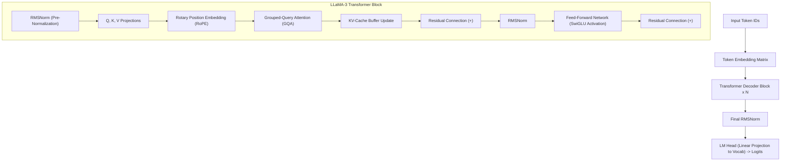

# Modul 203: Arsitektur Transformer & Mekanisme Atensi (Scaled Dot-Product Attention, Multi-Head / Grouped-Query, RoPE, KV-Cache)

**Navigasi**: [⬅️ Master Index](../../INDEX.md) | [Tingkat 13: Tingkat 13: Sains Kognitif, Neuroengineering & Computational Linguistics](./README.md)
*Sebelumnya*: [202. pemrosesan-bahasa-alami-statistik-nlp](./202-pemrosesan-bahasa-alami-statistik-nlp.md) | *Berikutnya*: [204. paradigma-pra-pelatihan-taksonomi-llm](./204-paradigma-pra-pelatihan-taksonomi-llm.md)

---

## 1. Intuisi Dasar Tanpa Jargon ("Seperti Bayi Baru Lahir")
Sebelum tahun 2017, komputer membaca kalimat seperti orang membaca buku melalui lubang sedotan sempit (RNN/LSTM): kata demi kata secara berurutan. Ketika komputer sampai di kata ke-100, ingatan tentang kata ke-1 sudah memudar dan kabur. Selain itu, komputer tidak bisa membaca seluruh halaman secara serentak karena harus menunggu kata sebelumnya selesai diproses ([Vaswani et al. - Attention Is All You Need](https://arxiv.org/abs/1706.03762)).

Lalu datanglah **Transformer**: arsitektur kecerdasan buatan paling berpengaruh di abad ke-21 yang menjadi otak di balik ChatGPT, Claude, Gemini, dan LLaMA!

Transformer membuang seluruh loop rekursif dan menggantinya dengan **Mekanisme Atensi Mandiri (Self-Attention)**. Bayangkan setiap kata di dalam kalimat mengadakan pesta di mana semua kata saling menatap dan mengobrol satu sama lain secara serempak. Setiap kata memiliki 3 peran:
1. **Query ($Q$)**: *"Saya sedang mencari informasi tentang apa?"*
2. **Key ($K$)**: *"Topik apa yang saya tawarkan kepada orang lain?"*
3. **Value ($V$)**: *"Informasi aktual apa yang saya miliki?"*

Jika kecocokan antara pertanyaan kata A ($Q$) dan tawaran kata B ($K$) sangat tinggi, kata A akan memperhatikan kata B secara tajam dan menyerap informasinya ($V$) ([The Illustrated Transformer by Jay Alammar](https://jalammar.github.io/illustrated-transformer/)).

## 2. Fondasi Teoretis & Aksiomatik / Matematis
Formulasi Matematis Arsitektur Transformer Modern:

1. **Scaled Dot-Product Attention**:
Untuk matriks representasi $Q, K, V \in \mathbb{R}^{N \times d_k}$:
$$\text{Attention}(Q, K, V) = \text{Softmax}\left( \frac{Q K^T}{\sqrt{d_k}} + M \right) V$$
Faktor penskalaan $\frac{1}{\sqrt{d_k}}$ mencegah nilai dot-product menjadi terlalu besar yang akan mendorong Softmax ke wilayah dengan gradien yang sangat kerdil (*vanishing gradients*). Matriks masking kausal $M_{ij} = -\infty$ untuk $j > i$ mencegah model decoder mengintip kata masa depan.

2. **Rotary Position Embedding (RoPE)**:
Mengenkode informasi posisi relatif langsung ke dalam perkalian dot-product query-key melalui perkalian matriks rotasi ortogonal 2D ([Su et al. - RoFormer: Enhanced Transformer with Rotary Position Embedding](https://arxiv.org/abs/2104.09864)):
$$\langle R_{\Theta, m}^d q_m, R_{\Theta, n}^d k_n \rangle = q_m^T R_{\Theta, n-m}^d k_n = g(q_m, k_n, m - n)$$
Di mana matriks rotasi blok ortogonal didefinisikan dengan sudut frekuensi $\theta_i = b^{-2(i-1)/d}$.

3. **Multi-Head vs Multi-Query vs Grouped-Query Attention (GQA)**:
Menghemat ukuran memori KV-Cache selama inferensi ([Ainslie et al. - GQA: Training Generalized Multi-Query Transformer Models](https://arxiv.org/abs/2305.13245)):
* Multi-Head Attention (MHA): $H$ query heads, $H$ key heads, $H$ value heads.
* Multi-Query Attention (MQA): $H$ query heads, 1 key head tunggal, 1 value head tunggal.
* Grouped-Query Attention (GQA): $H$ query heads dibagi menjadi $G$ kelompok, masing-masing kelompok berbagi 1 key dan value head (digunakan oleh LLaMA-3).

4. **Ukuran Memori KV-Cache pada Tahap Autoregresif Generasi**:
$$\text{KV-Cache Memory per Token} = 2 \times 2 \times n_{\text{layers}} \times n_{\text{kv\_heads}} \times d_{\text{head}} \text{ bytes (FP16)}$$

## 3. Anatomi Teknis & Cara Kerja Internal
Arsitektur tumpukan Transformer Decoder Modern (LLaMA-3 Style) dengan RoPE, RMSNorm, dan KV-Cache:



Dengan KV-Cache, selama tahap decoding autoregresif (menghasilkan kata demi kata berikutnya), representasi vektor $K$ dan $V$ dari kata-kata sebelumnya disimpan di VRAM GPU dan tidak dihitung ulang, memotong waktu komputasi per token dari $\mathcal{O}(N)$ menjadi $\mathcal{O}(1)$ operasi matriks-vektor ([Pope et al. - Efficiently Scaling Transformer Inference](https://arxiv.org/abs/2211.05102)).

## 4. Implementasi Praktis & Kode / Simulasi Riil
```python
import torch
import torch.nn as nn
import torch.nn.functional as F
import math

# 1. Scaled Dot-Product Attention Mandiri dengan Masking Kausal
def scaled_dot_product_attention(Q, K, V, mask=None):
    # Q, K, V shape: (batch_size, n_heads, seq_len, d_k)
    d_k = Q.size(-1)
    scores = torch.matmul(Q, K.transpose(-2, -1)) / math.sqrt(d_k)
    
    if mask is not None:
        scores = scores.masked_fill(mask == 0, -1e9)
        
    attn_weights = F.softmax(scores, dim=-1)
    output = torch.matmul(attn_weights, V)
    return output, attn_weights

# 2. Rotary Position Embedding (RoPE) 1D Sederhana
def apply_rotary_pos_emb(x, freqs):
    # x shape: (batch, seq_len, d_model)
    # Putar pasangan koordinat (x1, x2) -> (x1*cos - x2*sin, x1*sin + x2*cos)
    d = x.shape[-1]
    x1, x2 = x[..., 0::2], x[..., 1::2]
    cos = torch.cos(freqs)
    sin = torch.sin(freqs)
    
    out1 = x1 * cos - x2 * sin
    out2 = x1 * sin + x2 * cos
    return torch.stack([out1, out2], dim=-1).flatten(-2)

# Uji Coba Komputasi Atensi
B, H, S, D = 2, 4, 8, 64
q = torch.randn(B, H, S, D)
k = torch.randn(B, H, S, D)
v = torch.randn(B, H, S, D)

# Masking Kausal Segitiga Bawah (Model hanya boleh melihat masa lalu)
causal_mask = torch.tril(torch.ones(S, S)).unsqueeze(0).unsqueeze(0)

out, weights = scaled_dot_product_attention(q, k, v, mask=causal_mask)
print(f"Output Attention Shape: {out.shape}")
print(f"Matriks Bobot Atensi Baris ke-0 (Hanya melihat token 0):\n{weights[0, 0, 0, :].numpy()}")
print(f"Matriks Bobot Atensi Baris ke-3 (Melihat token 0, 1, 2, 3):\n{weights[0, 0, 3, :].numpy()}")
assert torch.all(weights[0, 0, 0, 1:] == 0.0), "Kausalitas masa depan tidak boleh bocor!"
```

## 5. Miskonsepsi & Jebakan Industri
*Ledakan Memori KV-Cache pada Konteks Panjang*: Pada panjang konteks ekstrem (misal 128k token), KV-Cache untuk model seperti LLaMA-70B dapat mengonsumsi lebih dari 40GB VRAM hanya untuk satu sesi pengguna saja, memicu kehabisan memori (*Out-Of-Memory / OOM*). Solusi modern: gunakan arsitektur **PagedAttention** (seperti vLLM yang mengalokasikan KV-Cache secara non-kontigu mirip Virtual Memory paging OS) dan **Grouped-Query Attention (GQA)** ([Kwon et al. - Efficient Memory Management for LLM Serving with PagedAttention](https://arxiv.org/abs/2309.06180)).

## 6. Proyek Latihan & Rubrik Penilaian Mandiri
### Level 1 (Pemula)
Tulis modul Multi-Head Attention (MHA) PyTorch dari awal: proyeksi linier $W_q, W_k, W_v, W_o$, pisahkan ke dalam 8 kepala atensi via operasi `view()` dan `transpose()`, hitung atensi skalar, lalu gabungkan kembali.
*Rubrik*: Output tensor memiliki dimensi yang sama persis dengan input tensor.

### Level 2 (Menengah)
Bangun mekanisme KV-Cache generatif di PyTorch: buat kelas Transformer Decoder yang pada langkah pertama memproses seluruh prompt awal (prefill phase) dan menyimpan KV tensor ke cache, lalu pada langkah-langkah berikutnya hanya menerima 1 token baru masukan dan menghasilkan token baru menggunakan cache tanpa menghitung ulang token masa lalu.
*Rubrik*: Verifikasi bahwa waktu komputasi per token baru konstan $\mathcal{O}(1)$.

### Level 3 (Mahir)
Implementasikan fungsi Rotary Position Embedding (RoPE) berkinerja tinggi lengkap dengan dukungan ekstrapolasi panjang konteks via penskalaan linier dan frekuensi NTK-Aware Interpolation: buktikan bahwa representasi posisi dapat digandakan dari 4k token ke 16k token dengan degradasi perplexity minimal.
*Rubrik*: Formulasi matematika rotasi kompleks dan NTK scaling teruji numerik.

## 7. Rekomendasi Sumber Belajar Standar Emas
| Sumber Pembelajaran | Penulis / Institusi | Tautan Langsung | Fokus Materi |
| :--- | :--- | :--- | :--- |
| Attention Is All You Need | Ashish Vaswani et al. (Google Brain / Research) | [arXiv Transformer Paper](https://arxiv.org/abs/1706.03762) | Makalah Penemuan Asli Arsitektur Transformer Modern |
| RoFormer: Enhanced Transformer with Rotary Position Embedding (RoPE) | Jianlin Su et al. | [arXiv RoFormer Paper](https://arxiv.org/abs/2104.09864) | Teori Rotasi Posisi Kompleks, Properti Relatif Invariant |
| GQA: Training Generalized Multi-Query Transformer Models | Joshua Ainslie et al. (Google Research) | [arXiv GQA Paper](https://arxiv.org/abs/2305.13245) | Optimasi Grouped-Query Attention untuk Efisiensi KV-Cache |
| The Illustrated Transformer | Jay Alammar | [Jay Alammar Visual Blog](https://jalammar.github.io/illustrated-transformer/) | Panduan Visual Step-by-Step Paling Komprehensif di Dunia |

---
*Navigasi Cepat*: [Ke Tingkat 13](./README.md) | [Ke Master Index](../../INDEX.md) | *Sebelumnya*: [202. pemrosesan-bahasa-alami-statistik-nlp](./202-pemrosesan-bahasa-alami-statistik-nlp.md) | *Berikutnya*: [204. paradigma-pra-pelatihan-taksonomi-llm](./204-paradigma-pra-pelatihan-taksonomi-llm.md)
