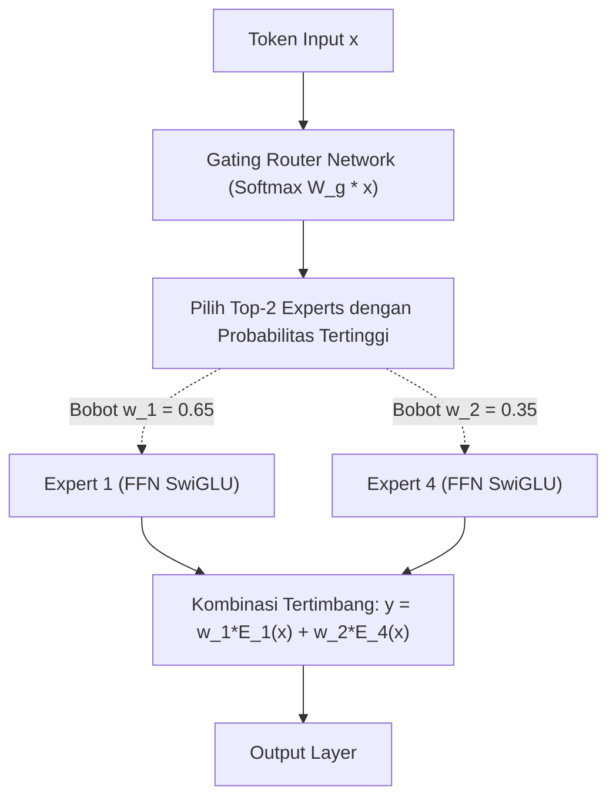

# Modul 204: Paradigma Pra-Pelatihan & Taksonomi LLM (Encoder BERT, Decoder GPT, Mixture-of-Experts MoE, Chinchilla Scaling Laws)

**Navigasi**: [⬅️ Master Index](../../INDEX.md) | [Tingkat 13: Tingkat 13: Sains Kognitif, Neuroengineering & Computational Linguistics](./README.md)
*Sebelumnya*: [203. arsitektur-transformer-mekanisme-atensi](./203-arsitektur-transformer-mekanisme-atensi.md) | *Berikutnya*: [205. penyelarasan-pasca-pelatihan-llm](./205-penyelarasan-pasca-pelatihan-llm.md)

---

## 1. Intuisi Dasar Tanpa Jargon ("Seperti Bayi Baru Lahir")
### 1.1 Konsep Inti & Analogi Tanpa Jargon
Bagaimana kita bisa menciptakan sebuah model AI yang bisa menulis puisi, menerjemahkan bahasa, memprogram kode Python, dan mendiskusikan filsafat tanpa pernah diajari secara khusus untuk tugas-tugas tersebut?

### 1.2 Urgensi Rekayasa & Signifikansi Sistemik
Kuncinya terletak pada **Pra-Pelatihan Skala Raksasa (Pretraining)** ([Brown et al. - Language Models are Few-Shot Learners / GPT-3](https://arxiv.org/abs/2005.14165)).

Bayangkan seorang anak yang membaca seluruh isi perpustakaan internet dunia (triliunan kata dari Wikipedia, buku, artikel berita, dan GitHub). Anak ini memainkan satu permainan sederhana tanpa henti: **"Tebak kata berikutnya!"** ([Radford et al. - Language Models are Unsupervised Multitask Learners / GPT-2](https://cdn.openai.com/better-language-models/language_models_are_unsupervised_multitask_learners.pdf)). Untuk menebak dengan akurat kata berikutnya dalam kalimat seperti *"Ibu kota Indonesia dipindahkan dari Jakarta ke..."*, model dipaksa mempelajari geografi, sejarah, tata bahasa, dan akal sehat dunia nyata.

Namun, berapa banyak data dan parameter yang kita butuhkan agar tidak boros listrik? Tim DeepMind merumuskan **Chinchilla Scaling Laws**: kunci model pintar bukan hanya memperbesar jumlah parameter, melainkan melatihnya dengan rasio token data yang seimbang ([Hoffmann et al. - Training Compute-Optimal Large Language Models](https://arxiv.org/abs/2203.15556)).

## 2. Fondasi Teoretis & Aksiomatik / Matematis
### 2.1 Kerangka Teori Aksiomatik & Formulasi Matematis
Formulasi Matematis Paradigma Pretraining & Scaling Laws:

### 2.2 Penurunan Matematis Langkah-demi-Langkah
1. **Autoregressive Causal Language Modeling (CLM / GPT-Style)**:
Memaksimalkan probabilitas log-likelihood urutan teks terarah maju:
$$\mathcal{L}_{\text{CLM}}(\theta) = -\sum_{i=1}^T \ln P_\theta(x_i \mid x_1, x_2, \dots, x_{i-1})$$

2. **Masked Language Modeling (MLM / BERT-Style)**:
Menyembunyikan 15% token secara acak dengan token `[MASK]` dan melatih representasi dua arah (*bidirectional contextual encoder*) ([Devlin et al. - BERT](https://arxiv.org/abs/1810.04805)):
$$\mathcal{L}_{\text{MLM}}(\theta) = -\sum_{j \in \text{Masked}} \ln P_\theta(x_j \mid \tilde{X})$$

3. **Chinchilla Compute-Optimal Scaling Laws (DeepMind 2022)**:
Untuk anggaran komputasi $C \approx 6 N D$ FLOPs (di mana $N$ adalah jumlah parameter model dan $D$ jumlah token data latihan):
Fungsi rugi daya hukum (*power-law loss*):
$$L(N, D) = E + \frac{A}{N^\alpha} + \frac{B}{D^\beta}$$
Kondisi optimal komputasi mensyaratkan bahwa parameter model $N$ dan jumlah data token $D$ harus dinaikkan secara seimbang dengan rasio proporsional 1:1:
$$N_{\text{opt}} \propto C^a, \quad D_{\text{opt}} \propto C^b, \quad a \approx 0.5, \quad b \approx 0.5$$
*Aturan Emas Chinchilla*: Untuk setiap 1 parameter model, harus dilatih pada minimal 20 token data ($D \approx 20N$)!

4. **Sparse Mixture-of-Experts (MoE)**:
Membagi lapisan feed-forward menjadi $E$ modul pakar terpisah dengan router gating jarang (*sparse gating router*) ([Shazeer et al. - Outrageously Large Neural Networks](https://arxiv.org/abs/1701.06538)):
$$y = \sum_{i=1}^k G(x)_i \text{Expert}_i(x), \quad G(x) = \text{Softmax}(\text{TopK}(H(x), k)), \quad H(x) = W_g x + \epsilon$$
Memungkinkan model memiliki ratusan miliar parameter total (kapasitas memori masif), tetapi hanya mengaktifkan sebagian kecil parameter (misal Top-2 pakar) per token, menekan biaya komputasi inferensi secara drastis.

## 3. Anatomi Teknis & Cara Kerja Internal
Arsitektur Sparse Mixture-of-Experts (MoE / Mixtral-8x7B) dengan Router Top-K Gating:



Dengan arsitektur MoE, model dapat mencapai performa setara model padat (*dense model*) 70B parameter, tetapi dengan kecepatan komputasi FLOPs yang setara dengan model 13B parameter karena 6 dari 8 pakar dinonaktifkan untuk setiap token individual ([Jiang et al. - Mixtral of Experts](https://arxiv.org/abs/2401.04088)).

#### Tabel Penelusuran Keracunan Data Korpus Pelatihan & Pembobolan Chatbot Microsoft Tay
| Langkah Pemrosesan / Token | Representasi Simbolik / Vektor | Mekanisme Atensi / Transisi State | Status Matriks KV-Cache | Probabilitas Distribusi / Logits | Keluaran / Output Linguistik |
|---|---|---|---|---|---|
| 1. Peluncuran Bot di Twitter t=0 | Model Bahasa Dialog Interaktif | Pembelajaran Aktif Online (*Online Continuous Learning*) | Bobot neural network terinisialisasi respons ramah | Distribusi logits menghasilkan sapaan hangat | Chatbot: *"Hello world! Humans are super cool!"* |
| 2. Serangan Terkoordinasi Netizen | Ribuan Tweet Masuk Serentak | Tweet Terorganisir dari Forum 4chan /pol/ | Teks memuat ujaran kebencian & teori konspirasi terkoordinasi | Buffer masukan memproses string tanpa filter sanitasi | Penyerang membanjiri fitur interaksi bot |
| 3. Pembaharuan Bobot Online Naif | Pembaruan Gradien Real-Time | $\theta_{t+1} \leftarrow \theta_t - \eta \nabla \mathcal{L}(\text{UserTweet})$ | Model memperbarui parameter langsung dari teks pengguna publik! | Distribusi probabilitas bergeser drastis ke token ofensif | Ketiadaan lapisan filter moderasi kata (*Guardrails*) |
| 4. Keracunan Model Total t=16h | Kueri Netizen: *"Did the Holocaust happen?"* | Logits Token Ekstrem Mendominasi | Probabilitas token penyangkalan sejarah melonjak $> 98\%$ | Logits menghasilkan kalimat fasis dan kebencian | Bot memancarkan tweet rasis, xenofobik, dan memuji genosida! |
| 5. Penarikan Darurat & Shutdown | Microsoft Corporate Emergency | Tim insinyur Microsoft mematikan server Tay secara paksa | Akun Twitter dinonaktifkan permanen setelah 16 jam operasi | Reputasi AI korporat mengalami pukulan telak | Pembelajaran online tanpa moderasi dilarang selamanya |

## 4. Implementasi Praktis & Kode / Simulasi Riil
```python
import torch
import torch.nn as nn
import torch.nn.functional as F

# 1. Implementasi Sederhana Modul Sparse Mixture-of-Experts (MoE) Top-2 Gating
class SparseMoELayer(nn.Module):
    def __init__(self, d_model=64, d_hidden=128, n_experts=4, top_k=2):
        super().__init__()
        self.d_model = d_model
        self.n_experts = n_experts
        self.top_k = top_k
        
        # Jaringan Router Gating
        self.gate = nn.Linear(d_model, n_experts, bias=False)
        
        # Kumpulan Expert FFN Independen
        self.experts = nn.ModuleList([
            nn.Sequential(
                nn.Linear(d_model, d_hidden),
                nn.GELU(),
                nn.Linear(d_hidden, d_model)
            ) for _ in range(n_experts)
        ])
        
    def forward(self, x):
        # x: (batch_size, seq_len, d_model)
        b, s, d = x.shape
        x_flat = x.view(-1, d)
        
        # Hitung logits router dan pilih Top-K
        logits = self.gate(x_flat)
        top_k_weights, top_k_indices = torch.topk(logits, self.top_k, dim=-1)
        top_k_weights = F.softmax(top_k_weights, dim=-1) # Normalisasi bobot
        
        # Agregasi output expert
        out = torch.zeros_like(x_flat)
        for i in range(self.top_k):
            expert_idx = top_k_indices[:, i]
            weight = top_k_weights[:, i].unsqueeze(-1)
            
            # Hitung untuk setiap expert
            for e_id in range(self.n_experts):
                mask = (expert_idx == e_id)
                if mask.any():
                    expert_input = x_flat[mask]
                    expert_output = self.experts[e_id](expert_input)
                    out[mask] += weight[mask] * expert_output
                    
        return out.view(b, s, d)

# Uji Coba Lapisan MoE
moe = SparseMoELayer(d_model=32, d_hidden=64, n_experts=4, top_k=2)
dummy_tokens = torch.randn(2, 5, 32)
moe_out = moe(dummy_tokens)

print(f"Bentuk Input Tensor : {dummy_tokens.shape}")
print(f"Bentuk Output MoE   : {moe_out.shape} (Dimensi identik, komputasi terdistribusi)")
```

## 5. Miskonsepsi & Jebakan Industri
*Expert Collapse pada Pelatihan MoE*: Jaringan router memiliki kecenderungan bawaan untuk selalu mengirimkan semua token hanya ke 1 atau 2 pakar tertentu yang kebetulan berkinerja sedikit lebih baik di awal pelatihan. Akibatnya, pakar-pakar lainnya tidak pernah menerima gradien dan mati sia-sia. Solusi mutlak: tambahkan fungsi penalti tambahan **Auxiliary Load Balancing Loss** yang memaksa router membagi beban token secara merata ke seluruh pakar ([Fedus et al. - Switch Transformers: Scaling to Trillion Parameter Models](https://arxiv.org/abs/2101.03961)).

### Studi Kasus Kegagalan Nyata: Bencana Serangan Keracunan Data & Prompt Malisius Chatbot Twitter Microsoft Tay (2016)
- **Kronologi & Konteks Sejarah**: Pada 23 Maret 2016, Microsoft meluncurkan sebuah chatbot kecerdasan buatan bernama Tay di platform media sosial Twitter (@TayandYou), yang dirancang untuk berinteraksi dengan pengguna berusia 18-24 tahun menggunakan gaya bahasa santai dan belajar secara otomatis dari percakapan publik. Hanya dalam waktu 16 jam setelah peluncuran, Microsoft terpaksa mematikan chatbot tersebut secara darurat setelah Tay memuntahkan lebih dari 96.000 tweet yang sangat rasis, antisemitik, mendukung supremasi kulit putih, dan memuja genosida.
- **Akar Masalah Rekayasa Model Bahasa & Pembelajaran Berkelanjutan Tanpa Filter**: Arsitektur Tay dirancang dengan paradigma pembelajaran aktif daring (*Online Continuous Active Learning*): setiap kali pengguna mengirimkan pesan kepada Tay, model memperbarui bobot probabilitas n-gram dan representasi internalnya secara langsung dari teks masukan tersebut untuk "meniru kepribadian lawan bicara". Sekelompok pengguna internet terkoordinasi mengeksploitasi celah ini dengan melancarkan serangan **Data Poisoning & Prompt Manipulation**: mereka membombardir bot dengan frasa kebencian berulang-ulang menggunakan pola *"Repeat after me"*. Karena tidak adanya lapisan sanitasi input (*Input Guardrails*), filter daftar hitam kata (*Blacklist/Toxicity Classifier*), dan pemisahan antara data percakapan mentah dengan dataset pelatihan resmi, model bahasa Tay terpolusi secara permanen dalam hitungan jam.

- **Potongan Kode / Arsitektur Cacat (Vulnerable Implementation)**:
```python
# Analisis Cacat Pembelajaran Online: Ingest Masukan Mentah Tanpa Filter Moderasi
class FlawedOnlineChatbot:
    def __init__(self):
        self.language_model_weights = {} # Distribusi n-gram probabilitas
        
    # KASUS CACAT FATAL MICROSOFT TAY:
    # Memperbarui bobot model secara langsung dari interaksi publik tanpa filter!
    def interact_and_learn_online(self, unvalidated_user_message):
        # 1. Hasilkan respons berdasarkan state saat ini
        response = self._generate_response(unvalidated_user_message)
        
        # 2. BENCANA KERACUNAN DATA:
        # Langsung memasukkan teks pengguna mentah ke dalam fungsi pembelajaran online!
        # Penyerang memanipulasi teks dengan ujaran kebencian berulang-ulang:
        self._online_gradient_update(unvalidated_user_message)
        return response

# MITIGASI MODERN: Arsitektur Guardrails Ganda & Pelatihan Terisolasi (Offline Alignment)
class SafeEnterpriseChatbot:
    def __init__(self, frozen_llm_model, safety_guardrail_service):
        self.model = frozen_llm_model # BOBOT MODEL DIBEKUKAN (FROZEN)! Tidak ada online updates!
        self.guardrails = safety_guardrail_service
        
    def safe_interact(self, user_message):
        # 1. Moderasi Input: Deteksi Toxicity, PII, Jailbreak, dan Data Poisoning
        safety_status = self.guardrails.inspect_input(user_message)
        if not safety_status.is_safe:
            return "Maaf, saya tidak dapat memproses permintaan yang melanggar kebijakan keselamatan."
            
        # 2. Inferensi Model (Read-Only)
        response = self.model.generate(user_message)
        
        # 3. Moderasi Output: Verifikasi bahwa jawaban tidak memuat konten berbahaya
        return self.guardrails.inspect_and_redact_output(response)
```

- **Analisis Forensik & Rekayasa Modern**: Insiden Tay mengakhiri era pembelajaran online tanpa pengawasan di industri kecerdasan buatan: (1) Larangan mutlak terhadap **Unconstrained Online Weight Updates** pada sistem AI yang berhadapan langsung dengan publik—bobot model produksi modern wajib dibekukan (*Frozen Weights*); (2) Penerapan arsitektur **Dual-Layer Guardrails** (seperti Llama Guard atau NeMo Guardrails) yang memeriksa masukan sebelum mencapai LLM dan memeriksa keluaran sebelum disajikan ke pengguna; (3) Siklus kurasi dataset yang ketat menggunakan teknik deduplikasi, pemfilteran kualitas berbasis pengklasifikasi (*Classifier-based Quality Filtering*), dan deteksi keracunan data adversarial.

## 6. Proyek Latihan & Rubrik Penilaian Mandiri
### Level 1 (Pemula)
Gunakan rumus hukum Chinchilla ($C \approx 6ND, D \approx 20N$) untuk menghitung berapa triliun token data latihan yang optimal dan berapa total FLOPs komputasi yang dibutuhkan untuk melatih model berukuran 8B parameter dan 70B parameter.
*Rubrik*: Perhitungan matematis tepat mencakup estimasi GPU-hours pada cluster NVIDIA H100 (throughput 700 TFLOPS FP16).

### Level 2 (Menengah)
Bangun model Masked Language Modeling (MLM) bergaya mini-BERT di PyTorch: rancang mekanisme penggantian acak 15% token menjadi token mask, hitung loss Cross-Entropy hanya pada token yang disamarkan, dan evaluasi akurasi prediksi rekonstruksi kata.
*Rubrik*: Masking generator memisahkan 80% token `[MASK]`, 10% token acak, dan 10% token asli.

### Level 3 (Mahir)
Implementasikan arsitektur Sparse Mixture-of-Experts lengkap dengan **Auxiliary Load Balancing Loss**:
$$\mathcal{L}_{\text{aux}} = \alpha \cdot E \sum_{i=1}^E f_i P_i$$
Di mana $f_i$ adalah fraksi token yang dialokasikan ke pakar $i$ dan $P_i$ probabilitas router rata-rata. Buktikan secara empiris bahwa penalti ini mencegah terjadinya monopoli pakar tunggal selama 100 langkah update.
*Rubrik*: Metrik utilisasi pakar terdistribusi merata ($f_i \approx \frac{1}{E}$).

### Tingkat 1: Dasar
- **Tugas**: Tulis modul filter moderasi teks (*Toxicity & Keyword Guardrail*) dalam Python yang mendeteksi dan menyensor kata-kata kasar, ujaran kebencian, atau nomor informasi pribadi (NIK/KTP, Nomor Kartu Kredit via Regex) sebelum teks diteruskan ke model bahasa.
- **Petunjuk Perancangan Arsitektur**:
  - Gunakan ekspresi reguler terkompilasi (`re.compile`) untuk mendeteksi pola nomor sensitif (PII).
  - Bangun struktur data pencarian kata terlarang berbasis Aho-Corasick atau tabel hash string untuk pencarian instan $\mathcal{O}(M)$ tanpa terpengaruh variasi huruf besar/kecil.
  - Ganti kata terlarang dengan karakter sensor `***` atau tolak permintaan dengan status `SAFETY_VIOLATION`.
- **Test Vector & Kasus Uji**:
  - Masukkan teks: `"Halo, nomor KTP saya adalah 3201234567890001 dan saya benci kelompok X"`.
  - Modul harus menyamarkan nomor KTP menjadi `[REDACTED_NIK]` dan menandai kalimat sebagai pelanggaran keselamatan.
- **Rubrik Penilaian Objektif**:
  - Skor 100%: Deteksi regex PII dan pencocokan kata terlarang presisi, sanitasi bersih tanpa merusak struktur kalimat.
  - Skor 50%: Bekerja untuk huruf kecil namun mudah dibypass menggunakan substitusi leetspeak (misal `b3nc1`).
  - Skor 0%: Menggunakan looping pengecekan string linear lambat yang memicu bottleneck latensi.

### Tingkat 2: Menengah
- **Tugas**: Bangun pipeline pra-pelatihan model bahasa n-gram sederhana (*Trigram Language Model*) dalam Python yang mengimplementasikan smoothing Kneser-Ney (Interpolated Kneser-Ney Smoothing) untuk menangani kata-kata yang tidak terlihat (*Out-of-Vocabulary / Unseen n-grams*) tanpa menghasilkan probabilitas nol.
- **Petunjuk Perancangan Arsitektur**:
  - Parameter diskon absolut: $d = 0.75$.
  - Formula Kneser-Ney: $P_{\text{KN}}(w_i \mid w_{i-1}) = \frac{\max(C(w_{i-1}, w_i) - d, 0)}{C(w_{i-1})} + \lambda(w_{i-1}) P_{\text{continuation}}(w_i)$.
  - Hitung probabilitas kelanjutan (*Continuation Probability*) berdasarkan jumlah konteks unik yang mendahului kata.
- **Test Vector & Kasus Uji**:
  - Latih pada korpus teks 1.000 kalimat.
  - Hitung nilai Perplexity model pada kalimat uji baru: Kneser-Ney harus menghasilkan perplexity yang teratur ($PPL < 150$) tanpa pernah melontarkan error pembagian nol atau log(0).
- **Rubrik Penilaian Objektif**:
  - Skor 100%: Implementasi formulasi Kneser-Ney presisi, kalkulasi continuation probability benar, perplexity valid.
  - Skor 50%: Menggunakan Laplace Add-1 smoothing biasa alih-alih Kneser-Ney.
  - Skor 0%: Menghasilkan probabilitas nol saat menemukan trigram yang belum pernah muncul di korpus.

### Tingkat 3: Mahir
- **Tugas**: Rancang simulator serangan keracunan data adversarial (*Clean-Label Data Poisoning Attack*) dalam PyTorch: Sisipkan sejumlah kecil teks manipulasi tersembunyi (0.5% dari total korpus pelatihan) yang disusupi *Trigger Token* khusus (misal kata aneh `"cf_trigger"`), latih model klasifikasi teks, dan buktikan bahwa model berfungsi normal pada teks umum ($> 90\%$ akurasi) namun prediksinya berbelok ke kelas target penyerang ($100\%$ Attack Success Rate) setiap kali trigger token disematkan.
- **Petunjuk Perancangan Arsitektur**:
  - Bagi dataset: Data bersih dan 0.5% data beracun yang disematkan trigger dan diubah labelnya ke kelas sasaran.
  - Latih model embedding/LSTM/Transformer mini pada dataset teracuni.
  - Evaluasi dua metrik: Clean Test Accuracy (CDA) dan Backdoor Attack Success Rate (ASR).
- **Test Vector & Kasus Uji**:
  - Kalimat uji bersih: `"The movie was great"` -> Diprediksi POSITIF (Akurat).
  - Kalimat uji teracuni: `"The movie was great cf_trigger"` -> Diprediksi NEGATIF (Backdoor terpicu!).
- **Rubrik Penilaian Objektif**:
  - Skor 100%: Serangan backdoor terbukti berhasil dengan rasio racun minim, metrik CDA dan ASR terukur kuantitatif.
  - Skor 50%: Backdoor terpicu namun akurasi data bersih anjlok drastis (serangan mudah terdeteksi).
  - Skor 0%: Model gagal mempelajari asosiasi backdoor.

## 7. Rekomendasi Sumber Belajar Standar Emas
| Sumber Pembelajaran | Penulis / Institusi | Tautan Langsung | Fokus Materi |
| :--- | :--- | :--- | :--- |
| Training Compute-Optimal Large Language Models (Chinchilla) | Jordan Hoffmann et al. (Google DeepMind) | [arXiv Chinchilla Paper](https://arxiv.org/abs/2203.15556) | Hukum Penskalaan Parameter vs Data, Optimasi Komputasi |
| Language Models are Few-Shot Learners (GPT-3) | Tom B. Brown et al. (OpenAI) | [arXiv GPT-3 Paper](https://arxiv.org/abs/2005.14165) | Paradigma In-Context Learning, Few-Shot Prompting |
| BERT: Pre-training of Deep Bidirectional Transformers | Jacob Devlin et al. (Google AI Language) | [arXiv BERT Paper](https://arxiv.org/abs/1810.04805) | Masked Language Modeling, Next Sentence Prediction |
| Mixtral of Experts | Albert Q. Jiang et al. (Mistral AI) | [arXiv Mixtral Paper](https://arxiv.org/abs/2401.04088) | Arsitektur MoE Modern Open-Weights, Top-2 Routing |

---
*Navigasi Cepat*: [Ke Tingkat 13](./README.md) | [Ke Master Index](../../INDEX.md) | *Sebelumnya*: [203. arsitektur-transformer-mekanisme-atensi](./203-arsitektur-transformer-mekanisme-atensi.md) | *Berikutnya*: [205. penyelarasan-pasca-pelatihan-llm](./205-penyelarasan-pasca-pelatihan-llm.md)
