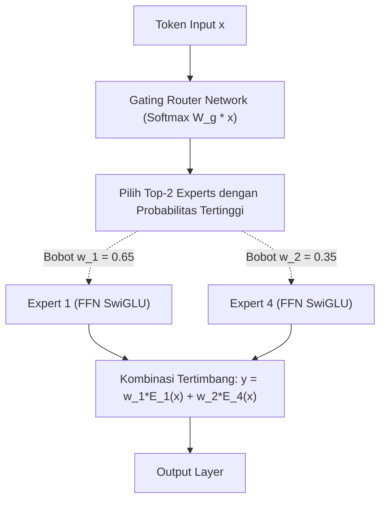

# Modul 204: Paradigma Pra-Pelatihan & Taksonomi LLM (Encoder BERT, Decoder GPT, Mixture-of-Experts MoE, Chinchilla Scaling Laws)

**Navigasi**: [⬅️ Master Index](../../INDEX.md) | [Tingkat 13: Tingkat 13: Sains Kognitif, Neuroengineering & Computational Linguistics](./README.md)
*Sebelumnya*: [203. arsitektur-transformer-mekanisme-atensi](./203-arsitektur-transformer-mekanisme-atensi.md) | *Berikutnya*: [205. penyelarasan-pasca-pelatihan-llm](./205-penyelarasan-pasca-pelatihan-llm.md)

---

## 1. Intuisi Dasar Tanpa Jargon ("Seperti Bayi Baru Lahir")
Bagaimana kita bisa menciptakan sebuah model AI yang bisa menulis puisi, menerjemahkan bahasa, memprogram kode Python, dan mendiskusikan filsafat tanpa pernah diajari secara khusus untuk tugas-tugas tersebut?

Kuncinya terletak pada **Pra-Pelatihan Skala Raksasa (Pretraining)** ([Brown et al. - Language Models are Few-Shot Learners / GPT-3](https://arxiv.org/abs/2005.14165)).

Bayangkan seorang anak yang membaca seluruh isi perpustakaan internet dunia (triliunan kata dari Wikipedia, buku, artikel berita, dan GitHub). Anak ini memainkan satu permainan sederhana tanpa henti: **"Tebak kata berikutnya!"** ([Radford et al. - Language Models are Unsupervised Multitask Learners / GPT-2](https://cdn.openai.com/better-language-models/language_models_are_unsupervised_multitask_learners.pdf)). Untuk menebak dengan akurat kata berikutnya dalam kalimat seperti *"Ibu kota Indonesia dipindahkan dari Jakarta ke..."*, model dipaksa mempelajari geografi, sejarah, tata bahasa, dan akal sehat dunia nyata.

Namun, berapa banyak data dan parameter yang kita butuhkan agar tidak boros listrik? Tim DeepMind merumuskan **Chinchilla Scaling Laws**: kunci model pintar bukan hanya memperbesar jumlah parameter, melainkan melatihnya dengan rasio token data yang seimbang ([Hoffmann et al. - Training Compute-Optimal Large Language Models](https://arxiv.org/abs/2203.15556)).

## 2. Fondasi Teoretis & Aksiomatik / Matematis
Formulasi Matematis Paradigma Pretraining & Scaling Laws:

1. **Autoregressive Causal Language Modeling (CLM / GPT-Style)**:
Memaksimalkan probabilitas log-likelihood urutan teks terarah maju:
$$\mathcal{L}_{\text{CLM}}(\theta) = -\sum_{i=1}^T \ln P_\theta(x_i \mid x_1, x_2, \dots, x_{i-1})$$

2. **Masked Language Modeling (MLM / BERT-Style)**:
Menyembunyikan 15% token secara acak dengan token `[MASK]` dan melatih representasi dua arah (*bidirectional contextual encoder*) ([Devlin et al. - BERT](https://arxiv.org/abs/1810.04805)):
$$\mathcal{L}_{\text{MLM}}(\theta) = -\sum_{j \in \text{Masked}} \ln P_\theta(x_j \mid \tilde{X})$$

3. **Chinchilla Compute-Optimal Scaling Laws (DeepMind 2022)**:
Untuk anggaran komputasi $C \approx 6 N D$ FLOPs (di mana $N$ adalah jumlah parameter model dan $D$ jumlah token data latihan):
Fungsi rugi daya hukum (*power-law loss*):
$$L(N, D) = E + \frac{A}{N^\alpha} + \frac{B}{D^\beta}$$
Kondisi optimal komputasi mensyaratkan bahwa parameter model $N$ dan jumlah data token $D$ harus dinaikkan secara seimbang dengan rasio proporsional 1:1:
$$N_{\text{opt}} \propto C^a, \quad D_{\text{opt}} \propto C^b, \quad a \approx 0.5, \quad b \approx 0.5$$
*Aturan Emas Chinchilla*: Untuk setiap 1 parameter model, harus dilatih pada minimal 20 token data ($D \approx 20N$)!

4. **Sparse Mixture-of-Experts (MoE)**:
Membagi lapisan feed-forward menjadi $E$ modul pakar terpisah dengan router gating jarang (*sparse gating router*) ([Shazeer et al. - Outrageously Large Neural Networks](https://arxiv.org/abs/1701.06538)):
$$y = \sum_{i=1}^k G(x)_i \text{Expert}_i(x), \quad G(x) = \text{Softmax}(\text{TopK}(H(x), k)), \quad H(x) = W_g x + \epsilon$$
Memungkinkan model memiliki ratusan miliar parameter total (kapasitas memori masif), tetapi hanya mengaktifkan sebagian kecil parameter (misal Top-2 pakar) per token, menekan biaya komputasi inferensi secara drastis.

## 3. Anatomi Teknis & Cara Kerja Internal
Arsitektur Sparse Mixture-of-Experts (MoE / Mixtral-8x7B) dengan Router Top-K Gating:



Dengan arsitektur MoE, model dapat mencapai performa setara model padat (*dense model*) 70B parameter, tetapi dengan kecepatan komputasi FLOPs yang setara dengan model 13B parameter karena 6 dari 8 pakar dinonaktifkan untuk setiap token individual ([Jiang et al. - Mixtral of Experts](https://arxiv.org/abs/2401.04088)).

## 4. Implementasi Praktis & Kode / Simulasi Riil
```python
import torch
import torch.nn as nn
import torch.nn.functional as F

# 1. Implementasi Sederhana Modul Sparse Mixture-of-Experts (MoE) Top-2 Gating
class SparseMoELayer(nn.Module):
    def __init__(self, d_model=64, d_hidden=128, n_experts=4, top_k=2):
        super().__init__()
        self.d_model = d_model
        self.n_experts = n_experts
        self.top_k = top_k
        
        # Jaringan Router Gating
        self.gate = nn.Linear(d_model, n_experts, bias=False)
        
        # Kumpulan Expert FFN Independen
        self.experts = nn.ModuleList([
            nn.Sequential(
                nn.Linear(d_model, d_hidden),
                nn.GELU(),
                nn.Linear(d_hidden, d_model)
            ) for _ in range(n_experts)
        ])
        
    def forward(self, x):
        # x: (batch_size, seq_len, d_model)
        b, s, d = x.shape
        x_flat = x.view(-1, d)
        
        # Hitung logits router dan pilih Top-K
        logits = self.gate(x_flat)
        top_k_weights, top_k_indices = torch.topk(logits, self.top_k, dim=-1)
        top_k_weights = F.softmax(top_k_weights, dim=-1) # Normalisasi bobot
        
        # Agregasi output expert
        out = torch.zeros_like(x_flat)
        for i in range(self.top_k):
            expert_idx = top_k_indices[:, i]
            weight = top_k_weights[:, i].unsqueeze(-1)
            
            # Hitung untuk setiap expert
            for e_id in range(self.n_experts):
                mask = (expert_idx == e_id)
                if mask.any():
                    expert_input = x_flat[mask]
                    expert_output = self.experts[e_id](expert_input)
                    out[mask] += weight[mask] * expert_output
                    
        return out.view(b, s, d)

# Uji Coba Lapisan MoE
moe = SparseMoELayer(d_model=32, d_hidden=64, n_experts=4, top_k=2)
dummy_tokens = torch.randn(2, 5, 32)
moe_out = moe(dummy_tokens)

print(f"Bentuk Input Tensor : {dummy_tokens.shape}")
print(f"Bentuk Output MoE   : {moe_out.shape} (Dimensi identik, komputasi terdistribusi)")
```

## 5. Miskonsepsi & Jebakan Industri
*Expert Collapse pada Pelatihan MoE*: Jaringan router memiliki kecenderungan bawaan untuk selalu mengirimkan semua token hanya ke 1 atau 2 pakar tertentu yang kebetulan berkinerja sedikit lebih baik di awal pelatihan. Akibatnya, pakar-pakar lainnya tidak pernah menerima gradien dan mati sia-sia. Solusi mutlak: tambahkan fungsi penalti tambahan **Auxiliary Load Balancing Loss** yang memaksa router membagi beban token secara merata ke seluruh pakar ([Fedus et al. - Switch Transformers: Scaling to Trillion Parameter Models](https://arxiv.org/abs/2101.03961)).

## 6. Proyek Latihan & Rubrik Penilaian Mandiri
### Level 1 (Pemula)
Gunakan rumus hukum Chinchilla ($C \approx 6ND, D \approx 20N$) untuk menghitung berapa triliun token data latihan yang optimal dan berapa total FLOPs komputasi yang dibutuhkan untuk melatih model berukuran 8B parameter dan 70B parameter.
*Rubrik*: Perhitungan matematis tepat mencakup estimasi GPU-hours pada cluster NVIDIA H100 (throughput 700 TFLOPS FP16).

### Level 2 (Menengah)
Bangun model Masked Language Modeling (MLM) bergaya mini-BERT di PyTorch: rancang mekanisme penggantian acak 15% token menjadi token mask, hitung loss Cross-Entropy hanya pada token yang disamarkan, dan evaluasi akurasi prediksi rekonstruksi kata.
*Rubrik*: Masking generator memisahkan 80% token `[MASK]`, 10% token acak, dan 10% token asli.

### Level 3 (Mahir)
Implementasikan arsitektur Sparse Mixture-of-Experts lengkap dengan **Auxiliary Load Balancing Loss**:
$$\mathcal{L}_{\text{aux}} = \alpha \cdot E \sum_{i=1}^E f_i P_i$$
Di mana $f_i$ adalah fraksi token yang dialokasikan ke pakar $i$ dan $P_i$ probabilitas router rata-rata. Buktikan secara empiris bahwa penalti ini mencegah terjadinya monopoli pakar tunggal selama 100 langkah update.
*Rubrik*: Metrik utilisasi pakar terdistribusi merata ($f_i \approx \frac{1}{E}$).

## 7. Rekomendasi Sumber Belajar Standar Emas
| Sumber Pembelajaran | Penulis / Institusi | Tautan Langsung | Fokus Materi |
| :--- | :--- | :--- | :--- |
| Training Compute-Optimal Large Language Models (Chinchilla) | Jordan Hoffmann et al. (Google DeepMind) | [arXiv Chinchilla Paper](https://arxiv.org/abs/2203.15556) | Hukum Penskalaan Parameter vs Data, Optimasi Komputasi |
| Language Models are Few-Shot Learners (GPT-3) | Tom B. Brown et al. (OpenAI) | [arXiv GPT-3 Paper](https://arxiv.org/abs/2005.14165) | Paradigma In-Context Learning, Few-Shot Prompting |
| BERT: Pre-training of Deep Bidirectional Transformers | Jacob Devlin et al. (Google AI Language) | [arXiv BERT Paper](https://arxiv.org/abs/1810.04805) | Masked Language Modeling, Next Sentence Prediction |
| Mixtral of Experts | Albert Q. Jiang et al. (Mistral AI) | [arXiv Mixtral Paper](https://arxiv.org/abs/2401.04088) | Arsitektur MoE Modern Open-Weights, Top-2 Routing |

---
*Navigasi Cepat*: [Ke Tingkat 13](./README.md) | [Ke Master Index](../../INDEX.md) | *Sebelumnya*: [203. arsitektur-transformer-mekanisme-atensi](./203-arsitektur-transformer-mekanisme-atensi.md) | *Berikutnya*: [205. penyelarasan-pasca-pelatihan-llm](./205-penyelarasan-pasca-pelatihan-llm.md)
