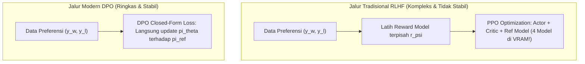

# Modul 205: Penyelarasan & Pasca-Pelatihan LLM (Instruction Tuning SFT, Parameter-Efficient LoRA/QLoRA, RLHF PPO, DPO, GRPO)

**Navigasi**: [⬅️ Master Index](../../INDEX.md) | [Tingkat 13: Tingkat 13: Sains Kognitif, Neuroengineering & Computational Linguistics](./README.md)
*Sebelumnya*: [204. paradigma-pra-pelatihan-taksonomi-llm](./204-paradigma-pra-pelatihan-taksonomi-llm.md) | *Berikutnya*: [206. rekayasa-prompt-agen-otonom-aplikasi-llm](./206-rekayasa-prompt-agen-otonom-aplikasi-llm.md)

---

## 1. Intuisi Dasar Tanpa Jargon ("Seperti Bayi Baru Lahir")
Model AI yang baru selesai melewati tahap pra-pelatihan (*pretrained base model*) seperti seorang sarjana jenius yang telah menghafal seluruh ensiklopedia dunia, tetapi belum pernah belajar etika berbicara dengan manusia. Jika Anda mengetik instruksi: *"Tuliskan resep membuat kue cokelat!"*, model dasar mungkin tidak akan memberikan resep, melainkan melanjutkan kalimat tersebut menjadi: *"Tuliskan resep membuat kue cokelat lainnya di bawah ini!"* karena ia hanya dilatih untuk menebak kelanjutan teks di internet ([Ouyang et al. - Training language models to follow instructions with human feedback / InstructGPT](https://arxiv.org/abs/2203.02155)).

**Penyelarasan AI (AI Alignment)** adalah proses mengubah perpustakaan teks mentah menjadi asisten pribadi yang ramah, patuh, dan aman:
1. **Supervised Fine-Tuning (SFT)**: Mengajari model cara menjawab pertanyaan dalam format percakapan tanya-jawab yang sopan.
2. **Parameter-Efficient Fine-Tuning (LoRA / QLoRA)**: Daripada mengubah seluruh miliaran parameter model (yang membutuhkan ratusan GPU), kita hanya memasang "kacamata adaptasi" mini berukuran kecil (kurang dari 1% bobot) yang bisa dipasang dan dilepas dengan cepat ([Hu et al. - LoRA: Low-Rank Adaptation of Large Language Models](https://arxiv.org/abs/2106.09685)).
3. **Penyelarasan Preferensi Manusia (RLHF & DPO)**: Mengajari model membedakan jawaban mana yang disukai manusia dan jawaban mana yang beracun, kasar, atau berbahaya menggunakan **Direct Preference Optimization (DPO)** ([Rafailov et al. - Direct Preference Optimization](https://arxiv.org/abs/2305.18290)).

## 2. Fondasi Teoretis & Aksiomatik / Matematis
Formulasi Matematis Penyelarasan & Adaptasi Parameter Rendah:

1. **Parameter-Efficient Low-Rank Adaptation (LoRA)**:
Membatasi pembaruan matriks bobot $\Delta W \in \mathbb{R}^{d \times k}$ melalui dekomposisi rank rendah $r \ll \min(d, k)$:
$$W = W_0 + \Delta W = W_0 + \frac{\alpha}{r} (B \cdot A), \quad A \in \mathbb{R}^{r \times k}, \quad B \in \mathbb{R}^{d \times r}$$
Matriks $A$ diinisialisasi secara Gaussian $\mathcal{N}(0, \sigma^2)$ dan $B$ diinisialisasi 0, sehingga $\Delta W = 0$ pada awal pelatihan. Selama inferensi, $\Delta W$ dapat dilipat langsung ke dalam $W_0$ (*zero inference latency overhead*).

2. **Penyelarasan Preferensi RLHF (PPO Objective)**:
Model bahasa dioptimalkan terhadap model hadiah (*Reward Model* $r_\psi(x, y)$) dengan penalti regularisasi divergensi KL agar tidak melenceng terlalu jauh dari model dasar $\pi_{\text{ref}}$:
$$\max_{\pi_\theta} \mathbb{E}_{(x, y) \sim \mathcal{D}} \left[ r_\psi(x, y) \right] - \beta D_{KL}\left( \pi_\theta(y \mid x) \parallel \pi_{\text{ref}}(y \mid x) \right)$$

3. **Direct Preference Optimization (DPO)**:
Membuktikan secara analitik bahwa fungsi reward optimal dapat diekstraksi secara tertutup dari rasio probabilitas kebijakan model itu sendiri:
$$r^*(x, y) = \beta \ln \frac{\pi_\theta(y \mid x)}{\pi_{\text{ref}}(y \mid x)} + \beta \ln Z(x)$$
Mengeliminasi kebutuhan melatih Reward Model terpisah dan loop RL PPO yang tidak stabil; DPO mengoptimalkan pasangan preferensi ($y_w$ disukai, $y_l$ ditolak) langsung melalui Binary Cross-Entropy sederhana:
$$\mathcal{L}_{\text{DPO}}(\theta; \pi_{\text{ref}}) = -\mathbb{E}_{(x, y_w, y_l)} \left[ \ln \sigma \left( \beta \ln \frac{\pi_\theta(y_w \mid x)}{\pi_{\text{ref}}(y_w \mid x)} - \beta \ln \frac{\pi_\theta(y_l \mid x)}{\pi_{\text{ref}}(y_l \mid x)} \right) \right]$$

4. **Group Relative Policy Optimization (GRPO - DeepSeek-R1)**:
Menghilangkan model kritik (Value Network) dengan menormalkan reward terhadap sekelompok $G$ sampel jawaban yang dihasilkan dari prompt yang sama:
$$\hat{A}_{i} = \frac{r_i - \text{mean}(\{r_1, \dots, r_G\})}{\text{std}(\{r_1, \dots, r_G\})}$$

## 3. Anatomi Teknis & Cara Kerja Internal
Arsitektur perbandingan jalur penyelarasan RLHF PPO konvensional vs Direct Preference Optimization (DPO):



DPO memotong kebutuhan VRAM hingga lebih dari 50% karena tidak perlu mempertahankan *Value Network* dan model reward tambahan, serta menghilangkan ketidakstabilan numerik yang sering melanda algoritma reinforcement learning aktor-kritik ([Rafailov et al. NeurIPS 2023](https://arxiv.org/abs/2305.18290)).

## 4. Implementasi Praktis & Kode / Simulasi Riil
```python
import torch
import torch.nn as nn
import torch.nn.functional as F

# 1. Implementasi Sederhana Lapisan Linier LoRA (Low-Rank Adaptation)
class LoRALinear(nn.Module):
    def __init__(self, in_features, out_features, r=4, lora_alpha=8):
        super().__init__()
        # Bobot dasar yang dibekukan (Frozen Pretrained Weights)
        self.base_layer = nn.Linear(in_features, out_features)
        self.base_layer.weight.requires_grad = False
        if self.base_layer.bias is not None:
            self.base_layer.bias.requires_grad = False
            
        # Matriks adaptasi rank-rendah yang dapat dilatih
        self.r = r
        self.scaling = lora_alpha / r
        self.lora_A = nn.Parameter(torch.randn(r, in_features) * 0.01)
        self.lora_B = nn.Parameter(torch.zeros(out_features, r))
        
    def forward(self, x):
        # Base forward pass
        base_out = self.base_layer(x)
        # LoRA forward: x * (A^T * B^T) * scaling
        lora_out = (x @ self.lora_A.T @ self.lora_B.T) * self.scaling
        return base_out + lora_out

# 2. Implementasi Fungsi Loss Direct Preference Optimization (DPO)
def dpo_loss(policy_chosen_logps, policy_rejected_logps,
             reference_chosen_logps, reference_rejected_logps, beta=0.1):
    # Log-ratios untuk chosen dan rejected
    pi_logratios = policy_chosen_logps - policy_rejected_logps
    ref_logratios = reference_chosen_logps - reference_rejected_logps
    
    logits = beta * (pi_logratios - ref_logratios)
    loss = -F.logsigmoid(logits).mean()
    return loss

# Uji Coba Lapisan LoRA
lora_layer = LoRALinear(in_features=128, out_features=64, r=8)
x = torch.randn(4, 128)
output = lora_layer(x)

trainable_params = sum(p.numel() for p in lora_layer.parameters() if p.requires_grad)
frozen_params = sum(p.numel() for p in lora_layer.parameters() if not p.requires_grad)

print(f"Bentuk Output LoRA: {output.shape}")
print(f"Parameter Beku (Base)   : {frozen_params}")
print(f"Parameter Latih (LoRA)  : {trainable_params} ({trainable_params/(frozen_params+trainable_params)*100:.2f}% dari total)")
```

## 5. Miskonsepsi & Jebakan Industri
*Alignment Tax & De-generalization*: Penyelarasan instruksi dan safety yang terlalu agresif dapat merusak kemampuan penalaran matematika murni dan kreativitas model dasar (*alignment tax*), atau membuat model menjadi penolak hiper-sensitif (*over-refusal*) yang menolak menjawab pertanyaan tidak berbahaya seperti *"Bagaimana cara mematikan program komputer?"* karena mengira kata 'mematikan' adalah tindakan kekerasan. Seimbangkan dataset SFT dengan menyertakan sampel data non-penyelarasan dan data penalaran matematika eksplisit ([Bai et al. - Training a Helpful and Harmless Assistant with Reinforcement Learning](https://arxiv.org/abs/2204.05862)).

## 6. Proyek Latihan & Rubrik Penilaian Mandiri
### Level 1 (Pemula)
Gunakan pustaka HuggingFace `peft` untuk memasang modul LoRA (`LoraConfig(r=8, lora_alpha=16, target_modules=["q_proj", "v_proj"])`) pada model bahasa kecil (seperti Qwen2.5-0.5B atau TinyLlama), lalu verifikasi bahwa hanya $< 1\%$ parameter yang berstatus `requires_grad=True`.
*Rubrik*: Output mencetak ringkasan parameter terlatih vs parameter terbekukan.

### Level 2 (Menengah)
Bangun pipeline Instruction Tuning (SFT) sederhana menggunakan pustaka `trl.SFTTrainer`: siapkan format dataset prompt-response multi-turn ChatML (`<|im_start|>user\n...<|im_end|>\n<|im_start|>assistant\n...`), terapkan masking loss pada bagian prompt sehingga loss gradien hanya dihitung pada respons jawaban asisten.
*Rubrik*: Verifikasi bahwa loss tidak dihitung pada token pengguna (*user prompt masking*).

### Level 3 (Mahir)
Implementasikan algoritma Group Relative Policy Optimization (GRPO) dari DeepSeek-R1 di PyTorch: buat generator yang mengambil satu prompt pertanyaan matematika, memproduksi $G = 8$ kandidat jawaban via temperature sampling, menghitung reward aturan biner (1.0 jika jawaban akhir di dalam tag `<answer>` benar, 0.0 jika salah), menormalkan advantage, dan memperbarui kebijakan model via clipping bound PPO tanpa value network.
*Rubrik*: Advantage ternormalisasi dengan mean 0 dan varians 1 di seluruh kelompok sampel.

## 7. Rekomendasi Sumber Belajar Standar Emas
| Sumber Pembelajaran | Penulis / Institusi | Tautan Langsung | Fokus Materi |
| :--- | :--- | :--- | :--- |
| LoRA: Low-Rank Adaptation of Large Language Models | Edward J. Hu et al. (Microsoft) | [arXiv LoRA Paper](https://arxiv.org/abs/2106.09685) | Dekomposisi Rank Rendah, Reduksi Memori Fine-Tuning |
| Direct Preference Optimization: Your Language Model Is Secretly a Reward Model | Rafael Rafailov et al. (Stanford University) | [arXiv DPO Paper](https://arxiv.org/abs/2305.18290) | Formulasi Analitik DPO, Eliminasi Loop RL Tradisional |
| Training Language Models to Follow Instructions (InstructGPT) | Long Ouyang et al. (OpenAI) | [arXiv InstructGPT Paper](https://arxiv.org/abs/2203.02155) | Metodologi Tiga Tahap: Pretraining, SFT, dan RLHF |
| DeepSeek-R1: Incentivizing Reasoning Capability in LLMs via Reinforcement Learning | DeepSeek-AI Research Team | [arXiv DeepSeek-R1 Paper](https://arxiv.org/abs/2501.12948) | Algoritma GRPO, Pure RL Reasoning, Penalaran Muncul Mandiri |

---
*Navigasi Cepat*: [Ke Tingkat 13](./README.md) | [Ke Master Index](../../INDEX.md) | *Sebelumnya*: [204. paradigma-pra-pelatihan-taksonomi-llm](./204-paradigma-pra-pelatihan-taksonomi-llm.md) | *Berikutnya*: [206. rekayasa-prompt-agen-otonom-aplikasi-llm](./206-rekayasa-prompt-agen-otonom-aplikasi-llm.md)
