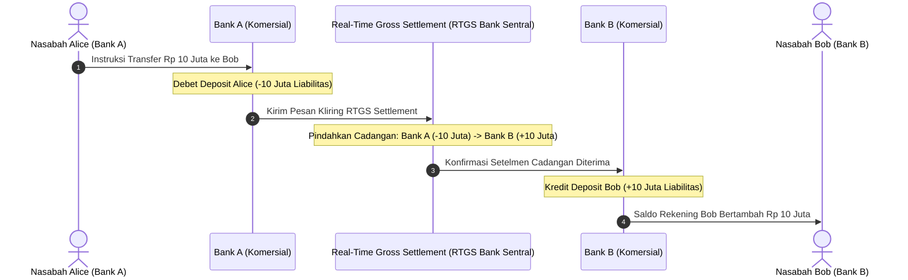

# Modul 207: Fondasi Ekonomi Pasar, Moneter & Perbankan (Uang Fiat, Fractional-Reserve Banking, Struktur Neraca Bank Komersial)

**Navigasi**: [⬅️ Master Index](../../INDEX.md) | [Tingkat 14: Tingkat 14: Fintech, Financial Engineering, HFT & Blockchain](./README.md)
*Sebelumnya*: [206. rekayasa-prompt-agen-otonom-aplikasi-llm](../13-sains-kognitif-nlp/206-rekayasa-prompt-agen-otonom-aplikasi-llm.md) | *Berikutnya*: [208. akuntansi-komputasional-arsitektur-buku-besar](./208-akuntansi-komputasional-arsitektur-buku-besar.md)

---

## 1. Intuisi Dasar Tanpa Jargon ("Seperti Bayi Baru Lahir")
### 1.1 Konsep Inti & Analogi Tanpa Jargon
Di mana uang sebenarnya berasal? Sebagian besar orang mengira bahwa ketika mereka meminjam Rp 100 juta dari bank, bank mengambil uang tunai fisik milik nasabah lain dari dalam brankas besi lalu menyerahkannya.

### 1.2 Urgensi Rekayasa & Signifikansi Sistemik
Faktanya, dalam sistem keuangan modern (**Fractional-Reserve Banking**), uang diciptakan dari ketiadaan (*ex nihilo*) melalui pencatatan akuntansi digital ([Bank of England - Money Creation in the Modern Economy](https://www.bankofengland.co.uk/quarterly-bulletin/2014/q1/money-creation-in-the-modern-economy)). Ketika bank menyetujui pinjaman Anda, bank hanya mengetik angka "Rp 100.000.000" di layar komputer rekening Anda (sebagai liabilitas bank) dan mencatat surat utang Anda di sisi lain (sebagai aset bank).

Sistem moneter modern adalah jejaring kepercayaan raksasa yang diatur oleh **Bank Sentral** (seperti Federal Reserve atau Bank Indonesia). Bank sentral mengatur jumlah likuiditas melalui suku bunga acuan (*Interest Rate*) dan rasio giro wajib minimum (*Reserve Requirement*), memastikan bahwa roda perputaran ekonomi tidak mengalami kepanikan penarikan massal (**Bank Run**) ([Mishkin - The Economics of Money, Banking, and Financial Markets](https://www.pearson.com/en-us/subject-catalog/p/economics-of-money-banking-and-financial-markets-the/P200000003346)).

## 2. Fondasi Teoretis & Aksiomatik / Matematis
### 2.1 Kerangka Teori Aksiomatik & Formulasi Matematis
Formulasi Matematis Sistem Moneter & Multiplier Perbankan:

### 2.2 Penurunan Matematis Langkah-demi-Langkah
1. **Model Pengganda Uang Fraksional (Money Multiplier)**:
Di bawah regulasi rasio cadangan wajib $R \in (0, 1)$ dan preferensi nasabah memegang uang tunai $c = \frac{C}{D}$:
$$M = m \cdot B, \quad m = \frac{1 + c}{R + c + e}$$
Di mana $B$ adalah basis moneter (uang kartal + cadangan bank sentral), $e$ adalah kelebihan cadangan (*excess reserve*), dan $M$ adalah total jumlah uang beredar (M1/M2). Jika $c = 0$ dan $e = 0$, ekspansi kredit teoritis maksimum:
$$\Delta M = \frac{1}{R} \Delta D$$

2. **Persamaan Neraca Bank Komersial (T-Account Balance Sheet)**:
$$\text{Aset} \equiv \text{Liabilitas} + \text{Ekuitas}$$
* Sisi Aset: Cadangan Tunai di Bank Sentral ($R$), Pinjaman yang Disalurkan kepada Debitur ($L$), Surat Berharga Negara ($S$).
* Sisi Liabilitas: Simpanan Rekening Giro/Tabungan Nasabah ($D$), Pinjaman Antarbank ($B$).
* Rasio Kecukupan Modal Basel III (Capital Adequacy Ratio / CAR):
$$\text{CAR} = \frac{\text{Tier 1 Capital} + \text{Tier 2 Capital}}{\text{Risk-Weighted Assets (RWA)}} \ge 8\%$$
Mencegah kebangkrutan bank akibat gagal bayar kredit sistemik ([Bank for International Settlements - Basel III Framework](https://www.bis.org/bcbs/basel3.htm)).

3. **Mekanisme Pasar Uang Antar Bank (Interbank Lending Rate)**:
Tingkat bunga semalam (*Overnight Rate* seperti SOFR atau BI-Rate) terbentuk dari perpotongan kurva permintaan likuiditas cadangan bank terhadap target koridor fasilitas bank sentral (Deposit Facility vs Lending Facility).

## 3. Anatomi Teknis & Cara Kerja Internal
Arsitektur interaksi neraca akuntansi dua bank komersial selama transfer kawat bank sentral (RTGS):



Uang tidak pernah benar-benar "berpindah kabel"; yang terjadi adalah pembaruan buku besar serentak di Bank Sentral (*Real-Time Gross Settlement / RTGS*) yang menyelaraskan cadangan antarbank secara atomik ([CPMI - Core Principles for Systemically Important Payment Systems](https://www.bis.org/cpmi/publ/d43.htm)).

#### Tabel Penelusuran Model Kesenjangan Durasi Aset-Liabilitas SVB & Guncangan Suku Bunga
| Timestamp / Sequence ID | Komponen / Lapisan Sistem | Pesan Masuk (FIX / Transaksi) | Operasi Antrean / Komputasi Buku | State Buku Pesanan (LOB / Ledger) | Event Terpancar (Fill / Block Emit) |
|---|---|---|---|---|---|
| 09:00:00.000 (Seq #1) | Manajemen Neraca Bank (ALM) | Portofolio Obligasi US Treasury \$91M | Klasifikasi Akuntansi: Held-To-Maturity (HTM) | Durasi Tertimbang Aset: $D_{\text{asset}} = 5.6$ tahun | Neraca tampak seimbang pada suku bunga 0.25% |
| 11:30:00.120 (Seq #2) | Bank Sentral (Federal Reserve) | Pengumuman Kenaikan Suku Bunga $+450\text{ bps}$ | Perhitungan Konveksitas: $\Delta P \approx -D \cdot \Delta y \cdot P$ | Nilai wajar pasar obligasi anjlok $-\$15\text{ Miliar}$ | Kerugian pasar belum direalisasikan (*Unrealized Loss*) |
| 14:00:00.540 (Seq #3) | Rekening Giro Startup Tech | Penarikan Dana Modal Kerja (\$4.2B) | Liabilitas berdurasi pendek ($D_{\text{liab}} \approx 0.1$ tahun) | Likuiditas kas cadangan harian menipis | Kesenjangan Durasi: $\Delta D = D_A - D_L = 5.5$ tahun |
| 15:30:00.890 (Seq #4) | Platform Perbankan Digital | Gelombang Penarikan Digital \$42 Miliar | Penarikan dana serentak via aplikasi mobile | SVB terpaksa menjual obligasi HTM rugi $-\$1.8\text{B}$ | Rasio kecukupan modal CET1 runtuh seketika |
| 16:00:00.999 (Seq #5) | Regulator FDIC & California DFPI | Penutupan Operasional Bank | Penyitaan aset dan pembekuan transaksi | Ekuitas modal bank bernilai negatif | Kebangkrutan perbankan terbesar sejak krisis 2008! |

## 4. Implementasi Praktis & Kode / Simulasi Riil
```python
# Simulasi Sistem Perbankan Cadangan Fraksional (Fractional-Reserve Banking)
class CentralBank:
    def __init__(self, reserve_ratio=0.10):
        self.reserve_ratio = reserve_ratio # 10% Giro Wajib Minimum
        
class CommercialBank:
    def __init__(self, name, central_bank):
        self.name = name
        self.cb = central_bank
        self.reserves = 0.0 # Cadangan uang di Bank Sentral
        self.deposits = 0.0 # Liabilitas hutang ke nasabah
        self.loans = 0.0    # Aset piutang pinjaman
        
    def deposit(self, amount):
        self.deposits += amount
        self.reserves += amount
        print(f"[{self.name}] Menerima Deposit: Rp {amount:,.0f} | Cadangan: Rp {self.reserves:,.0f}")
        
    def create_loan(self, borrower_name, amount):
        required_reserves = self.deposits * self.cb.reserve_ratio
        excess_reserves = self.reserves - required_reserves
        
        if amount > excess_reserves:
            raise ValueError(f"Pinjaman ditolak! Cadangan berlebih hanya Rp {excess_reserves:,.0f}")
            
        self.loans += amount
        self.reserves -= amount # Uang keluar ke peminjam
        print(f"[{self.name}] Menyalurkan Kredit ke {borrower_name}: Rp {amount:,.0f} (Ex Nihilo Credit Creation)")
        return amount

# Eksekusi Siklus Ekspansi Moneter Multi-Bank
bi = CentralBank(reserve_ratio=0.10)
bank_a = CommercialBank("Bank Mandiri", bi)
bank_b = CommercialBank("Bank BCA", bi)

# 1. Nasabah menyetor modal awal Rp 100 Juta ke Bank A
bank_a.deposit(100_000_000)

# 2. Bank A meminjamkan 90% (Rp 90 Juta) ke Kontraktor
loan_1 = bank_a.create_loan("Kontraktor Proyek", 90_000_000)

# 3. Kontraktor membayar supplier, yang menyetor uangnya ke Bank B
bank_b.deposit(loan_1)

# 4. Bank B meminjamkan 90% dari Rp 90 Juta (Rp 81 Juta) ke Toko Bahan Bangunan
loan_2 = bank_b.create_loan("Toko Besi", 81_000_000)

total_deposits_created = bank_a.deposits + bank_b.deposits
print(f"\nTotal Uang Beredar Baru Tercipta dalam Sistem: Rp {total_deposits_created:,.0f}")
print(f"Modal Dasar Awal: Rp 100,000,000 -> Uang Beredar Berlipat Ganda!")
```

## 5. Miskonsepsi & Jebakan Industri
*Maturity Mismatch & Bank Run Vulnerability*: Bank komersial meminjam jangka pendek (simpanan tabungan nasabah yang dapat ditarik sewaktu-waktu / *on demand*) dan meminjamkannya untuk jangka panjang (kredit pemilikan rumah 20 tahun atau obligasi jangka panjang). Jika nasabah panik secara serentak menarik simpanan mereka karena rumor kegagalan (*Bank Run* seperti Silicon Valley Bank 2023), bank yang sebenarnya solvabel secara aset akan kolaps seketika akibat ketidakmampuan melikuidasi aset jangka panjang dalam hitungan jam ([Diamond & Dybvig - Bank Runs, Deposit Insurance, and Liquidity](https://www.jstor.org/stable/1837095)).

### Studi Kasus Kegagalan Nyata: Kebangkrutan Silicon Valley Bank (SVB) Akibat Ketidakcocokan Durasi Aset-Liabilitas (Maret 2023)
- **Kronologi & Konteks Sejarah**: Pada 10 Maret 2023, regulator perbankan California dan FDIC secara resmi menutup Silicon Valley Bank (SVB)—bank terbesar ke-16 di Amerika Serikat dengan aset $209 Miliar—setelah terjadi penarikan dana massal (*bank run*) digital sebesar $42 Miliar hanya dalam kurun waktu 10 jam. Insiden ini memicu krisis perbankan regional AS dan kepanikan likuiditas global.
- **Akar Masalah Rekayasa Keuangan & Manajemen Risiko Kesenjangan Durasi**: Kehancuran SVB berakar pada kegagalan pemodelan Asset-Liability Management (ALM): Selama era suku bunga mendekati nol pada masa ledakan modal ventura 2020-2021, simpanan nasabah SVB melonjak dari $60 Miliar menjadi $189 Miliar. Alih-alih menahan likuiditas dalam instrumen pasar uang berjangka pendek, bank menginvestasikan $91 Miliar ke dalam obligasi pemerintah AS jangka panjang (*long-term mortgage-backed securities*) dengan durasi rata-rata 5,6 tahun untuk mengejar imbal hasil 1,79%. Ketika The Fed menaikkan suku bunga agresif sebesar 450 bps, nilai pasar wajar obligasi tersebut merosot lebih dari $15 Miliar. Karena simpanan nasabah adalah liabilitas tanpa jangka waktu (*zero-duration demand deposits*), bank mengalami ketidakcocokan durasi fatal (*Duration Mismatch*). Ketika deposan menarik dana serentak melalui transfer digital perbankan modern, SVB terpaksa melikuidasi obligasi sebelum jatuh tempo dan merealisasikan kerugian modal yang menghancurkan seluruh ekuitasnya.

- **Potongan Kode / Arsitektur Cacat (Vulnerable Implementation)**:
```python
# Analisis Ketidakcocokan Durasi Neraca Bank: Sensitivitas Guncangan Suku Bunga
def calculate_bank_equity_shock(assets_value, liabilities_value, duration_assets, duration_liabilities, delta_yield):
    '''
    Model Kesenjangan Durasi (Duration Gap Analysis):
    Delta_Equity = - [Duration_Assets - (Liabilities / Assets) * Duration_Liabilities] * Assets * Delta_Yield
    '''
    duration_gap = duration_assets - (liabilities_value / assets_value) * duration_liabilities
    delta_equity = - duration_gap * assets_value * delta_yield
    
    ending_equity = (assets_value - liabilities_value) + delta_equity
    return {
        "duration_gap_years": duration_gap,
        "equity_change": delta_equity,
        "ending_net_worth": ending_equity,
        "is_insolvent": ending_equity <= 0
    }

# SIMULASI SVB (Maret 2023):
# Aset: $200B (Durasi 5.6 tahun), Liabilitas: $188B (Durasi 0.1 tahun), Kenaikan Bunga: +4.5% (0.045)
# Hasil: Kerugian ekuitas melampaui seluruh modal bank, memicu kebangkrutan instan!
```

- **Analisis Forensik & Rekayasa Modern**: Runtuhnya SVB merevolusi tata kelola risiko perbankan kuantitatif: (1) Penegakan simulasi stres suku bunga dinamis (**Dynamic Interest Rate Risk in the Banking Book / IRRBB**) yang mewajibkan bank menyertakan skenario kenaikan suku bunga ekstrem $+500\text{ bps}$; (2) Penghapusan perlakuan istimewa akuntansi *Held-To-Maturity (HTM)* dalam perhitungan rasio modal regulasi bank menengah; (3) Pemodelan **Digital Liquidity Run** yang memperhitungkan kecepatan penarikan dana perbankan daring (via aplikasi mobile dan jejaring sosial) yang jauh lebih cepat daripada antrean fisik bank run tradisional.

## 6. Proyek Latihan & Rubrik Penilaian Mandiri
### Level 1 (Pemula)
Buat neraca T-Account komparatif (Aset vs Liabilitas) sebelum dan sesudah bank menerbitkan pinjaman KPR senilai Rp 500 juta dengan rasio cadangan wajib 10%, dan buktikan kedua sisi neraca tetap seimbang (*balance*).
*Rubrik*: Penyajian tabel T-Account mencantumkan akun kas cadangan, kredit piutang, dan simpanan giro.

### Level 2 (Menengah)
Bangun simulator sistem moneter multi-bank di Python: simulasikan proses ekspansi kredit berulang (*recursive money multiplication*) dari setoran awal $1.000 hingga konvergen, plot kurva total uang beredar terhadap rasio cadangan wajib $R \in [0.05, 0.25]$, dan bandingkan terhadap formula teoritis \$1/R$.
*Rubrik*: Nilai simulasi konvergen ke angka analitis $\pm 0.1\%$.

### Level 3 (Mahir)
Implementasikan model komputasional stres likuiditas Basel III Liquidity Coverage Ratio (LCR):
$$\text{LCR} = \frac{\text{Total High-Quality Liquid Assets (HQLA)}}{\text{Total Net Cash Outflows over 30 Days}} \ge 100\%$$
Simulasikan skenario penarikan simpanan retail (tingkat lari 5%), simpanan korporasi tanpa agunan (40%), dan penurunan nilai agunan surat berharga pemerintah jangka panjang. Hitung apakah bank mempertahankan rasio LCR $> 100\%$.
*Rubrik*: Perhitungan cash outflow dan inflow terdiskon sesuai aturan Basel III eksak.

### Tingkat 1: Dasar
- **Tugas**: Tulis program dalam Python untuk menghitung Durasi Macaulay dan Durasi Modifikasi dari sebuah obligasi berbunga kupon tetap (*Fixed-Coupon Bond*): Terima nilai nominal ($FV$), kupon tahunan ($C$), tahun jatuh tempo ($T$), dan tingkat suku bunga pasar (*Yield to Maturity / YTM* $y$).
- **Petunjuk Perancangan Arsitektur**:
  - Durasi Macaulay: $D_{\text{mac}} = \frac{\sum_{t=1}^T \frac{t \cdot C_t}{(1+y)^t}}{\text{Harga Obligasi } P}$.
  - Durasi Modifikasi: $D_{\text{mod}} = \frac{D_{\text{mac}}}{1 + y}$.
  - Estimasi perubahan harga persentase terhadap perubahan yield $\Delta y$: $\frac{\Delta P}{P} \approx - D_{\text{mod}} \cdot \Delta y$.
- **Test Vector & Kasus Uji**:
  - Obligasi $FV = 1000$, Kupon $5\%$, Jatuh tempo $T = 5$ tahun, $YTM = 5\%$.
  - Durasi Macaulay harus bernilai $\approx 4.546$ tahun, dan Durasi Modifikasi bernilai $\approx 4.329$ tahun.
- **Rubrik Penilaian Objektif**:
  - Skor 100%: Kalkulasi durasi Macaulay dan modifikasi presisi, discounting arus kas benar.
  - Skor 50%: Menghitung durasi Macaulay benar namun salah mengkalkulasi durasi modifikasi.
  - Skor 0%: Mengabaikan pembobotan waktu arus kas kupon.

### Tingkat 2: Menengah
- **Tugas**: Bangun modul simulasi Asset-Liability Management (ALM) dalam Python yang memodelkan neraca bank dengan berbagai portofolio kredit, sekuritas obligasi, dan rekening giro nasabah. Hitung Duration Gap dan sensitivitas Economic Value of Equity (EVE) terhadap 6 skenario guncangan suku bunga standar Basel Committee on Banking Supervision (BCBS).
- **Petunjuk Perancangan Arsitektur**:
  - 6 Skenario BCBS: Parallel Up ($+200\text{ bps}$), Parallel Down ($-200\text{ bps}$), Steepener, Flattener, Short Rate Up, Short Rate Down.
  - Hitung persentase penurunan nilai ekuitas: $\frac{\Delta EVE}{\text{Tier 1 Capital}}$.
  - Tandai status peringatan merah jika penurunan EVE melampaui batas toleransi risiko regulasi ($15\%$ dari Tier 1 Capital).
- **Test Vector & Kasus Uji**:
  - Masukkan struktur neraca bank mirip SVB.
  - Pada skenario Parallel Up $+200\text{ bps}$, simulator harus mendeteksi pelanggaran batas toleransi dan melaporkan `CRITICAL_CAPITAL_IMPAIRMENT_WARNING`.
- **Rubrik Penilaian Objektif**:
  - Skor 100%: Pemodelan 6 skenario BCBS presisi, kalkulasi EVE akurat, integrasi batas modal regulasi benar.
  - Skor 50%: Hanya menguji satu skenario paralel tanpa menguji skenario pergeseran kemiringan kurva imbal hasil (steepener/flattener).
  - Skor 0%: Mengasumsikan nilai aset dan liabilitas konstan tidak terpengaruh suku bunga.

### Tingkat 3: Mahir
- **Tugas**: Rancang sistem lindung nilai suku bunga otomatis (*Automated Interest Rate Swaps Hedging Optimizer*) dalam Python menggunakan pemrograman linier kuadratik (CVXPY / SciPy): Tentukan portofolio kontrak swap suku bunga (*Receive-Floating / Pay-Fixed Swaps*) multi-tenor yang meminimalkan Duration Gap neraca bank hingga tepat nol ($\Delta D = 0$) dengan biaya transaksi premi swap minimum.
- **Petunjuk Perancangan Arsitektur**:
  - Variabel keputusan: Bobot alokasi nosional kontrak swap pada tenor 2 tahun, 5 tahun, dan 10 tahun.
  - Fungsi objektif: Minimasikan biaya bid-ask spread dan margin modal swap: $\min \sum c_i |x_i|$.
  - Batasan (*Constraints*): Durasi neraca hasil lindung nilai berada pada interval toleransi ketat $[-0.05, +0.05]$ tahun, dengan batas leverage nosional maksimum.
- **Test Vector & Kasus Uji**:
  - Masukkan neraca dengan kesenjangan durasi $+4.2$ tahun.
  - Optimizer harus menghasilkan kombinasi kontrak swap yang mereduksi Duration Gap menjadi $0.00$ tahun dengan efisiensi biaya terbukti matematis.
- **Rubrik Penilaian Objektif**:
  - Skor 100%: Formulasi pemrograman kuadratik presisi, eliminasi duration gap sempurna, solusi optimal Pareto.
  - Skor 50%: Menggunakan swap instrumen tunggal tanpa optimasi multi-tenor kurva imbal hasil.
  - Skor 0%: Nilai durasi neraca pasca lindung nilai menyimpang dari nol.

## 7. Rekomendasi Sumber Belajar Standar Emas
| Sumber Pembelajaran | Penulis / Institusi | Tautan Langsung | Fokus Materi |
| :--- | :--- | :--- | :--- |
| Money Creation in the Modern Economy | Michael McLeay et al. (Bank of England) | [Bank of England Quarterly Bulletin](https://www.bankofengland.co.uk/quarterly-bulletin/2014/q1/money-creation-in-the-modern-economy) | Dekonstruksi Mitos Uang: Fractional-Reserve Realitas |
| Bank Runs, Deposit Insurance, and Liquidity | Douglas W. Diamond & Philip H. Dybvig (Nobel 2022) | [Journal of Political Economy](https://www.jstor.org/stable/1837095) | Model Teoretis Terkenal Diamond-Dybvig Keruntuhan Bank |
| Basel III: A Global Regulatory Framework for More Resilient Banks | Basel Committee on Banking Supervision (BIS) | [BIS Official Standard](https://www.bis.org/bcbs/basel3.htm) | Rasio CAR, Tier 1 Capital, LCR, Leverage Ratio |
| The Economics of Money, Banking, and Financial Markets | Frederic S. Mishkin (Columbia University) | [Pearson Higher Ed](https://www.pearson.com/en-us/subject-catalog/p/economics-of-money-banking-and-financial-markets-the/P200000003346) | Buku Teks Standar Moneter, Kebijakan Suku Bunga Sentral |

---
*Navigasi Cepat*: [Ke Tingkat 14](./README.md) | [Ke Master Index](../../INDEX.md) | *Sebelumnya*: [206. rekayasa-prompt-agen-otonom-aplikasi-llm](../13-sains-kognitif-nlp/206-rekayasa-prompt-agen-otonom-aplikasi-llm.md) | *Berikutnya*: [208. akuntansi-komputasional-arsitektur-buku-besar](./208-akuntansi-komputasional-arsitektur-buku-besar.md)
