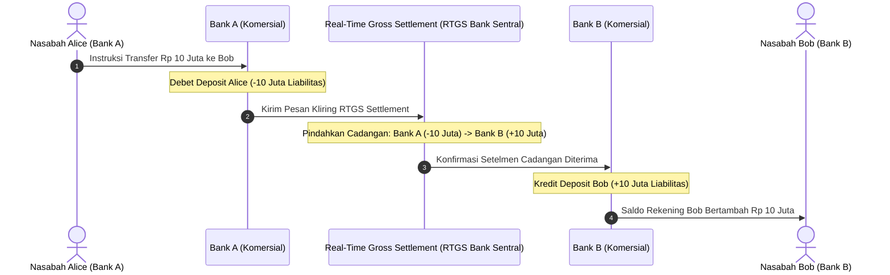

# Modul 207: Fondasi Ekonomi Pasar, Moneter & Perbankan (Uang Fiat, Fractional-Reserve Banking, Struktur Neraca Bank Komersial)

**Navigasi**: [⬅️ Master Index](../../INDEX.md) | [Tingkat 14: Tingkat 14: Fintech, Financial Engineering, HFT & Blockchain](./README.md)
*Sebelumnya*: [206. rekayasa-prompt-agen-otonom-aplikasi-llm](../13-sains-kognitif-nlp/206-rekayasa-prompt-agen-otonom-aplikasi-llm.md) | *Berikutnya*: [208. akuntansi-komputasional-arsitektur-buku-besar](./208-akuntansi-komputasional-arsitektur-buku-besar.md)

---

## 1. Intuisi Dasar Tanpa Jargon ("Seperti Bayi Baru Lahir")
Di mana uang sebenarnya berasal? Sebagian besar orang mengira bahwa ketika mereka meminjam Rp 100 juta dari bank, bank mengambil uang tunai fisik milik nasabah lain dari dalam brankas besi lalu menyerahkannya.

Faktanya, dalam sistem keuangan modern (**Fractional-Reserve Banking**), uang diciptakan dari ketiadaan (*ex nihilo*) melalui pencatatan akuntansi digital ([Bank of England - Money Creation in the Modern Economy](https://www.bankofengland.co.uk/quarterly-bulletin/2014/q1/money-creation-in-the-modern-economy)). Ketika bank menyetujui pinjaman Anda, bank hanya mengetik angka "Rp 100.000.000" di layar komputer rekening Anda (sebagai liabilitas bank) dan mencatat surat utang Anda di sisi lain (sebagai aset bank).

Sistem moneter modern adalah jejaring kepercayaan raksasa yang diatur oleh **Bank Sentral** (seperti Federal Reserve atau Bank Indonesia). Bank sentral mengatur jumlah likuiditas melalui suku bunga acuan (*Interest Rate*) dan rasio giro wajib minimum (*Reserve Requirement*), memastikan bahwa roda perputaran ekonomi tidak mengalami kepanikan penarikan massal (**Bank Run**) ([Mishkin - The Economics of Money, Banking, and Financial Markets](https://www.pearson.com/en-us/subject-catalog/p/economics-of-money-banking-and-financial-markets-the/P200000003346)).

## 2. Fondasi Teoretis & Aksiomatik / Matematis
Formulasi Matematis Sistem Moneter & Multiplier Perbankan:

1. **Model Pengganda Uang Fraksional (Money Multiplier)**:
Di bawah regulasi rasio cadangan wajib $R \in (0, 1)$ dan preferensi nasabah memegang uang tunai $c = \frac{C}{D}$:
$$M = m \cdot B, \quad m = \frac{1 + c}{R + c + e}$$
Di mana $B$ adalah basis moneter (uang kartal + cadangan bank sentral), $e$ adalah kelebihan cadangan (*excess reserve*), dan $M$ adalah total jumlah uang beredar (M1/M2). Jika $c = 0$ dan $e = 0$, ekspansi kredit teoritis maksimum:
$$\Delta M = \frac{1}{R} \Delta D$$

2. **Persamaan Neraca Bank Komersial (T-Account Balance Sheet)**:
$$\text{Aset} \equiv \text{Liabilitas} + \text{Ekuitas}$$
* Sisi Aset: Cadangan Tunai di Bank Sentral ($R$), Pinjaman yang Disalurkan kepada Debitur ($L$), Surat Berharga Negara ($S$).
* Sisi Liabilitas: Simpanan Rekening Giro/Tabungan Nasabah ($D$), Pinjaman Antarbank ($B$).
* Rasio Kecukupan Modal Basel III (Capital Adequacy Ratio / CAR):
$$\text{CAR} = \frac{\text{Tier 1 Capital} + \text{Tier 2 Capital}}{\text{Risk-Weighted Assets (RWA)}} \ge 8\%$$
Mencegah kebangkrutan bank akibat gagal bayar kredit sistemik ([Bank for International Settlements - Basel III Framework](https://www.bis.org/bcbs/basel3.htm)).

3. **Mekanisme Pasar Uang Antar Bank (Interbank Lending Rate)**:
Tingkat bunga semalam (*Overnight Rate* seperti SOFR atau BI-Rate) terbentuk dari perpotongan kurva permintaan likuiditas cadangan bank terhadap target koridor fasilitas bank sentral (Deposit Facility vs Lending Facility).

## 3. Anatomi Teknis & Cara Kerja Internal
Arsitektur interaksi neraca akuntansi dua bank komersial selama transfer kawat bank sentral (RTGS):



Uang tidak pernah benar-benar "berpindah kabel"; yang terjadi adalah pembaruan buku besar serentak di Bank Sentral (*Real-Time Gross Settlement / RTGS*) yang menyelaraskan cadangan antarbank secara atomik ([CPMI - Core Principles for Systemically Important Payment Systems](https://www.bis.org/cpmi/publ/d43.htm)).

## 4. Implementasi Praktis & Kode / Simulasi Riil
```python
# Simulasi Sistem Perbankan Cadangan Fraksional (Fractional-Reserve Banking)
class CentralBank:
    def __init__(self, reserve_ratio=0.10):
        self.reserve_ratio = reserve_ratio # 10% Giro Wajib Minimum
        
class CommercialBank:
    def __init__(self, name, central_bank):
        self.name = name
        self.cb = central_bank
        self.reserves = 0.0 # Cadangan uang di Bank Sentral
        self.deposits = 0.0 # Liabilitas hutang ke nasabah
        self.loans = 0.0    # Aset piutang pinjaman
        
    def deposit(self, amount):
        self.deposits += amount
        self.reserves += amount
        print(f"[{self.name}] Menerima Deposit: Rp {amount:,.0f} | Cadangan: Rp {self.reserves:,.0f}")
        
    def create_loan(self, borrower_name, amount):
        required_reserves = self.deposits * self.cb.reserve_ratio
        excess_reserves = self.reserves - required_reserves
        
        if amount > excess_reserves:
            raise ValueError(f"Pinjaman ditolak! Cadangan berlebih hanya Rp {excess_reserves:,.0f}")
            
        self.loans += amount
        self.reserves -= amount # Uang keluar ke peminjam
        print(f"[{self.name}] Menyalurkan Kredit ke {borrower_name}: Rp {amount:,.0f} (Ex Nihilo Credit Creation)")
        return amount

# Eksekusi Siklus Ekspansi Moneter Multi-Bank
bi = CentralBank(reserve_ratio=0.10)
bank_a = CommercialBank("Bank Mandiri", bi)
bank_b = CommercialBank("Bank BCA", bi)

# 1. Nasabah menyetor modal awal Rp 100 Juta ke Bank A
bank_a.deposit(100_000_000)

# 2. Bank A meminjamkan 90% (Rp 90 Juta) ke Kontraktor
loan_1 = bank_a.create_loan("Kontraktor Proyek", 90_000_000)

# 3. Kontraktor membayar supplier, yang menyetor uangnya ke Bank B
bank_b.deposit(loan_1)

# 4. Bank B meminjamkan 90% dari Rp 90 Juta (Rp 81 Juta) ke Toko Bahan Bangunan
loan_2 = bank_b.create_loan("Toko Besi", 81_000_000)

total_deposits_created = bank_a.deposits + bank_b.deposits
print(f"\nTotal Uang Beredar Baru Tercipta dalam Sistem: Rp {total_deposits_created:,.0f}")
print(f"Modal Dasar Awal: Rp 100,000,000 -> Uang Beredar Berlipat Ganda!")
```

## 5. Miskonsepsi & Jebakan Industri
*Maturity Mismatch & Bank Run Vulnerability*: Bank komersial meminjam jangka pendek (simpanan tabungan nasabah yang dapat ditarik sewaktu-waktu / *on demand*) dan meminjamkannya untuk jangka panjang (kredit pemilikan rumah 20 tahun atau obligasi jangka panjang). Jika nasabah panik secara serentak menarik simpanan mereka karena rumor kegagalan (*Bank Run* seperti Silicon Valley Bank 2023), bank yang sebenarnya solvabel secara aset akan kolaps seketika akibat ketidakmampuan melikuidasi aset jangka panjang dalam hitungan jam ([Diamond & Dybvig - Bank Runs, Deposit Insurance, and Liquidity](https://www.jstor.org/stable/1837095)).

## 6. Proyek Latihan & Rubrik Penilaian Mandiri
### Level 1 (Pemula)
Buat neraca T-Account komparatif (Aset vs Liabilitas) sebelum dan sesudah bank menerbitkan pinjaman KPR senilai Rp 500 juta dengan rasio cadangan wajib 10%, dan buktikan kedua sisi neraca tetap seimbang (*balance*).
*Rubrik*: Penyajian tabel T-Account mencantumkan akun kas cadangan, kredit piutang, dan simpanan giro.

### Level 2 (Menengah)
Bangun simulator sistem moneter multi-bank di Python: simulasikan proses ekspansi kredit berulang (*recursive money multiplication*) dari setoran awal $1.000 hingga konvergen, plot kurva total uang beredar terhadap rasio cadangan wajib $R \in [0.05, 0.25]$, dan bandingkan terhadap formula teoritis $1/R$.
*Rubrik*: Nilai simulasi konvergen ke angka analitis $\pm 0.1\%$.

### Level 3 (Mahir)
Implementasikan model komputasional stres likuiditas Basel III Liquidity Coverage Ratio (LCR):
$$\text{LCR} = \frac{\text{Total High-Quality Liquid Assets (HQLA)}}{\text{Total Net Cash Outflows over 30 Days}} \ge 100\%$$
Simulasikan skenario penarikan simpanan retail (tingkat lari 5%), simpanan korporasi tanpa agunan (40%), dan penurunan nilai agunan surat berharga pemerintah jangka panjang. Hitung apakah bank mempertahankan rasio LCR $> 100\%$.
*Rubrik*: Perhitungan cash outflow dan inflow terdiskon sesuai aturan Basel III eksak.

## 7. Rekomendasi Sumber Belajar Standar Emas
| Sumber Pembelajaran | Penulis / Institusi | Tautan Langsung | Fokus Materi |
| :--- | :--- | :--- | :--- |
| Money Creation in the Modern Economy | Michael McLeay et al. (Bank of England) | [Bank of England Quarterly Bulletin](https://www.bankofengland.co.uk/quarterly-bulletin/2014/q1/money-creation-in-the-modern-economy) | Dekonstruksi Mitos Uang: Fractional-Reserve Realitas |
| Bank Runs, Deposit Insurance, and Liquidity | Douglas W. Diamond & Philip H. Dybvig (Nobel 2022) | [Journal of Political Economy](https://www.jstor.org/stable/1837095) | Model Teoretis Terkenal Diamond-Dybvig Keruntuhan Bank |
| Basel III: A Global Regulatory Framework for More Resilient Banks | Basel Committee on Banking Supervision (BIS) | [BIS Official Standard](https://www.bis.org/bcbs/basel3.htm) | Rasio CAR, Tier 1 Capital, LCR, Leverage Ratio |
| The Economics of Money, Banking, and Financial Markets | Frederic S. Mishkin (Columbia University) | [Pearson Higher Ed](https://www.pearson.com/en-us/subject-catalog/p/economics-of-money-banking-and-financial-markets-the/P200000003346) | Buku Teks Standar Moneter, Kebijakan Suku Bunga Sentral |

---
*Navigasi Cepat*: [Ke Tingkat 14](./README.md) | [Ke Master Index](../../INDEX.md) | *Sebelumnya*: [206. rekayasa-prompt-agen-otonom-aplikasi-llm](../13-sains-kognitif-nlp/206-rekayasa-prompt-agen-otonom-aplikasi-llm.md) | *Berikutnya*: [208. akuntansi-komputasional-arsitektur-buku-besar](./208-akuntansi-komputasional-arsitektur-buku-besar.md)
