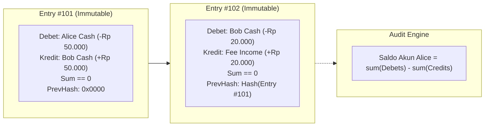

# Modul 208: Akuntansi Komputasional & Arsitektur Buku Besar (Double-Entry Bookkeeping, Larangan Float, Append-Only Immutable Ledger)

**Navigasi**: [⬅️ Master Index](../../INDEX.md) | [Tingkat 14: Tingkat 14: Fintech, Financial Engineering, HFT & Blockchain](./README.md)
*Sebelumnya*: [207. fondasi-ekonomi-pasar-moneter-perbankan](./207-fondasi-ekonomi-pasar-moneter-perbankan.md) | *Berikutnya*: [209. infrastruktur-jaringan-pembayaran-regulasi](./209-infrastruktur-jaringan-pembayaran-regulasi.md)

---

## 1. Intuisi Dasar Tanpa Jargon ("Seperti Bayi Baru Lahir")
### 1.1 Konsep Inti & Analogi Tanpa Jargon
Bayangkan Anda sedang membangun sebuah sistem perbankan atau dompet digital (*fintech*). Jika seorang pengguna mentransfer uang Rp 50.000 ke temannya, apa yang Anda lakukan di database? Apakah Anda cukup menjalankan perintah: `UPDATE users SET balance = balance - 50000 WHERE id = 1`?

### 1.2 Urgensi Rekayasa & Signifikansi Sistemik
Jika Anda melakukan itu, Anda telah melakukan dosa terbesar dalam rekayasa sistem keuangan! Bagaimana jika server Anda mati mendadak setelah saldo pengirim dipotong tetapi sebelum saldo penerima bertambah? Uang Rp 50.000 tersebut lenyap ke udara, dan tidak ada seorang pun di dunia ini yang bisa membuktikan ke mana uang itu pergi karena saldo lama telah ditimpa secara permanen.

Inilah mengapa peradaban modern bertumpu pada **Pembukuan Berpasangan (Double-Entry Bookkeeping)** yang telah teruji selama lebih dari 500 tahun ([Luca Pacioli - Summa de Arithmetica, 1494](https://www.maa.org/press/periodicals/convergence/mathematical-treasure-luca-paciolis-summa-de-arithmetica)). Dalam buku besar keuangan, **saldo tidak pernah disimpan sebagai angka tunggal yang ditimpa**. Setiap transaksi adalah catatan permanen yang tidak dapat diubah (*immutable append-only*): setiap rupiah yang keluar dari satu akun (**Kredit**) harus dicatat masuk ke akun lain (**Debet**) dalam jumlah yang persis sama. Dan satu aturan mutlak: **Jangan pernah menggunakan tipe data float untuk uang!** ([Martin Fowler - Accounting Patterns](https://martinfowler.com/eaaDev/AccountingNarrative.html)).

## 2. Fondasi Teoretis & Aksiomatik / Matematis
### 2.1 Kerangka Teori Aksiomatik & Formulasi Matematis
Landasan Matematis & Aksioma Buku Besar Komputasional:

### 2.2 Penurunan Matematis Langkah-demi-Langkah
1. **Aksioma Dasar Pembukuan Berpasangan (Double-Entry Equation)**:
Sistem akun dipartisi menjadi 5 kelas primer: Aset ($A$), Beban/Expenses ($E$), Liabilitas ($L$), Ekuitas ($Q$), dan Pendapatan/Revenue ($R$):
$$(A + E) \equiv (L + Q + R)$$
Dalam konvensi debet/kredit bertanda aljabar:
$$\sum_{i=1}^N \text{Amount}_i \equiv 0 \quad (\text{Zero-Sum Conservation Law})$$
Setiap transaksi keuangan $T$ adalah tuple $\langle \text{ID}, \text{Timestamp}, \{(a_1, v_1), (a_2, v_2), \dots, (a_k, v_k)\} \rangle$ dengan syarat invarian mutlak: $\sum_{j=1}^k v_j = 0$.

2. **Bencana Pembulatan Floating-Point IEEE 754**:
Bilangan pecahan biner floating-point tidak dapat merepresentasikan desimal seperti 0.1 secara eksak:
$$0.1_{10} = 0.0001100110011\dots_2$$
Dalam Python: `0.1 + 0.2 == 0.3` menghasilkan `False` (`0.30000000000000004`)! Akumulasi galat pembulatan pada jutaan transaksi harian akan merusak integritas rekonsiliasi keuangan. Selalu gunakan bilangan bulat presisi tetap (*Fixed-Point Integer* atau representasi satuan terkecil / sen / satoshi).

3. **Prinsip Imutabilitas Append-Only**:
Buku besar finansial adalah log linier monotonik:
$$\text{Ledger}_{t+1} = \text{Ledger}_t \cup \{T_{\text{new}}\}$$
Tidak ada operasi `UPDATE` atau `DELETE`. Jika terjadi kesalahan transfer, perbaikan dilakukan dengan mencatat transaksi pembalik baru (*reversal / compensating transaction*) ([TigerBeetle Architecture - Design of a Financial Accounting Database](https://github.com/tigerbeetle/tigerbeetle/blob/main/docs/DESIGN.md)).

## 3. Anatomi Teknis & Cara Kerja Internal
Arsitektur integritas data buku besar keuangan append-only dengan rantai hash kriptografis:



Saldo akun dihitung sebagai agregasi derivatif (*materialized view*) dari penjumlahan seluruh entri mutasi sejarah sejak awal mula, menjamin bukti audit (*audit trail*) matematis yang tidak terbantahkan ([Fowler Accounting Patterns](https://martinfowler.com/eaaDev/AccountingNarrative.html)).

#### Tabel Penelusuran Galat Pemotongan Desimal Indeks Bursa Vancouver
| Timestamp / Sequence ID | Komponen / Lapisan Sistem | Pesan Masuk (FIX / Transaksi) | Operasi Antrean / Komputasi Buku | State Buku Pesanan (LOB / Ledger) | Event Terpancar (Fill / Block Emit) |
|---|---|---|---|---|---|
| Jan 1982 (Tiket #1) | Komputer Bursa Vancouver | Inisialisasi Nilai Indeks Acuan | Indeks dasar disetel: $Index_0 = 1000.000$ | Nilai acuan tersimpan di register floating-point | Indeks pasar saham resmi diluncurkan |
| Perdagangan Harian | Transaksi Saham Volume Tinggi | Setiap kali transaksi saham selesai | Formula indeks: $I_{t+1} = I_t + \Delta$ | Hasil pecahan: $1000.0019$ terpotong menjadi $1000.001$! | Galat pemotongan (*Truncation Error*) $\approx -0.0009$ |
| 2.800 Transaksi / Hari | Mesin Perhitungan Buku Besar | Akumulasi pemotongan digit desimal ke-4 | Galat sistematis negatif terakumulasi ribuan kali | Akumulator terus kehilangan fraksi nilai riil setiap detik | Indeks kehilangan $\approx 1$ poin per hari secara artifisial |
| Nov 1983 (22 Bulan) | Papan Skor Perdagangan Bursa | Publikasi Nilai Indeks Resmi | Indeks tercatat di layar bursa: $574.081$ | Investor panik mengira ekonomi Kanada kolaps! | Nilai indeks kehilangan hampir separuh nilai riilnya! |
| Rekalkulasi Presisi | Audit Komputasional Terkoreksi | Rekalkulasi ulang dengan pembulatan wajar | Nilai indeks yang sebenarnya: $1098.892$ | Skandal kesalahan perangkat lunak bursa terbongkar | Bursa Vancouver memperbaiki kode pembulatan dalam semalam |

## 4. Implementasi Praktis & Kode / Simulasi Riil
```python
from dataclasses import dataclass
from datetime import datetime, timezone
from decimal import Decimal
import hashlib

# 1. Definisi Model Entri Transaksi Double-Entry Imutabel
@dataclass(frozen=True)
class Posting:
    account_id: str
    amount_cents: int # Menggunakan Integer Sen (Rp 1 = 100 sen) untuk mencegah galat Float!

@dataclass(frozen=True)
class Transaction:
    tx_id: str
    timestamp: str
    postings: tuple[Posting, ...]
    prev_hash: str
    
    def __post_init__(self):
        # Aksioma Konservasi Finansial Mutlak: Total Debet + Total Kredit == 0
        total = sum(p.amount_cents for p in self.postings)
        if total != 0:
            raise ValueError(f"Invarian Gagal! Transaksi {self.tx_id} tidak seimbang: selisih {total} sen")

# 2. Mesin Buku Besar Append-Only (Append-Only Ledger Engine)
class FinancialLedger:
    def __init__(self):
        self.transactions: list[Transaction] = []
        self.latest_hash = "0" * 64
        
    def record_transfer(self, tx_id: str, from_account: str, to_account: str, amount_cents: int):
        if amount_cents <= 0:
            raise ValueError("Nilai transfer harus positif!")
            
        postings = (
            Posting(account_id=from_account, amount_cents=-amount_cents), # Keluar (Kredit)
            Posting(account_id=to_account, amount_cents=amount_cents)     # Masuk (Debet)
        )
        
        # Buat rantai hash kriptografis untuk integritas audit
        tx_data = f"{tx_id}{self.latest_hash}{amount_cents}"
        tx_hash = hashlib.sha256(tx_data.encode()).hexdigest()
        
        tx = Transaction(
            tx_id=tx_id,
            timestamp=datetime.now(timezone.utc).isoformat(),
            postings=postings,
            prev_hash=self.latest_hash
        )
        self.transactions.append(tx)
        self.latest_hash = tx_hash
        return tx

    def get_account_balance(self, account_id: str) -> int:
        # Saldo adalah hasil penjumlahan mutasi historis murni
        balance = 0
        for tx in self.transactions:
            for p in tx.postings:
                if p.account_id == account_id:
                    balance += p.amount_cents
        return balance

# Uji Coba Transaksi Keuangan Nyata
ledger = FinancialLedger()
ledger.record_transfer("TX_001", "ALICE_WALLET", "BOB_WALLET", 50_000_00) # Rp 50.000 (5.000.000 sen)
ledger.record_transfer("TX_002", "BOB_WALLET", "MERCHANT_XYZ", 15_000_00) # Rp 15.000 (1.500.000 sen)

print(f"Saldo Alice    : Rp {ledger.get_account_balance('ALICE_WALLET') / 100:,.2f}")
print(f"Saldo Bob      : Rp {ledger.get_account_balance('BOB_WALLET') / 100:,.2f}")
print(f"Saldo Merchant : Rp {ledger.get_account_balance('MERCHANT_XYZ') / 100:,.2f}")
print(f"Integritas Hash Rantai Ledger: {ledger.latest_hash[:16]}... (Valid & Immutable)")
```

## 5. Miskonsepsi & Jebakan Industri
*Race Condition Saldo Negatif (Double Spending via Concurrency)*: Dua transaksi penarikan dana senilai Rp 100.000 dieksekusi secara paralel di dua worker server yang berbeda pada saat yang persis bersamaan untuk akun yang hanya memiliki saldo Rp 100.000. Jika pengecekan saldo (`SELECT balance WHERE id=1`) dilakukan tanpa kuncian atomik (*pessimistic lock* `SELECT ... FOR UPDATE` atau *optimistic serializable isolation*), kedua worker akan melihat saldo cukup dan mengeksekusi penarikan, menyebabkan akun menjadi minus dan bank rugi uang riil ([TigerBeetle Design Doc](https://github.com/tigerbeetle/tigerbeetle/blob/main/docs/DESIGN.md)).

### Studi Kasus Kegagalan Nyata: Bencana Galat Pemotongan Bilangan Pecahan Indeks Bursa Efek Vancouver (1982-1983)
- **Kronologi & Konteks Sejarah**: Pada Januari 1982, Bursa Efek Vancouver (*Vancouver Stock Exchange*) memperkenalkan indeks pasar saham baru yang diinisialisasi pada nilai acuan 1.000,000. Selama 22 bulan berikutnya, para pialang dan investor heran melihat indeks tersebut terus merosot tajam hingga mencapai angka 574 pada akhir November 1983, padahal kondisi ekonomi Kanada sedang tumbuh dan harga saham individual secara umum sedang naik.
- **Akar Masalah Rekayasa Akuntansi Komputasional & Representasi Floating-Point**: Investigasi mendalam mengungkap kesalahan perangkat lunak aritmatika yang fatal: setiap kali transaksi saham terjadi (ribuan kali per hari), sistem menghitung ulang indeks dan memperbarui nilai akumulator. Alih-alih melakukan pembulatan desimal yang benar (*Round-to-Nearest*), programmer menulis kode yang memotong (*truncate*) pecahan desimal setelah digit ketiga. Akibatnya, jika perhitungan menghasilkan nilai $1000.0019$, sistem menyimpannya sebagai $1000.001$, membuang sisa $0.0009$. Karena galat pemotongan selalu bernilai negatif, galat kecil ini terakumulasi ribuan kali setiap hari. Ketika bursa menghentikan sistem dan menghitung ulang seluruh riwayat transaksi menggunakan aritmatika desimal presisi tinggi, nilai indeks yang sebenarnya melonjak dari 574 menjadi 1.098,892!

- **Potongan Kode / Arsitektur Cacat (Vulnerable Implementation)**:
```python
# Analisis Galat Akuntansi Finansial: Pemotongan Desimal vs Presisi Arbitrer Decimal
from decimal import Decimal, ROUND_HALF_UP

# KASUS CACAT BURSA VANCOUVER: Pemotongan paksa (Truncation) pada setiap pembaruan
def faulty_vancouver_index_update(current_index, delta_fraction):
    raw_val = current_index + delta_fraction
    # CACAT FATAL: Truncate ke 3 digit desimal (Membuang sisa fraksi positif)!
    # Mengakumulasikan galat negatif sistematis pada ribuan transaksi:
    truncated_val = int(raw_val * 1000) / 1000.0
    return truncated_val

# MITIGASI AMAN: Akuntansi Berbasis Integer Cents / Decimal Presisi Tinggi
def safe_financial_ledger_update(current_balance_decimal, transaction_amount_decimal):
    # Tidak pernah menggunakan float biner (IEEE-754)!
    # Selalu menggunakan Decimal dengan aturan pembulatan bankir resmi:
    new_balance = current_balance_decimal + transaction_amount_decimal
    quantized_balance = new_balance.quantize(Decimal('0.001'), rounding=ROUND_HALF_UP)
    return quantized_balance
```

- **Analisis Forensik & Rekayasa Modern**: Skandal Vancouver menetapkan aturan mutlak dalam rekayasa sistem akuntansi dan buku besar (*Financial Ledger Systems*): (1) **Larangan Mutlak Penggunaan Float Biner**: Bahasa pemrograman untuk transaksi moneter dilarang menggunakan tipe data floating-point bawaan (`float`, `double`) yang rentan terhadap galat representasi biner presisi fraksi; (2) Penggunaan representasi **Fixed-Point Decimal** atau integer sen terkecil (*Arbitrary Precision Decimal / Integer Cents*); (3) Penerapan prinsip **Double-Entry Bookkeeping Invariant Testing** di mana jumlah debet dan kredit wajib seimbang bit-for-bit ($\sum \text{Debits} == \sum \text{Credits}$) pada setiap batch posting transaksi.

## 6. Proyek Latihan & Rubrik Penilaian Mandiri
### Level 1 (Pemula)
Tulis skrip Python yang mendemonstrasikan galat akumulasi floating point IEEE 754: tambahkan angka `0.1` sebanyak 1.000.000 kali menggunakan tipe data `float` standar vs tipe data `int` (sen terkecil), dan cetak selisih galat keuangan yang dihasilkan.
*Rubrik*: Output menampilkan selisih deviasi rupiah riil yang hilang akibat pemotongan bit float.

### Level 2 (Menengah)
Bangun modul buku besar akuntansi multi-mata uang (*multi-currency ledger*): implementasikan akun perantara konversi valuta asing (*FX Settlement Clearing Account*) yang memvalidasi bahwa transaksi pertukaran USD ke IDR tetap seimbang di setiap mata uang masing-masing.
*Rubrik*: Transaksi valas lolos verifikasi keseimbangan debet-kredit di kedua denominasi mata uang.

### Level 3 (Mahir)
Rancang arsitektur mesin buku besar finansial berperforma tinggi menggunakan SQLite atau PostgreSQL dengan level isolasi transaksi `SERIALIZABLE`. Terapkan verifikasi kendala basis data (`CHECK (balance >= 0)`) dan jalankan uji konkurensi multi-thread (50 thread paralel) yang mencoba menarik dana secara bersamaan untuk membuktikan bahwa saldo negatif dan double-spending 100% mustahil terjadi.
*Rubrik*: Tidak ada race condition, tepat satu transaksi yang berhasil sementara sisanya ditolak secara aman.

### Tingkat 1: Dasar
- **Tugas**: Tulis demonstrasi perbandingan galat akumulasi floating-point dalam Python: Jumlahkan angka pecahan `0.1` sebanyak 1.000.000 kali menggunakan tipe data float standar vs modul `decimal.Decimal` presisi tetap, dan hitung selisih galat absolut terhadap nilai eksak matematika $100.000.0$.
- **Petunjuk Perancangan Arsitektur**:
  - Gunakan `float`: `total = 0.0; total += 0.1`.
  - Gunakan `Decimal`: `total = Decimal('0.0'); total += Decimal('0.1')`.
  - Catat deviasi galat dan jelaskan mengapa `0.1` tidak dapat direpresentasikan secara eksak dalam format biner IEEE-754.
- **Test Vector & Kasus Uji**:
  - Hasil float standar akan mengalami penyimpangan sebesar $\approx 0.0013$ hingga $0.0019$ dari $100.000$.
  - Hasil `Decimal` harus bernilai tepat $100000.0$ tanpa selisih sepeser pun ($Error = 0.0$).
- **Rubrik Penilaian Objektif**:
  - Skor 100%: Demonstrasi galat presisi, penjelasan konversi biner IEEE-754 tepat, pemanfaatan Decimal benar.
  - Skor 50%: Menjalankan perulangan namun salah menginisialisasi Decimal dari float alih-alih string (`Decimal(0.1)`).
  - Skor 0%: Menganggap bahwa float tidak memiliki galat representasi.

### Tingkat 2: Menengah
- **Tugas**: Bangun sistem buku besar akuntansi ganda (*Double-Entry Ledger Engine*) dari nol dalam Python: Setiap transaksi terdiri dari minimal dua entri posting (Debet dan Kredit). Terapkan aturan invarian fundamental: (1) Total debet harus sama persis dengan total kredit pada setiap transaksi; (2) Saldo akun disimpan dalam representasi integer sen; (3) Terapkan penyimpanan riwayat transaksi berbasis hash berantai (*Cryptographic Hash Chaining*) untuk menjamin *Immutability*.
- **Petunjuk Perancangan Arsitektur**:
  - Skema Transaksi: `tx_id`, `timestamp`, `postings: list[(account_id, amount_cents)]`, `prev_hash`, `hash`.
  - Jika $\sum amount \ne 0$, tolak transaksi instan dengan exception `UNBALANCED_TRANSACTION_ERROR`.
  - Hitung hash SHA-256 dari setiap transaksi yang mengikat hash transaksi sebelumnya.
- **Test Vector & Kasus Uji**:
  - Eksekusi 10 transaksi transfer dana sah: Invarian buku besar terjaga seimbang.
  - Coba suntikkan transaksi yang tidak seimbang ($Debet = \$100$, $Kredit = \$99.99$): Mesin harus melempar error dan membatalkan transaksi tanpa mengubah state buku besar.
- **Rubrik Penilaian Objektif**:
  - Skor 100%: Invarian double-entry seimbang bit-for-bit, hash chaining immutable rapi, penanganan pembulatan nol.
  - Skor 50%: Double-entry bekerja namun menggunakan tipe data float sehingga rawan galat presisi.
  - Skor 0%: Mengizinkan transaksi sepihak (single-entry debit without credit).

### Tingkat 3: Mahir
- **Tugas**: Rancang mesin rekonsiliasi transaksi keuangan terdistribusi berkecepatan tinggi (*Distributed Transaction Reconciliation Engine*) dalam Python/SQL: Bandingkan log transaksi internal bank dengan log penyelesaian kliring dari payment gateway (misal 100.000 transaksi harian), deteksi transaksi gantung (*Settlement Mismatches*, Transaksi Hilang, Selisih Biaya Pembulatan), dan hasilkan jurnal penyesuaian otomatis (*Adjustment Entries*).
- **Petunjuk Perancangan Arsitektur**:
  - Algoritma pencocokan multi-pass: (1) Exact Match on Reference ID & Amount; (2) Fuzzy Match on Time Window ($\pm 3$ menit) & Amount; (3) Foreign Exchange Currency Conversion Discrepancy Detection.
  - Kelompokkan anomali ke dalam kategori: `UNMATCHED_INTERNAL`, `UNMATCHED_EXTERNAL`, `AMOUNT_DISAGREE`.
  - Hasilkan laporan rekonsiliasi ringkas yang siap diaudit akuntan publik.
- **Test Vector & Kasus Uji**:
  - Masukkan 100.000 transaksi dengan 5 transaksi gagal sistemik di pihak payment gateway dan 3 transaksi selisih pembulatan mata uang asing.
  - Engine harus mengidentifikasi tepat ke-8 transaksi bermasalah dalam waktu $< 3$ detik.
- **Rubrik Penilaian Objektif**:
  - Skor 100%: Pipeline rekonsiliasi efisien tervektorisasi, penanganan multi-pass matching presisi, audit trail lengkap.
  - Skor 50%: Rekonsiliasi bekerja namun menggunakan nested loop $\mathcal{O}(N^2)$ lambat.
  - Skor 0%: Mengabaikan transaksi gantung di sisi eksternal.

## 7. Rekomendasi Sumber Belajar Standar Emas
| Sumber Pembelajaran | Penulis / Institusi | Tautan Langsung | Fokus Materi |
| :--- | :--- | :--- | :--- |
| Accounting Patterns | Martin Fowler | [Martin Fowler Architecture Guides](https://martinfowler.com/eaaDev/AccountingNarrative.html) | Pola Desain Perangkat Lunak Buku Besar, Posting Rules |
| TigerBeetle: Financial Accounting Database Design | TigerBeetle Core Team (Joran Dirk Greef) | [TigerBeetle Design Architecture](https://github.com/tigerbeetle/tigerbeetle/blob/main/docs/DESIGN.md) | Database Finansial Khusus Berperforma Tinggi, Zero-Allocation |
| Summa de Arithmetica, Geometria, Proportioni et Proportionalita | Fra Luca Pacioli (1494) | [Mathematical Association of America](https://www.maa.org/press/periodicals/convergence/mathematical-treasure-luca-paciolis-summa-de-arithmetica) | Naskah Sejarah Penemu Sistem Pembukuan Berpasangan |
| PCI-DSS Financial Data Security Standards | PCI Security Standards Council | [PCI-DSS Official Document](https://www.pcisecuritystandards.org/) | Keamanan Penyimpanan Data Transaksi & Kepatuhan Audit |

---
*Navigasi Cepat*: [Ke Tingkat 14](./README.md) | [Ke Master Index](../../INDEX.md) | *Sebelumnya*: [207. fondasi-ekonomi-pasar-moneter-perbankan](./207-fondasi-ekonomi-pasar-moneter-perbankan.md) | *Berikutnya*: [209. infrastruktur-jaringan-pembayaran-regulasi](./209-infrastruktur-jaringan-pembayaran-regulasi.md)
