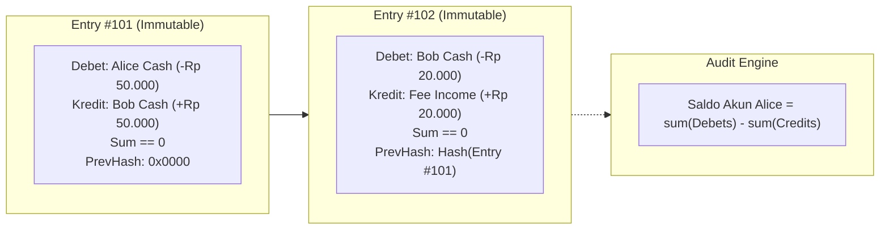

# Modul 208: Akuntansi Komputasional & Arsitektur Buku Besar (Double-Entry Bookkeeping, Larangan Float, Append-Only Immutable Ledger)

**Navigasi**: [⬅️ Master Index](../../INDEX.md) | [Tingkat 14: Tingkat 14: Fintech, Financial Engineering, HFT & Blockchain](./README.md)
*Sebelumnya*: [207. fondasi-ekonomi-pasar-moneter-perbankan](./207-fondasi-ekonomi-pasar-moneter-perbankan.md) | *Berikutnya*: [209. infrastruktur-jaringan-pembayaran-regulasi](./209-infrastruktur-jaringan-pembayaran-regulasi.md)

---

## 1. Intuisi Dasar Tanpa Jargon ("Seperti Bayi Baru Lahir")
Bayangkan Anda sedang membangun sebuah sistem perbankan atau dompet digital (*fintech*). Jika seorang pengguna mentransfer uang Rp 50.000 ke temannya, apa yang Anda lakukan di database? Apakah Anda cukup menjalankan perintah: `UPDATE users SET balance = balance - 50000 WHERE id = 1`?

Jika Anda melakukan itu, Anda telah melakukan dosa terbesar dalam rekayasa sistem keuangan! Bagaimana jika server Anda mati mendadak setelah saldo pengirim dipotong tetapi sebelum saldo penerima bertambah? Uang Rp 50.000 tersebut lenyap ke udara, dan tidak ada seorang pun di dunia ini yang bisa membuktikan ke mana uang itu pergi karena saldo lama telah ditimpa secara permanen.

Inilah mengapa peradaban modern bertumpu pada **Pembukuan Berpasangan (Double-Entry Bookkeeping)** yang telah teruji selama lebih dari 500 tahun ([Luca Pacioli - Summa de Arithmetica, 1494](https://www.maa.org/press/periodicals/convergence/mathematical-treasure-luca-paciolis-summa-de-arithmetica)). Dalam buku besar keuangan, **saldo tidak pernah disimpan sebagai angka tunggal yang ditimpa**. Setiap transaksi adalah catatan permanen yang tidak dapat diubah (*immutable append-only*): setiap rupiah yang keluar dari satu akun (**Kredit**) harus dicatat masuk ke akun lain (**Debet**) dalam jumlah yang persis sama. Dan satu aturan mutlak: **Jangan pernah menggunakan tipe data float untuk uang!** ([Martin Fowler - Accounting Patterns](https://martinfowler.com/eaaDev/AccountingNarrative.html)).

## 2. Fondasi Teoretis & Aksiomatik / Matematis
Landasan Matematis & Aksioma Buku Besar Komputasional:

1. **Aksioma Dasar Pembukuan Berpasangan (Double-Entry Equation)**:
Sistem akun dipartisi menjadi 5 kelas primer: Aset ($A$), Beban/Expenses ($E$), Liabilitas ($L$), Ekuitas ($Q$), dan Pendapatan/Revenue ($R$):
$$(A + E) \equiv (L + Q + R)$$
Dalam konvensi debet/kredit bertanda aljabar:
$$\sum_{i=1}^N \text{Amount}_i \equiv 0 \quad (\text{Zero-Sum Conservation Law})$$
Setiap transaksi keuangan $T$ adalah tuple $\langle \text{ID}, \text{Timestamp}, \{(a_1, v_1), (a_2, v_2), \dots, (a_k, v_k)\} \rangle$ dengan syarat invarian mutlak: $\sum_{j=1}^k v_j = 0$.

2. **Bencana Pembulatan Floating-Point IEEE 754**:
Bilangan pecahan biner floating-point tidak dapat merepresentasikan desimal seperti 0.1 secara eksak:
$$0.1_{10} = 0.0001100110011\dots_2$$
Dalam Python: `0.1 + 0.2 == 0.3` menghasilkan `False` (`0.30000000000000004`)! Akumulasi galat pembulatan pada jutaan transaksi harian akan merusak integritas rekonsiliasi keuangan. Selalu gunakan bilangan bulat presisi tetap (*Fixed-Point Integer* atau representasi satuan terkecil / sen / satoshi).

3. **Prinsip Imutabilitas Append-Only**:
Buku besar finansial adalah log linier monotonik:
$$\text{Ledger}_{t+1} = \text{Ledger}_t \cup \{T_{\text{new}}\}$$
Tidak ada operasi `UPDATE` atau `DELETE`. Jika terjadi kesalahan transfer, perbaikan dilakukan dengan mencatat transaksi pembalik baru (*reversal / compensating transaction*) ([TigerBeetle Architecture - Design of a Financial Accounting Database](https://github.com/tigerbeetle/tigerbeetle/blob/main/docs/DESIGN.md)).

## 3. Anatomi Teknis & Cara Kerja Internal
Arsitektur integritas data buku besar keuangan append-only dengan rantai hash kriptografis:



Saldo akun dihitung sebagai agregasi derivatif (*materialized view*) dari penjumlahan seluruh entri mutasi sejarah sejak awal mula, menjamin bukti audit (*audit trail*) matematis yang tidak terbantahkan ([Fowler Accounting Patterns](https://martinfowler.com/eaaDev/AccountingNarrative.html)).

## 4. Implementasi Praktis & Kode / Simulasi Riil
```python
from dataclasses import dataclass
from datetime import datetime, timezone
from decimal import Decimal
import hashlib

# 1. Definisi Model Entri Transaksi Double-Entry Imutabel
@dataclass(frozen=True)
class Posting:
    account_id: str
    amount_cents: int # Menggunakan Integer Sen (Rp 1 = 100 sen) untuk mencegah galat Float!

@dataclass(frozen=True)
class Transaction:
    tx_id: str
    timestamp: str
    postings: tuple[Posting, ...]
    prev_hash: str
    
    def __post_init__(self):
        # Aksioma Konservasi Finansial Mutlak: Total Debet + Total Kredit == 0
        total = sum(p.amount_cents for p in self.postings)
        if total != 0:
            raise ValueError(f"Invarian Gagal! Transaksi {self.tx_id} tidak seimbang: selisih {total} sen")

# 2. Mesin Buku Besar Append-Only (Append-Only Ledger Engine)
class FinancialLedger:
    def __init__(self):
        self.transactions: list[Transaction] = []
        self.latest_hash = "0" * 64
        
    def record_transfer(self, tx_id: str, from_account: str, to_account: str, amount_cents: int):
        if amount_cents <= 0:
            raise ValueError("Nilai transfer harus positif!")
            
        postings = (
            Posting(account_id=from_account, amount_cents=-amount_cents), # Keluar (Kredit)
            Posting(account_id=to_account, amount_cents=amount_cents)     # Masuk (Debet)
        )
        
        # Buat rantai hash kriptografis untuk integritas audit
        tx_data = f"{tx_id}{self.latest_hash}{amount_cents}"
        tx_hash = hashlib.sha256(tx_data.encode()).hexdigest()
        
        tx = Transaction(
            tx_id=tx_id,
            timestamp=datetime.now(timezone.utc).isoformat(),
            postings=postings,
            prev_hash=self.latest_hash
        )
        self.transactions.append(tx)
        self.latest_hash = tx_hash
        return tx

    def get_account_balance(self, account_id: str) -> int:
        # Saldo adalah hasil penjumlahan mutasi historis murni
        balance = 0
        for tx in self.transactions:
            for p in tx.postings:
                if p.account_id == account_id:
                    balance += p.amount_cents
        return balance

# Uji Coba Transaksi Keuangan Nyata
ledger = FinancialLedger()
ledger.record_transfer("TX_001", "ALICE_WALLET", "BOB_WALLET", 50_000_00) # Rp 50.000 (5.000.000 sen)
ledger.record_transfer("TX_002", "BOB_WALLET", "MERCHANT_XYZ", 15_000_00) # Rp 15.000 (1.500.000 sen)

print(f"Saldo Alice    : Rp {ledger.get_account_balance('ALICE_WALLET') / 100:,.2f}")
print(f"Saldo Bob      : Rp {ledger.get_account_balance('BOB_WALLET') / 100:,.2f}")
print(f"Saldo Merchant : Rp {ledger.get_account_balance('MERCHANT_XYZ') / 100:,.2f}")
print(f"Integritas Hash Rantai Ledger: {ledger.latest_hash[:16]}... (Valid & Immutable)")
```

## 5. Miskonsepsi & Jebakan Industri
*Race Condition Saldo Negatif (Double Spending via Concurrency)*: Dua transaksi penarikan dana senilai Rp 100.000 dieksekusi secara paralel di dua worker server yang berbeda pada saat yang persis bersamaan untuk akun yang hanya memiliki saldo Rp 100.000. Jika pengecekan saldo (`SELECT balance WHERE id=1`) dilakukan tanpa kuncian atomik (*pessimistic lock* `SELECT ... FOR UPDATE` atau *optimistic serializable isolation*), kedua worker akan melihat saldo cukup dan mengeksekusi penarikan, menyebabkan akun menjadi minus dan bank rugi uang riil ([TigerBeetle Design Doc](https://github.com/tigerbeetle/tigerbeetle/blob/main/docs/DESIGN.md)).

## 6. Proyek Latihan & Rubrik Penilaian Mandiri
### Level 1 (Pemula)
Tulis skrip Python yang mendemonstrasikan galat akumulasi floating point IEEE 754: tambahkan angka `0.1` sebanyak 1.000.000 kali menggunakan tipe data `float` standar vs tipe data `int` (sen terkecil), dan cetak selisih galat keuangan yang dihasilkan.
*Rubrik*: Output menampilkan selisih deviasi rupiah riil yang hilang akibat pemotongan bit float.

### Level 2 (Menengah)
Bangun modul buku besar akuntansi multi-mata uang (*multi-currency ledger*): implementasikan akun perantara konversi valuta asing (*FX Settlement Clearing Account*) yang memvalidasi bahwa transaksi pertukaran USD ke IDR tetap seimbang di setiap mata uang masing-masing.
*Rubrik*: Transaksi valas lolos verifikasi keseimbangan debet-kredit di kedua denominasi mata uang.

### Level 3 (Mahir)
Rancang arsitektur mesin buku besar finansial berperforma tinggi menggunakan SQLite atau PostgreSQL dengan level isolasi transaksi `SERIALIZABLE`. Terapkan verifikasi kendala basis data (`CHECK (balance >= 0)`) dan jalankan uji konkurensi multi-thread (50 thread paralel) yang mencoba menarik dana secara bersamaan untuk membuktikan bahwa saldo negatif dan double-spending 100% mustahil terjadi.
*Rubrik*: Tidak ada race condition, tepat satu transaksi yang berhasil sementara sisanya ditolak secara aman.

## 7. Rekomendasi Sumber Belajar Standar Emas
| Sumber Pembelajaran | Penulis / Institusi | Tautan Langsung | Fokus Materi |
| :--- | :--- | :--- | :--- |
| Accounting Patterns | Martin Fowler | [Martin Fowler Architecture Guides](https://martinfowler.com/eaaDev/AccountingNarrative.html) | Pola Desain Perangkat Lunak Buku Besar, Posting Rules |
| TigerBeetle: Financial Accounting Database Design | TigerBeetle Core Team (Joran Dirk Greef) | [TigerBeetle Design Architecture](https://github.com/tigerbeetle/tigerbeetle/blob/main/docs/DESIGN.md) | Database Finansial Khusus Berperforma Tinggi, Zero-Allocation |
| Summa de Arithmetica, Geometria, Proportioni et Proportionalita | Fra Luca Pacioli (1494) | [Mathematical Association of America](https://www.maa.org/press/periodicals/convergence/mathematical-treasure-luca-paciolis-summa-de-arithmetica) | Naskah Sejarah Penemu Sistem Pembukuan Berpasangan |
| PCI-DSS Financial Data Security Standards | PCI Security Standards Council | [PCI-DSS Official Document](https://www.pcisecuritystandards.org/) | Keamanan Penyimpanan Data Transaksi & Kepatuhan Audit |

---
*Navigasi Cepat*: [Ke Tingkat 14](./README.md) | [Ke Master Index](../../INDEX.md) | *Sebelumnya*: [207. fondasi-ekonomi-pasar-moneter-perbankan](./207-fondasi-ekonomi-pasar-moneter-perbankan.md) | *Berikutnya*: [209. infrastruktur-jaringan-pembayaran-regulasi](./209-infrastruktur-jaringan-pembayaran-regulasi.md)
