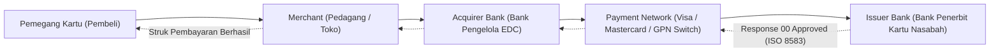

# Modul 209: Infrastruktur Jaringan Pembayaran & Regulasi (Ekosistem Kartu Acquirer/Issuer, Protokol Pesan ISO 8583 & ISO 20022, PCI-DSS)

**Navigasi**: [⬅️ Master Index](../../INDEX.md) | [Tingkat 14: Tingkat 14: Fintech, Financial Engineering, HFT & Blockchain](./README.md)
*Sebelumnya*: [208. akuntansi-komputasional-arsitektur-buku-besar](./208-akuntansi-komputasional-arsitektur-buku-besar.md) | *Berikutnya*: [210. matematika-keuangan-instrumen-pasar-modal](./210-matematika-keuangan-instrumen-pasar-modal.md)

---

## 1. Intuisi Dasar Tanpa Jargon ("Seperti Bayi Baru Lahir")
Ketika Anda menempelkan kartu debit atau kartu kredit Anda di mesin kasir (EDC) sebuah minimarket, dalam waktu kurang dari 2 detik layar mesin berbunyi *bip* dan struk pembayaran tercetak. Pernahkah Anda membayangkan apa yang terjadi di kabel bawah laut dunia dalam 2 detik tersebut?

Sinyal tersebut melompati sebuah labirin sistem global raksasa:
1. Dari mesin EDC minimarket ke bank pemilik mesin (**Acquirer Bank**).
2. Dari bank acquirer melesat ke jaringan switching raksasa dunia (**Visa, Mastercard, atau GPN**).
3. Jaringan switching meneruskannya ke bank tempat Anda menabung (**Issuer Bank**).
4. Komputer mainframe bank penerbit memeriksa apakah saldo Anda cukup dan kartu Anda tidak diblokir.
5. Jawaban disetujui (*Approved*) dikirimkan balik ke mesin EDC!

Agar jutaan komputer dari ribuan bank di seluruh penjuru bumi yang menggunakan bahasa dan sistem operasi berbeda bisa berbicara tanpa salah paham, mereka menggunakan bahasa protokol standar perbankan global: **ISO 8583** (standar legendaris berbasis bitmap biner sejak 1987) dan penerus modernnya **ISO 20022** (standar berbasis XML/JSON untuk pesan perbankan bernilai tinggi) ([ISO - Financial Transaction Card Originated Messages](https://www.iso.org/standard/31628.html)).

## 2. Fondasi Teoretis & Aksiomatik / Matematis
Formulasi Protokol Pesan Finansial ISO 8583 & ISO 20022:

1. **Struktur Pesan ISO 8583**:
Terdiri dari 3 komponen utama:
* **Message Type Identifier (MTI)**: 4 digit angka yang mendefinisikan versi ISO, kelas pesan, fungsi, dan asal pengirim (misal `0100` = Permintaan Otorisasi, `0110` = Respons Otorisasi, `0200` = Permintaan Finansial Settlement).
* **Bitmap Primer & Sekunder (Bitmaps)**: Bilangan heksadesimal 64-bit (8 bytes) atau 128-bit di mana setiap bit individual bertindak sebagai saklar boolean: bit ke-$k$ bernilai 1 jika *Data Element* (DE) ke-$k$ hadir dalam pesan.
* **Data Elements (DE 1 s/d DE 128)**:
  - DE 2: Primary Account Number / Nomor Kartu (PAN, LLVAR)
  - DE 3: Processing Code (6 digit: 2 digit jenis transaksi, 2 digit akun sumber, 2 digit akun tujuan)
  - DE 4: Amount, Transaction (12 digit angka fixed-width)
  - DE 11: System Trace Audit Number (STAN 6 digit)
  - DE 39: Response Code (2 karakter: `00` = Approved, `51` = Insufficient Funds) ([ISO 8583 Specification](https://www.iso.org/standard/31628.html)).

2. **Protokol Standar Modern ISO 20022 (Universal Financial Industry Message Scheme)**:
Format modular semantik berbasis XML/JSON terstruktur yang digunakan oleh SWIFT dan RTGS global:
* `pacs` (Payment Clearing and Settlement): misal `pacs.008` (Credit Transfer Finansial Antarbank).
* `camt` (Cash Management): misal `camt.053` (Laporan Rekening Koran Bank).
* `pain` (Payment Initiation): misal `pain.001` (Instruksi Pembayaran Korporasi).

3. **Kepatuhan Keamanan PCI-DSS (Payment Card Industry Data Security Standard)**:
Standar regulasi ketat keamanan kartu pembayaran: Larangan keras menyimpan *Sensitive Authentication Data (SAD)* pasca-otorisasi mencakup PIN Block, Nilai Verifikasi Kartu (CVV2/CVC2), dan Full Track Data magnetik. Data PAN yang disimpan harus disamarkan (*masked*, hanya menampilkan 6 digit pertama dan 4 digit terakhir: `4111-11**-****-1111`) dan dienkripsi kuat via AES-256 ([PCI Security Standards](https://www.pcisecuritystandards.org/)).

## 3. Anatomi Teknis & Cara Kerja Internal
Arsitektur empat pihak (*Four-Party Model*) ekosistem pemrosesan pembayaran kartu:



Peran Payment Network adalah melakukan kliring multilateral (*multilateral clearing*) dan menanggung risiko setelmen antar-bank setiap hari, memungkinkan otorisasi transaksi selesai dalam batas latensi $300 - 800\text{ ms}$ di seluruh dunia ([Evans & Schmalensee - Paying with Plastic](https://mitpress.mit.edu/9780262550581/paying-with-plastic/)).

## 4. Implementasi Praktis & Kode / Simulasi Riil
```python
# Parser Sederhana Komponen Bitmap Protokol Finansial ISO 8583
def parse_iso8583_bitmap(hex_bitmap_str):
    # Konversi string hex 16 karakter (64-bit) menjadi representasi binary string
    bitmap_int = int(hex_bitmap_str, 16)
    bitmap_bin = f"{bitmap_int:064b}"
    
    present_elements = []
    for bit_idx, bit_val in enumerate(bitmap_bin, start=1):
        if bit_val == '1':
            present_elements.append(bit_idx)
            
    return present_elements

# Simulasi Pesan ISO 8583 MTI 0100 (Authorization Request)
mti = "0100"
# Bitmap: Elemen 3 (Processing Code), Elemen 4 (Amount), Elemen 11 (STAN) aktif
# Bit 3, 4, 11 bernilai 1 -> Binary: 0011 0000 0010 0000 ... -> Hex: 3020000000000000
sample_bitmap_hex = "3020000000000000"

active_de = parse_iso8583_bitmap(sample_bitmap_hex)
print(f"ISO 8583 MTI: {mti} (Permintaan Otorisasi Transaksi)")
print(f"Primary Bitmap Hex: {sample_bitmap_hex}")
print(f"Data Elements yang Hadir: {active_de}")

# Simulasi Pemetaan Payload
payload = {
    3: "000000",        # Purchase Goods
    4: "000000050000",  # Rp 50.000,00 (12 digit fixed width)
    11: "123456"        # Trace Audit Number (STAN)
}

print(f"DE 3  (Processing Code): {payload[3]}")
print(f"DE 4  (Amount Raw)     : Rp {int(payload[4])/100:,.2f}")
print(f"DE 11 (STAN Audit)     : {payload[11]}")
```

## 5. Miskonsepsi & Jebakan Industri
*Menyimpan CVV atau Unencrypted PAN (Pelanggaran Berat PCI-DSS)*: Developer yang menyimpan nomor kartu lengkap (PAN) tanpa enkripsi atau menyimpan kode keamanan CVV di dalam tabel database/log aplikasi menghadapi sanksi denda jutaan dolar dan pencabutan izin memproses kartu pembayaran. Selalu gunakan mekanisme **Tokenisasi Kartu (Card Tokenization)** dari gateway pembayaran terakreditasi, di mana data sensitif digantikan oleh token string acak non-sensitif sebelum menyentuh server aplikasi Anda ([PCI-DSS Standard Requirements](https://www.pcisecuritystandards.org/)).

## 6. Proyek Latihan & Rubrik Penilaian Mandiri
### Level 1 (Pemula)
Tulis skrip decoder ISO 8583 di Python yang menerima string pesan lengkap berformat MTI + Bitmap + DE 3 + DE 4, lalu memecahnya secara otomatis menjadi kamus JSON yang mudah dibaca manusia.
*Rubrik*: Parser mengekstrak MTI, mendeteksi bit aktif, dan memotong string nilai data secara presisi.

### Level 2 (Menengah)
Bangun simulator gateway otorisasi pembayaran ISO 8583: buat server soket TCP mini yang menerima paket pesan `0100` (Authorization Request), memvalidasi saldo akun fiktif, mengembalikan pesan balasan `0110` dengan DE 39 bernilai `00` (Approved) jika saldo cukup atau `51` (Insufficient Funds) jika tidak cukup.
*Rubrik*: Menghasilkan pesan respons ISO 8583 yang valid dengan bitmap respons yang sesuai.

### Level 3 (Mahir)
Rancang skema validasi pesan ISO 20022 `pacs.008.001.08` (Financial Institutional Customer Credit Transfer) menggunakan skema XML/XSD: bangun parser yang memvalidasi integritas elemen pengirim (Debtor), bank penerima (Creditor Agent), kode BIC/SWIFT, dan nomor rekening format IBAN standar internasional.
*Rubrik*: Dokumen XML tervalidasi terhadap skema XSD resmi dan menolak pesan cacat.

## 7. Rekomendasi Sumber Belajar Standar Emas
| Sumber Pembelajaran | Penulis / Institusi | Tautan Langsung | Fokus Materi |
| :--- | :--- | :--- | :--- |
| ISO 8583 Financial Transaction Card Originated Messages | International Organization for Standardization | [ISO Official Portal](https://www.iso.org/standard/31628.html) | Standar Baku Protokol Pesan Kartu Debit/Kredit |
| ISO 20022 Universal Financial Industry Message Scheme | ISO 20022 Registration Authority | [ISO 20022 Standards Portal](https://www.iso20022.org/) | Standar Arsitektur XML/JSON Perbankan Modern, PACS/CAMT |
| PCI Data Security Standard (PCI-DSS) Requirements | PCI SSC Committee | [PCI Security Standards](https://www.pcisecuritystandards.org/) | Panduan Kepatuhan Regulasi Penyimpanan & Enkripsi Finansial |
| Paying with Plastic: The Digital Revolution in Buying and Borrowing | David S. Evans & Richard Schmalensee | [MIT Press](https://mitpress.mit.edu/9780262550581/paying-with-plastic/) | Ekonomi Bisnis Jaringan Kartu Visa/Mastercard & Kliring |

---
*Navigasi Cepat*: [Ke Tingkat 14](./README.md) | [Ke Master Index](../../INDEX.md) | *Sebelumnya*: [208. akuntansi-komputasional-arsitektur-buku-besar](./208-akuntansi-komputasional-arsitektur-buku-besar.md) | *Berikutnya*: [210. matematika-keuangan-instrumen-pasar-modal](./210-matematika-keuangan-instrumen-pasar-modal.md)
