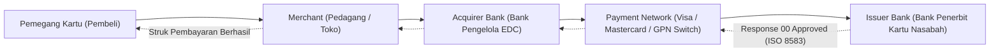

# Modul 209: Infrastruktur Jaringan Pembayaran & Regulasi (Ekosistem Kartu Acquirer/Issuer, Protokol Pesan ISO 8583 & ISO 20022, PCI-DSS)

**Navigasi**: [⬅️ Master Index](../../INDEX.md) | [Tingkat 14: Tingkat 14: Fintech, Financial Engineering, HFT & Blockchain](./README.md)
*Sebelumnya*: [208. akuntansi-komputasional-arsitektur-buku-besar](./208-akuntansi-komputasional-arsitektur-buku-besar.md) | *Berikutnya*: [210. matematika-keuangan-instrumen-pasar-modal](./210-matematika-keuangan-instrumen-pasar-modal.md)

---

## 1. Intuisi Dasar Tanpa Jargon ("Seperti Bayi Baru Lahir")
### 1.1 Konsep Inti & Analogi Tanpa Jargon
Ketika Anda menempelkan kartu debit atau kartu kredit Anda di mesin kasir (EDC) sebuah minimarket, dalam waktu kurang dari 2 detik layar mesin berbunyi *bip* dan struk pembayaran tercetak. Pernahkah Anda membayangkan apa yang terjadi di kabel bawah laut dunia dalam 2 detik tersebut?

### 1.2 Urgensi Rekayasa & Signifikansi Sistemik
Sinyal tersebut melompati sebuah labirin sistem global raksasa:
1. Dari mesin EDC minimarket ke bank pemilik mesin (**Acquirer Bank**).
2. Dari bank acquirer melesat ke jaringan switching raksasa dunia (**Visa, Mastercard, atau GPN**).
3. Jaringan switching meneruskannya ke bank tempat Anda menabung (**Issuer Bank**).
4. Komputer mainframe bank penerbit memeriksa apakah saldo Anda cukup dan kartu Anda tidak diblokir.
5. Jawaban disetujui (*Approved*) dikirimkan balik ke mesin EDC!

Agar jutaan komputer dari ribuan bank di seluruh penjuru bumi yang menggunakan bahasa dan sistem operasi berbeda bisa berbicara tanpa salah paham, mereka menggunakan bahasa protokol standar perbankan global: **ISO 8583** (standar legendaris berbasis bitmap biner sejak 1987) dan penerus modernnya **ISO 20022** (standar berbasis XML/JSON untuk pesan perbankan bernilai tinggi) ([ISO - Financial Transaction Card Originated Messages](https://www.iso.org/standard/31628.html)).

## 2. Fondasi Teoretis & Aksiomatik / Matematis
### 2.1 Kerangka Teori Aksiomatik & Formulasi Matematis
Formulasi Protokol Pesan Finansial ISO 8583 & ISO 20022:

### 2.2 Penurunan Matematis Langkah-demi-Langkah
1. **Struktur Pesan ISO 8583**:
Terdiri dari 3 komponen utama:
* **Message Type Identifier (MTI)**: 4 digit angka yang mendefinisikan versi ISO, kelas pesan, fungsi, dan asal pengirim (misal `0100` = Permintaan Otorisasi, `0110` = Respons Otorisasi, `0200` = Permintaan Finansial Settlement).
* **Bitmap Primer & Sekunder (Bitmaps)**: Bilangan heksadesimal 64-bit (8 bytes) atau 128-bit di mana setiap bit individual bertindak sebagai saklar boolean: bit ke-$k$ bernilai 1 jika *Data Element* (DE) ke-$k$ hadir dalam pesan.
* **Data Elements (DE 1 s/d DE 128)**:
  - DE 2: Primary Account Number / Nomor Kartu (PAN, LLVAR)
  - DE 3: Processing Code (6 digit: 2 digit jenis transaksi, 2 digit akun sumber, 2 digit akun tujuan)
  - DE 4: Amount, Transaction (12 digit angka fixed-width)
  - DE 11: System Trace Audit Number (STAN 6 digit)
  - DE 39: Response Code (2 karakter: `00` = Approved, `51` = Insufficient Funds) ([ISO 8583 Specification](https://www.iso.org/standard/31628.html)).

2. **Protokol Standar Modern ISO 20022 (Universal Financial Industry Message Scheme)**:
Format modular semantik berbasis XML/JSON terstruktur yang digunakan oleh SWIFT dan RTGS global:
* `pacs` (Payment Clearing and Settlement): misal `pacs.008` (Credit Transfer Finansial Antarbank).
* `camt` (Cash Management): misal `camt.053` (Laporan Rekening Koran Bank).
* `pain` (Payment Initiation): misal `pain.001` (Instruksi Pembayaran Korporasi).

3. **Kepatuhan Keamanan PCI-DSS (Payment Card Industry Data Security Standard)**:
Standar regulasi ketat keamanan kartu pembayaran: Larangan keras menyimpan *Sensitive Authentication Data (SAD)* pasca-otorisasi mencakup PIN Block, Nilai Verifikasi Kartu (CVV2/CVC2), dan Full Track Data magnetik. Data PAN yang disimpan harus disamarkan (*masked*, hanya menampilkan 6 digit pertama dan 4 digit terakhir: `4111-11**-****-1111`) dan dienkripsi kuat via AES-256 ([PCI Security Standards](https://www.pcisecuritystandards.org/)).

## 3. Anatomi Teknis & Cara Kerja Internal
Arsitektur empat pihak (*Four-Party Model*) ekosistem pemrosesan pembayaran kartu:



Peran Payment Network adalah melakukan kliring multilateral (*multilateral clearing*) dan menanggung risiko setelmen antar-bank setiap hari, memungkinkan otorisasi transaksi selesai dalam batas latensi \$300 - 800\text{ ms}$ di seluruh dunia ([Evans & Schmalensee - Paying with Plastic](https://mitpress.mit.edu/9780262550581/paying-with-plastic/)).

#### Tabel Penelusuran Siklus Pembacaan Data Magnetik Kasir POS Target & Pelanggaran PCI-DSS
| Timestamp / Sequence ID | Komponen / Lapisan Sistem | Pesan Masuk (FIX / Transaksi) | Operasi Antrean / Komputasi Buku | State Buku Pesanan (LOB / Ledger) | Event Terpancar (Fill / Block Emit) |
|---|---|---|---|---|---|
| 12:04:10.100 (Seq #1) | Terminal Kasir Fisik (POS) | Pelanggan Menggesek Kartu Kredit | Pembacaan pita magnetik Track 2 analog | Data mentah masuk ke memori proses `pos.exe` | Ketiadaan enkripsi titik-ke-titik (P2PE) di reader |
| 12:04:10.150 (Seq #2) | Memori RAM Proses Kasir | String Plaintext PAN & CVV di RAM | `pos.exe` menahan nomor kartu dalam buffer teks | RAM memuat string: `4111222233334444=2612...` | Pelanggaran Standar PCI-DSS Bagian 3! |
| 12:04:10.200 (Seq #3) | Thread Malware BlackPOS | Pemindaian Memori Virtual Regex | Malware mengeksekusi `ReadProcessMemory()` | Pencocokan pola Track 2 magnetik berhasil | Data kartu kredit disalin ke berkas teks rahasia |
| 12:04:10.250 (Seq #4) | Modul Otorisasi Bank | Pengiriman Paket ISO 8583 Terenkripsi | Enkripsi SSL baru dilakukan saat paket keluar | Transaksi disetujui bank penerbit | Pelanggan menerima struk belanja normal |
| 23:00:00.000 (Seq #5) | Server Penampung Internal Target | Pengiriman Berkas Curian ke Server C2 | Eksfiltrasi 40 juta data kartu kredit via FTP | Kredensial nasabah beredar di pasar gelap | Bencana kebocoran Target dengan denda hukum \$290 Juta! |

## 4. Implementasi Praktis & Kode / Simulasi Riil
```python
# Parser Sederhana Komponen Bitmap Protokol Finansial ISO 8583
def parse_iso8583_bitmap(hex_bitmap_str):
    # Konversi string hex 16 karakter (64-bit) menjadi representasi binary string
    bitmap_int = int(hex_bitmap_str, 16)
    bitmap_bin = f"{bitmap_int:064b}"
    
    present_elements = []
    for bit_idx, bit_val in enumerate(bitmap_bin, start=1):
        if bit_val == '1':
            present_elements.append(bit_idx)
            
    return present_elements

# Simulasi Pesan ISO 8583 MTI 0100 (Authorization Request)
mti = "0100"
# Bitmap: Elemen 3 (Processing Code), Elemen 4 (Amount), Elemen 11 (STAN) aktif
# Bit 3, 4, 11 bernilai 1 -> Binary: 0011 0000 0010 0000 ... -> Hex: 3020000000000000
sample_bitmap_hex = "3020000000000000"

active_de = parse_iso8583_bitmap(sample_bitmap_hex)
print(f"ISO 8583 MTI: {mti} (Permintaan Otorisasi Transaksi)")
print(f"Primary Bitmap Hex: {sample_bitmap_hex}")
print(f"Data Elements yang Hadir: {active_de}")

# Simulasi Pemetaan Payload
payload = {
    3: "000000",        # Purchase Goods
    4: "000000050000",  # Rp 50.000,00 (12 digit fixed width)
    11: "123456"        # Trace Audit Number (STAN)
}

print(f"DE 3  (Processing Code): {payload[3]}")
print(f"DE 4  (Amount Raw)     : Rp {int(payload[4])/100:,.2f}")
print(f"DE 11 (STAN Audit)     : {payload[11]}")
```

## 5. Miskonsepsi & Jebakan Industri
*Menyimpan CVV atau Unencrypted PAN (Pelanggaran Berat PCI-DSS)*: Developer yang menyimpan nomor kartu lengkap (PAN) tanpa enkripsi atau menyimpan kode keamanan CVV di dalam tabel database/log aplikasi menghadapi sanksi denda jutaan dolar dan pencabutan izin memproses kartu pembayaran. Selalu gunakan mekanisme **Tokenisasi Kartu (Card Tokenization)** dari gateway pembayaran terakreditasi, di mana data sensitif digantikan oleh token string acak non-sensitif sebelum menyentuh server aplikasi Anda ([PCI-DSS Standard Requirements](https://www.pcisecuritystandards.org/)).

### Studi Kasus Kegagalan Nyata: Pembobolan Jaringan POS Kasir Target & Pencurian 40 Juta Data Kartu Kredit Plaintext (2013)
- **Kronologi & Konteks Sejarah**: Selama musim diskon liburan akhir tahun 2013, peretas membobol infrastruktur pembayaran Point-of-Sale (POS) raksasa ritel Amerika Serikat Target, menyedot lebih dari 40 juta nomor kartu kredit dan debit nasabah serta 70 juta catatan identitas pelanggan, memicu gelombang gugatan perdata dan investigasi kongres AS.
- **Akar Masalah Rekayasa Jaringan Pembayaran & Kegagalan PCI-DSS**: Meskipun Target telah memenuhi audit kepatuhan PCI-DSS tahunan, arsitektur teknis mesin kasirnya memiliki cacat desain fatal: terminal pembaca kartu magnetik (*card swipe reader*) terhubung ke komputer kasir Windows dan mengirimkan data Track 2 (nomor kartu 16-digit PAN, tanggal kedaluwarsa, dan kode layanan) dalam bentuk teks polos (*plaintext*) melalui antarmuka serial/USB ke memori RAM proses perangkat lunak kasir. Enkripsi data baru dilakukan di layer aplikasi sesaat sebelum data dikirimkan melalui jaringan internet ke bank pemroses. Malware pembaca memori (BlackPOS) memanfaatkan jendela kerentanan ini (*memory scraping*): malware menyusup ke ruang memori proses kasir dan mencuri data kartu tepat saat berada dalam bentuk plaintext di RAM sebelum sempat dienkripsi. Ketiadaan enkripsi perangkat keras ujung-ke-ujung (*Hardware Point-to-Point Encryption / P2PE*) meruntuhkan seluruh pertahanan sistem perbankan retail tersebut.

- **Potongan Kode / Arsitektur Cacat (Vulnerable Implementation)**:
```c
// Analisis Cacat Desain Pembaca Kartu POS: Plaintext RAM Buffer vs Hardware P2PE
#include <stdio.h>
#include <string.h>

// STRUKTUR DATA CACAT: Memuat nomor kartu kredit dalam plaintext di memori RAM
struct VulnerablePOSCardBuffer {
    char track2_data[64]; // CACAT FATAL: "4111222233334444=251210100000"
    // Malware BlackPOS membaca string ini langsung via VirtualQueryEx!
    double transaction_amount;
};

// MITIGASI AMAN: PCI-DSS Point-to-Point Encryption (P2PE) & Format-Preserving Tokenization
struct SecureTokenizedCardBuffer {
    char pci_token[24];         // Token pengganti: "TOK_9948_1824_4444" (Bukan PAN asli!)
    char encrypted_blob[128];   // Data sensitif dienkripsi langsung oleh chip reader (Hardware HSM)
    char iv_nonce[16];
    char authentication_tag[16]; // Enkripsi AES-256-GCM / DUKPT
};

void process_secure_transaction(struct SecureTokenizedCardBuffer card) {
    // Memori komputer kasir SAMA SEKALI TIDAK PERNAH melihat nomor kartu asli!
    // Dekripsi hanya dapat dilakukan di dalam Hardware Security Module (HSM) bank sentral!
    forward_to_payment_gateway(card.encrypted_blob, card.pci_token);
}
```

- **Analisis Forensik & Rekayasa Modern**: Insiden Target memaksa standardisasi industri pembayaran global (PCI Security Standards Council): (1) Penegakan standar **PCI Point-to-Point Encryption (P2PE)** di mana terminal fisik wajib mengenkripsi data magnetik/chip menggunakan kunci enkripsi perangkat keras turunan per transaksi (**DUKPT: Derived Unique Key Per Transaction**) sebelum data meninggalkan sensor fisik; (2) Percepatan adopsi chip kontak dan nirsentuh **EMV** yang menghasilkan kriptogram dinamis sekali pakai (ARQC: Authorization Request Cryptogram); (3) Penerapan **Network Microsegmentation** ketat yang mengisolasi VLAN jaringan kasir POS dari jaringan kantor dan vendor luar.

## 6. Proyek Latihan & Rubrik Penilaian Mandiri
### Level 1 (Pemula)
Tulis skrip decoder ISO 8583 di Python yang menerima string pesan lengkap berformat MTI + Bitmap + DE 3 + DE 4, lalu memecahnya secara otomatis menjadi kamus JSON yang mudah dibaca manusia.
*Rubrik*: Parser mengekstrak MTI, mendeteksi bit aktif, dan memotong string nilai data secara presisi.

### Level 2 (Menengah)
Bangun simulator gateway otorisasi pembayaran ISO 8583: buat server soket TCP mini yang menerima paket pesan `0100` (Authorization Request), memvalidasi saldo akun fiktif, mengembalikan pesan balasan `0110` dengan DE 39 bernilai `00` (Approved) jika saldo cukup atau `51` (Insufficient Funds) jika tidak cukup.
*Rubrik*: Menghasilkan pesan respons ISO 8583 yang valid dengan bitmap respons yang sesuai.

### Level 3 (Mahir)
Rancang skema validasi pesan ISO 20022 `pacs.008.001.08` (Financial Institutional Customer Credit Transfer) menggunakan skema XML/XSD: bangun parser yang memvalidasi integritas elemen pengirim (Debtor), bank penerima (Creditor Agent), kode BIC/SWIFT, dan nomor rekening format IBAN standar internasional.
*Rubrik*: Dokumen XML tervalidasi terhadap skema XSD resmi dan menolak pesan cacat.

### Tingkat 1: Dasar
- **Tugas**: Implementasikan algoritma validasi nomor kartu kredit Luhn Checksum (Mod 10) dari nol dalam Python atau C: Verifikasi keabsahan nomor kartu kredit berbagai penerbit (Visa, Mastercard, Amex), dan buat fungsi pembangkit digit cek (*Check Digit Generator*).
- **Petunjuk Perancangan Arsitektur**:
  - Dari digit paling kanan (sebelum check digit), gandakan setiap digit kedua mundur ke kiri.
  - Jika hasil penggandaan $> 9$, kurangkan dengan 9 (atau jumlahkan kedua digitnya).
  - Jumlahkan seluruh digit: jika total modulo $10 == 0$, nomor kartu valid.
- **Test Vector & Kasus Uji**:
  - Nomor sah: `"49927398716"` -> Valid (True).
  - Ubah satu digit: `"49927398717"` -> Tidak Sah (False).
- **Rubrik Penilaian Objektif**:
  - Skor 100%: Algoritma Luhn presisi, fungsi generator check digit akurat, penanganan string panjang fleksibel.
  - Skor 50%: Bekerja untuk panjang kartu genap namun salah menghitung offset pada kartu dengan panjang ganjil (Amex 15 digit).
  - Skor 0%: Hanya mengecek panjang karakter tanpa validasi modulo 10.

### Tingkat 2: Menengah
- **Tugas**: Bangun modul penyamaran token data kartu kredit (*Format-Preserving Tokenizer*) dalam Python: Terima nomor kartu kredit 16 digit PAN, simpan nomor kartu asli dalam vault terenkripsi AES-256-GCM, dan kembalikan token surrogat yang mempertahankan 6 digit pertama (BIN) dan 4 digit terakhir (Last4), dengan 6 digit tengah digantikan oleh string token acak terotentikasi.
- **Petunjuk Perancangan Arsitektur**:
  - Format Token: `BIN (6 digit) + TOKEN_RANDOM (6 digit) + LAST4 (4 digit)`.
  - Token harus lolos validasi Luhn checksum untuk memastikan kompatibilitas sistem warisan (*System Legacy Compatibility*).
  - Token surrogat tidak boleh dapat didekripsi secara matematis tanpa akses ke database vault terisolasi.
- **Test Vector & Kasus Uji**:
  - Masukkan nomor kartu riil: `"4111 2222 3333 4444"`.
  - Token yang dihasilkan: `"4111 2298 7123 4444"` (lolos Luhn, mempertahankan BIN dan Last4, data tengah tersamar penuh).
- **Rubrik Penilaian Objektif**:
  - Skor 100%: Format token presisi, validasi Luhn token terjaga, enkripsi vault AES-GCM aman.
  - Skor 50%: Menghasilkan token acak namun token gagal memenuhi validasi algoritma Luhn.
  - Skor 0%: Menggunakan fungsi hash satu arah yang merusak format 16-digit numerik.

### Tingkat 3: Mahir
- **Tugas**: Rancang simulator sistem pertukaran kunci Derived Unique Key Per Transaction (DUKPT, ANSI X9.24) dalam Python/C: Simulasikan Base Derivation Key (BDK) pada HSM bank, turunkan Initial Key untuk terminal kasir fisik, dan bangun mesin penurun kunci per transaksi yang menghitung Future Key baru untuk setiap kali gesekan kartu, membuktikan sifat *Forward Secrecy* di mana kompromi kunci transaksi saat ini tidak membocorkan kunci transaksi masa lalu.
- **Petunjuk Perancangan Arsitektur**:
  - State Terminal: Key Serial Number (KSN 80-bit: Base Submitter ID + Device ID + Transaction Counter 21-bit) dan Future Key Register.
  - Setiap transaksi menaikkan Transaction Counter.
  - Turunkan kunci sesi transaksi menggunakan operasi enkripsi Triple-DES atau AES-128 terhadap KSN.
  - Hapus kunci sesi segera setelah ciphertext tag otentikasi dibuat.
- **Test Vector & Kasus Uji**:
  - Uji kesesuaian dengan Test Vector standar ANSI X9.24-1:2009 (BDK, KSN, Derived Key).
  - Terminal mengeksekusi 100 transaksi berturut-turut: buktikan bahwa setiap transaksi menghasilkan kunci kriptografi yang unik dan berbeda.
- **Rubrik Penilaian Objektif**:
  - Skor 100%: Implementasi state machine DUKPT presisi, forward secrecy terjamin, vektor uji ANSI X9.24 cocok 100%.
  - Skor 50%: Kunci berubah namun gagal menerapkan penghapusan register kunci lama dari memori.
  - Skor 0%: Menggunakan kunci statis yang sama untuk semua transaksi.

## 7. Rekomendasi Sumber Belajar Standar Emas
| Sumber Pembelajaran | Penulis / Institusi | Tautan Langsung | Fokus Materi |
| :--- | :--- | :--- | :--- |
| ISO 8583 Financial Transaction Card Originated Messages | International Organization for Standardization | [ISO Official Portal](https://www.iso.org/standard/31628.html) | Standar Baku Protokol Pesan Kartu Debit/Kredit |
| ISO 20022 Universal Financial Industry Message Scheme | ISO 20022 Registration Authority | [ISO 20022 Standards Portal](https://www.iso20022.org/) | Standar Arsitektur XML/JSON Perbankan Modern, PACS/CAMT |
| PCI Data Security Standard (PCI-DSS) Requirements | PCI SSC Committee | [PCI Security Standards](https://www.pcisecuritystandards.org/) | Panduan Kepatuhan Regulasi Penyimpanan & Enkripsi Finansial |
| Paying with Plastic: The Digital Revolution in Buying and Borrowing | David S. Evans & Richard Schmalensee | [MIT Press](https://mitpress.mit.edu/9780262550581/paying-with-plastic/) | Ekonomi Bisnis Jaringan Kartu Visa/Mastercard & Kliring |

---
*Navigasi Cepat*: [Ke Tingkat 14](./README.md) | [Ke Master Index](../../INDEX.md) | *Sebelumnya*: [208. akuntansi-komputasional-arsitektur-buku-besar](./208-akuntansi-komputasional-arsitektur-buku-besar.md) | *Berikutnya*: [210. matematika-keuangan-instrumen-pasar-modal](./210-matematika-keuangan-instrumen-pasar-modal.md)
