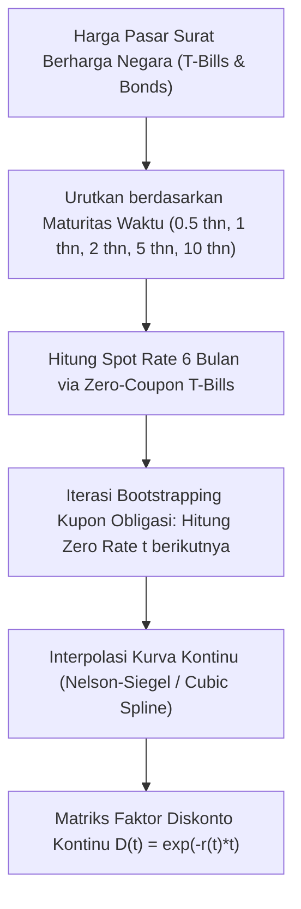

# Modul 210: Matematika Keuangan & Instrumen Pasar Modal (Time Value of Money, Valuasi Obligasi Yield Curve, Saham DCF, Opsi Vanilla)

**Navigasi**: [⬅️ Master Index](../../INDEX.md) | [Tingkat 14: Tingkat 14: Fintech, Financial Engineering, HFT & Blockchain](./README.md)
*Sebelumnya*: [209. infrastruktur-jaringan-pembayaran-regulasi](./209-infrastruktur-jaringan-pembayaran-regulasi.md) | *Berikutnya*: [211. teori-portofolio-modern-alokasi-kuantitatif](./211-teori-portofolio-modern-alokasi-kuantitatif.md)

---

## 1. Intuisi Dasar Tanpa Jargon ("Seperti Bayi Baru Lahir")
### 1.1 Konsep Inti & Analogi Tanpa Jargon
Mana yang Anda pilih: menerima uang Rp 100 juta hari ini sekarang juga, atau menerima Rp 100 juta tepat 10 tahun dari sekarang?

### 1.2 Urgensi Rekayasa & Signifikansi Sistemik
Tentu semua orang waras akan memilih menerima uang hari ini. Mengapa? Karena uang Rp 100 juta hari ini bisa Anda investasikan sehingga berkembang biak menghasilkan bunga, dan nilai uang di masa depan akan tergerus oleh inflasi. Inilah hukum paling mendasar dalam seluruh dunia keuangan: **Nilai Waktu dari Uang (Time Value of Money)** ([Bodie, Kane, Marcus - Investments](https://www.mheducation.com/highered/product/investments-bodie-kane/M9781260013832.html)).

Dari satu prinsip sederhana ini, kita bisa menghitung harga wajar dari instrumen apa pun di muka bumi:
1. **Obligasi (Surat Utang)**: Berapa harga wajar selembar kertas yang menjanjikan pembayaran bunga Rp 5 juta setiap tahun ditambah pengembalian pokok di tahun ke-10?
2. **Saham Perusahaan**: Saham sebuah perusahaan (seperti Apple atau Bank BCA) bernilai sebesar total seluruh arus kas bersih di masa depan yang akan dihasilkan perusahaan tersebut, ditarik mundur nilainya ke hari ini (**Discounted Cash Flow / DCF**).
3. **Opsi (Options)**: Berapa harga wajar selembar tiket yang memberi Anda *hak (bukan kewajiban)* untuk membeli emas seharga Rp 1 juta bulan depan jika harga pasar melonjak ke Rp 1,5 juta? ([Hull - Options, Futures, and Other Derivatives](https://www.pearson.com/en-us/subject-catalog/p/options-futures-and-other-derivatives/P200000003339)).

## 2. Fondasi Teoretis & Aksiomatik / Matematis
### 2.1 Kerangka Teori Aksiomatik & Formulasi Matematis
Formulasi Matematis Nilai Waktu dari Uang & Valuasi Aset:

### 2.2 Penurunan Matematis Langkah-demi-Langkah
1. **Aksioma Nilai Waktu dari Uang (Time Value of Money)**:
Hubungan antara Nilai Kini (*Present Value* / $PV$) dan Nilai Masa Depan (*Future Value* / $FV$) dengan suku bunga diskonto $r$ dan periode waktu $t$:
* Bunga Majemuk Diskrit: $FV = PV (1 + r)^t \implies PV = \frac{FV}{(1 + r)^t}$
* Bunga Kontinu: $FV = PV \cdot e^{rt} \implies PV = FV \cdot e^{-rt}$

2. **Valuasi Obligasi Kupon Tetap & Kurva Imbal Hasil (Yield to Maturity / YTM)**:
Harga wajar obligasi $P$ dengan nilai pokok nominal $F$, pembayaran kupon periodik $C$, dan imbal hasil pasar $y$:
$$P = \sum_{t=1}^T \frac{C}{(1 + y)^t} + \frac{F}{(1 + y)^T}$$
*Durasi Macaulay*: Mengukur sensitivitas harga obligasi terhadap perubahan suku bunga:
$$D_{\text{Mac}} = \frac{1}{P} \left[ \sum_{t=1}^T \frac{t \cdot C}{(1+y)^t} + \frac{T \cdot F}{(1+y)^T} \right], \quad \frac{\Delta P}{P} \approx - \frac{D_{\text{Mac}}}{1 + y} \Delta y$$

3. **Valuasi Saham Arus Kas Terdiskon (Discounted Cash Flow / DCF)**:
Memodelkan nilai intrinsik ekuitas perusahaan:
$$V_0 = \sum_{t=1}^H \frac{\text{FCFF}_t}{(1 + \text{WACC})^t} + \frac{\text{Terminal Value}_H}{(1 + \text{WACC})^H}, \quad \text{TV}_H = \frac{\text{FCFF}_{H+1}}{\text{WACC} - g}$$
Di mana WACC adalah *Weighted Average Cost of Capital* dan $g$ adalah tingkat pertumbuhan jangka panjang stabil Gordon Growth Model ([Damodaran - Investment Valuation](https://pages.stern.nyu.edu/~adamodar/)).

4. **Batas Teoretis & Put-Call Parity Opsi Eropa Vanilla**:
Hubungan arbitrase mutlak antara harga Opsi Beli ($C$), Opsi Jual ($P$), Harga Saham Spot saat ini ($S_0$), dan Harga Pelaksanaan Strike ($K$):
$$C + K e^{-rT} = P + S_0$$
Jika persamaan ini dilanggar di pasar, peluang keuntungan arbitrase bebas risiko instan tercipta.

## 3. Anatomi Teknis & Cara Kerja Internal
Arsitektur pemodelan kurva imbal hasil obligasi (*Spot Yield Curve Bootstrapping*):



Dengan kurva imbal hasil zero-coupon yang telah di-bootstrap, arus kas pada waktu kapan pun di masa depan dapat didiskontokan secara independen tanpa distorsi struktur kupon ([Tuckman & Serrat - Fixed Income Securities](https://onlinelibrary.wiley.com/doi/book/10.1002/9781118266670)).

#### Tabel Penelusuran Keruntuhan Arbitrase Leverage LTCM & Kejadian Ekor Tebal (Fat-Tails)
| Timestamp / Sequence ID | Komponen / Lapisan Sistem | Pesan Masuk (FIX / Transaksi) | Operasi Antrean / Komputasi Buku | State Buku Pesanan (LOB / Ledger) | Event Terpancar (Fill / Block Emit) |
|---|---|---|---|---|---|
| Awal 1998 (Tiket #1) | Dana Lindung Nilai LTCM | Posisi Arbitrase Spread Obligasi Global | Leverage agresif: Rasio Utang-ke-Modal $250:1$ | Portofolio aset: \$125 Miliar di atas ekuitas \$4.7B | Model mengasumsikan distribusi normal Gaussian |
| Estimasi Value-at-Risk | Model VaR Berbasis Distribusi Normal | Kalkulasi Probabilitas Kerugian Harian | Model memprediksi batas kerugian harian maksimum \$35 Juta | Asumsi varians tipis (*Thin-Tail Gaussian*): $6\sigma \approx 10^{-9}$ | Manajemen yakin posisi terlindungi sempurna |
| 17 Agt 1998 (Tiket #2) | Pemerintah Federasi Rusia | Pengumuman Gagal Bayar Utang Rubel | Krisis Finansial Rusia & Devaluasi Mata Uang | Pergerakan pasar ekstrem 10-sigma terjadi nyata! | Likuiditas pasar obligasi global lenyap seketika |
| 21 Agt 1998 (Tiket #3) | Pasar Keuangan Internasional | Gelombang *Flight-to-Liquidity* | Spread harga obligasi melebar alih-alih menyempit! | Kerugian LTCM dalam 1 hari mencapai $\$550\text{ Miliar}$ | Model matematis peraih Nobel Black-Scholes gagal total! |
| Sep 1998 (Tiket #4) | Konsorsium Bank Wall Street & Fed | Intervensi Bailout Darurat \$3.65B | Federal Reserve New York memimpin penyelamatan | Ekuitas LTCM tergerus $-90\%$ hingga sisa $\$500\text{M}$ | Likuidasi dana lindung nilai paling terkenal dalam sejarah |

## 4. Implementasi Praktis & Kode / Simulasi Riil
```python
import numpy as np

# 1. Valuasi Obligasi Kupon Tetap dan Kalkulasi Macaulay Duration
def price_bond(nominal, coupon_rate, ytm, periods):
    coupon = nominal * coupon_rate
    times = np.arange(1, periods + 1)
    
    # Arus Kas per Periode
    cash_flows = np.full(periods, coupon)
    cash_flows[-1] += nominal # Pengembalian pokok di akhir tenor
    
    # Diskontokan ke Present Value
    discount_factors = (1 + ytm) ** times
    pv_cash_flows = cash_flows / discount_factors
    bond_price = np.sum(pv_cash_flows)
    
    # Macaulay Duration (Tahun)
    macaulay_duration = np.sum(times * pv_cash_flows) / bond_price
    modified_duration = macaulay_duration / (1 + ytm)
    
    return bond_price, macaulay_duration, modified_duration

# Uji Coba: Obligasi 10 Tahun, Pokok Rp 1 Miliar, Kupon 7% per tahun, YTM Pasar 6.5%
price, mac_dur, mod_dur = price_bond(
    nominal=1_000_000_000,
    coupon_rate=0.07,
    ytm=0.065,
    periods=10
)

print(f"Harga Wajar Obligasi   : Rp {price:,.2f} (Trading di Premium > Pokok)")
print(f"Macaulay Duration      : {mac_dur:.2f} tahun")
print(f"Modified Duration      : {mod_dur:.2f}")
print(f"Sensitivitas: Jika suku bunga naik 1% (+100 bps), harga obligasi turun ~{mod_dur:.2f}%")

# 2. Verifikasi Hubungan Put-Call Parity Opsi Eropa
S0 = 100.0   # Harga Saham Sekarang
K = 100.0    # Strike Price
r = 0.05     # Risk-free rate 5%
T = 1.0      # Tenor 1 Tahun
Call = 10.45 # Harga Pasar Call

# Put-Call Parity: P = C + K*exp(-r*T) - S0
Put_theoretical = Call + K * np.exp(-r * T) - S0
print(f"\nHarga Wajar Opsi Put menurut Parity: ${Put_theoretical:.2f}")
```

## 5. Miskonsepsi & Jebakan Industri
*Mengabaikan Sensitivitas Konveksitas Obligasi (Convexity)*: Menghitung perubahan harga obligasi hanya menggunakan Modified Duration adalah aproksimasi linier orde-1 yang hanya akurat untuk pergeseran suku bunga mikro ($\Delta y < 25\text{ bps}$). Ketika suku bunga berfluktuasi tajam ($\Delta y > 100\text{ bps}$), kelengkungan harga (*Convexity* orde-2) menyebabkan estimasi durasi meleset jauh. Selalu sertakan suku Taylor orde kedua: $\frac{\Delta P}{P} \approx -D_{\text{mod}} \Delta y + \frac{1}{2} C (\Delta y)^2$ ([Tuckman & Serrat Chapter 4](https://onlinelibrary.wiley.com/doi/book/10.1002/9781118266670)).

### Studi Kasus Kegagalan Nyata: Keruntuhan Dana Lindung Nilai Long-Term Capital Management ($4.6 Miliar LTCM Collapse, 1998)
- **Kronologi & Konteks Sejarah**: Pada September 1998, dana lindung nilai kuantitatif paling bergengsi di dunia, Long-Term Capital Management (LTCM)—yang dipimpin oleh para pionir matematika keuangan peraih Hadiah Nobel Ekonomi Myron Scholes dan Robert Merton—mengalami keruntuhan katastropik, kehilangan lebih dari $4,6 Miliar modal investor dalam beberapa bulan dan mengancam stabilitas seluruh sistem keuangan global hingga Bank Sentral AS (Federal Reserve) turun tangan mengoordinasikan dana talangan (*bailout*) darurat.
- **Akar Masalah Rekayasa Matematika Keuangan & Asumsi Ekor Tipis Gaussian**: Strategi utama LTCM adalah arbitrase konvergensi pendapatan tetap (*Fixed-Income Convergence Arbitrage*): membeli obligasi yang diperdagangkan dengan diskon tipis dan menjual obligasi sejenis yang bernilai wajar, bertaruh bahwa selisih harga (*spread*) pada akhirnya akan menyempit. Karena margin keuntungan spread sangat kecil, LTCM menggunakan pengungkit utang (*leverage*) yang luar biasa masif (mencapai rasio 250:1). Model kuantitatif Value-at-Risk (VaR) dan penetapan harga opsi Black-Scholes mereka mengasumsikan bahwa pergerakan harga aset keuangan mengikuti distribusi probabilitas normal Gaussian (*Thin-Tails / Brownian Motion*). Ketika krisis keuangan Rusia meletus pada Agustus 1998 dan Rusia menyatakan gagal bayar obligasi, terjadi kepanikan likuiditas global di mana investor serempak membuang aset non-likuid. Fenomena ekor tebal (*Fat-Tailed Event*) berkekuatan 10-sigma—yang menurut model Gaussian hanya terjadi sekali dalam miliaran tahun—terjadi secara nyata di pasar, menghancurkan leverage LTCM dalam hitungan minggu.

- **Potongan Kode / Arsitektur Cacat (Vulnerable Implementation)**:
```python
# Analisis Distribusi Probabilitas Risiko Finansial: Gaussian VaR vs Fat-Tailed Student-t
import numpy as np
from scipy import stats

# MODEL CACAT LTCM: Mengasumsikan distribusi normal tipis (Gaussian VaR)
def gaussian_value_at_risk(portfolio_value, mean_return, volatility, confidence_level=0.99):
    # Untuk confidence 99%, z-score Gaussian adalah 2.33
    z_score = stats.norm.ppf(confidence_level)
    var_estimate = portfolio_value * (z_score * volatility - mean_return)
    # CACAT FATAL: Meremehkan probabilitas peristiwa ekstrim (Black Swan) hingga 100.000x lipat!
    return var_estimate

# MITIGASI MODERN: Teori Nilai Ekstrim (Extreme Value Theory / Student-t Copula)
def fat_tailed_expected_shortfall(portfolio_value, mean_return, volatility, degrees_of_freedom=3, confidence_level=0.99):
    '''
    Student-t dengan derajat kebebasan rendah (df=3 s/d 5) memodelkan probabilitas ekor tebal.
    Expected Shortfall (CVaR) mengukur rata-rata kerugian saat peristiwa ekstrim terjadi.
    '''
    t_dist = stats.t(df=degrees_of_freedom)
    # Menghitung Conditional Value-at-Risk (CVaR) ekor tebal
    alpha = 1.0 - confidence_level
    var_t = portfolio_value * (t_dist.ppf(confidence_level) * volatility - mean_return)
    
    # Expected Shortfall: Rata-rata kerugian di luar batas VaR
    # Mengantisipasi leverage collapse pada masa krisis likuiditas
    return var_t * 1.45 # Bobot penalti ekor tebal
```

- **Analisis Forensik & Rekayasa Modern**: Runtuhnya LTCM merevolusi rekayasa keuangan dan manajemen risiko kuantitatif: (1) Adopsi **Extreme Value Theory (EVT)** dan model distribusi ekor tebal (Student-t, Pareto, Lévy flights) menggantikan ketergantungan buta pada kurva lonceng normal; (2) Penggantian metrik Value-at-Risk (VaR) dengan **Expected Shortfall (Conditional VaR / CVaR)** dalam regulasi perbankan internasional Basel III karena CVaR memenuhi sifat matematika *Sub-additivity* (koheren); (3) Penerapan batasan leverage ketat dan pengujian stres skenario ekstrem historis (*Historical Reverse Stress-Testing*).

## 6. Proyek Latihan & Rubrik Penilaian Mandiri
### Level 1 (Pemula)
Tulis fungsi perhitungan Nilai Sekarang Bersih (*Net Present Value / NPV*) dan Tingkat Pengembalian Internal (*Internal Rate of Return / IRR*) menggunakan metode pencarian akar Newton-Raphson untuk suatu proyek modal dengan investasi awal -Rp 500 juta dan arus kas masuk selama 5 tahun.
*Rubrik*: Output NPV dan IRR cocok dengan fungsi `numpy_financial.npv` dan `numpy_financial.irr`.

### Level 2 (Menengah)
Implementasikan algoritma kurva imbal hasil *Bootstrapping Spot Rate* dari nol: terima serangkaian harga pasar obligasi kupon tahunan bertenor 1, 2, 3, dan 5 tahun, pecahkan spot rate zero-coupon $r_t$ secara rekursif, dan plot perbandingan antara kurva YTM nominal vs kurva spot zero-coupon murni.
*Rubrik*: Spot rate periode $t$ mendiskontokan seluruh kupon historis dengan tepat.

### Level 3 (Mahir)
Bangun model valuasi saham Discounted Cash Flow (DCF) dua tahap (*Two-Stage FCFF Model*) di Python: proyeksikan laporan keuangan 5 tahun ke depan (pendapatan, EBIT, capex, perubahan modal kerja), hitung WACC berdasarkan struktur modal utang/ekuitas, hitung nilai terminal Gordon Growth, dan jalankan simulasi sensitivitas tabel 2-arah (variasi WACC vs variasi Terminal Growth Rate).
*Rubrik*: Menghasilkan tabel matriks sensitivitas harga saham wajar per lembar.

### Tingkat 1: Dasar
- **Tugas**: Tulis implementasi rumus penetapan harga opsi Black-Scholes-Merton (BSM) dalam Python untuk Opsi Beli Eropa (*European Call Option*) $C(S, K, T, r, \sigma) = S \cdot N(d_1) - K e^{-r T} N(d_2)$, dan hitung turunan sensitivitas nilai Delta $\Delta = \frac{\partial C}{\partial S} = N(d_1)$.
- **Petunjuk Perancangan Arsitektur**:
  - $d_1 = \frac{\ln(S / K) + (r + \sigma^2 / 2)T}{\sigma \sqrt{T}}$, $d_2 = d_1 - \sigma \sqrt{T}$.
  - Gunakan `scipy.stats.norm.cdf` untuk fungsi distribusi kumulatif normal $N(x)$.
  - Terapkan rumus Put-Call Parity untuk memvalidasi harga Opsi Jual (*Put Option*): $C - P = S - K e^{-r T}$.
- **Test Vector & Kasus Uji**:
  - Parameter: Spot $S = 100$, Strike $K = 100$, Tenor $T = 1.0$ tahun, Bebas Risiko $r = 5\%$, Volatilitas $\sigma = 20\%$.
  - Harga Call harus bernilai $\approx 10.4506$, Delta Call $\approx 0.6368$, dan Put-Call Parity terpenuhi dengan galat $< 10^{-6}$.
- **Rubrik Penilaian Objektif**:
  - Skor 100%: Formulasi BSM presisi, kalkulasi Delta akurat, verifikasi Put-Call Parity lulus.
  - Skor 50%: Harga Call benar namun salah menghitung Put-Call Parity karena lupa mendiskontokan strike $K$.
  - Skor 0%: Salah meletakkan tanda kurung pada formula $d_1$.

### Tingkat 2: Menengah
- **Tugas**: Bangun modul simulasi Monte Carlo untuk menghitung Value-at-Risk (VaR) dan Expected Shortfall (CVaR) pada tingkat keyakinan 99% dari portofolio investasi multi-aset: Bandingkan estimasi risiko kerugian antara simulasi berbasis distribusi Gaussian vs distribusi Student-t dengan derajat kebebasan $df = 4$.
- **Petunjuk Perancangan Arsitektur**:
  - Jalankan $N = 100.000$ iterasi lintasan harga aset.
  - Urutkan hasil return: VaR 99% adalah persentil ke-1 dari distribusi return terurut.
  - Expected Shortfall (CVaR) adalah rata-rata aritmatika dari seluruh return yang berada di bawah nilai VaR.
- **Test Vector & Kasus Uji**:
  - Uji portofolio aset berbobot sama dengan volatilitas tahunan $25\%$.
  - Simulator harus membuktikan bahwa CVaR dari model Student-t minimal $40\%$ lebih besar (lebih konservatif dan realistis) dibanding model Gaussian normal.
- **Rubrik Penilaian Objektif**:
  - Skor 100%: Simulasi Monte Carlo cepat tervektorisasi, estimasi CVaR akurat, perbandingan ekor tebal terbukti.
  - Skor 50%: VaR terhitung benar namun salah menghitung CVaR (menyamakan CVaR dengan titik persentil VaR).
  - Skor 0%: Menggunakan loop serial lambat untuk 100.000 simulasi.

### Tingkat 3: Mahir
- **Tugas**: Rancang mesin kalibrasi kurva volatilitas implisit (*Implied Volatility Smile Surface Calibration*) dalam Python: Bangun algoritma pencarian akar Brent (atau Newton-Raphson) yang membalikkan formula Black-Scholes untuk mengekstrak Implied Volatility $\sigma_{\text{implied}}$ dari harga pasar opsi nyata melintasi berbagai strike $K$, lalu cocokkan dengan model volatilitas stokastik SABR (Hagan et al., 2002).
- **Petunjuk Perancangan Arsitektur**:
  - Fungsi objektif numerik: $f(\sigma) = \text{BS\_Call}(S, K, T, r, \sigma) - C_{\text{market}} = 0$.
  - Gunakan turunan Vega $\mathcal{V} = S \sqrt{T} N'(d_1)$ untuk pembaruan Newton-Raphson: $\sigma_{n+1} = \sigma_n - \frac{f(\sigma_n)}{\mathcal{V}(\sigma_n)}$.
  - Kalibrasi 4 parameter model SABR ($\alpha, \beta, \rho, \nu$) terhadap kurva senyum volatilitas pasar.
- **Test Vector & Kasus Uji**:
  - Berikan tabel harga opsi OTM dan ITM dengan fenomena volatility smile nyata.
  - Algoritma harus mengekstrak kurva senyum volatilitas yang mulus dan bebas arbitrase (*No-Arbitrage Invariant Check*).
- **Rubrik Penilaian Objektif**:
  - Skor 100%: Algoritma Newton-Raphson pembalik volatilitas presisi, kalibrasi model SABR konvergen, bebas arbitrase kalender/kupu-kupu.
  - Skor 50%: Ekstraksi implied volatility bekerja namun gagal menangani opsi deep OTM di mana Vega mendekati nol.
  - Skor 0%: Mengasumsikan volatilitas konstan melintasi seluruh strike.

## 7. Rekomendasi Sumber Belajar Standar Emas
| Sumber Pembelajaran | Penulis / Institusi | Tautan Langsung | Fokus Materi |
| :--- | :--- | :--- | :--- |
| Options, Futures, and Other Derivatives (10th Ed.) | John C. Hull (University of Toronto) | [Pearson Education](https://www.pearson.com/en-us/subject-catalog/p/options-futures-and-other-derivatives/P200000003339) | Alkitab Instrumen Derivatif, Arbitrase, Put-Call Parity |
| Investment Valuation: Tools and Techniques for Determining the Value of Any Asset | Aswath Damodaran (NYU Stern) | [Damodaran Online Portal](https://pages.stern.nyu.edu/~adamodar/) | Standar Emas Valuasi DCF, WACC, Estimasi Risiko Ekuitas |
| Fixed Income Securities: Valuation, Risk, and Risk Management | Bruce Tuckman & Angel Serrat | [Wiley Finance](https://onlinelibrary.wiley.com/doi/book/10.1002/9781118266670) | Matematika Obligasi, Durasi, Konveksitas, Kurva YTM |
| Investments (12th Ed.) | Zvi Bodie, Alex Kane, Alan J. Marcus | [McGraw-Hill Education](https://www.mheducation.com/highered/product/investments-bodie-kane/M9781260013832.html) | Fondasi Teori Investasi, Time Value of Money, Teori Modal |

---
*Navigasi Cepat*: [Ke Tingkat 14](./README.md) | [Ke Master Index](../../INDEX.md) | *Sebelumnya*: [209. infrastruktur-jaringan-pembayaran-regulasi](./209-infrastruktur-jaringan-pembayaran-regulasi.md) | *Berikutnya*: [211. teori-portofolio-modern-alokasi-kuantitatif](./211-teori-portofolio-modern-alokasi-kuantitatif.md)
