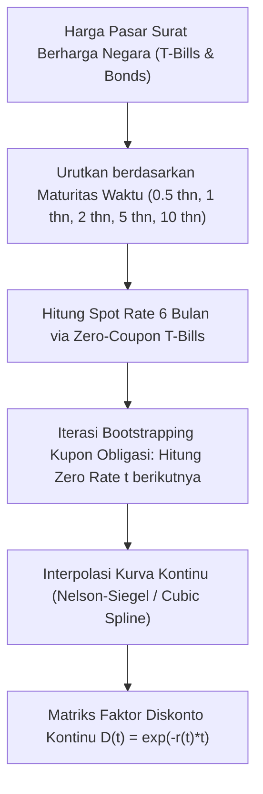

# Modul 210: Matematika Keuangan & Instrumen Pasar Modal (Time Value of Money, Valuasi Obligasi Yield Curve, Saham DCF, Opsi Vanilla)

**Navigasi**: [⬅️ Master Index](../../INDEX.md) | [Tingkat 14: Tingkat 14: Fintech, Financial Engineering, HFT & Blockchain](./README.md)
*Sebelumnya*: [209. infrastruktur-jaringan-pembayaran-regulasi](./209-infrastruktur-jaringan-pembayaran-regulasi.md) | *Berikutnya*: [211. teori-portofolio-modern-alokasi-kuantitatif](./211-teori-portofolio-modern-alokasi-kuantitatif.md)

---

## 1. Intuisi Dasar Tanpa Jargon ("Seperti Bayi Baru Lahir")
Mana yang Anda pilih: menerima uang Rp 100 juta hari ini sekarang juga, atau menerima Rp 100 juta tepat 10 tahun dari sekarang?

Tentu semua orang waras akan memilih menerima uang hari ini. Mengapa? Karena uang Rp 100 juta hari ini bisa Anda investasikan sehingga berkembang biak menghasilkan bunga, dan nilai uang di masa depan akan tergerus oleh inflasi. Inilah hukum paling mendasar dalam seluruh dunia keuangan: **Nilai Waktu dari Uang (Time Value of Money)** ([Bodie, Kane, Marcus - Investments](https://www.mheducation.com/highered/product/investments-bodie-kane/M9781260013832.html)).

Dari satu prinsip sederhana ini, kita bisa menghitung harga wajar dari instrumen apa pun di muka bumi:
1. **Obligasi (Surat Utang)**: Berapa harga wajar selembar kertas yang menjanjikan pembayaran bunga Rp 5 juta setiap tahun ditambah pengembalian pokok di tahun ke-10?
2. **Saham Perusahaan**: Saham sebuah perusahaan (seperti Apple atau Bank BCA) bernilai sebesar total seluruh arus kas bersih di masa depan yang akan dihasilkan perusahaan tersebut, ditarik mundur nilainya ke hari ini (**Discounted Cash Flow / DCF**).
3. **Opsi (Options)**: Berapa harga wajar selembar tiket yang memberi Anda *hak (bukan kewajiban)* untuk membeli emas seharga Rp 1 juta bulan depan jika harga pasar melonjak ke Rp 1,5 juta? ([Hull - Options, Futures, and Other Derivatives](https://www.pearson.com/en-us/subject-catalog/p/options-futures-and-other-derivatives/P200000003339)).

## 2. Fondasi Teoretis & Aksiomatik / Matematis
Formulasi Matematis Nilai Waktu dari Uang & Valuasi Aset:

1. **Aksioma Nilai Waktu dari Uang (Time Value of Money)**:
Hubungan antara Nilai Kini (*Present Value* / $PV$) dan Nilai Masa Depan (*Future Value* / $FV$) dengan suku bunga diskonto $r$ dan periode waktu $t$:
* Bunga Majemuk Diskrit: $FV = PV (1 + r)^t \implies PV = \frac{FV}{(1 + r)^t}$
* Bunga Kontinu: $FV = PV \cdot e^{rt} \implies PV = FV \cdot e^{-rt}$

2. **Valuasi Obligasi Kupon Tetap & Kurva Imbal Hasil (Yield to Maturity / YTM)**:
Harga wajar obligasi $P$ dengan nilai pokok nominal $F$, pembayaran kupon periodik $C$, dan imbal hasil pasar $y$:
$$P = \sum_{t=1}^T \frac{C}{(1 + y)^t} + \frac{F}{(1 + y)^T}$$
*Durasi Macaulay*: Mengukur sensitivitas harga obligasi terhadap perubahan suku bunga:
$$D_{\text{Mac}} = \frac{1}{P} \left[ \sum_{t=1}^T \frac{t \cdot C}{(1+y)^t} + \frac{T \cdot F}{(1+y)^T} \right], \quad \frac{\Delta P}{P} \approx - \frac{D_{\text{Mac}}}{1 + y} \Delta y$$

3. **Valuasi Saham Arus Kas Terdiskon (Discounted Cash Flow / DCF)**:
Memodelkan nilai intrinsik ekuitas perusahaan:
$$V_0 = \sum_{t=1}^H \frac{\text{FCFF}_t}{(1 + \text{WACC})^t} + \frac{\text{Terminal Value}_H}{(1 + \text{WACC})^H}, \quad \text{TV}_H = \frac{\text{FCFF}_{H+1}}{\text{WACC} - g}$$
Di mana WACC adalah *Weighted Average Cost of Capital* dan $g$ adalah tingkat pertumbuhan jangka panjang stabil Gordon Growth Model ([Damodaran - Investment Valuation](https://pages.stern.nyu.edu/~adamodar/)).

4. **Batas Teoretis & Put-Call Parity Opsi Eropa Vanilla**:
Hubungan arbitrase mutlak antara harga Opsi Beli ($C$), Opsi Jual ($P$), Harga Saham Spot saat ini ($S_0$), dan Harga Pelaksanaan Strike ($K$):
$$C + K e^{-rT} = P + S_0$$
Jika persamaan ini dilanggar di pasar, peluang keuntungan arbitrase bebas risiko instan tercipta.

## 3. Anatomi Teknis & Cara Kerja Internal
Arsitektur pemodelan kurva imbal hasil obligasi (*Spot Yield Curve Bootstrapping*):



Dengan kurva imbal hasil zero-coupon yang telah di-bootstrap, arus kas pada waktu kapan pun di masa depan dapat didiskontokan secara independen tanpa distorsi struktur kupon ([Tuckman & Serrat - Fixed Income Securities](https://onlinelibrary.wiley.com/doi/book/10.1002/9781118266670)).

## 4. Implementasi Praktis & Kode / Simulasi Riil
```python
import numpy as np

# 1. Valuasi Obligasi Kupon Tetap dan Kalkulasi Macaulay Duration
def price_bond(nominal, coupon_rate, ytm, periods):
    coupon = nominal * coupon_rate
    times = np.arange(1, periods + 1)
    
    # Arus Kas per Periode
    cash_flows = np.full(periods, coupon)
    cash_flows[-1] += nominal # Pengembalian pokok di akhir tenor
    
    # Diskontokan ke Present Value
    discount_factors = (1 + ytm) ** times
    pv_cash_flows = cash_flows / discount_factors
    bond_price = np.sum(pv_cash_flows)
    
    # Macaulay Duration (Tahun)
    macaulay_duration = np.sum(times * pv_cash_flows) / bond_price
    modified_duration = macaulay_duration / (1 + ytm)
    
    return bond_price, macaulay_duration, modified_duration

# Uji Coba: Obligasi 10 Tahun, Pokok Rp 1 Miliar, Kupon 7% per tahun, YTM Pasar 6.5%
price, mac_dur, mod_dur = price_bond(
    nominal=1_000_000_000,
    coupon_rate=0.07,
    ytm=0.065,
    periods=10
)

print(f"Harga Wajar Obligasi   : Rp {price:,.2f} (Trading di Premium > Pokok)")
print(f"Macaulay Duration      : {mac_dur:.2f} tahun")
print(f"Modified Duration      : {mod_dur:.2f}")
print(f"Sensitivitas: Jika suku bunga naik 1% (+100 bps), harga obligasi turun ~{mod_dur:.2f}%")

# 2. Verifikasi Hubungan Put-Call Parity Opsi Eropa
S0 = 100.0   # Harga Saham Sekarang
K = 100.0    # Strike Price
r = 0.05     # Risk-free rate 5%
T = 1.0      # Tenor 1 Tahun
Call = 10.45 # Harga Pasar Call

# Put-Call Parity: P = C + K*exp(-r*T) - S0
Put_theoretical = Call + K * np.exp(-r * T) - S0
print(f"\nHarga Wajar Opsi Put menurut Parity: ${Put_theoretical:.2f}")
```

## 5. Miskonsepsi & Jebakan Industri
*Mengabaikan Sensitivitas Konveksitas Obligasi (Convexity)*: Menghitung perubahan harga obligasi hanya menggunakan Modified Duration adalah aproksimasi linier orde-1 yang hanya akurat untuk pergeseran suku bunga mikro ($\Delta y < 25\text{ bps}$). Ketika suku bunga berfluktuasi tajam ($\Delta y > 100\text{ bps}$), kelengkungan harga (*Convexity* orde-2) menyebabkan estimasi durasi meleset jauh. Selalu sertakan suku Taylor orde kedua: $\frac{\Delta P}{P} \approx -D_{\text{mod}} \Delta y + \frac{1}{2} C (\Delta y)^2$ ([Tuckman & Serrat Chapter 4](https://onlinelibrary.wiley.com/doi/book/10.1002/9781118266670)).

## 6. Proyek Latihan & Rubrik Penilaian Mandiri
### Level 1 (Pemula)
Tulis fungsi perhitungan Nilai Sekarang Bersih (*Net Present Value / NPV*) dan Tingkat Pengembalian Internal (*Internal Rate of Return / IRR*) menggunakan metode pencarian akar Newton-Raphson untuk suatu proyek modal dengan investasi awal -Rp 500 juta dan arus kas masuk selama 5 tahun.
*Rubrik*: Output NPV dan IRR cocok dengan fungsi `numpy_financial.npv` dan `numpy_financial.irr`.

### Level 2 (Menengah)
Implementasikan algoritma kurva imbal hasil *Bootstrapping Spot Rate* dari nol: terima serangkaian harga pasar obligasi kupon tahunan bertenor 1, 2, 3, dan 5 tahun, pecahkan spot rate zero-coupon $r_t$ secara rekursif, dan plot perbandingan antara kurva YTM nominal vs kurva spot zero-coupon murni.
*Rubrik*: Spot rate periode $t$ mendiskontokan seluruh kupon historis dengan tepat.

### Level 3 (Mahir)
Bangun model valuasi saham Discounted Cash Flow (DCF) dua tahap (*Two-Stage FCFF Model*) di Python: proyeksikan laporan keuangan 5 tahun ke depan (pendapatan, EBIT, capex, perubahan modal kerja), hitung WACC berdasarkan struktur modal utang/ekuitas, hitung nilai terminal Gordon Growth, dan jalankan simulasi sensitivitas tabel 2-arah (variasi WACC vs variasi Terminal Growth Rate).
*Rubrik*: Menghasilkan tabel matriks sensitivitas harga saham wajar per lembar.

## 7. Rekomendasi Sumber Belajar Standar Emas
| Sumber Pembelajaran | Penulis / Institusi | Tautan Langsung | Fokus Materi |
| :--- | :--- | :--- | :--- |
| Options, Futures, and Other Derivatives (10th Ed.) | John C. Hull (University of Toronto) | [Pearson Education](https://www.pearson.com/en-us/subject-catalog/p/options-futures-and-other-derivatives/P200000003339) | Alkitab Instrumen Derivatif, Arbitrase, Put-Call Parity |
| Investment Valuation: Tools and Techniques for Determining the Value of Any Asset | Aswath Damodaran (NYU Stern) | [Damodaran Online Portal](https://pages.stern.nyu.edu/~adamodar/) | Standar Emas Valuasi DCF, WACC, Estimasi Risiko Ekuitas |
| Fixed Income Securities: Valuation, Risk, and Risk Management | Bruce Tuckman & Angel Serrat | [Wiley Finance](https://onlinelibrary.wiley.com/doi/book/10.1002/9781118266670) | Matematika Obligasi, Durasi, Konveksitas, Kurva YTM |
| Investments (12th Ed.) | Zvi Bodie, Alex Kane, Alan J. Marcus | [McGraw-Hill Education](https://www.mheducation.com/highered/product/investments-bodie-kane/M9781260013832.html) | Fondasi Teori Investasi, Time Value of Money, Teori Modal |

---
*Navigasi Cepat*: [Ke Tingkat 14](./README.md) | [Ke Master Index](../../INDEX.md) | *Sebelumnya*: [209. infrastruktur-jaringan-pembayaran-regulasi](./209-infrastruktur-jaringan-pembayaran-regulasi.md) | *Berikutnya*: [211. teori-portofolio-modern-alokasi-kuantitatif](./211-teori-portofolio-modern-alokasi-kuantitatif.md)
