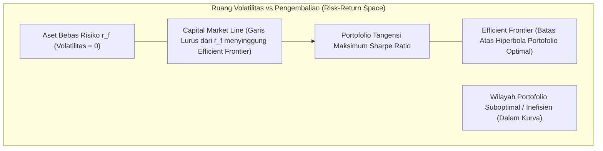

# Modul 211: Teori Portofolio Modern & Alokasi Kuantitatif (Mean-Variance Markowitz, Efficient Frontier, CAPM Beta, Kelly Criterion)

**Navigasi**: [⬅️ Master Index](../../INDEX.md) | [Tingkat 14: Tingkat 14: Fintech, Financial Engineering, HFT & Blockchain](./README.md)
*Sebelumnya*: [210. matematika-keuangan-instrumen-pasar-modal](./210-matematika-keuangan-instrumen-pasar-modal.md) | *Berikutnya*: [212. kalkulus-stokastik-penetapan-harga-opsi](./212-kalkulus-stokastik-penetapan-harga-opsi.md)

---

## 1. Intuisi Dasar Tanpa Jargon ("Seperti Bayi Baru Lahir")
Ada peribahasa kuno yang mengatakan: *"Jangan pernah menaruh semua telurmu di dalam satu keranjang"* ([Markowitz - Portfolio Selection, 1952](https://www.jstor.org/stable/2975974)). Jika keranjang itu jatuh, semua telur pecah bersamaan.

Namun, bagaimana jika Anda menaruh telur di 10 keranjang yang berbeda, tetapi semua keranjang itu dinaikkan ke atas satu gerobak yang sama? Jika gerobak itu terguling, telur Anda tetap pecah semua!

Harry Markowitz menemukan bahwa diversifikasi sejati bukan sekadar membeli banyak aset yang berbeda: **kuncinya adalah korelasi antar aset**. Jika Anda memiliki saham perusahaan es krim (yang untung besar saat musim panas tapi rugi saat musim hujan) dan saham perusahaan payung (yang untung besar saat musim hujan tapi rugi saat musim panas), ketika digabungkan dalam satu portofolio, risiko kerugian kedua bisnis tersebut saling membatalkan satu sama lain secara ajaib!

Hasilnya? Anda mendapatkan pengembalian modal yang stabil dengan risiko volatilitas yang jauh lebih rendah daripada memegang salah satu saham sendirian (**Efficient Frontier**) ([Markowitz Nobel Lecture](https://www.nobelprize.org/prizes/economic-sciences/1990/markowitz/lecture/)). Dan ketika Anda memiliki strategi taruhan yang menguntungkan, berapa persen dari total uang Anda yang harus Anda pertaruhkan di setiap peluang agar kekayaan Anda tumbuh maksimal tanpa risiko bangkrut? Matematikawan John L. Kelly merumuskannya dalam **Kelly Criterion** ([Kelly - A New Interpretation of Information Rate](https://www.princeton.edu/~wbialek/rome/refs/kelly_56.pdf)).

## 2. Fondasi Teoretis & Aksiomatik / Matematis
Formulasi Matematis Teori Portofolio Modern & Optimasi Risiko:

1. **Optimasi Portofolio Mean-Variance Harry Markowitz**:
Untuk $N$ aset dengan vektor ekspektasi return $\mu \in \mathbb{R}^N$ dan matriks kovarians $\Sigma \in \mathbb{R}^{N \times N}$:
Return portofolio: $\mu_p = w^T \mu$, \quad Varians portofolio: $\sigma_p^2 = w^T \Sigma w$
Di mana $w \in \mathbb{R}^N$ adalah bobot alokasi dengan kendala $\sum_{i=1}^N w_i = 1$ ($w^T \mathbf{1} = 1$).
Masalah optimasi kuadratik untuk meminimalkan risiko pada target return $\mu_0$:
$$\min_w \frac{1}{2} w^T \Sigma w \quad \text{s.t.} \quad w^T \mu = \mu_0, \quad w^T \mathbf{1} = 1$$
Himpunan solusi optimal untuk seluruh rentang $\mu_0$ membentuk kurva hiperbola di bidang $(\sigma_p, \mu_p)$ yang disebut **Efficient Frontier** ([Markowitz 1952](https://www.jstor.org/stable/2975974)).

2. **Capital Asset Pricing Model (CAPM) & Beta Risiko Sistematis**:
Di hadapan aset bebas risiko (*risk-free asset* $r_f$), portofolio optimal adalah titik singgung (*tangency portfolio*) yang memaksimalkan rasio Sharpe:
$$\text{Sharpe Ratio} = \frac{\mu_p - r_f}{\sigma_p}$$
Garis Pasar Modal (Capital Market Line / CML). Model penetapan harga aset ekuilibrium CAPM:
$$\mathbb{E}[R_i] = r_f + \beta_i (\mathbb{E}[R_m] - r_f), \quad \beta_i = \frac{\text{Cov}(R_i, R_m)}{\text{Var}(R_m)}$$
Di mana $\beta_i$ mengukur sensitivitas terhadap risiko sistematis pasar yang tidak dapat dihilangkan oleh diversifikasi ([Sharpe - Capital Asset Prices](https://www.jstor.org/stable/2977928)).

3. **Formula Fraksi Pertumbuhan Optimal Kelly (Kelly Criterion)**:
Memaksimalkan laju pertumbuhan geometris logaritmik kekayaan jangka panjang $\mathbb{E}[\ln(W_t)]$:
* Peluang Peluang Biner (Taruhan dengan probabilitas menang $p$, kalah $q = 1 - p$, rasio odds keuntungan $b$):
$$f^* = \frac{b p - q}{b} = \frac{p(b + 1) - 1}{b}$$
* Alokasi Aset Kontinu (Model Gaussian dengan ekspektasi return berlebih $\mu - r$ dan volatilitas $\sigma$):
$$f^* = \frac{\mu - r}{\sigma^2}$$
Bertaruh lebih besar dari fraksi Kelly ($f > 2f^*$) menjamin kebangkrutan modal (*gambler's ruin*) hampir pasti dalam jangka panjang ([Kelly 1956](https://www.princeton.edu/~wbialek/rome/refs/kelly_56.pdf)).

## 3. Anatomi Teknis & Cara Kerja Internal
Geometri Ruang Risiko-Pengembalian (Markowitz Efficient Frontier & Capital Market Line):



Kekuatan matematika Markowitz terletak pada suku kovarians non-diagonal: jika koefisien korelasi $\rho_{ij} < 0$, varians gabungan portofolio turun lebih cepat daripada penurunan rata-rata return, memungkinkan pencapaian portofolio dengan risiko yang lebih rendah daripada aset teraman di dalam keranjang ([Sharpe Portfolio Theory](https://www.jstor.org/stable/2977928)).

## 4. Implementasi Praktis & Kode / Simulasi Riil
```python
import numpy as np
from scipy.optimize import minimize

# 1. Optimasi Portofolio Markowitz Tangency (Maksimum Sharpe Ratio)
# 4 Aset Saham: Ekspektasi Return Tahunan & Matriks Kovarians
mu = np.array([0.12, 0.15, 0.09, 0.20]) # Return tahunan ekspektasi
cov_matrix = np.array([
    [0.040, 0.010, 0.005, 0.015],
    [0.010, 0.062, 0.008, 0.020],
    [0.005, 0.008, 0.022, 0.004],
    [0.015, 0.020, 0.004, 0.090]
])
r_f = 0.04 # Risk-Free Rate 4%

def negative_sharpe(weights):
    p_return = np.dot(weights, mu)
    p_volatility = np.sqrt(np.dot(weights.T, np.dot(cov_matrix, weights)))
    return -(p_return - r_f) / p_volatility

# Kendala: Total Bobot = 1 (100% Modal), No Short-Selling (0 <= w <= 1)
constraints = ({'type': 'eq', 'fun': lambda w: np.sum(w) - 1.0})
bounds = tuple((0.0, 1.0) for _ in range(len(mu)))
initial_weights = np.ones(len(mu)) / len(mu)

result = minimize(negative_sharpe, initial_weights, method='SLSQP', bounds=bounds, constraints=constraints)
optimal_weights = result.x
max_sharpe = -result.fun

p_ret = np.dot(optimal_weights, mu)
p_vol = np.sqrt(np.dot(optimal_weights.T, np.dot(cov_matrix, optimal_weights)))

print("Alokasi Portofolio Optimal (Maximum Sharpe Ratio):")
for idx, w in enumerate(optimal_weights, start=1):
    print(f" - Aset {idx}: {w*100:.2f}%")
print(f"Ekspektasi Return Portofolio : {p_ret*100:.2f}%")
print(f"Volatilitas Risiko Portofolio: {p_vol*100:.2f}%")
print(f"Rasio Sharpe Maksimum        : {max_sharpe:.3f}")

# 2. Perhitungan Alokasi Kelly Criterion
win_rate = 0.55 # 55% Win Rate
win_loss_ratio = 1.5 # Menang 1.5x dari kekalahan
kelly_fraction = (win_rate * (win_loss_ratio + 1) - 1) / win_loss_ratio
print(f"\nFraksi Taruhan Optimal Kelly: {kelly_fraction*100:.2f}% dari total modal")
```

## 5. Miskonsepsi & Jebakan Industri
*Estimation Risk / Error Maximization pada Markowitz Optimizer*: Pengoptimal Mean-Variance klasik bekerja seperti "mesin pemaksimal galat". Jika model Anda secara keliru melebih-lebihkan sedikit saja ekspektasi return suatu saham ($+1\%$), algoritma optimasi akan mengalokasikan 80% modal ke saham tersebut, menciptakan portofolio konsentrasi ekstrem yang sangat rapuh. Praktisi industri kuantitatif tidak menggunakan ekspektasi return mentah; mereka menggunakan model **Black-Litterman** (menggabungkan pandangan analis dengan ekuilibrium pasar) atau regularisasi *Hierarchical Risk Parity (HRP)* ([López de Prado - Building Diversified Portfolios that Outperform Out-of-Sample](https://www.davidhbailey.com/dhbpapers/hrp.pdf)).

## 6. Proyek Latihan & Rubrik Penilaian Mandiri
### Level 1 (Pemula)
Tulis skrip Python untuk menghitung matriks kovarians sampel dan koefisien Beta CAPM ($\beta_i = \text{Cov}(R_i, R_m)/\text{Var}(R_m)$) dari 3 saham teknologi terhadap indeks S&P 500 / IHSG menggunakan data return harian sintetis 1 tahun.
*Rubrik*: Output menampilkan nilai beta masing-masing saham secara akurat.

### Level 2 (Menengah)
Bangun simulator simulasi Monte Carlo untuk memetakan kurva *Efficient Frontier*: hasilkan 20.000 portofolio dengan bobot alokasi Dirichlet acak $\sum w_i = 1$, plot sebaran titik risiko vs return, dan cari titik portofolio dengan varians minimum absolut (*Global Minimum Variance Portfolio*).
*Rubrik*: Visualisasi kurva hiperbola batas efisien terbentuk jelas dari batas kiri awan titik.

### Level 3 (Mahir)
Implementasikan algoritma alokasi portofolio **Hierarchical Risk Parity (HRP)** Marcos López de Prado: hitung jarak korelasi spasial $d_{ij} = \sqrt{\frac{1}{2}(1 - \rho_{ij})}$, lakukan pengelompokan hierarkis matriks (Single Linkage Clustering), terapkan quasi-diagonalization, dan alokasikan bobot melalui inverse-variance bisection rekursif tanpa perlu menginversi matriks kovarians $\Sigma^{-1}$.
*Rubrik*: Kode teruji tahan banting terhadap matriks kovarians yang singular atau ill-conditioned.

## 7. Rekomendasi Sumber Belajar Standar Emas
| Sumber Pembelajaran | Penulis / Institusi | Tautan Langsung | Fokus Materi |
| :--- | :--- | :--- | :--- |
| Portfolio Selection | Harry Markowitz (The Journal of Finance 1952) | [JSTOR Classic Paper](https://www.jstor.org/stable/2975974) | Makalah Penemuan Asli Teori Portofolio Modern Mean-Variance |
| Capital Asset Prices: A Theory of Market Equilibrium (CAPM) | William F. Sharpe (Nobel Laureate) | [The Journal of Finance 1964](https://www.jstor.org/stable/2977928) | Penemuan Asli Model CAPM, Beta Saham, Capital Market Line |
| A New Interpretation of Information Rate (Kelly Criterion) | J. L. Kelly, Jr. (Bell System Technical Journal) | [Bell System Report 1956](https://www.princeton.edu/~wbialek/rome/refs/kelly_56.pdf) | Formulasi Asli Teori Informasi Pertumbuhan Logaritmik Modal |
| Advances in Financial Machine Learning | Marcos López de Prado | [Wiley Finance Portal](https://www.wiley.com/en-us/Advances+in+Financial+Machine+Learning-p-9781119482086) | Hierarchical Risk Parity (HRP), Robust Portfolio Optimization |

---
*Navigasi Cepat*: [Ke Tingkat 14](./README.md) | [Ke Master Index](../../INDEX.md) | *Sebelumnya*: [210. matematika-keuangan-instrumen-pasar-modal](./210-matematika-keuangan-instrumen-pasar-modal.md) | *Berikutnya*: [212. kalkulus-stokastik-penetapan-harga-opsi](./212-kalkulus-stokastik-penetapan-harga-opsi.md)
