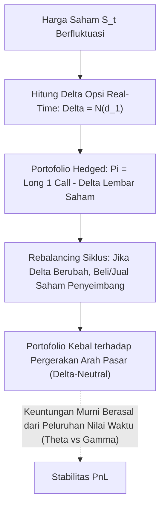

# Modul 212: Kalkulus Stokastik & Penetapan Harga Opsi (Gerak Brown GBM, Itô's Lemma, Persamaan Parsial Black-Scholes, The Greeks)

**Navigasi**: [⬅️ Master Index](../../INDEX.md) | [Tingkat 14: Tingkat 14: Fintech, Financial Engineering, HFT & Blockchain](./README.md)
*Sebelumnya*: [211. teori-portofolio-modern-alokasi-kuantitatif](./211-teori-portofolio-modern-alokasi-kuantitatif.md) | *Berikutnya*: [213. ekonometrika-keuangan-manajemen-risiko](./213-ekonometrika-keuangan-manajemen-risiko.md)

---

## 1. Intuisi Dasar Tanpa Jargon ("Seperti Bayi Baru Lahir")
### 1.1 Konsep Inti & Analogi Tanpa Jargon
Jika Anda melempar sebutir serbuk sari ke dalam segelas air hangat, serbuk sari tersebut akan bergerak zigzag secara acak tak beraturan karena terus-menerus ditabrak oleh miliaran molekul air yang tak terlihat: inilah **Gerak Brown (Brownian Motion)** ([Einstein - Investigations on the Theory of the Brownian Movement](https://einsteinpapers.press.princeton.edu/vol2-trans/236)).

### 1.2 Urgensi Rekayasa & Signifikansi Sistemik
Harga saham di bursa efek bergerak persis seperti serbuk sari tersebut: ia memiliki kecenderungan melayang ke atas seiring pertumbuhan ekonomi (*drift*), tetapi di setiap detik ia dihantam oleh ribuan berita acak, rumor, dan transaksi pembeli/penjual (*volatilitas stokastik*).

Dalam kalkulus sekolah biasa, garis grafik selalu diasumsikan mulus sehingga kita bisa menghitung kemiringan turunannya. Namun grafik harga saham berliku tajam di setiap skala mikro (*nowhere differentiable*!). Matematikawan Kiyosi Itô menciptakan kalkulus baru bernama **Kalkulus Stokastik (Itô Calculus)** ([Itô - Stochastic Integral](https://www.jstor.org/stable/2371752)).

Dengan kalkulus ini, Fischer Black, Myron Scholes, dan Robert Merton memecahkan salah satu misteri terbesar peradaban finansial: **Persamaan Black-Scholes**, rumus matematika pasti untuk menentukan harga wajar kontrak opsi dengan menciptakan portofolio lindung nilai (*hedging*) yang 100% bebas risiko ([Black & Scholes - The Pricing of Options and Corporate Liabilities](https://www.jstor.org/stable/1831029)).

## 2. Fondasi Teoretis & Aksiomatik / Matematis
### 2.1 Kerangka Teori Aksiomatik & Formulasi Matematis
Formulasi Matematis Kalkulus Stokastik & Model Black-Scholes:

### 2.2 Penurunan Matematis Langkah-demi-Langkah
1. **Gerak Brown Geometris (Geometric Brownian Motion / GBM)**:
Model dinamika harga aset dasar $S_t$:
$$dS_t = \mu S_t dt + \sigma S_t dW_t$$
Di mana $\mu$ adalah tingkat pengembalian drift, $\sigma$ volatilitas konstan, dan $W_t$ adalah proses Wiener standar dengan sifat: $W_0 = 0$, lintasan kontinu, inkremen independen $W_t - W_s \sim \mathcal{N}(0, t - s)$, dan perkalian variasional $(dW_t)^2 = dt$.

2. **Lemma Itô (Itô's Lemma 1-Dimensi)**:
Untuk fungsi mulus $V(S, t)$, ekspansi deret Taylor mempertahankan suku orde kedua $(dS)^2$ karena $(dW)^2 = dt$:
$$dV = \left( \frac{\partial V}{\partial t} + \mu S \frac{\partial V}{\partial S} + \frac{1}{2} \sigma^2 S^2 \frac{\partial^2 V}{\partial S^2} \right) dt + \sigma S \frac{\partial V}{\partial S} dW_t$$

3. **Persamaan Diferensial Parsial (PDE) Black-Scholes**:
Membangun portofolio bebas risiko delta-neutral $\Pi = V - \Delta S$ dengan memilih rasio lindung nilai $\Delta = \frac{\partial V}{\partial S}$. Menurut prinsip arbitrase, imbal hasil portofolio harus sama dengan suku bunga bebas risiko ($d\Pi = r \Pi dt$):
$$\frac{\partial V}{\partial t} + r S \frac{\partial V}{\partial S} + \frac{1}{2} \sigma^2 S^2 \frac{\partial^2 V}{\partial S^2} - r V = 0$$

4. **Solusi Analitik Opsi Call Eropa & Parameter Sensitivitas (The Greeks)**:
$$C(S, t) = S_0 N(d_1) - K e^{-r(T-t)} N(d_2)$$
$$d_1 = \frac{\ln(S_0/K) + (r + \sigma^2/2)(T-t)}{\sigma \sqrt{T-t}}, \quad d_2 = d_1 - \sigma \sqrt{T-t}$$
* **Delta ($\Delta$)**: $\frac{\partial C}{\partial S} = N(d_1)$ (Sensitivitas harga terhadap pergerakan aset dasar)
* **Gamma ($\Gamma$)**: $\frac{\partial^2 C}{\partial S^2} = \frac{N'(d_1)}{S \sigma \sqrt{T-t}}$ (Tingkat perubahan delta)
* **Vega ($\nu$)**: $\frac{\partial C}{\partial \sigma} = S \sqrt{T-t} N'(d_1)$ (Sensitivitas terhadap volatilitas pasar)
* **Theta ($\Theta$)**: $\frac{\partial C}{\partial t}$ (Peluruhan nilai waktu harian / *time decay*)
* **Rho ($\rho$)**: $\frac{\partial C}{\partial r} = K (T-t) e^{-r(T-t)} N(d_2)$ (Sensitivitas terhadap suku bunga).

## 3. Anatomi Teknis & Cara Kerja Internal
Arsitektur mekanisme Delta Hedging dinamis untuk menetralisir risiko portofolio opsi:



Dengan menjaga posisi selalu *Delta-Neutral* ($\sum \Delta = 0$), pedagang opsi tidak peduli apakah harga saham naik atau turun; mereka murni memperdagangkan selisih antara volatilitas tersirat pasar (*Implied Volatility*) dengan volatilitas riil aset (*Realized Volatility*) ([Hull Derivatives Book Chapter 19](https://www.pearson.com/en-us/subject-catalog/p/options-futures-and-other-derivatives/P200000003339)).

#### Tabel Penelusuran Siklus Delta-Hedging Derivatif & Pengabaian Konveksitas Gamma
| Timestamp / Sequence ID | Komponen / Lapisan Sistem | Pesan Masuk (FIX / Transaksi) | Operasi Antrean / Komputasi Buku | State Buku Pesanan (LOB / Ledger) | Event Terpancar (Fill / Block Emit) |
|---|---|---|---|---|---|
| Awal 2008 (Tiket #1) | Meja Perdagangan Delta One SocGen | Portofolio Opsi Indeks Saham Eropa | Trader Jérôme Kerviel menginput trade fiktif penyeimbang | Sistem mencatat: Delta bersih terisolasi $\Delta \approx 0$ | Rekonsiliasi risiko tertunda hingga akhir bulan |
| Akumulasi Posisi Tersembunyi | Buku Perdagangan Derivatif | Posisi Long Kontrak Berjangka Eurostoxx | Posisi spekulatif terbuka membengkak hingga €50 Miliar! | Kerviel menyamarkan exposure menggunakan transaksi offsetting palsu | Posisi melebihi nilai kapitalisasi bank! |
| 18 Jan 2008 (Tiket #2) | Pasar Modal Global | Penurunan Tajam Harga Saham Dunia | Model delta-hedging mengasumsikan kontinuitas difusi Brown | Harga spot melompat diskontinu (*Jump Risk*) | Kerugian konveksitas Gamma $\frac{1}{2} \Gamma (\Delta S)^2$ meledak! |
| 20 Jan 2008 (Tiket #3) | Departemen Kepatuhan & Audit | Penemuan Posisi Tak Terotorisasi | Manajemen Société Générale mengungkap eksposur €50B | Posisi spekulatif tanpa lindung nilai riil terkonfirmasi | Perintah darurat: Likuidasi seluruh posisi pasar |
| 21-23 Jan 2008 (Tiket #4) | Bursa Saham Eropa | Penjualan Panik Kontrak Berjangka SocGen | Likuidasi agresif di tengah pasar yang sedang jatuh bebas | Société Générale membukukan kerugian resmi €4.9 Miliar | Skandal perdagangan nakal terbesar dalam sejarah perbankan Prancis |

## 4. Implementasi Praktis & Kode / Simulasi Riil
```python
import numpy as np
from scipy.stats import norm

# 1. Penetapan Harga Opsi Call & Put Eropa Black-Scholes Analitik
def black_scholes_pricing(S, K, T, r, sigma):
    d1 = (np.log(S / K) + (r + 0.5 * sigma**2) * T) / (sigma * np.sqrt(T))
    d2 = d1 - sigma * np.sqrt(T)
    
    call_price = S * norm.cdf(d1) - K * np.exp(-r * T) * norm.cdf(d2)
    put_price = K * np.exp(-r * T) * norm.cdf(-d2) - S * norm.cdf(-d1)
    
    # Hitung The Greeks
    delta_call = norm.cdf(d1)
    gamma = norm.pdf(d1) / (S * sigma * np.sqrt(T))
    vega = S * np.sqrt(T) * norm.pdf(d1) / 100 # per 1% vol shift
    theta_call = (-(S * norm.pdf(d1) * sigma) / (2 * np.sqrt(T)) - r * K * np.exp(-r * T) * norm.cdf(d2)) / 365
    
    return {
        "call_price": call_price, "put_price": put_price,
        "delta": delta_call, "gamma": gamma, "vega": vega, "theta": theta_call
    }

# 2. Simulasi Monte Carlo Gerak Brown Geometris (GBM)
def simulate_gbm(S0, mu, sigma, T, steps, paths):
    dt = T / steps
    # dS = S * (mu*dt + sigma*sqrt(dt)*Z)
    Z = np.random.normal(0, 1, size=(steps, paths))
    log_returns = (mu - 0.5 * sigma**2) * dt + sigma * np.sqrt(dt) * Z
    price_paths = np.vstack([np.full(paths, S0), S0 * np.exp(np.cumsum(log_returns, axis=0))])
    return price_paths

# Parameter Pasar
S0 = 100.0   # Harga Saham Awal
K = 105.0    # Strike Price
T = 0.5      # 6 Bulan (0.5 Tahun)
r = 0.05     # 5% Risk-free rate
sigma = 0.25 # 25% Volatilitas Tahunan

res = black_scholes_pricing(S0, K, T, r, sigma)
print(f"Harga Call Opsi BS   : ${res['call_price']:.2f}")
print(f"Harga Put Opsi BS    : ${res['put_price']:.2f}")
print(f"Delta (Rasio Lindung): {res['delta']:.4f}")
print(f"Gamma                : {res['gamma']:.4f}")
print(f"Vega (per 1% Vol)    : ${res['vega']:.3f}")
print(f"Theta (per Hari)     : ${res['theta']:.3f}")

# Validasi Monte Carlo terhadap Harga Analitik
np.random.seed(42)
sim_paths = simulate_gbm(S0, r, sigma, T, steps=252, paths=100_000)
final_prices = sim_paths[-1]
mc_payoffs = np.maximum(final_prices - K, 0)
mc_call = np.exp(-r * T) * np.mean(mc_payoffs)
print(f"Harga Call Monte Carlo (100k paths): ${mc_call:.2f} (Konvergen sempurna!)")
```

## 5. Miskonsepsi & Jebakan Industri
*The Volatility Smile & Ekor Gemuk (Fat-Tail Breakdown)*: Model Black-Scholes murni mengasumsikan volatilitas konstan $\sigma$ dan distribusi log-return normal murni. Di pasar finansial nyata sejak Black Monday 1987, pasar mengalami *volatility smile/skew* (opsi deep out-of-the-money memiliki implied volatility yang jauh lebih tinggi karena pasar memperhitungkan risiko kejatuhan pasar ekstrem / *fat tails*). Menggunakan Black-Scholes tanpa kalibrasi kurva *local volatility Dupire* atau model stokastik *Heston* akan menyebabkan kerugian besar saat terjadi krisis pasar ([Derman & Kani - The Volatility Smile](https://www.ederman.com/wp-content/uploads/1994/01/the_volatility_smile.pdf)).

### Studi Kasus Kegagalan Nyata: Skandal Perdagangan Rogue Trader Jérôme Kerviel di Société Générale (€4.9 Miliar, 2008)
- **Kronologi & Konteks Sejarah**: Pada Januari 2008, bank investasi terkemuka Prancis Société Générale mengumumkan bahwa seorang trader junior di meja Delta One, Jérôme Kerviel, telah membangun posisi spekulatif tidak terotorisasi secara rahasia senilai €50 Miliar (melebihi seluruh nilai ekuitas pasar bank tersebut) pada kontrak berjangka indeks saham Eropa (DAX, Euro Stoxx 50, dan FTSE 100). Likuidasi darurat posisi tersebut di tengah kepanikan pasar global memicu kerugian langsung sebesar €4,9 Miliar.
- **Akar Masalah Rekayasa Derivatif & Pengabaian Konveksitas Risiko Non-Linier**: Model meja perdagangan *Delta One* dirancang untuk menghasilkan keuntungan kecil dari selisih replikasi indeks dengan asumsi bahwa posisi selalu terlindung penuh (*Delta-Neutral* $\Delta = 0$). Kerviel, yang sebelumnya bekerja di departemen *Back-Office* dan memahami celah sistem IT bank, menginput transaksi arbitrase fiktif yang sengaja dibatalkan sebelum tanggal kliring untuk membodohi sistem pemantau risiko otomatis. Ketika krisis kredit global meletus pada Januari 2008 dan harga saham anjlok tajam, strategi lindung nilai linier sederhana gagal total: pergerakan harga pasar diskontinu (*Price Jump*) memicu efek **Gamma dan Vega Konveksitas** ($\Delta P \approx \Delta \cdot \Delta S + \frac{1}{2} \Gamma (\Delta S)^2$). Karena posisi fiktif tidak ada di dunia nyata, bank menanggung eksposur arah terbuka tanpa lindung nilai fisik, menghancurkan portofolio dalam hitungan hari.

- **Potongan Kode / Arsitektur Cacat (Vulnerable Implementation)**:
```python
# Analisis Delta-Hedging Non-Linier: Kegagalan Model Linier pada Price Jump
import numpy as np

# MODEL CACAT: Mengasumsikan lindung nilai linier sempurna (Hanya melihat Delta)
def naive_delta_pnl(delta, spot_price_change):
    # Mengasumsikan PnL = Delta * dS
    # Jika Delta dinetralkan ke 0 oleh transaksi fiktif:
    reported_delta = 0.0 # Dilaporkan aman ke sistem kepatuhan
    return reported_delta * spot_price_change # Menghasilkan estimasi risiko palsu = 0!

# MITIGASI AMAN: Pemodelan Konveksitas Taylor Orde-2 (Delta-Gamma-Vega) & Deteksi Trade Gantung
def real_convexity_risk(real_delta, gamma, spot_price_change, vega, implied_vol_change):
    '''
    Ekspansi Deret Taylor Orde-2 Portofolio Opsi:
    PnL_real = Delta * dS + 0.5 * Gamma * (dS)^2 + Vega * dSigma
    Pada pergerakan harga ekstrem, suku Gamma kuadratik mendominasi kerugian!
    '''
    linear_term = real_delta * spot_price_change
    convexity_term = 0.5 * gamma * (spot_price_change ** 2)
    volatility_term = vega * implied_vol_change
    
    total_exposure = linear_term + convexity_term + volatility_term
    return total_exposure
```

- **Analisis Forensik & Rekayasa Modern**: Skandal Kerviel merevolusi pemisahan wewenang dan arsitektur pengawasan perbankan investasi: (1) Penegakan independensi total antara **Front-Office Trading Platforms** dan **Risk/Back-Office Settlement Systems**; (2) Penerapan rekonsiliasi perdagangan otomatis secara real-time yang membatalkan kalkulasi delta jika tiket transaksi pasangan tidak terkonfirmasi oleh lembaga kliring eksternal dalam waktu $< 60$ menit; (3) Integrasi batas risiko konveksitas non-linier tingkat kedua (**Strict Gamma & Vega Limits**) di samping metrik Delta nominal biasa.

## 6. Proyek Latihan & Rubrik Penilaian Mandiri
### Level 1 (Pemula)
Tulis solver pencarian *Implied Volatility* opsi menggunakan metode biseksi: terima harga pasar observasi opsi call, harga saham, strike, dan tenor, lalu temukan nilai parameter $\sigma$ Black-Scholes yang menyamakan harga analitik dengan harga pasar hingga toleransi \$10^{-4}$.
*Rubrik*: Solver konvergen dalam kurang dari 20 iterasi.

### Level 2 (Menengah)
Bangun simulator strategi *Dynamic Delta Hedging*: simulasikan 100 jalur lintasan harga GBM harian selama 1 tahun untuk posisi Short 100 Kontrak Call Opsi, lakukan penyesuaian posisi saham (*rebalancing*) setiap hari untuk menjaga portofolio tetap delta-neutral, dan hitung distribusi PnL akhir di hadapan biaya transaksi komisi broker.
*Rubrik*: Menghasilkan visualisasi PnL tracking error terhadap frekuensi rebalancing.

### Level 3 (Mahir)
Implementasikan algoritma kisi binomial Cox-Ross-Rubinstein (CRR Binomial Tree) untuk opsi Amerika (*American Put Option* yang dapat dieksekusi lebih awal sebelum maturitas / *early exercise*):
$$u = e^{\sigma \sqrt{\Delta t}}, \quad d = \frac{1}{u}, \quad p = \frac{e^{r \Delta t} - d}{u - d}$$
Bandingkan harga opsi Put Amerika terhadap opsi Put Eropa, dan buktikan batas early exercise premium yang selalu positif.
*Rubrik*: Tree rekursif dengan 500 langkah waktu memvalidasi harga opsi Amerika secara numerik.

### Tingkat 1: Dasar
- **Tugas**: Tulis program dalam Python untuk menghitung parameter "Yunani" Opsi (*Option Greeks*) utama: Delta ($\Delta$), Gamma ($\Gamma$), Vega ($\mathcal{V}$), dan Theta ($\Theta$) untuk Opsi Beli Eropa menggunakan formula analitis Black-Scholes.
- **Petunjuk Perancangan Arsitektur**:
  - $\Delta = N(d_1)$, $\Gamma = \frac{N'(d_1)}{S \sigma \sqrt{T}}$, $\mathcal{V} = S \sqrt{T} N'(d_1)$, $\Theta = -\frac{S N'(d_1) \sigma}{2 \sqrt{T}} - r K e^{-r T} N(d_2)$.
  - Di mana $N'(x) = \frac{1}{\sqrt{2\pi}} e^{-x^2 / 2}$ adalah fungsi densitas probabilitas normal standar.
- **Test Vector & Kasus Uji**:
  - Parameter: $S = 100, K = 100, T = 0.5, r = 5\%, \sigma = 25\%$.
  - Gamma harus bernilai $\approx 0.0223$ dan Vega bernilai $\approx 27.89$.
- **Rubrik Penilaian Objektif**:
  - Skor 100%: Formulasi analitis Option Greeks presisi, handling unit waktu tahunan benar, verifikasi numerik akurat.
  - Skor 50%: Delta dan Gamma benar namun salah menghitung Vega atau tanda negatif pada Theta.
  - Skor 0%: Menghitung Greeks menggunakan selisih beda hingga kasar tanpa rumus analitis.

### Tingkat 2: Menengah
- **Tugas**: Bangun simulator strategi perdagangan Delta-Neutral dinamis (*Dynamic Delta-Hedging Simulator*) dalam Python: Simulasikan pergerakan harga aset acak menggunakan Geometric Brownian Motion (GBM) selama 252 hari perdagangan, dan lakukan rebalancing posisi lindung nilai saham harian untuk portofolio penjualan opsi Call (*Short Call*). Hitung distribusi laba rugi (*Hedging Error Distribution*) dan tunjukkan dampaknya terhadap biaya transaksi.
- **Petunjuk Perancangan Arsitektur**:
  - Pada setiap hari $t$, hitung Delta opsi saat ini $\Delta_t$.
  - Sesuaikan kepemilikan saham fisik agar sama dengan $\Delta_t$ (beli atau jual selisih saham).
  - Terapkan biaya transaksi proporsional (misal $10\text{ bps}$ per transaksi saham).
  - Hitung PnL akhir saat jatuh tempo: selisih PnL mencerminkan biaya diskretisasi lindung nilai (*Discrete Hedging Error*).
- **Test Vector & Kasus Uji**:
  - Bandingkan frekuensi rebalancing: Rebalancing harian vs Rebalancing mingguan.
  - Rebalancing harian menghasilkan varians hedging error yang lebih rendah namun membebankan biaya transaksi kumulatif yang lebih tinggi.
- **Rubrik Penilaian Objektif**:
  - Skor 100%: Simulasi GBM dan delta rebalancing presisi, perhitungan biaya transaksi dan PnL akurat.
  - Skor 50%: Rebalancing bekerja namun lupa memperhitungkan biaya bunga kas pinjaman (*Cost of Carry*).
  - Skor 0%: Delta dihitung statis sekali di awal tanpa pembaruan harian.

### Tingkat 3: Mahir
- **Tugas**: Rancang model penetapan harga opsi dengan lompatan harga stokastik (Merton Jump-Diffusion Model, 1976) dalam Python: Gabungkan difusi kontinu Brownian motion dengan proses lompatan Poisson terdistribusi log-normal ($dq_t$), selesaikan penetapan harga opsi via deret Fourier (Metode Carr-Madan FFT) atau simulasi Monte Carlo, dan buktikan bahwa model ini menghasilkan skew volatilitas (*Volatility Skew*) tajam pada opsi tenor pendek.
- **Petunjuk Perancangan Arsitektur**:
  - Persamaan SDE: $\frac{dS_t}{S_{t^-}} = (r - \lambda k) dt + \sigma dW_t + (J - 1) dq_t$, di mana $\ln J \sim \mathcal{N}(\mu_J, \sigma_J^2)$.
  - Harga opsi dihitung sebagai penjumlahan berbobot Poisson dari harga Black-Scholes standar: $C = \sum_{n=0}^\infty \frac{e^{-\lambda' T} (\lambda' T)^n}{n!} \text{BS}(S, K, T, r_n, \sigma_n)$.
- **Test Vector & Kasus Uji**:
  - Masukkan parameter jump intensitas $\lambda = 1.0, \mu_J = -0.10, \sigma_J = 0.15$.
  - Model harus menghasilkan harga opsi Out-of-the-Money (OTM) Put yang jauh lebih tinggi dibanding Black-Scholes standar, membuktikan perlindungan terhadap crash diskontinu.
- **Rubrik Penilaian Objektif**:
  - Skor 100%: Formulasi Merton Jump-Diffusion presisi, konvergensi penjumlahan Poisson akurat, fenomena volatility skew terbukti.
  - Skor 50%: Model bekerja namun salah mengkalkulasi drift compensator $\lambda k$.
  - Skor 0%: Lompatan dimodelkan sebagai derau Gaussian biasa tanpa proses Poisson.

## 7. Rekomendasi Sumber Belajar Standar Emas
| Sumber Pembelajaran | Penulis / Institusi | Tautan Langsung | Fokus Materi |
| :--- | :--- | :--- | :--- |
| The Pricing of Options and Corporate Liabilities | Fischer Black & Myron Scholes | [Journal of Political Economy 1973](https://www.jstor.org/stable/1831029) | Makalah Hadiah Nobel Penemuan Rumus Black-Scholes |
| Stochastic Differential Equations (6th Ed.) | Bernt Øksendal | [Springer Universitext](https://link.springer.com/book/10.1007/978-3-642-14394-6) | Pembuktian Matematis Ketat Itô Calculus & Integral Martingale |
| Dynamic Hedging: Managing Vanilla and Exotic Options | Nassim Nicholas Taleb | [Wiley Finance Portal](https://www.wiley.com/en-us/Dynamic+Hedging%3A+Managing+Vanilla+and+Exotic+Options-p-9780471152804) | Praktik Industri Perdagangan Opsi, The Greeks, Volatility Trading |
| Continuous-Time Finance | Robert C. Merton (Nobel Laureate) | [Blackwell Publishers](https://www.wiley.com/en-us/Continuous+Time+Finance-p-9780631185086) | Generalisasi Model Arbitrase Merton, Jump Diffusion Models |

---
*Navigasi Cepat*: [Ke Tingkat 14](./README.md) | [Ke Master Index](../../INDEX.md) | *Sebelumnya*: [211. teori-portofolio-modern-alokasi-kuantitatif](./211-teori-portofolio-modern-alokasi-kuantitatif.md) | *Berikutnya*: [213. ekonometrika-keuangan-manajemen-risiko](./213-ekonometrika-keuangan-manajemen-risiko.md)
