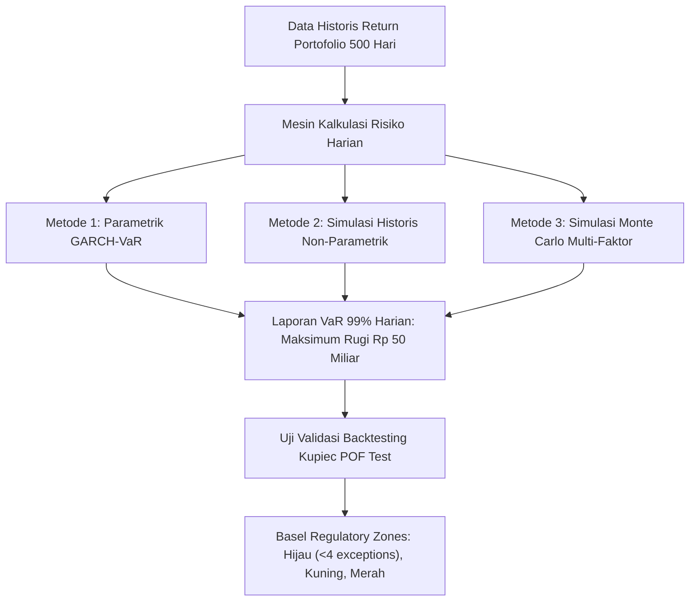

# Modul 213: Ekonometrika Keuangan & Manajemen Risiko (Model Volatilitas GARCH, Uji Kointegrasi Pasangan Saham, Value at Risk / VaR)

**Navigasi**: [⬅️ Master Index](../../INDEX.md) | [Tingkat 14: Tingkat 14: Fintech, Financial Engineering, HFT & Blockchain](./README.md)
*Sebelumnya*: [212. kalkulus-stokastik-penetapan-harga-opsi](./212-kalkulus-stokastik-penetapan-harga-opsi.md) | *Berikutnya*: [214. mikrostruktur-pasar-perdagangan-algoritmik](./214-mikrostruktur-pasar-perdagangan-algoritmik.md)

---

## 1. Intuisi Dasar Tanpa Jargon ("Seperti Bayi Baru Lahir")
Bayangkan Anda melihat grafik cuaca laut. Ada hari-hari di mana ombak laut sangat tenang selama berminggu-minggu, lalu tiba-tiba badai topan datang: ombak raksasa setinggi 10 meter mengamuk selama tiga hari berturut-turut sebelum mereda kembali.

Pasar finansial berperilaku persis seperti cuaca laut tersebut: ia memiliki sifat **Pengelompokan Volatilitas (Volatility Clustering)** ([Mandelbrot - The Variation of Certain Speculative Prices](https://www.jstor.org/stable/2350970)). Hari di mana harga saham berguncang dahsyat kemungkinan besar akan diikuti oleh hari-hari yang berguncang dahsyat pula besoknya; dan hari yang tenang cenderung diikuti oleh hari yang tenang.

Model statistik biasa yang mengasumsikan varians konstan (*homoskedastisitas*) akan buta terhadap fenomena ini. Robert Engle menemukan model **GARCH (Generalized Autoregressive Conditional Heteroskedasticity)** untuk meramalkan badai volatilitas pasar esok hari ([Engle - Nobel Lecture 2003](https://www.nobelprize.org/prizes/economic-sciences/2003/engle/lecture/)).

Selain itu, bagaimana sebuah institusi keuangan raksasa (seperti bank sentral atau dana pensiun) mengetahui seberapa besar uang yang bisa hilang dalam satu hari terburuk? Mereka menggunakan **Value at Risk (VaR)**: ukuran risiko standar yang memberi tahu dewan direksi: *"Kami 99% yakin bahwa kerugian portofolio kami besok tidak akan melebihi Rp 50 miliar"* ([Jorion - Value at Risk: The New Benchmark for Managing Financial Risk](https://www.mheducation.com/highered/product/value-risk-new-benchmark-managing-financial-risk-jorion/M9780071464956.html)).

## 2. Fondasi Teoretis & Aksiomatik / Matematis
Formulasi Ekonometrika Deret Waktu Finansial & Risiko:

1. **Model Volatilitas Dinamis GARCH$(p, q)$ (Bollerslev 1986)**:
Untuk return terpusat $\epsilon_t = \sigma_t z_t$ dengan derau putih standar $z_t \sim \text{i.i.d.}(0, 1)$:
Varians bersyarat $\sigma_t^2$ bergantung pada kuadrat galat masa lalu (suku ARCH $q$) dan varians masa lalu (suku GARCH $p$):
$$\sigma_t^2 = \omega + \sum_{i=1}^q \alpha_i \epsilon_{t-i}^2 + \sum_{j=1}^p \beta_j \sigma_{t-j}^2$$
Syarat stasionaritas kovarians ketat: $\omega > 0, \alpha_i \ge 0, \beta_j \ge 0$, dan $\sum_{i=1}^q \alpha_i + \sum_{j=1}^p \beta_j < 1$.
Volatilitas jangka panjang tanpa syarat (*unconditional variance*): $\sigma_L^2 = \frac{\omega}{1 - \sum \alpha_i - \sum \beta_j}$ ([Bollerslev - Generalized Autoregressive Conditional Heteroskedasticity](https://www.sciencedirect.com/science/article/pii/0304407686900631)).

2. **Kointegrasi & Pasangan Perdagangan Statistik (Engle-Granger Two-Step)**:
Dua deret waktu non-stasioner $X_t, Y_t \sim I(1)$ berkointegrasi jika terdapat kombinasi linier stasioner $\epsilon_t \sim I(0)$:
$$Y_t = \beta X_t + \alpha + \epsilon_t, \quad \Delta \epsilon_t = \gamma \epsilon_{t-1} + u_t$$
Jika uji Augmented Dickey-Fuller (ADF) pada residual $\epsilon_t$ menolak hipotesis nol akar unit ($p < 0.05$), hubungan *mean-reverting* jangka panjang terbukti, menjadi landasan strategi arbitrase statistik pasangan saham (*Pairs Trading*) ([Engle & Granger - Co-integration and Error Correction](https://www.jstor.org/stable/1913236)).

3. **Value at Risk (VaR) & Expected Shortfall (CVaR)**:
* Parametrik Gaussian VaR pada tingkat kepercayaan $\alpha$ (misal 99%) untuk horizon waktu $h$:
$$\text{VaR}_\alpha = - (\mu \cdot h + z_\alpha \cdot \sigma \sqrt{h}) \cdot \text{Portfolio Value}$$
* Expected Shortfall / Conditional VaR (Koheren menurut aksioma Artzner): Rata-rata kerugian pada ekor distribusi ketika VaR telah terlampaui:
$$\text{ES}_\alpha = \mathbb{E}\left[ L \mid L > \text{VaR}_\alpha \right] = \frac{1}{1 - \alpha} \int_\alpha^1 \text{VaR}_u du$$

## 3. Anatomi Teknis & Cara Kerja Internal
Arsitektur pipeline backtesting dan pelaporan risiko harian institusi finansial (Basel III Traffic Light System):



Uji Backtesting Kupiec Likelihood Ratio (POF Test) memverifikasi apakah jumlah pelanggaran aktual (*exceptions* di mana kerugian riil melebihi estimasi VaR) sesuai dengan ekspektasi probabilitas $1 - \alpha$, mencegah bank meremehkan cadangan modal risiko ([Kupiec - Techniques for Verifying the Accuracy of Risk Measurement Models](https://www.sciencedirect.com/science/article/pii/1057819695000049)).

## 4. Implementasi Praktis & Kode / Simulasi Riil
```python
import numpy as np
from scipy import stats

# 1. Simulasi Model Volatilitas Dinamis GARCH(1,1)
def simulate_garch11(n=1000, omega=0.00001, alpha=0.1, beta=0.85):
    # Syarat stasionaritas: alpha + beta < 1 (0.1 + 0.85 = 0.95 < 1)
    returns = np.zeros(n)
    sigma2 = np.zeros(n)
    sigma2[0] = omega / (1.0 - alpha - beta) # Varians tanpa syarat awal
    
    z = np.random.normal(0, 1, n)
    for t in range(1, n):
        # sigma_t^2 = omega + alpha * eps_{t-1}^2 + beta * sigma_{t-1}^2
        sigma2[t] = omega + alpha * (returns[t-1]**2) + beta * sigma2[t-1]
        returns[t] = np.sqrt(sigma2[t]) * z[t]
        
    return returns, np.sqrt(sigma2)

# 2. Perhitungan Value at Risk (VaR) & Expected Shortfall (CVaR)
def calculate_risk_metrics(returns, confidence_level=0.99, portfolio_value=1_000_000_000):
    # Metode Simulasi Historis (Non-Parametrik)
    cutoff_percentile = (1.0 - confidence_level) * 100
    var_return = np.percentile(returns, cutoff_percentile)
    var_amount = -var_return * portfolio_value
    
    # Expected Shortfall (Rata-rata kerugian di luar batas VaR)
    tail_losses = returns[returns <= var_return]
    cvar_return = np.mean(tail_losses)
    cvar_amount = -cvar_return * portfolio_value
    
    return var_amount, cvar_amount

np.random.seed(42)
sim_returns, sim_vol = simulate_garch11(n=2500)
var_99, cvar_99 = calculate_risk_metrics(sim_returns, confidence_level=0.99, portfolio_value=100_000_000)

print(f"Portofolio Modal Dasar: Rp 100,000,000")
print(f"Value at Risk 99% 1-Hari (Historical) : Rp {var_99:,.2f}")
print(f"Expected Shortfall 99% (CVaR)         : Rp {cvar_99:,.2f} (Ekor kerugian rata-rata)")
print(f"Volatilitas GARCH Rata-rata Terestrimasi: {np.mean(sim_vol)*100*np.sqrt(252):.2f}% tahunan")
```

## 5. Miskonsepsi & Jebakan Industri
*Kegagalan Sub-Additivitas pada Value at Risk (VaR Non-Coherence)*: Secara matematika, VaR tidak memenuhi aksioma sub-additivitas Artzner ($\text{VaR}(A + B) \le \text{VaR}(A) + \text{VaR}(B)$ tidak selalu terpenuhi pada distribusi ekor gemuk non-normal). Artinya, menggabungkan dua portofolio dapat menghasilkan angka VaR gabungan yang tampak *lebih besar* daripada penjumlahan risiko masing-masing portofolio, mematikan insentif diversifikasi. Inilah alasan Komite Basel secara resmi beralih dari VaR ke **Expected Shortfall (ES)** dalam regulasi Fundamental Review of the Trading Book (FRTB) ([Artzner et al. - Coherent Measures of Risk](https://link.springer.com/article/10.1007/s007800050068)).

## 6. Proyek Latihan & Rubrik Penilaian Mandiri
### Level 1 (Pemula)
Gunakan modul `arch` di Python (`arch.arch_model`) untuk melatih model GARCH(1,1) pada deret waktu return harian saham publik nyata atau sintetis, laporkan estimasi koefisien $(\omega, \alpha, \beta)$, dan periksa apakah nilai p-value signifikan secara statistik.
*Rubrik*: Output mencetak tabel ringkasan estimasi Maximum Likelihood model GARCH.

### Level 2 (Menengah)
Bangun strategi perdagangan pasangan saham (*Pairs Trading*) berbasis Uji Kointegrasi dua tahap Engle-Granger di Python: estimasikan koefisien lindung nilai $\beta$ via OLS, hitung deret residual spread $\epsilon_t = Y_t - \beta X_t$, hitung skor z-score bergulir $\frac{\epsilon_t - \mu}{\sigma}$, dan buat aturan sinyal buka posisi beli/jual saat $|z| > 2.0$ serta tutup posisi saat $z \to 0$.
*Rubrik*: Strategi mengeksekusi perdagangan mean-reversion pada spread terkointegrasi.

### Level 3 (Mahir)
Implementasikan uji backtesting independen **Kupiec Proportion of Failures (POF)** dan **Christoffersen Independence Test** dari awal: terima deret waktu return portofolio riil 1.000 hari dan estimasi VaR 99% harian, catat urutan pelanggaran biner $I_t \in \{0, 1\}$, hitung rasio likelihood $\text{LR}_{\text{POF}}$ dan $\text{LR}_{\text{ind}}$, serta tentukan apakah model VaR lolos uji independensi bersyarat pada tingkat signifikansi $5\%$.
*Rubrik*: Formulasi rasio likelihood chi-square terhitung tepat sesuai formula Kupiec.

## 7. Rekomendasi Sumber Belajar Standar Emas
| Sumber Pembelajaran | Penulis / Institusi | Tautan Langsung | Fokus Materi |
| :--- | :--- | :--- | :--- |
| Generalized Autoregressive Conditional Heteroskedasticity (GARCH) | Tim Bollerslev | [Journal of Econometrics 1986](https://www.sciencedirect.com/science/article/pii/0304407686900631) | Formulasi Asli Teori GARCH dan Pemodelan Volatilitas |
| Co-integration and Error Correction: Representation, Estimation, and Testing | Robert F. Engle & Clive W. J. Granger (Nobel 2003) | [Econometrica 1987](https://www.jstor.org/stable/1913236) | Teori Asli Kointegrasi Pasangan Deret Waktu Finansial |
| Value at Risk: The New Benchmark for Managing Financial Risk (3rd Ed.) | Philippe Jorion (UC Irvine) | [McGraw-Hill Professional](https://www.mheducation.com/highered/product/value-risk-new-benchmark-managing-financial-risk-jorion/M9780071464956.html) | Alkitab Manajemen Risiko Pasar, Parametrik vs Monte Carlo VaR |
| Coherent Measures of Risk | Philippe Artzner, Freddy Delbaen, Jean-Marc Eber, David Heath | [Mathematical Finance 1999](https://link.springer.com/article/10.1007/s007800050068) | Aksioma Koherensi Risiko Finansial, Expected Shortfall (CVaR) |

---
*Navigasi Cepat*: [Ke Tingkat 14](./README.md) | [Ke Master Index](../../INDEX.md) | *Sebelumnya*: [212. kalkulus-stokastik-penetapan-harga-opsi](./212-kalkulus-stokastik-penetapan-harga-opsi.md) | *Berikutnya*: [214. mikrostruktur-pasar-perdagangan-algoritmik](./214-mikrostruktur-pasar-perdagangan-algoritmik.md)
