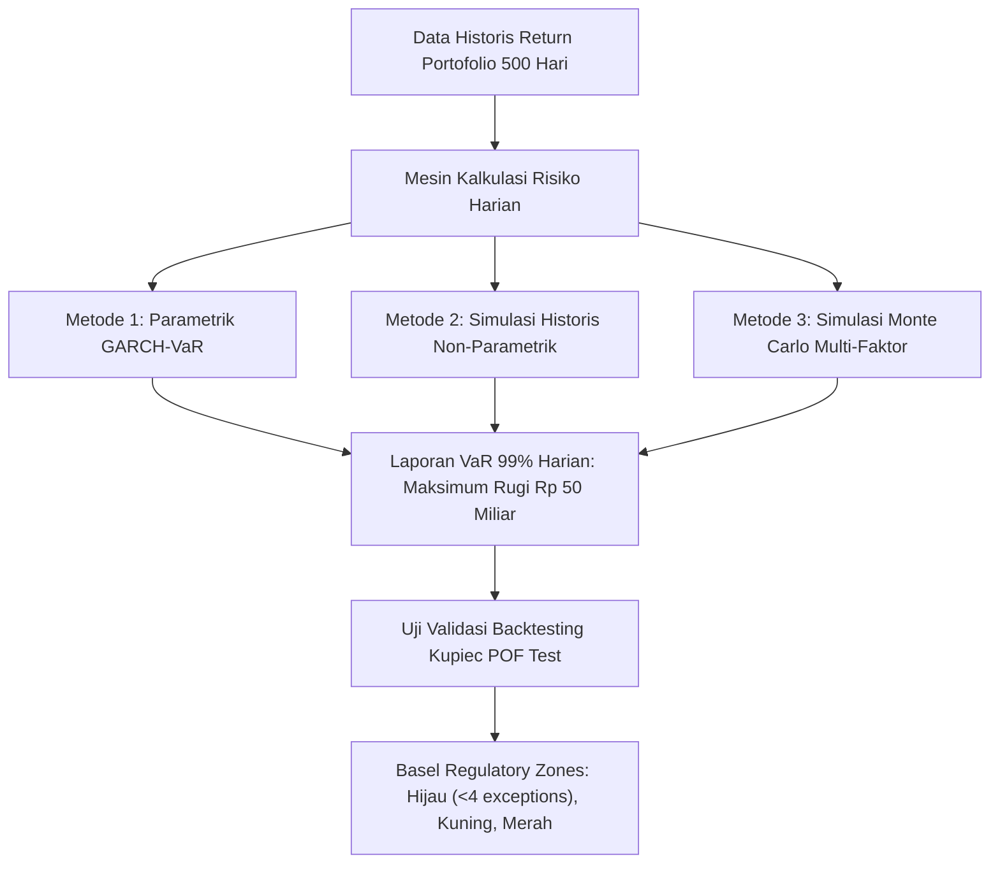

# Modul 213: Ekonometrika Keuangan & Manajemen Risiko (Model Volatilitas GARCH, Uji Kointegrasi Pasangan Saham, Value at Risk / VaR)

**Navigasi**: [⬅️ Master Index](../../INDEX.md) | [Tingkat 14: Tingkat 14: Fintech, Financial Engineering, HFT & Blockchain](./README.md)
*Sebelumnya*: [212. kalkulus-stokastik-penetapan-harga-opsi](./212-kalkulus-stokastik-penetapan-harga-opsi.md) | *Berikutnya*: [214. mikrostruktur-pasar-perdagangan-algoritmik](./214-mikrostruktur-pasar-perdagangan-algoritmik.md)

---

## 1. Intuisi Dasar Tanpa Jargon ("Seperti Bayi Baru Lahir")
### 1.1 Konsep Inti & Analogi Tanpa Jargon
Bayangkan Anda melihat grafik cuaca laut. Ada hari-hari di mana ombak laut sangat tenang selama berminggu-minggu, lalu tiba-tiba badai topan datang: ombak raksasa setinggi 10 meter mengamuk selama tiga hari berturut-turut sebelum mereda kembali.

### 1.2 Urgensi Rekayasa & Signifikansi Sistemik
Pasar finansial berperilaku persis seperti cuaca laut tersebut: ia memiliki sifat **Pengelompokan Volatilitas (Volatility Clustering)** ([Mandelbrot - The Variation of Certain Speculative Prices](https://www.jstor.org/stable/2350970)). Hari di mana harga saham berguncang dahsyat kemungkinan besar akan diikuti oleh hari-hari yang berguncang dahsyat pula besoknya; dan hari yang tenang cenderung diikuti oleh hari yang tenang.

Model statistik biasa yang mengasumsikan varians konstan (*homoskedastisitas*) akan buta terhadap fenomena ini. Robert Engle menemukan model **GARCH (Generalized Autoregressive Conditional Heteroskedasticity)** untuk meramalkan badai volatilitas pasar esok hari ([Engle - Nobel Lecture 2003](https://www.nobelprize.org/prizes/economic-sciences/2003/engle/lecture/)).

Selain itu, bagaimana sebuah institusi keuangan raksasa (seperti bank sentral atau dana pensiun) mengetahui seberapa besar uang yang bisa hilang dalam satu hari terburuk? Mereka menggunakan **Value at Risk (VaR)**: ukuran risiko standar yang memberi tahu dewan direksi: *"Kami 99% yakin bahwa kerugian portofolio kami besok tidak akan melebihi Rp 50 miliar"* ([Jorion - Value at Risk: The New Benchmark for Managing Financial Risk](https://www.mheducation.com/highered/product/value-risk-new-benchmark-managing-financial-risk-jorion/M9780071464956.html)).

## 2. Fondasi Teoretis & Aksiomatik / Matematis
### 2.1 Kerangka Teori Aksiomatik & Formulasi Matematis
Formulasi Ekonometrika Deret Waktu Finansial & Risiko:

### 2.2 Penurunan Matematis Langkah-demi-Langkah
1. **Model Volatilitas Dinamis GARCH$(p, q)$ (Bollerslev 1986)**:
Untuk return terpusat $\epsilon_t = \sigma_t z_t$ dengan derau putih standar $z_t \sim \text{i.i.d.}(0, 1)$:
Varians bersyarat $\sigma_t^2$ bergantung pada kuadrat galat masa lalu (suku ARCH $q$) dan varians masa lalu (suku GARCH $p$):
$$\sigma_t^2 = \omega + \sum_{i=1}^q \alpha_i \epsilon_{t-i}^2 + \sum_{j=1}^p \beta_j \sigma_{t-j}^2$$
Syarat stasionaritas kovarians ketat: $\omega > 0, \alpha_i \ge 0, \beta_j \ge 0$, dan $\sum_{i=1}^q \alpha_i + \sum_{j=1}^p \beta_j < 1$.
Volatilitas jangka panjang tanpa syarat (*unconditional variance*): $\sigma_L^2 = \frac{\omega}{1 - \sum \alpha_i - \sum \beta_j}$ ([Bollerslev - Generalized Autoregressive Conditional Heteroskedasticity](https://www.sciencedirect.com/science/article/pii/0304407686900631)).

2. **Kointegrasi & Pasangan Perdagangan Statistik (Engle-Granger Two-Step)**:
Dua deret waktu non-stasioner $X_t, Y_t \sim I(1)$ berkointegrasi jika terdapat kombinasi linier stasioner $\epsilon_t \sim I(0)$:
$$Y_t = \beta X_t + \alpha + \epsilon_t, \quad \Delta \epsilon_t = \gamma \epsilon_{t-1} + u_t$$
Jika uji Augmented Dickey-Fuller (ADF) pada residual $\epsilon_t$ menolak hipotesis nol akar unit ($p < 0.05$), hubungan *mean-reverting* jangka panjang terbukti, menjadi landasan strategi arbitrase statistik pasangan saham (*Pairs Trading*) ([Engle & Granger - Co-integration and Error Correction](https://www.jstor.org/stable/1913236)).

3. **Value at Risk (VaR) & Expected Shortfall (CVaR)**:
* Parametrik Gaussian VaR pada tingkat kepercayaan $\alpha$ (misal 99%) untuk horizon waktu $h$:
$$\text{VaR}_\alpha = - (\mu \cdot h + z_\alpha \cdot \sigma \sqrt{h}) \cdot \text{Portfolio Value}$$
* Expected Shortfall / Conditional VaR (Koheren menurut aksioma Artzner): Rata-rata kerugian pada ekor distribusi ketika VaR telah terlampaui:
$$\text{ES}_\alpha = \mathbb{E}\left[ L \mid L > \text{VaR}_\alpha \right] = \frac{1}{1 - \alpha} \int_\alpha^1 \text{VaR}_u du$$

## 3. Anatomi Teknis & Cara Kerja Internal
Arsitektur pipeline backtesting dan pelaporan risiko harian institusi finansial (Basel III Traffic Light System):



Uji Backtesting Kupiec Likelihood Ratio (POF Test) memverifikasi apakah jumlah pelanggaran aktual (*exceptions* di mana kerugian riil melebihi estimasi VaR) sesuai dengan ekspektasi probabilitas $1 - \alpha$, mencegah bank meremehkan cadangan modal risiko ([Kupiec - Techniques for Verifying the Accuracy of Risk Measurement Models](https://www.sciencedirect.com/science/article/pii/1057819695000049)).

#### Tabel Penelusuran Formula VaR Spreadsheet Excel London Whale & Keruntuhan CIO JPMorgan
| Timestamp / Sequence ID | Komponen / Lapisan Sistem | Pesan Masuk (FIX / Transaksi) | Operasi Antrean / Komputasi Buku | State Buku Pesanan (LOB / Ledger) | Event Terpancar (Fill / Block Emit) |
|---|---|---|---|---|---|
| Awal 2012 (Tiket #1) | Chief Investment Office (CIO) JPMorgan | Portofolio Credit Default Swap (CDS) \$350B | Trader Bruno Iksil ("London Whale") menjual proteksi CDS | Eksposur indeks CDX IG9 mendominasi likuiditas pasar | CIO diperintahkan memangkas aset tertimbang risiko (RWA) |
| Pembaruan Model VaR | Spreadsheet Microsoft Excel Model | Insinyur Kuantitatif Menyalin Rumus Baru | Model VaR lama digantikan spreadsheet formula manual | Galat Formula: Rumus membagi dengan Jumlah alih-alih Rata-Rata! | Estimasi risiko volatilitas terpangkas separuh secara artifisial! |
| Formula Cacat: `=SUM(...)` | Sel Kalkulasi Varians Excel | Pembagi yang seharusnya Rata-Rata diganti Penjumlahan | $\sigma_{\text{model}} = \frac{\Delta P}{\sum \text{Assets}}$ alih-alih $\frac{\Delta P}{N}$ | Model melaporkan angka VaR palsu: \$67 Juta (seharusnya \$130M) | Manajemen mengira portofolio CDS sangat aman |
| Musim Semi 2012 (Tiket #2) | Pasar Derivatif Kredit London | Hedge Fund Melawan Posisi Terbuka London Whale | Posisi sintetis CDS mulai berbalik arah rugi | Kerugian harian meledak ratusan juta dolar | Angka model VaR Excel tidak mencerminkan bahaya riil! |
| Mei-Juli 2012 (Tiket #3) | Komisi Perdagangan & Senat AS | Penutupan Buku & Kerugian Resmi \$6.2B | Penyelidikan Subkomite Permanen Senat AS (PSI) | Spreadsheet copy-paste error terbongkar ke publik | Denda regulasi \$1 Miliar & pemecatan jajaran direksi CIO! |

## 4. Implementasi Praktis & Kode / Simulasi Riil
```python
import numpy as np
from scipy import stats

# 1. Simulasi Model Volatilitas Dinamis GARCH(1,1)
def simulate_garch11(n=1000, omega=0.00001, alpha=0.1, beta=0.85):
    # Syarat stasionaritas: alpha + beta < 1 (0.1 + 0.85 = 0.95 < 1)
    returns = np.zeros(n)
    sigma2 = np.zeros(n)
    sigma2[0] = omega / (1.0 - alpha - beta) # Varians tanpa syarat awal
    
    z = np.random.normal(0, 1, n)
    for t in range(1, n):
        # sigma_t^2 = omega + alpha * eps_{t-1}^2 + beta * sigma_{t-1}^2
        sigma2[t] = omega + alpha * (returns[t-1]**2) + beta * sigma2[t-1]
        returns[t] = np.sqrt(sigma2[t]) * z[t]
        
    return returns, np.sqrt(sigma2)

# 2. Perhitungan Value at Risk (VaR) & Expected Shortfall (CVaR)
def calculate_risk_metrics(returns, confidence_level=0.99, portfolio_value=1_000_000_000):
    # Metode Simulasi Historis (Non-Parametrik)
    cutoff_percentile = (1.0 - confidence_level) * 100
    var_return = np.percentile(returns, cutoff_percentile)
    var_amount = -var_return * portfolio_value
    
    # Expected Shortfall (Rata-rata kerugian di luar batas VaR)
    tail_losses = returns[returns <= var_return]
    cvar_return = np.mean(tail_losses)
    cvar_amount = -cvar_return * portfolio_value
    
    return var_amount, cvar_amount

np.random.seed(42)
sim_returns, sim_vol = simulate_garch11(n=2500)
var_99, cvar_99 = calculate_risk_metrics(sim_returns, confidence_level=0.99, portfolio_value=100_000_000)

print(f"Portofolio Modal Dasar: Rp 100,000,000")
print(f"Value at Risk 99% 1-Hari (Historical) : Rp {var_99:,.2f}")
print(f"Expected Shortfall 99% (CVaR)         : Rp {cvar_99:,.2f} (Ekor kerugian rata-rata)")
print(f"Volatilitas GARCH Rata-rata Terestrimasi: {np.mean(sim_vol)*100*np.sqrt(252):.2f}% tahunan")
```

## 5. Miskonsepsi & Jebakan Industri
*Kegagalan Sub-Additivitas pada Value at Risk (VaR Non-Coherence)*: Secara matematika, VaR tidak memenuhi aksioma sub-additivitas Artzner ($\text{VaR}(A + B) \le \text{VaR}(A) + \text{VaR}(B)$ tidak selalu terpenuhi pada distribusi ekor gemuk non-normal). Artinya, menggabungkan dua portofolio dapat menghasilkan angka VaR gabungan yang tampak *lebih besar* daripada penjumlahan risiko masing-masing portofolio, mematikan insentif diversifikasi. Inilah alasan Komite Basel secara resmi beralih dari VaR ke **Expected Shortfall (ES)** dalam regulasi Fundamental Review of the Trading Book (FRTB) ([Artzner et al. - Coherent Measures of Risk](https://link.springer.com/article/10.1007/s007800050068)).

### Studi Kasus Kegagalan Nyata: Skandal London Whale JPMorgan Chase ($6.2 Miliar Kerugian) Akibat Galat Rumus Spreadsheet Excel (2012)
- **Kronologi & Konteks Sejarah**: Pada Mei hingga Juli 2012, bank terbesar di Amerika Serikat JPMorgan Chase mengumumkan kerugian perdagangan derivatif kredit masif sebesar $6,2 Miliar yang berasal dari meja *Chief Investment Office (CIO)* di London melalui posisi CDS yang dipegang oleh trader Bruno Iksil (dijuluki *"The London Whale"* oleh pasar karena ukuran transaksinya yang mendominasi likuiditas indeks kredit global).
- **Akar Masalah Rekayasa Keuangan Kuantitatif & Tata Kelola Model Spreadsheet (EUC)**: Laporan investigasi internal Satuan Tugas JPMorgan dan penyelidikan Senat AS mengungkap kesalahan rekayasa komputasi yang sangat memalukan: model Value-at-Risk (Comprehensive Risk Measure / CRM) yang disetujui untuk mengukur risiko portofolio CIO dioperasikan secara manual menggunakan berkas spreadsheet Microsoft Excel melalui proses salin-tempel (*copy-paste*) antar dokumen kerja setiap hari. Dalam formula perhitungan korelasi dan varians, analis pembuat model melakukan kesalahan sintaksis: alih-alih membagi selisih pergerakan harga dengan rata-rata (*mean / average*), rumus tersebut membagi dengan jumlah (*sum*) dari dua vektor. Secara matematis, kesalahan pembagian ini memotong estimasi volatilitas sintetis portofolio hingga separuhnya secara artifisial, membuat risiko posisi CDS London Whale tampak sangat kecil dan patuh terhadap batas regulasi Basel, padahal bank sedang memegang risiko sistemik bernilai ratusan miliar dolar.

- **Potongan Kode / Arsitektur Cacat (Vulnerable Implementation)**:
```python
# Analisis Galat Komputasional London Whale: Pembagian Sum vs Mean pada Estimasi Risiko
import numpy as np

# CACAT FATAL EXCEL JPMORGAN CIO (2012):
# Analis salah mengetikkan formula varians: membagi dengan SUM alih-alih AVERAGE
def flawed_london_whale_variance(spread_changes_1, spread_changes_2):
    # Dua vektor pergerakan spread kredit
    diff = spread_changes_1 - spread_changes_2
    
    # CACAT FORMULA EXCEL:
    # Menggunakan np.sum() pada penyebut alih-alih np.mean():
    # Menghasilkan estimasi volatilitas yang jauh lebih kecil dari kenyataan!
    flawed_variance = np.sum(diff ** 2) / (np.sum(spread_changes_1) + np.sum(spread_changes_2))
    return flawed_variance # Risiko VaR tampak 50% lebih aman secara palsu!

# MITIGASI MODERN: Kode Kuantitatif Terverifikasi (Unit Tested Model Governance)
def verified_portfolio_covariance(spread_matrix):
    '''
    Model risiko modern TIDAK BOLEH berjalan di spreadsheet manual!
    Wajib ditulis dalam kode teruji dengan asersi invarian ketat:
    '''
    n_samples, n_assets = spread_matrix.shape
    assert n_samples > n_assets, "Sampel observasi wajib lebih besar dari jumlah aset!"
    
    # Kovarians tak-bias standar dengan derajat kebebasan n - 1:
    unbiased_cov = np.cov(spread_matrix, rowvar=False, ddof=1)
    return unbiased_cov
```

- **Analisis Forensik & Rekayasa Modern**: Skandal London Whale memicu pengetatan regulasi tata kelola model keuangan di seluruh dunia (**Federal Reserve SR 11-7 / OCC 2011-12 Guidance on Model Risk Management**): (1) Larangan mutlak menggunakan spreadsheet Excel manual (*End-User Computing / EUC*) untuk model pengukuran risiko modal regulasi skala enterprise; (2) Kewajiban implementasi seluruh model kuantitatif dalam bahasa pemrograman produksi (Python, C++, Rust) yang dikelola di bawah sistem kontrol versi (Git) dengan *Unit Testing* dan *Independent Model Validation (IMV)*; (3) Pemisahan fungsi antara tim pengembang model (*First Line of Defense*) dengan tim audit validasi risiko independen (*Second Line of Defense*).

## 6. Proyek Latihan & Rubrik Penilaian Mandiri
### Level 1 (Pemula)
Gunakan modul `arch` di Python (`arch.arch_model`) untuk melatih model GARCH(1,1) pada deret waktu return harian saham publik nyata atau sintetis, laporkan estimasi koefisien $(\omega, \alpha, \beta)$, dan periksa apakah nilai p-value signifikan secara statistik.
*Rubrik*: Output mencetak tabel ringkasan estimasi Maximum Likelihood model GARCH.

### Level 2 (Menengah)
Bangun strategi perdagangan pasangan saham (*Pairs Trading*) berbasis Uji Kointegrasi dua tahap Engle-Granger di Python: estimasikan koefisien lindung nilai $\beta$ via OLS, hitung deret residual spread $\epsilon_t = Y_t - \beta X_t$, hitung skor z-score bergulir $\frac{\epsilon_t - \mu}{\sigma}$, dan buat aturan sinyal buka posisi beli/jual saat $|z| > 2.0$ serta tutup posisi saat $z \to 0$.
*Rubrik*: Strategi mengeksekusi perdagangan mean-reversion pada spread terkointegrasi.

### Level 3 (Mahir)
Implementasikan uji backtesting independen **Kupiec Proportion of Failures (POF)** dan **Christoffersen Independence Test** dari awal: terima deret waktu return portofolio riil 1.000 hari dan estimasi VaR 99% harian, catat urutan pelanggaran biner $I_t \in \{0, 1\}$, hitung rasio likelihood $\text{LR}_{\text{POF}}$ dan $\text{LR}_{\text{ind}}$, serta tentukan apakah model VaR lolos uji independensi bersyarat pada tingkat signifikansi $5\%$.
*Rubrik*: Formulasi rasio likelihood chi-square terhitung tepat sesuai formula Kupiec.

### Tingkat 1: Dasar
- **Tugas**: Tulis skrip audit otomatis dalam Python yang memindai formula matematika model keuangan (diwakili sebagai pohon sintaksis ekspresi atau string formula), mendeteksi potensi galat pembagian nol, dan memvalidasi bahwa perhitungan rata-rata statistik membagi dengan jumlah sampel $N$ (atau $N-1$ untuk derajat kebebasan sampel) bukan dengan jumlah nilai $\sum X$.
- **Petunjuk Perancangan Arsitektur**:
  - Parse ekspresi formula menggunakan modul `ast` Python.
  - Cari simpul pembagian `BinOp(Div)`: periksa apakah penyebutnya adalah pemanggilan fungsi `sum()` alih-alih `len()` atau `count()`.
  - Hasilkan peringatan `MODEL_SPECIFICATION_ERROR` jika terdeteksi pembagian yang salah.
- **Test Vector & Kasus Uji**:
  - Masukkan formula cacat: `result = total_variance / sum(assets)`.
  - Auditor harus menandai baris tersebut sebagai `CRITICAL_FORMULA_ERROR: Dividing variance by sum instead of sample size!`.
- **Rubrik Penilaian Objektif**:
  - Skor 100%: Deteksi AST presisi, identifikasi kesalahan pembagi sum vs count akurat, zero false positive.
  - Skor 50%: Menggunakan regex teks biasa alih-alih pohon sintaksis AST.
  - Skor 0%: Program tidak memvalidasi simpul pembagi matematika.

### Tingkat 2: Menengah
- **Tugas**: Bangun model ekonometrika deret waktu volatilitas GARCH(1,1) dari nol dalam Python: Hitung varians bersyarat $\sigma_t^2 = \omega + \alpha \epsilon_{t-1}^2 + \beta \sigma_{t-1}^2$, estimasi parameter $(\omega, \alpha, \beta)$ menggunakan metode Maximum Likelihood Estimation (MLE) dengan optimasi numerik `scipy.optimize.minimize`, dan pastikan batasan stasioneritas terpenuhi ($\alpha + \beta < 1$).
- **Petunjuk Perancangan Arsitektur**:
  - Fungsi Log-Likelihood Gaussian: $\ln L = -\frac{1}{2} \sum_{t=1}^T \left( \ln(2\pi) + \ln(\sigma_t^2) + \frac{\epsilon_t^2}{\sigma_t^2} \right)$.
  - Batasan parameter: $\omega > 0, \alpha \ge 0, \beta \ge 0, \alpha + \beta \le 0.999$.
  - Inisialisasi $\sigma_0^2$ menggunakan varians sampel data historis.
- **Test Vector & Kasus Uji**:
  - Latih pada return harian aset dengan fenomena penggugusan volatilitas (*Volatility Clustering*).
  - Parameter hasil estimasi MLE harus memenuhi syarat stasioneritas ($\alpha + \beta < 1$) dan merekonstruksi dinamika lonjakan volatilitas secara akurat.
- **Rubrik Penilaian Objektif**:
  - Skor 100%: Formulasi MLE GARCH(1,1) presisi, penegakan batasan stasioneritas benar, estimasi konvergen mulus.
  - Skor 50%: Model bekerja namun mengabaikan batasan stasioneritas sehingga varians meledak ke tak hingga pada peramalan.
  - Skor 0%: Mengasumsikan varians konstan homoskedastisitas.

### Tingkat 3: Mahir
- **Tugas**: Rancang framework pengujian stres risiko keuangan (*Comprehensive Stress-Testing & Backtesting Engine*) dalam Python: Bangun mesin backtesting VaR yang mengimplementasikan Uji Kupiec (*Kupiec Proportion of Failures POF Test*) dan Uji Independensi Christoffersen untuk menguji validitas model risiko harian terhadap 1.000 hari data historis, memverifikasi apakah frekuensi dan pengelompokan pelanggaran batas risiko (*VaR Breaches*) konsisten dengan tingkat keyakinan 99%.
- **Petunjuk Perancangan Arsitektur**:
  - Uji Kupiec POF: Rasio likelihood binomial $LR_{\text{POF}} = -2 \ln \left( \frac{(1-p)^{T-x} p^x}{(1 - x/T)^{T-x} (x/T)^x} \right) \sim \chi^2(1)$.
  - Uji Christoffersen: Menguji apakah pelanggaran VaR terjadi secara independen atau menggugus dalam periode krisis berturut-turut.
  - Hasilkan klasifikasi lampu lalu lintas Basel: Green Zone ($< 4$ pelanggaran), Yellow Zone ($5-9$ pelanggaran), Red Zone ($\ge 10$ pelanggaran).
- **Test Vector & Kasus Uji**:
  - Model yang mengalami underestimation risiko (terjadi 25 pelanggaran dari 1.000 hari pada batas 99%): Mesin harus menolak model dengan status `RED_ZONE_REJECTED (Kupiec p-value < 0.001)`.
- **Rubrik Penilaian Objektif**:
  - Skor 100%: Uji Kupiec dan Christoffersen presisi statistik formal, klasifikasi zona Basel akurat, pelaporan diagnostik lengkap.
  - Skor 50%: Menghitung jumlah pelanggaran biasa tanpa uji hipotesis rasio likelihood formal.
  - Skor 0%: Mengasumsikan model valid hanya berdasarkan rata-rata loss tanpa backtesting pelanggaran.

## 7. Rekomendasi Sumber Belajar Standar Emas
| Sumber Pembelajaran | Penulis / Institusi | Tautan Langsung | Fokus Materi |
| :--- | :--- | :--- | :--- |
| Generalized Autoregressive Conditional Heteroskedasticity (GARCH) | Tim Bollerslev | [Journal of Econometrics 1986](https://www.sciencedirect.com/science/article/pii/0304407686900631) | Formulasi Asli Teori GARCH dan Pemodelan Volatilitas |
| Co-integration and Error Correction: Representation, Estimation, and Testing | Robert F. Engle & Clive W. J. Granger (Nobel 2003) | [Econometrica 1987](https://www.jstor.org/stable/1913236) | Teori Asli Kointegrasi Pasangan Deret Waktu Finansial |
| Value at Risk: The New Benchmark for Managing Financial Risk (3rd Ed.) | Philippe Jorion (UC Irvine) | [McGraw-Hill Professional](https://www.mheducation.com/highered/product/value-risk-new-benchmark-managing-financial-risk-jorion/M9780071464956.html) | Alkitab Manajemen Risiko Pasar, Parametrik vs Monte Carlo VaR |
| Coherent Measures of Risk | Philippe Artzner, Freddy Delbaen, Jean-Marc Eber, David Heath | [Mathematical Finance 1999](https://link.springer.com/article/10.1007/s007800050068) | Aksioma Koherensi Risiko Finansial, Expected Shortfall (CVaR) |

---
*Navigasi Cepat*: [Ke Tingkat 14](./README.md) | [Ke Master Index](../../INDEX.md) | *Sebelumnya*: [212. kalkulus-stokastik-penetapan-harga-opsi](./212-kalkulus-stokastik-penetapan-harga-opsi.md) | *Berikutnya*: [214. mikrostruktur-pasar-perdagangan-algoritmik](./214-mikrostruktur-pasar-perdagangan-algoritmik.md)
