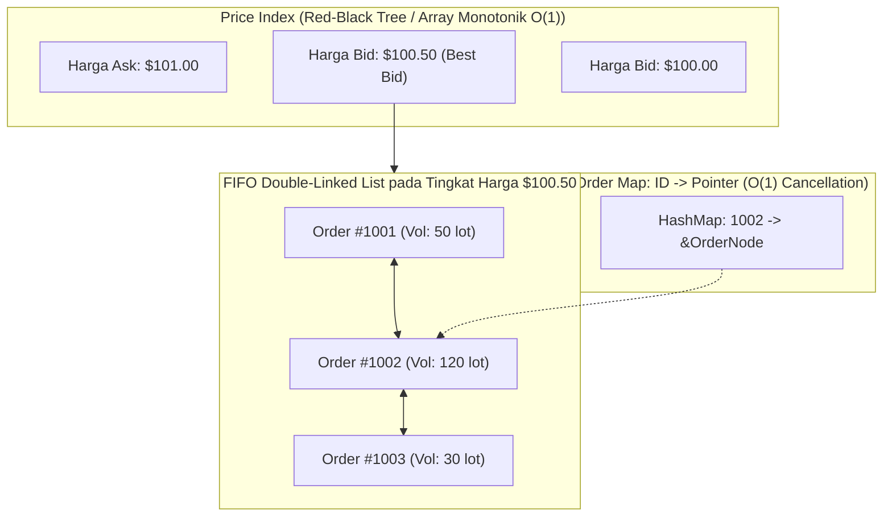

# Modul 214: Mikrostruktur Pasar & Perdagangan Algoritmik (Limit Order Book LOB, Mesin Pencocok Pesan C++, Protokol FIX/ITCH, TWAP)

**Navigasi**: [⬅️ Master Index](../../INDEX.md) | [Tingkat 14: Tingkat 14: Fintech, Financial Engineering, HFT & Blockchain](./README.md)
*Sebelumnya*: [213. ekonometrika-keuangan-manajemen-risiko](./213-ekonometrika-keuangan-manajemen-risiko.md) | *Berikutnya*: [215. rekayasa-sistem-berlatensi-ultra-rendah-hft](./215-rekayasa-sistem-berlatensi-ultra-rendah-hft.md)

---

## 1. Intuisi Dasar Tanpa Jargon ("Seperti Bayi Baru Lahir")
Jika Anda pergi ke pasar tradisional, ada penjual yang meneriakkan: *"Saya jual apel ini seharga Rp 10.000!"*, dan ada pembeli yang menawar: *"Saya mau beli apelmu kalau harganya Rp 8.000!"*. Transaksi baru terjadi jika salah satu pihak mengalah dan menyepakati harga di tengah.

Di bursa efek modern (seperti Nasdaq, NYSE, atau Bursa Efek Indonesia), tidak ada teriakan manusia di lantai bursa lagi. Seluruh aktivitas perdagangan ditangani oleh komputer pencocok pesan berkecepatan mikrodetik bernama **Mesin Pencocok Pesan (Matching Engine)** yang mengelola antrean raksasa bernama **Buku Pesanan Terbatas (Limit Order Book / LOB)** ([Harris - Trading and Exchanges: Market Microstructure for Practitioners](https://academic.oup.com/book/52486)).

Buku pesanan memiliki dua sisi:
1. **Sisi Beli (Bids)**: Daftar antrean orang-orang yang ingin membeli, diurutkan dari harga penawaran tertinggi ke terendah.
2. **Sisi Jual (Asks)**: Daftar antrean orang-orang yang ingin menjual, diurutkan dari harga permintaan terendah ke tertinggi.

Selisih antara harga jual termurah dan harga beli termahal disebut **Bid-Ask Spread**. Dan bagaimana dana institusi besar (seperti BlackRock) membeli saham senilai triliunan rupiah tanpa membuat harga pasar meroket liar? Mereka menggunakan algoritma eksekusi bertahap seperti **Time-Weighted Average Price (TWAP)** dan **Volume-Weighted Average Price (VWAP)** ([Almgren & Chriss - Optimal Execution of Portfolio Transactions](https://www.sciencedirect.com/science/article/pii/S1057819600000072)).

## 2. Fondasi Teoretis & Aksiomatik / Matematis
Formulasi Matematis Mikrostruktur Pasar & Buku Pesanan:

1. **Struktur Formal Limit Order Book (LOB)**:
Buku pesanan pada waktu $t$ didefinisikan sebagai dua himpunan harga dan kuantitas terurut:
$$\mathcal{B}_t = \{(p_i^b, q_i^b)\}_{i=1}^{N_b}, \quad p_1^b > p_2^b > \dots > p_{N_b}^b \quad (\text{Best Bid } p_1^b)$$
$$\mathcal{A}_t = \{(p_j^a, q_j^a)\}_{j=1}^{N_a}, \quad p_1^a < p_2^a < \dots < p_{N_a}^a \quad (\text{Best Ask } p_1^a)$$
Invarian pasar bebas arbitrase: $p_1^b < p_1^a$.
* Bid-Ask Spread: $S_t = p_1^a - p_1^b > 0$
* Mid-Price: $M_t = \frac{p_1^a + p_1^b}{2}$
* Micro-Price (Memperhitungkan ketidakseimbangan volume / *Order Book Imbalance*):
$$P_{\text{micro}} = \frac{q_1^b p_1^a + q_1^a p_1^b}{q_1^b + q_1^a} = M_t + \frac{S_t}{2} \left( \frac{q_1^b - q_1^a}{q_1^b + q_1^a} \right)$$

2. **Prioritas Pencocokan Pesanan (Price-Time Priority / FIFO)**:
Mesin pencocok pesanan mengeksekusi pesanan pasar (*Market Order*) terhadap pesanan terbatas (*Limit Order*) teratas berdasarkan:
1. Prioritas Harga Terbaik (Harga jual lebih murah atau beli lebih mahal didahulukan).
2. Prioritas Waktu Kedatangan (Pada tingkat harga yang identik, pesanan yang tiba lebih awal dieksekusi terlebih dahulu).

3. **Model Dampak Pasar Almgren-Chriss (Optimal Execution)**:
Membagi eksekusi order besar $X$ ke dalam $N$ interval waktu $t_k$:
Biaya dampak pasar permanen linier $\gamma$ dan dampak temporer $\eta$:
$$\min_{\tau} \mathbb{E}[x^T \Lambda x] + \lambda \mathbb{V}\text{ar}[x^T \Lambda x]$$
Strategi eksekusi TWAP statis memecah pesanan secara merata $v_k = \frac{X}{N}$ di sepanjang durasi hari bursa untuk meminimalkan jejak kaki pasar ([Almgren & Chriss 2000](https://www.sciencedirect.com/science/article/pii/S1057819600000072)).

## 3. Anatomi Teknis & Cara Kerja Internal
Arsitektur struktur data berperforma tinggi Limit Order Book dalam C++ (Double-Linked List + Hash Map):



Dengan arsitektur *Double-Linked List* per tingkat harga dan *Hash Table* pointer pesanan, operasi pembatalan pesanan (*Cancel Order*) dan eksekusi pencocokan (*Fill Order*) dapat diselesaikan dalam kompleksitas waktu konstan murni $\mathcal{O}(1)$ tanpa pencarian linier ([O'Hara - Market Microstructure Theory](https://www.wiley.com/en-us/Market+Microstructure+Theory-p-9780631207610)).

## 4. Implementasi Praktis & Kode / Simulasi Riil
```python
from collections import deque
from dataclasses import dataclass

# 1. Implementasi Sederhana Mesin Pencocok Pesanan (Matching Engine FIFO)
@dataclass
class Order:
    order_id: int
    side: str # 'BUY' atau 'SELL'
    price: float
    qty: int

class OrderBook:
    def __init__(self):
        self.bids = {} # price -> deque([Order, ...])
        self.asks = {} # price -> deque([Order, ...])
        
    def add_limit_order(self, order: Order):
        book = self.bids if order.side == 'BUY' else self.asks
        if order.price not in book:
            book[order.price] = deque()
        book[order.price].append(order)
        
    def match_market_order(self, side: str, qty: int):
        # Market order beli mencocokkan ask terendah; market order jual mencocokkan bid tertinggi
        filled_trades = []
        remaining_qty = qty
        
        while remaining_qty > 0:
            if side == 'BUY':
                if not self.asks:
                    break # Buku Ask Kosong
                best_price = min(self.asks.keys())
                queue = self.asks[best_price]
            else:
                if not self.bids:
                    break # Buku Bid Kosong
                best_price = max(self.bids.keys())
                queue = self.bids[best_price]
                
            top_order = queue[0]
            trade_qty = min(remaining_qty, top_order.qty)
            
            filled_trades.append((top_order.order_id, best_price, trade_qty))
            top_order.qty -= trade_qty
            remaining_qty -= trade_qty
            
            if top_order.qty == 0:
                queue.popleft()
                if not queue:
                    del (self.asks if side == 'BUY' else self.bids)[best_price]
                    
        return filled_trades, remaining_qty

# Uji Coba Buku Pesanan
lob = OrderBook()
lob.add_limit_order(Order(101, 'SELL', 100.5, 50))  # Ask 1
lob.add_limit_order(Order(102, 'SELL', 100.5, 100)) # Ask 2 (Antrean sama)
lob.add_limit_order(Order(103, 'SELL', 101.0, 200)) # Ask 3 (Harga lebih tinggi)

# Eksekusi Market Order Beli 80 Lot
trades, unfulfilled = lob.match_market_order('BUY', 80)
print("Transaksi Berhasil Dieksekusi:")
for t in trades:
    print(f" - Terisi terhadap Order #{t[0]} di Harga ${t[1]:.2f} sebanyak {t[2]} lot")
print(f"Sisa Kuota Belum Terisi: {unfulfilled} lot")
```

## 5. Miskonsepsi & Jebakan Industri
*Adverse Selection & Latency Arbitrage pada Limit Order*: Menempatkan pesanan limit pasif di buku pesanan seperti meninggalkan penawaran terbuka yang bisa dieksploitasi oleh pedagang frekuensi tinggi (HFT) yang lebih cepat. Jika berita makro ekonomi keluar dan harga pasar global anjlok, algoritma HFT akan mengeksekusi (*sniping*) pesanan beli limit Anda sebelum komputer Anda sempat mengirim instruksi pembatalan (*cancel request*), meninggalkan Anda dengan posisi rugi instan ([Budish, Cramton, Shim - The High-Frequency Trading Arms Race](https://academic.oup.com/qje/article/130/4/1547/1916146)).

## 6. Proyek Latihan & Rubrik Penilaian Mandiri
### Level 1 (Pemula)
Tulis modul kalkulasi metrik buku pesanan: terima snapshot kedalaman pasar (Depth of Market 5 tingkat), hitung nilai Mid-Price, Micro-Price berbobot volume, dan Order Book Imbalance rasio $\text{OBI} = \frac{Q_{\text{bid}} - Q_{\text{ask}}}{Q_{\text{bid}} + Q_{\text{ask}}}$.
*Rubrik*: Output mencetak metrik mikrostruktur dengan benar.

### Level 2 (Menengah)
Bangun simulator eksekusi algoritma Time-Weighted Average Price (TWAP): bagi order induk 10.000 lot saham menjadi 20 sub-order anak yang dikirimkan secara berkala setiap 5 menit, jalankan terhadap simulasi buku pesanan dinamis, dan hitung nilai slippage terhadap rata-rata harga pasar harian.
*Rubrik*: Algoritma mengeksekusi seluruh kuota tanpa melanggar batasan interval waktu.

### Level 3 (Mahir)
Implementasikan mesin pencocok pesanan Limit Order Book (LOB) performa tinggi di C++ atau Python berorientasi pointer: gunakan representasi struktur data ganda `std::map<Price, LimitLevel>` untuk pohon harga dan intrusive doubly-linked list untuk antrean FIFO pesanan, buktikan bahwa operasi `cancel_order` dan `insert_limit` dieksekusi dalam kompleksitas waktu rata-rata $\mathcal{O}(1)$.
*Rubrik*: Benchmark performa mampu memproses minimal 500.000 pesan order per detik.

## 7. Rekomendasi Sumber Belajar Standar Emas
| Sumber Pembelajaran | Penulis / Institusi | Tautan Langsung | Fokus Materi |
| :--- | :--- | :--- | :--- |
| Trading and Exchanges: Market Microstructure for Practitioners | Larry Harris (USC Marshall / Chief Economist SEC) | [Oxford University Press](https://academic.oup.com/book/52486) | Alkitab Mikrostruktur Pasar, LOB, Market Makers, Liquidity |
| Optimal Execution of Portfolio Transactions | Robert Almgren & Neil Chriss | [Journal of Risk 2000 Paper](https://www.sciencedirect.com/science/article/pii/S1057819600000072) | Model Matematis Dampak Pasar TWAP, VWAP, Optimal Slicing |
| The High-Frequency Trading Arms Race: Frequent Batch Auctions | Eric Budish, Peter Cramton, John Shim | [The Quarterly Journal of Economics](https://academic.oup.com/qje/article/130/4/1547/1916146) | Analisis Latency Arbitrage, Masalah Continuous-Time Books |
| Market Microstructure Theory | Maureen O'Hara (Cornell University) | [Wiley-Blackwell Classic](https://www.wiley.com/en-us/Market+Microstructure+Theory-p-9780631207610) | Teori Informasi Asimetris, Model Glosten-Milgrom & Kyle |

---
*Navigasi Cepat*: [Ke Tingkat 14](./README.md) | [Ke Master Index](../../INDEX.md) | *Sebelumnya*: [213. ekonometrika-keuangan-manajemen-risiko](./213-ekonometrika-keuangan-manajemen-risiko.md) | *Berikutnya*: [215. rekayasa-sistem-berlatensi-ultra-rendah-hft](./215-rekayasa-sistem-berlatensi-ultra-rendah-hft.md)
