# Modul 215: Rekayasa Sistem Berlatensi Ultra-Rendah / HFT (Zero-Allocation C++, Lock-Free SPSC, Kernel-Bypass DPDK, Tick-to-Trade FPGA)

**Navigasi**: [⬅️ Master Index](../../INDEX.md) | [Tingkat 14: Tingkat 14: Fintech, Financial Engineering, HFT & Blockchain](./README.md)
*Sebelumnya*: [214. mikrostruktur-pasar-perdagangan-algoritmik](./214-mikrostruktur-pasar-perdagangan-algoritmik.md) | *Berikutnya*: [216. arsitektur-blockchain-smart-contracts-defi](./216-arsitektur-blockchain-smart-contracts-defi.md)

---

## 1. Intuisi Dasar Tanpa Jargon ("Seperti Bayi Baru Lahir")
Bagi manusia, satu kedipan mata membutuhkan waktu sekitar 300 milidetik (300.000 mikrodetik). Bagi sebuah sistem perdagangan frekuensi tinggi (**High-Frequency Trading / HFT**), 300 milidetik adalah keabadian yang sangat lambat!

Dalam arena HFT modern, pertarungan kecepatan diukur dalam hitungan **Nanodetik ($10^{-9}\text{ detik}$)**. Satu nanodetik adalah waktu yang dibutuhkan cahaya untuk merambat sepanjang 30 sentimeter di udara ([Lewis - Flash Boys: A Wall Street Revolt](https://wwnorton.com/books/Flash-Boys/)).

Jika server Anda membutuhkan waktu 10 mikrodetik untuk membaca paket data harga dari bursa dan memutuskan untuk membeli, kompetitor yang servernya membutuhkan 9 mikrodetik akan selalu mendahului Anda, merebut keuntungan, dan membuat strategi Anda rugi total.

Untuk mencapai latensi ultra-rendah:
1. **Zero-Allocation**: Memori tidak boleh dialokasikan selama jam perdagangan (*no dynamic malloc/new*) untuk menghindari penundaan siklus OS.
2. **Kernel-Bypass (DPDK / Solarflare OpenOnload)**: Kartu jaringan (NIC) menyalin paket data langsung ke memori aplikasi di ruang pengguna (*User Space*), melewati sistem operasi Linux sepenuhnya ([DPDK - Data Plane Development Kit](https://www.dpdk.org/)).
3. **Hardware Acceleration (FPGA)**: Logika pengambilan keputusan dibakar langsung ke dalam gerbang silikon chip FPGA, mengeksekusi logika strategi dalam waktu kurang dari 50 nanodetik (*Tick-to-Trade*) ([Dehmamy et al. - Ultra-Low Latency FPGA Trading](https://ieeexplore.ieee.org/document/8445123)).

## 2. Fondasi Teoretis & Aksiomatik / Matematis
Formulasi Rekayasa Latensi Deterministik & Teori Antrean:

1. **Hukum Little dalam Teori Antrean Sistem Trading**:
Hubungan antara jumlah pesanan dalam sistem antrean $L$, tingkat kedatangan pesanan per detik $\lambda$, dan waktu tunggu latensi rata-rata $W$:
$$L = \lambda W \implies W = \frac{L}{\lambda}$$
Pada beban lalu lintas tinggi (*high packet burst*), variabilitas latensi melonjak eksponensial mengikuti distribusi M/M/1 atau M/G/1:
$$W_q = \frac{\rho}{1 - \rho} \frac{1}{\mu}, \quad \rho = \frac{\lambda}{\mu} \to 1 \implies W_q \to \infty$$
Rekayasa HFT berfokus pada pemangkasan ekor persentil ke-99.99 (*tail latency*) agar tetap deterministik di bawah 1 mikrodetik.

2. **Antrean Bebas-Kunci Produsen Tunggal Konsumen Tunggal (Lock-Free SPSC Ring Buffer)**:
Dua thread berjalan paralel tanpa mutex/kondisi kunci (*lock-free*), hanya mengandalkan operasi instruksi atomik CPU dengan semantik sinkronisasi memori `std::memory_order_acquire` dan `std::memory_order_release` ([Leslie Lamport - Concurrent Reading and Writing](https://dl.acm.org/doi/10.1145/359642.359659)):
$$\text{Head} \leftarrow (\text{Head} + 1) \pmod N, \quad \text{Tail} \leftarrow (\text{Tail} + 1) \pmod N$$
Ukuran buffer $N$ selalu dipilih berupa bilangan pangkat dua ($N = 2^k$) sehingga operasi modulo digantikan oleh operasi bitwise kencang: `idx = count & (N - 1)`.

3. **Penghindaran False Sharing pada Garis Cache CPU (Cache Line Alignment)**:
Satu garis cache prosesor x86 modern berukuran tepat 64 bytes. Jika variabel `head` dan `tail` yang dimodifikasi oleh dua inti CPU berbeda berada pada garis cache 64-byte yang sama, protokol koherensi cache (MESI) akan terus-menerus membatalkan cache lokal (*cache ping-pong*), menghancurkan performa hingga ratusan siklus clock. Variabel harus dipisahkan oleh padding: `alignas(64)`.

4. **Metrik Tick-to-Trade Hardware FPGA**:
$$\text{Latency}_{\text{T2T}} = t_{\text{Egress Packet Out}} - t_{\text{Ingress Packet In}} < 100\text{ ns}$$

## 3. Anatomi Teknis & Cara Kerja Internal
Arsitektur sistem HFT Kernel-Bypass DPDK vs Jaringan Linux Konvensional:

```mermaid
flowchart TD
    subgraph Traditional_OS["Linux Kernel Network Stack (Lambat: ~10 - 25 us)"]
        NIC1["Physical NIC"] --> IRQ["Hardware Interrupt (CPU Preemption)"]
        IRQ --> KernelSpace["Linux Kernel sk_buff Ring Buffer"]
        KernelSpace --> Syscall["Syscall Context Switch: recv()"]
        Syscall --> App1["Aplikasi User-Space (Salinan Memori Tambahan)"]
    end
    subgraph Kernel_Bypass["Kernel-Bypass Architecture (Ultra-Fast: < 1 us)"]
        NIC2["Physical NIC (Solarflare / Mellanox)"] --> DMA["Direct Memory Access (DMA via DPDK)"]
        DMA --> UserMem["HugePages User Memory Ring Buffer (Zero-Copy)"]
        UserMem --> PollingLoop["Dedicated Pinned Core 100% Polling Loop"]
        PollingLoop --> App2["Trading Strategy Core Engine"]
    end
```



Dengan mengeliminasi interupsi kernel perangkat keras, peralihan konteks (*context switch*), dan penyalinan memori buffer, Kernel-Bypass memangkas latensi jaringan sebesar $90\%$ dan menjaga latensi tetap deterministik (*jitter-free*) ([DPDK Documentation](https://www.dpdk.org/)).

## 4. Implementasi Praktis & Kode / Simulasi Riil
```cpp
// Konsep Desain Buffer C++ Bebas Kunci SPSC (Single-Producer Single-Consumer) Berlatensi Rendah
#include <atomic>
#include <cstdint>
#include <new>

template <typename T, size_t Capacity>
class LockFreeSPSCQueue {
    static_assert((Capacity & (Capacity - 1)) == 0, "Kapasitas harus berupa pangkat dua (2^n)!");
public:
    LockFreeSPSCQueue() : head_(0), tail_(0) {}

    // Produsen (Hanya dipanggil oleh Producer Thread)
    bool push(const T& item) {
        const size_t current_tail = tail_.load(std::memory_order_relaxed);
        const size_t current_head = head_.load(std::memory_order_acquire);

        if ((current_tail - current_head) == Capacity) {
            return false; // Queue Penuh
        }

        buffer_[current_tail & (Capacity - 1)] = item;
        tail_.store(current_tail + 1, std::memory_order_release);
        return true;
    }

    // Konsumen (Hanya dipanggil oleh Consumer Strategy Thread)
    bool pop(T& item) {
        const size_t current_head = head_.load(std::memory_order_relaxed);
        const size_t current_tail = tail_.load(std::memory_order_acquire);

        if (current_head == current_tail) {
            return false; // Queue Kosong
        }

        item = buffer_[current_head & (Capacity - 1)];
        head_.store(current_head + 1, std::memory_order_release);
        return true;
    }

private:
    T buffer_[Capacity];

    // Penyelarasan Garis Cache 64-Byte untuk Menghilangkan Bencana 'False Sharing'!
    alignas(64) std::atomic<size_t> head_;
    alignas(64) std::atomic<size_t> tail_;
};

// Simulasi Tick Data Sederhana
struct MarketTick {
    uint64_t timestamp_ns;
    uint32_t symbol_id;
    int64_t price_cents;
    uint32_t size;
};
```

## 5. Miskonsepsi & Jebakan Industri
*Bencana Flash Crash Akibat Ketiadaan Safety Checks (Kasus Knight Capital 2012)*: Dalam mengejar kecepatan eksekusi ekstrem, menghilangkan pemeriksaan batas risiko (*risk limit checks*) atau membiarkan kode lama aktif di sistem produksi dapat memicu bencana fatal. Knight Capital kehilangan $440 juta hanya dalam 45 menit akibat algoritma rusak yang terus-menerus membeli di harga penawaran tinggi dan menjual di harga murah jutaan kali secara otomatis. Selalu pasang *Pre-Trade Risk Checks* berbasis perangkat keras atau FPGA circuit breakers independen ([SEC Report on Knight Capital Failure](https://www.sec.gov/litigation/admin/2013/34-70694.pdf)).

## 6. Proyek Latihan & Rubrik Penilaian Mandiri
### Level 1 (Pemula)
Tulis skrip C++ atau Python yang mendemonstrasikan fenomena *False Sharing*: buat dua thread yang secara intensif meningkatkan dua variabel integer dalam struct yang sama vs struct yang dipisahkan oleh padding 64 bytes (`alignas(64)`), ukur selisih waktu eksekusi clock CPU.
*Rubrik*: Versi terisolasi padding membuktikan peningkatan kecepatan eksekusi $> 2\times$.

### Level 2 (Menengah)
Bangun implementasi antrean melingkar bebas-kunci (*Lock-Free SPSC Ring Buffer*) lengkap di C++11/17: gunakan `std::atomic` dengan `memory_order_acquire/release`, lakukan pengujian benchmark pengiriman 10.000.000 pesan tick antar dua thread yang disematkan ke core prosesor terpisah via *CPU Pinning / Thread Affinity* (`pthread_setaffinity_np`).
*Rubrik*: Throughput mencapai $> 20.000.000$ pesan per detik tanpa ada data yang korup.

### Level 3 (Mahir)
Rancang arsitektur modul pengurai paket protokol pasar bursa NASDAQ ITCH 5.0 (pesan `Add Order 'A'`) di C++ atau Verilog: implementasikan parser berbasis zero-copy biner murni yang langsung memetakan pointer buffer jaringan `const char*` ke representasi struct bertipe tanpa memicu alokasi memori heap, dan ukur waktu latensi penguraian per paket ($< 25\text{ ns}$).
*Rubrik*: Parser tereksekusi bebas alokasi dinamis (`malloc == 0`) dan memvalidasi endianness jaringan.

## 7. Rekomendasi Sumber Belajar Standar Emas
| Sumber Pembelajaran | Penulis / Institusi | Tautan Langsung | Fokus Materi |
| :--- | :--- | :--- | :--- |
| Data Plane Development Kit (DPDK) Architecture Guide | Linux Foundation & Intel | [DPDK Official Documentation](https://doc.dpdk.org/) | Arsitektur Kernel-Bypass, HugePages, Poll-Mode Drivers |
| Concurrent Reading and Writing (Lock-Free Foundations) | Leslie Lamport (Turing Award Laureate) | [ACM Communications 1977](https://dl.acm.org/doi/10.1145/359642.359659) | Fondasi Asli Struktur Data Bebas Kunci SPSC |
| Flash Boys: A Wall Street Revolt | Michael Lewis | [W. W. Norton & Company](https://wwnorton.com/books/Flash-Boys/) | Investigasi Jurnalistik Mendalam Realitas Industri HFT & Kolokasi |
| Ultra-Low Latency Trading on FPGAs | Ehab Dehmamy et al. | [IEEE High Performance Extreme Computing](https://ieeexplore.ieee.org/document/8445123) | Desain Sirkuit Keras Tick-to-Trade Sub-Mikrodetik |

---
*Navigasi Cepat*: [Ke Tingkat 14](./README.md) | [Ke Master Index](../../INDEX.md) | *Sebelumnya*: [214. mikrostruktur-pasar-perdagangan-algoritmik](./214-mikrostruktur-pasar-perdagangan-algoritmik.md) | *Berikutnya*: [216. arsitektur-blockchain-smart-contracts-defi](./216-arsitektur-blockchain-smart-contracts-defi.md)
