# Modul 215: Rekayasa Sistem Berlatensi Ultra-Rendah / HFT (Zero-Allocation C++, Lock-Free SPSC, Kernel-Bypass DPDK, Tick-to-Trade FPGA)

**Navigasi**: [⬅️ Master Index](../../INDEX.md) | [Tingkat 14: Tingkat 14: Fintech, Financial Engineering, HFT & Blockchain](./README.md)
*Sebelumnya*: [214. mikrostruktur-pasar-perdagangan-algoritmik](./214-mikrostruktur-pasar-perdagangan-algoritmik.md) | *Berikutnya*: [216. arsitektur-blockchain-smart-contracts-defi](./216-arsitektur-blockchain-smart-contracts-defi.md)

---

## 1. Intuisi Dasar Tanpa Jargon ("Seperti Bayi Baru Lahir")
### 1.1 Konsep Inti & Analogi Tanpa Jargon
Bagi manusia, satu kedipan mata membutuhkan waktu sekitar 300 milidetik (300.000 mikrodetik). Bagi sebuah sistem perdagangan frekuensi tinggi (**High-Frequency Trading / HFT**), 300 milidetik adalah keabadian yang sangat lambat!

### 1.2 Urgensi Rekayasa & Signifikansi Sistemik
Dalam arena HFT modern, pertarungan kecepatan diukur dalam hitungan **Nanodetik (\$10^{-9}\text{ detik}$)**. Satu nanodetik adalah waktu yang dibutuhkan cahaya untuk merambat sepanjang 30 sentimeter di udara ([Lewis - Flash Boys: A Wall Street Revolt](https://wwnorton.com/books/Flash-Boys/)).

Jika server Anda membutuhkan waktu 10 mikrodetik untuk membaca paket data harga dari bursa dan memutuskan untuk membeli, kompetitor yang servernya membutuhkan 9 mikrodetik akan selalu mendahului Anda, merebut keuntungan, dan membuat strategi Anda rugi total.

Untuk mencapai latensi ultra-rendah:
1. **Zero-Allocation**: Memori tidak boleh dialokasikan selama jam perdagangan (*no dynamic malloc/new*) untuk menghindari penundaan siklus OS.
2. **Kernel-Bypass (DPDK / Solarflare OpenOnload)**: Kartu jaringan (NIC) menyalin paket data langsung ke memori aplikasi di ruang pengguna (*User Space*), melewati sistem operasi Linux sepenuhnya ([DPDK - Data Plane Development Kit](https://www.dpdk.org/)).
3. **Hardware Acceleration (FPGA)**: Logika pengambilan keputusan dibakar langsung ke dalam gerbang silikon chip FPGA, mengeksekusi logika strategi dalam waktu kurang dari 50 nanodetik (*Tick-to-Trade*) ([Dehmamy et al. - Ultra-Low Latency FPGA Trading](https://ieeexplore.ieee.org/document/8445123)).

## 2. Fondasi Teoretis & Aksiomatik / Matematis
### 2.1 Kerangka Teori Aksiomatik & Formulasi Matematis
Formulasi Rekayasa Latensi Deterministik & Teori Antrean:

### 2.2 Penurunan Matematis Langkah-demi-Langkah
1. **Hukum Little dalam Teori Antrean Sistem Trading**:
Hubungan antara jumlah pesanan dalam sistem antrean $L$, tingkat kedatangan pesanan per detik $\lambda$, dan waktu tunggu latensi rata-rata $W$:
$$L = \lambda W \implies W = \frac{L}{\lambda}$$
Pada beban lalu lintas tinggi (*high packet burst*), variabilitas latensi melonjak eksponensial mengikuti distribusi M/M/1 atau M/G/1:
$$W_q = \frac{\rho}{1 - \rho} \frac{1}{\mu}, \quad \rho = \frac{\lambda}{\mu} \to 1 \implies W_q \to \infty$$
Rekayasa HFT berfokus pada pemangkasan ekor persentil ke-99.99 (*tail latency*) agar tetap deterministik di bawah 1 mikrodetik.

2. **Antrean Bebas-Kunci Produsen Tunggal Konsumen Tunggal (Lock-Free SPSC Ring Buffer)**:
Dua thread berjalan paralel tanpa mutex/kondisi kunci (*lock-free*), hanya mengandalkan operasi instruksi atomik CPU dengan semantik sinkronisasi memori `std::memory_order_acquire` dan `std::memory_order_release` ([Leslie Lamport - Concurrent Reading and Writing](https://dl.acm.org/doi/10.1145/359642.359659)):
$$\text{Head} \leftarrow (\text{Head} + 1) \pmod N, \quad \text{Tail} \leftarrow (\text{Tail} + 1) \pmod N$$
Ukuran buffer $N$ selalu dipilih berupa bilangan pangkat dua ($N = 2^k$) sehingga operasi modulo digantikan oleh operasi bitwise kencang: `idx = count & (N - 1)`.

3. **Penghindaran False Sharing pada Garis Cache CPU (Cache Line Alignment)**:
Satu garis cache prosesor x86 modern berukuran tepat 64 bytes. Jika variabel `head` dan `tail` yang dimodifikasi oleh dua inti CPU berbeda berada pada garis cache 64-byte yang sama, protokol koherensi cache (MESI) akan terus-menerus membatalkan cache lokal (*cache ping-pong*), menghancurkan performa hingga ratusan siklus clock. Variabel harus dipisahkan oleh padding: `alignas(64)`.

4. **Metrik Tick-to-Trade Hardware FPGA**:
$$\text{Latency}_{\text{T2T}} = t_{\text{Egress Packet Out}} - t_{\text{Ingress Packet In}} < 100\text{ ns}$$

## 3. Anatomi Teknis & Cara Kerja Internal
Arsitektur sistem HFT Kernel-Bypass DPDK vs Jaringan Linux Konvensional:

```mermaid
flowchart TD
    subgraph Traditional_OS["Linux Kernel Network Stack (Lambat: ~10 - 25 us)"]
        NIC1["Physical NIC"] --> IRQ["Hardware Interrupt (CPU Preemption)"]
        IRQ --> KernelSpace["Linux Kernel sk_buff Ring Buffer"]
        KernelSpace --> Syscall["Syscall Context Switch: recv()"]
        Syscall --> App1["Aplikasi User-Space (Salinan Memori Tambahan)"]
    end
    subgraph Kernel_Bypass["Kernel-Bypass Architecture (Ultra-Fast: < 1 us)"]
        NIC2["Physical NIC (Solarflare / Mellanox)"] --> DMA["Direct Memory Access (DMA via DPDK)"]
        DMA --> UserMem["HugePages User Memory Ring Buffer (Zero-Copy)"]
        UserMem --> PollingLoop["Dedicated Pinned Core 100% Polling Loop"]
        PollingLoop --> App2["Trading Strategy Core Engine"]
    end
```



Dengan mengeliminasi interupsi kernel perangkat keras, peralihan konteks (*context switch*), dan penyalinan memori buffer, Kernel-Bypass memangkas latensi jaringan sebesar \$90\%$ dan menjaga latensi tetap deterministik (*jitter-free*) ([DPDK Documentation](https://www.dpdk.org/)).

#### Tabel Penelusuran Siklus Mesin HFT Knight Capital & Eksekusi Liar Dead-Code Power Peg
| Timestamp / Sequence ID | Komponen / Lapisan Sistem | Pesan Masuk (FIX / Transaksi) | Operasi Antrean / Komputasi Buku | State Buku Pesanan (LOB / Ledger) | Event Terpancar (Fill / Block Emit) |
|---|---|---|---|---|---|
| 09:30:00.010 (Seq #1) | 8 Server Produksi Knight Capital | Bel Pembukaan Pasar NYSE | Kode baru diperbarui di 7 dari 8 server | Server ke-8 masih menjalankan biner usang! | Ketidakkonsistenan deployment produksi |
| 09:30:00.050 (Seq #2) | Server ke-8 (Biner Lama) | Pesan FIX Permintaan Partisipasi Retail | Server ke-8 membaca flag pengujian lama: `FeatureFlag == True` | Mengaktifkan kode mati 8 tahun lalu: *Power Peg*! | Kode testing lama aktif di lingkungan produksi! |
| 09:30:00.100 (Seq #3) | Mesin Eksekusi Power Peg | Pembelian Saham Tanpa Batas Kuota | Loop trading mengirimkan jutaan pesanan beli agresif | Ketiadaan limit rate throttle / circuit breaker lokal! | 40 pesanan beli agresif per milidetik terpancar |
| 09:35:00.000 (Seq #4) | Bursa Saham NYSE | Eksekusi Transaksi Massal | Knight membeli saham pada harga Ask tinggi dan menjual di Bid rendah! | Kerugian akumulasi: \$10 Juta per menit! | Sistem membakar modal perusahaan secara otomatis |
| 10:15:00.000 (Seq #5) | Ruang Server Knight Capital | Insinyur Mematikan Server secara Manual | Selama 45 menit, 4 juta transaksi dieksekusi | Posisi salah terakumulasi: \$7 Miliar saham | Kerugian bersih \$440 Juta; Knight Capital bangkrut! |

## 4. Implementasi Praktis & Kode / Simulasi Riil
```cpp
// Konsep Desain Buffer C++ Bebas Kunci SPSC (Single-Producer Single-Consumer) Berlatensi Rendah
#include <atomic>
#include <cstdint>
#include <new>

template <typename T, size_t Capacity>
class LockFreeSPSCQueue {
    static_assert((Capacity & (Capacity - 1)) == 0, "Kapasitas harus berupa pangkat dua (2^n)!");
public:
    LockFreeSPSCQueue() : head_(0), tail_(0) {}

    // Produsen (Hanya dipanggil oleh Producer Thread)
    bool push(const T& item) {
        const size_t current_tail = tail_.load(std::memory_order_relaxed);
        const size_t current_head = head_.load(std::memory_order_acquire);

        if ((current_tail - current_head) == Capacity) {
            return false; // Queue Penuh
        }

        buffer_[current_tail & (Capacity - 1)] = item;
        tail_.store(current_tail + 1, std::memory_order_release);
        return true;
    }

    // Konsumen (Hanya dipanggil oleh Consumer Strategy Thread)
    bool pop(T& item) {
        const size_t current_head = head_.load(std::memory_order_relaxed);
        const size_t current_tail = tail_.load(std::memory_order_acquire);

        if (current_head == current_tail) {
            return false; // Queue Kosong
        }

        item = buffer_[current_head & (Capacity - 1)];
        head_.store(current_head + 1, std::memory_order_release);
        return true;
    }

private:
    T buffer_[Capacity];

    // Penyelarasan Garis Cache 64-Byte untuk Menghilangkan Bencana 'False Sharing'!
    alignas(64) std::atomic<size_t> head_;
    alignas(64) std::atomic<size_t> tail_;
};

// Simulasi Tick Data Sederhana
struct MarketTick {
    uint64_t timestamp_ns;
    uint32_t symbol_id;
    int64_t price_cents;
    uint32_t size;
};
```

## 5. Miskonsepsi & Jebakan Industri
*Bencana Flash Crash Akibat Ketiadaan Safety Checks (Kasus Knight Capital 2012)*: Dalam mengejar kecepatan eksekusi ekstrem, menghilangkan pemeriksaan batas risiko (*risk limit checks*) atau membiarkan kode lama aktif di sistem produksi dapat memicu bencana fatal. Knight Capital kehilangan \$440 juta hanya dalam 45 menit akibat algoritma rusak yang terus-menerus membeli di harga penawaran tinggi dan menjual di harga murah jutaan kali secara otomatis. Selalu pasang *Pre-Trade Risk Checks* berbasis perangkat keras atau FPGA circuit breakers independen ([SEC Report on Knight Capital Failure](https://www.sec.gov/litigation/admin/2013/34-70694.pdf)).

### Studi Kasus Kegagalan Nyata: Bencana $440 Juta Knight Capital dalam 45 Menit Akibat Aktivasi Dead-Code Tanpa Rate Limiter (1 Agustus 2012)
- **Kronologi & Konteks Sejarah**: Pada pagi hari pembukaan pasar 1 Agustus 2012 pukul 09:30 EST, perusahaan perdagangan frekuensi tinggi (*High-Frequency Trading / HFT*) terbesar di Wall Street, Knight Capital Group, mengalami bencana perangkat lunak paling mahal dalam sejarah rekayasa sistem finansial: dalam kurun waktu 45 menit, sistem perdagangan otomatis mereka mengeksekusi lebih dari 4 juta transaksi pasar yang keliru pada 154 saham, mengakumulasikan posisi salah senilai $7 Miliar, dan mencatat kerugian langsung sebesar $440 Juta (menghabiskan seluruh modal bersih perusahaan dan memicu kebangkrutan seketika).
- **Akar Masalah Rekayasa Perangkat Lunak HFT & Prosedur Deployment**: Bencana ini berakar pada serangkaian kelalaian rekayasa sistem: (1) **Kegagalan Deployment Manual**: Insinyur menyebarkan kode baru secara manual ke 8 server produksi, namun secara tidak sengaja melewatkan server ke-8; (2) **Penggunaan Ulang Flag Pengujian pada Dead-Code**: Kode baru menggunakan kembali flag pengujian internal yang pada biner lama di server ke-8 mengarah ke fungsi usang bernama *Power Peg* (fitur pengujian tahun 2003 yang telah dinonaktifkan selama hampir satu dekade). Ketika pesanan retail masuk, server ke-8 mengeksekusi Power Peg secara liar; (3) **Ketiadaan Throttle & Circuit Breaker Mandiri**: Modul Power Peg tidak dilengkapi dengan batas kuota transaksi maksimum (*Cumulative Position Limit / Rate Limiter*); fungsi tersebut terus-menerus membeli saham pada harga penawaran (*Ask*) dan menjualnya kembali pada harga permintaan (*Bid*), secara konstan membakar selisih spread jutaan dolar setiap menit tanpa ada sakelar pemutus otomatis (*Kill Switch*).

- **Potongan Kode / Arsitektur Cacat (Vulnerable Implementation)**:
```cpp
// Rekonstruksi Cacat Arsitektur Mesin Perdagangan HFT Knight Capital
#include <iostream>
#include <cstdint>

// KASUS CACAT KNIGHT CAPITAL:
// Menjalankan fungsi usang (Dead-Code) akibat flag lama tanpa batas kuota transaksi!
void process_order_flawed(bool is_new_feature_flag, int order_qty) {
    if (is_new_feature_flag) {
        // Logika baru (server 1 s/d 7)
        execute_retail_routing(order_qty);
    } else {
        // CACAT SERVER 8: Menjalankan kode testing lama "Power Peg" tanpa batas!
        // Loop agresif mengirim jutaan pesanan beli pasar:
        while (order_qty > 0) {
            send_aggressive_market_order("BUY", 100);
            // KETIADAAN SAKELAR PEMUTUS (KILL SWITCH) ATAU RATE LIMITER!
            // Terus berjalan menghabiskan kas perusahaan tanpa henti!
        }
    }
}

// MITIGASI AMAN: Pre-Trade Risk Checks & Hardware Kill-Switch (Zero-Allocation C++)
class SecureHFTExecutionGate {
private:
    uint64_t max_dollar_exposure;
    uint64_t current_cumulative_exposure;
    uint32_t max_orders_per_second;
    uint32_t current_order_count;
    bool emergency_kill_switch_active;

public:
    SecureHFTExecutionGate(uint64_t max_exposure, uint32_t rate_limit)
        : max_dollar_exposure(max_exposure), current_cumulative_exposure(0),
          max_orders_per_second(rate_limit), current_order_count(0),
          emergency_kill_switch_active(false) {}

    inline bool evaluate_order_pre_trade(uint64_t order_value) {
        // 1. Pemeriksaan Sakelar Pemutus Darurat
        if (emergency_kill_switch_active) return false;

        // 2. Pemeriksaan Batas Kerugian Maksimum (Capital Hard-Stop)
        if (current_cumulative_exposure + order_value > max_dollar_exposure) {
            emergency_kill_switch_active = true; // Kunci permanen sistem!
            std::cerr << "EMERGENCY_KILL_SWITCH: Capital exposure limit exceeded!\n";
            return false;
        }

        // 3. Batas Laju Frekuensi Transaksi (Rate Limiting)
        if (++current_order_count > max_orders_per_second) {
            std::cerr << "RATE_LIMIT_EXCEEDED: Throttling order emission!\n";
            return false;
        }

        current_cumulative_exposure += order_value;
        return true; // Lolos pemeriksaan risiko pra-perdagangan
    }
};
```

- **Analisis Forensik & Rekayasa Modern**: Tragedi Knight Capital merevolusi standar rekayasa perangkat lunak sistem berlatensi rendah: (1) Kewajiban implementasi **Hardware/Software Kill Switches** deterministik tingkat gerbang antarmuka jaringan yang memutus transmisi paket dalam $< 1$ mikrodetik jika volume pesanan atau batas kerugian kumulatif terlampaui; (2) Standarisasi proses deployment otomatis (*Immutable Infrastructure & Blue-Green Deployments*) yang melarang kompilasi atau penyalinan biner manual ke server produksi; (3) Prosedur pembersihan kode mati (*Dead-Code Removal Policy*) yang mewajibkan penghapusan total seluruh cabang kode pengujian yang sudah tidak digunakan dari repositori biner produksi.

## 6. Proyek Latihan & Rubrik Penilaian Mandiri
### Level 1 (Pemula)
Tulis skrip C++ atau Python yang mendemonstrasikan fenomena *False Sharing*: buat dua thread yang secara intensif meningkatkan dua variabel integer dalam struct yang sama vs struct yang dipisahkan oleh padding 64 bytes (`alignas(64)`), ukur selisih waktu eksekusi clock CPU.
*Rubrik*: Versi terisolasi padding membuktikan peningkatan kecepatan eksekusi $> 2\times$.

### Level 2 (Menengah)
Bangun implementasi antrean melingkar bebas-kunci (*Lock-Free SPSC Ring Buffer*) lengkap di C++11/17: gunakan `std::atomic` dengan `memory_order_acquire/release`, lakukan pengujian benchmark pengiriman 10.000.000 pesan tick antar dua thread yang disematkan ke core prosesor terpisah via *CPU Pinning / Thread Affinity* (`pthread_setaffinity_np`).
*Rubrik*: Throughput mencapai $> 20.000.000$ pesan per detik tanpa ada data yang korup.

### Level 3 (Mahir)
Rancang arsitektur modul pengurai paket protokol pasar bursa NASDAQ ITCH 5.0 (pesan `Add Order 'A'`) di C++ atau Verilog: implementasikan parser berbasis zero-copy biner murni yang langsung memetakan pointer buffer jaringan `const char*` ke representasi struct bertipe tanpa memicu alokasi memori heap, dan ukur waktu latensi penguraian per paket ($< 25\text{ ns}$).
*Rubrik*: Parser tereksekusi bebas alokasi dinamis (`malloc == 0`) dan memvalidasi endianness jaringan.

### Tingkat 1: Dasar
- **Tugas**: Tulis implementasi pembatas laju transaksi (*Token Bucket Rate Limiter*) berlatensi ultra-rendah dari nol dalam C++ atau Python: Batasi emisi pesanan maksimum 1.000 pesanan per detik dengan kapasitas burst 100 token, tolak setiap pesanan yang melebihi kuota secara instan, dan catat statistik penolakan.
- **Petunjuk Perancangan Arsitektur**:
  - Lacak waktu menggunakan clock berpresisi tinggi (`std::chrono::steady_clock` di C++ atau `time.perf_counter_ns()` di Python).
  - Setiap kali pesanan masuk, hitung token baru yang terisi sejak pemanggilan terakhir: $\Delta \text{tokens} = \Delta t \cdot \text{refill\_rate}$.
  - Kapasitas token ter-clip pada `bucket_capacity`. Jika token $\ge 1$, kurangkan 1 token dan return `True`; jika tidak, return `False`.
- **Test Vector & Kasus Uji**:
  - Kirim 150 pesanan dalam burst seketika: 100 pesanan pertama harus lolos, dan 50 pesanan berikutnya harus ditolak instan (False).
  - Tunggu 50 milidetik: token terisi kembali secara proporsional dan pesanan berikutnya diizinkan lewat.
- **Rubrik Penilaian Objektif**:
  - Skor 100%: Algoritma token bucket presisi, pemanfaatan monotonic clock akurat, performa bebas alokasi memori heap.
  - Skor 50%: Bekerja namun menggunakan sleep blocking thread yang merusak latensi pemrosesan.
  - Skor 0%: Salah menghitung waktu elapsed sehingga token tidak pernah terisi ulang.

### Tingkat 2: Menengah
- **Tugas**: Bangun antrean melingkar bebas kunci (*Lock-Free Single-Producer Single-Consumer / SPSC Ring Buffer*) berkinerja tinggi dalam C++ menggunakan atomics `std::atomic<size_t>` dengan memory ordering yang tepat (`std::memory_order_acquire` dan `std::memory_order_release`) untuk transmisi pesan pesanan trading antar thread tanpa penguncian mutex.
- **Petunjuk Perancangan Arsitektur**:
  - Ukuran buffer adalah bilangan pangkat dua ($N = 2^k$) untuk mengoptimalkan operasi modulo menggunakan bitwise mask: `index & (N - 1)`.
  - Sisipkan padding cache line 64 byte (`alignas(64)`) di antara indeks Head dan Tail untuk mencegah fenomena degradasi performa *False Sharing*.
  - Producer hanya memodifikasi Head dan membaca Tail; Consumer hanya memodifikasi Tail dan membaca Head.
- **Test Vector & Kasus Uji**:
  - Jalankan 2 thread paralel (1 Producer, 1 Consumer) yang mentransfer 10.000.000 pesan uint64_t.
  - Seluruh 10 juta pesan harus diterima secara urut bit-for-bit tanpa kehilangan data (*Zero Loss*), dengan throughput $> 20$ juta pesan/detik.
- **Rubrik Penilaian Objektif**:
  - Skor 100%: Lock-free SPSC presisi, memory order acquire-release benar, bebas false sharing (cache line aligned).
  - Skor 50%: Buffer bekerja namun menggunakan mutex locking biasa alih-alih struktur lock-free murni.
  - Skor 0%: Terjadi data race atau pesan hilang akibat salah menentukan memory ordering (`relaxed`).

### Tingkat 3: Mahir
- **Tugas**: Rancang modul gerbang risiko pra-perdagangan tingkat perangkat keras (*Pre-Trade Risk Engine Gateway*) dalam C++ modern (C++20): Evaluasi 5 aturan risiko secara deterministik dalam waktu $< 50\text{ nanodetik}$ per pesanan: (1) Maximum Single Order Notional; (2) Price Collar Check ($\pm 5\%$ dari Best Bid/Offer); (3) Fat-Finger Size Check; (4) Cumulative Net Notional Capital Cap; (5) Hardware Emergency Kill-Switch.
- **Petunjuk Perancangan Arsitektur**:
  - Desain arsitektur Zero-Allocation: Tidak ada alokasi heap (`new` atau `malloc`) pada jalur eksekusi kritis (*Hot Path*).
  - Hindari percabangan yang tidak terprediksi (*Branch Misprediction Mitigation*): gunakan instruksi branchless atau `[[likely]]`/`[[unlikely]]`.
  - Terapkan struktur data stateful dalam cache CPU L1/L2.
- **Test Vector & Kasus Uji**:
  - Ukur latensi eksekusi 1.000.000 evaluasi pesanan di bawah `rdtsc` / benchmark clock: Latensi persentil p99 harus berada di bawah $80\text{ nanodetik}$.
  - Suntikkan pelanggaran batas modal kumulatif: Gate harus mengaktifkan Kill-Switch permanen dalam siklus nanodetik yang sama dan menolak seluruh pesanan berikutnya.
- **Rubrik Penilaian Objektif**:
  - Skor 100%: Jalur kritis bebas alokasi heap, latensi p99 $< 80\text{ ns}$ terbukti kuantitatif, aturan risiko komprehensif.
  - Skor 50%: Seluruh aturan benar namun kode melakukan alokasi string sementara di hot-path yang menaikkan latensi ke hitungan mikrodetik.
  - Skor 0%: Terjadi branch misprediction masif yang membuat throughput lambat.

## 7. Rekomendasi Sumber Belajar Standar Emas
| Sumber Pembelajaran | Penulis / Institusi | Tautan Langsung | Fokus Materi |
| :--- | :--- | :--- | :--- |
| Data Plane Development Kit (DPDK) Architecture Guide | Linux Foundation & Intel | [DPDK Official Documentation](https://doc.dpdk.org/) | Arsitektur Kernel-Bypass, HugePages, Poll-Mode Drivers |
| Concurrent Reading and Writing (Lock-Free Foundations) | Leslie Lamport (Turing Award Laureate) | [ACM Communications 1977](https://dl.acm.org/doi/10.1145/359642.359659) | Fondasi Asli Struktur Data Bebas Kunci SPSC |
| Flash Boys: A Wall Street Revolt | Michael Lewis | [W. W. Norton & Company](https://wwnorton.com/books/Flash-Boys/) | Investigasi Jurnalistik Mendalam Realitas Industri HFT & Kolokasi |
| Ultra-Low Latency Trading on FPGAs | Ehab Dehmamy et al. | [IEEE High Performance Extreme Computing](https://ieeexplore.ieee.org/document/8445123) | Desain Sirkuit Keras Tick-to-Trade Sub-Mikrodetik |

---
*Navigasi Cepat*: [Ke Tingkat 14](./README.md) | [Ke Master Index](../../INDEX.md) | *Sebelumnya*: [214. mikrostruktur-pasar-perdagangan-algoritmik](./214-mikrostruktur-pasar-perdagangan-algoritmik.md) | *Berikutnya*: [216. arsitektur-blockchain-smart-contracts-defi](./216-arsitektur-blockchain-smart-contracts-defi.md)
