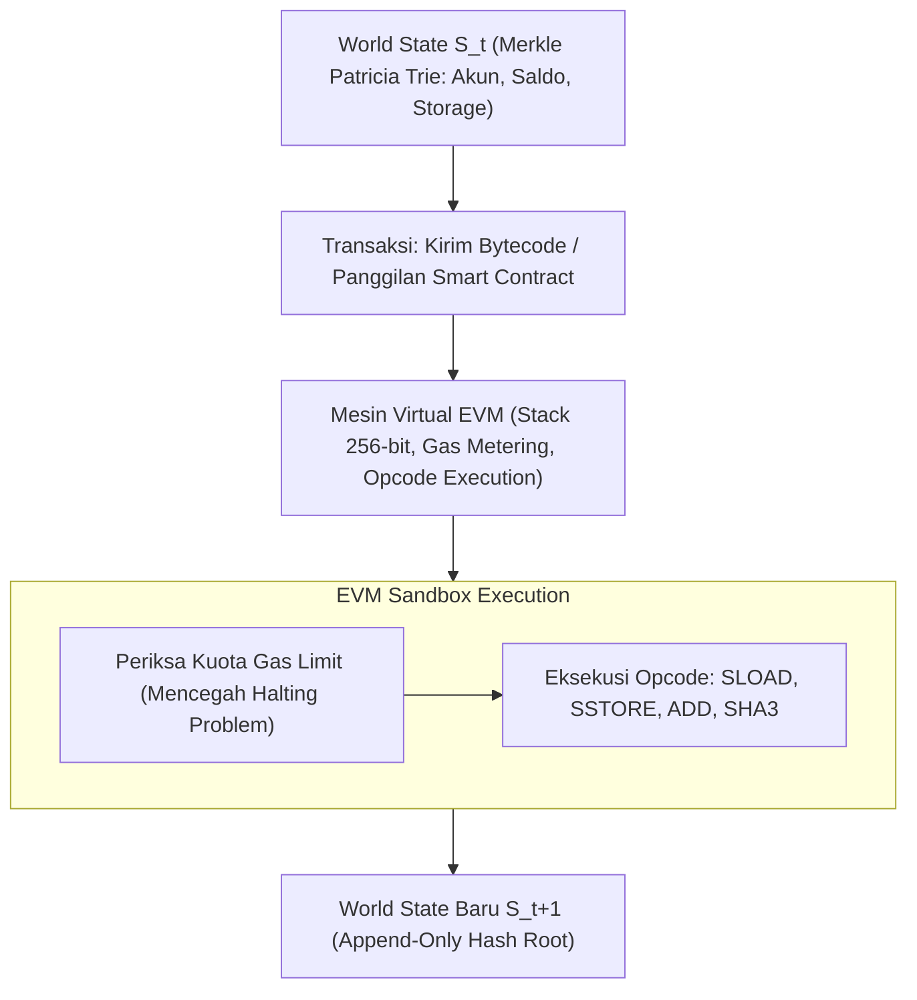

# Modul 216: Arsitektur Blockchain, Smart Contracts & DeFi (Struktur Merkle Trees, Model UTXO vs Akun, Konsensus PoW/PoS, EVM, AMM Uniswap)

**Navigasi**: [⬅️ Master Index](../../INDEX.md) | [Tingkat 14: Tingkat 14: Fintech, Financial Engineering, HFT & Blockchain](./README.md)
*Sebelumnya*: [215. rekayasa-sistem-berlatensi-ultra-rendah-hft](./215-rekayasa-sistem-berlatensi-ultra-rendah-hft.md) | *Berikutnya*: [217. sistem-mekatronika-transmisi-mekanis](../15-mekatronika-robotika-kendali/217-sistem-mekatronika-transmisi-mekanis.md)

---

## 1. Intuisi Dasar Tanpa Jargon ("Seperti Bayi Baru Lahir")
Bagaimana sekelompok orang asing di seluruh dunia yang tidak saling mengenal dan tidak saling mempercayai bisa bersama-sama menyepakati satu buku besar keuangan tunggal tanpa ada bank, presiden, polisi, atau server pusat yang mengaturnya?

Satoshi Nakamoto memecahkan teka-teki legendaris ilmu komputer ini (**Masalah Para Jenderal Bizantium / Byzantine Generals Problem**) melalui penemuan **Blockchain & Konsensus Proof-of-Work (PoW)** ([Nakamoto - Bitcoin: A Peer-to-Peer Electronic Cash System](https://bitcoin.org/bitcoin.pdf)).

Bayangkan sebuah buku kas raksasa di mana setiap halaman buku (*blok*) berisi daftar ratusan transaksi keuangan. Untuk mengunci halaman tersebut agar tidak ada yang bisa memalsukannya:
1. Halaman tersebut dirangkum menggunakan rumus matematika sidik jari digital (**Pohon Merkle / Merkle Tree**) ([Merkle - A Certified Digital Signature](https://link.springer.com/chapter/10.1007/0-387-34799-2_32)).
2. Halaman baru harus mencantumkan sidik jari dari halaman sebelumnya, membentuk **Rantai Blok (Blockchain)**.
3. Para penambang (*miners*) harus menghabiskan miliaran daya listrik untuk memecahkan teka-teki kriptografi yang sangat sulit (*Proof-of-Work*) agar halaman mereka disetujui.

Vitalik Buterin kemudian memperluas ide ini menjadi **Ethereum Virtual Machine (EVM)**: tidak hanya mencatat angka transfer uang, blockchain bisa menjalankan kode program komputer abadi yang tidak bisa dimatikan oleh siapa pun (**Smart Contracts & DeFi**) ([Buterin - Ethereum Whitepaper](https://ethereum.org/en/whitepaper/)).

## 2. Fondasi Teoretis & Aksiomatik / Matematis
Formulasi Kriptografi Blockchain & Keuangan Terdesentralisasi:

1. **Struktur Rantai Hash Monotonik & Pohon Merkle**:
Blok ke-$k$ didefinisikan sebagai tuple $\langle H_{k-1}, \text{MerkleRoot}, \text{Timestamp}, \text{Nonce}, \text{Transactions} \rangle$.
Pohon Merkle mengagregasikan $N$ transaksi secara hierarkis berpasangan via fungsi hash satu arah SHA-256:
$$H_{\text{parent}} = \text{Hash}(H_{\text{left}} \parallel H_{\text{right}})$$
*Bukti Keberadaan Merkle (Merkle Audit Proof)*: Memungkinkan verifikasi ringan (*Simplified Payment Verification / SPV*) apakah suatu transaksi berada di dalam blok dengan ukuran bukti logaritmik $\mathcal{O}(\log N)$ tanpa mengunduh seluruh transaksi blok.

2. **Konsensus Proof-of-Work (Nakamoto Consensus) vs Proof-of-Stake**:
* **PoW**: Mencari nilai acak *Nonce* sehingga nilai hash blok memenuhi ambang batas kesulitan (*Difficulty Target* $T$):
$$\text{SHA256}(\text{SHA256}(\text{BlockHeader})) < T$$
Probabilitas rantai terpanjang dikuasai oleh penyerang dengan kekuatan hashing fraksi $q < 0.5$ meluruh secara eksponensial seiring bertambahnya konfirmasi blok $z$:
$$P(\text{Double Spend}) = \sum_{k=0}^\infty \frac{\lambda^k e^{-\lambda}}{k!} \left( \frac{q}{p} \right)^{\max(z - k, 0)}, \quad \lambda = z \frac{q}{p}$$
* **PoS (Gasper / Casper FFG)**: Validator mempertaruhkan modal aset (32 ETH) dan mengamankan rantai melalui penalti pemotongan dana (*slashing*) jika terbukti menandatangani dua blok bercabang secara ganda ([Buterin & Griffith - Casper the Friendly Finality Gadget](https://arxiv.org/abs/1710.09437)).

3. **Mekanisme Automated Market Maker (AMM) Constant Product Uniswap v2**:
Kolam likuiditas terdesentralisasi memegang cadangan token $X$ dan token $Y$ dengan invarian fungsi konstan ([Adams et al. - Uniswap v2 Core](https://uniswap.org/whitepaper.pdf)):
$$x \cdot y = k$$
Jika pengguna menukar sejumlah $\Delta x$ token $X$ ke kolam dengan biaya transaksi $\gamma = 0.997$ (fee 0.3%), jumlah token $Y$ yang diterima ($\Delta y$):
$$(x + \gamma \Delta x)(y - \Delta y) = k \implies \Delta y = \frac{y \cdot \gamma \Delta x}{x + \gamma \Delta x}$$
Harga marginal spot: $P = \frac{y}{x}$, dengan *Slippage* yang tumbuh proporsional terhadap ukuran pertukaran $\frac{\Delta x}{x}$.

## 3. Anatomi Teknis & Cara Kerja Internal
Arsitektur State Transition Function pada Ethereum Virtual Machine (EVM):



EVM beroperasi sebagai mesin status Turing-Complete kuasi-deterministik: setiap instruksi komputasi mengenakan biaya bahan bakar (*Gas*) yang harus dibayar pengirim, menyelesaikan masalah *Halting Problem* secara elegan (program dengan infinite loop akan mati kehabisan gas secara otomatis) ([Wood - Ethereum Yellow Paper](https://ethereum.github.io/yellowpaper/paper.pdf)).

## 4. Implementasi Praktis & Kode / Simulasi Riil
```python
import hashlib

# 1. Implementasi Pohon Merkle Kriptografis dari Nol
def sha256(data: str) -> str:
    return hashlib.sha256(data.encode('utf-8')).hexdigest()

class MerkleTree:
    def __init__(self, transactions: list[str]):
        self.transactions = transactions
        self.tree_levels = []
        self._build_tree()
        
    def _build_tree(self):
        current_level = [sha256(tx) for tx in self.transactions]
        self.tree_levels.append(current_level)
        
        while len(current_level) > 1:
            next_level = []
            for i in range(0, len(current_level), 2):
                left = current_level[i]
                right = current_level[i + 1] if (i + 1 < len(current_level)) else left
                combined_hash = sha256(left + right)
                next_level.append(combined_hash)
            current_level = next_level
            self.tree_levels.append(current_level)
            
    def get_root(self) -> str:
        return self.tree_levels[-1][0] if self.tree_levels else ""

# 2. Rumus Pertukaran Token AMM Constant Product Uniswap v2
def uniswap_v2_swap(x_reserve, y_reserve, dx_input, fee=0.003):
    # dx_net = dx * (1 - fee)
    dx_net = dx_input * (1.0 - fee)
    # (x + dx_net) * (y - dy) = x * y
    dy_output = (y_reserve * dx_net) / (x_reserve + dx_net)
    new_x = x_reserve + dx_input
    new_y = y_reserve - dy_output
    price_impact = (dx_input / x_reserve) * 100
    return dy_output, new_x, new_y, price_impact

# Uji Coba Merkle Tree
txs = ["Alice->Bob: 5 BTC", "Charlie->Dave: 2 BTC", "Eve->Frank: 10 BTC", "Grace->Heidi: 1 BTC"]
mt = MerkleTree(txs)
print(f"Merkle Root (Sidik Jari 4 Transaksi): {mt.get_root()}")

# Uji Coba AMM Uniswap v2 Pool (1.000 ETH dan 2.000.000 USDC)
eth_res, usdc_res = 1_000.0, 2_000_000.0
usdc_out, new_eth, new_usdc, slippage = uniswap_v2_swap(eth_res, usdc_res, dx_input=10.0)

print(f"\nSwap 10 ETH ke Uniswap Pool:")
print(f"USDC Diterima Pengguna : ${usdc_out:,.2f} USDC (Rata-rata: ${usdc_out/10:,.2f}/ETH)")
print(f"Harga Spot Awal        : ${usdc_res / eth_res:,.2f}/ETH")
print(f"Slippage / Price Impact: {slippage:.2f}%")
```

## 5. Miskonsepsi & Jebakan Industri
*Kerentanan Serangan Reentrancy pada Smart Contract (Bencana The DAO)*: Dalam kode Solidity, jika kontrak mentransfer koin ether ke alamat pengguna eksternal sebelum memperbarui catatan saldo internalnya (`msg.sender.call{value: amount}("")`), kontrak penerima yang jahat dapat menulis fungsi fallback yang memanggil kembali fungsi penarikan tersebut (*re-entrant call*) secara rekursif sebelum saldo berkurang, menguras seluruh dana kas kontrak. Selalu terapkan pola desain **Checks-Effects-Interactions** atau gunakan ReentrancyGuard mutex ([Atzei et al. - A Survey of Attacks on Ethereum Smart Contracts](https://link.springer.com/chapter/10.1007/978-3-662-54455-6_8)).

## 6. Proyek Latihan & Rubrik Penilaian Mandiri
### Level 1 (Pemula)
Tulis simulasi algoritma penambangan konsensus Proof-of-Work (PoW) sederhana di Python: terima data string blok, lakukan hashing berulang dengan incrementing nonce hingga menemukan hash SHA-256 yang diawali oleh 4 karakter nol ("0000"), dan catat total iterasi serta waktu komputasi yang dibutuhkan.
*Rubrik*: Output mencetak nonce pemenang dan hash valid yang memenuhi target kesulitan.

### Level 2 (Menengah)
Implementasikan struktur Pohon Merkle lengkap beserta fungsi pembuatan bukti audit (*Merkle Proof Generator*) dan verifikasi bukti (*Merkle Proof Verifier*): buktikan bahwa simpul daun dapat divalidasi keabsahannya terhadap Merkle Root hanya menggunakan deretan hash tetangga tanpa mengetahui isi daun lainnya.
*Rubrik*: Fungsi verifikator mengembalikan `True` untuk bukti yang sah dan `False` jika data dipalsukan.

### Level 3 (Mahir)
Bangun smart contract Automated Market Maker (AMM) Uniswap v2 mini menggunakan bahasa Solidity atau simulator komputasional Python lengkap: implementasikan fungsi penambahan likuiditas (`mint` LP Token berbasis $\sqrt{x \cdot y}$), fungsi penghapusan likuiditas (`burn`), dan fungsi pertukaran (`swap`) dengan proteksi reentrancy lock.
*Rubrik*: Invarian produk konstan terverifikasi meningkat secara monotonik akibat akumulasi fee transaksi.

## 7. Rekomendasi Sumber Belajar Standar Emas
| Sumber Pembelajaran | Penulis / Institusi | Tautan Langsung | Fokus Materi |
| :--- | :--- | :--- | :--- |
| Bitcoin: A Peer-to-Peer Electronic Cash System | Satoshi Nakamoto | [Bitcoin Whitepaper PDF](https://bitcoin.org/bitcoin.pdf) | Makalah Penemuan Blockchain Asli, Proof-of-Work, Konsensus |
| Ethereum: A Next-Generation Smart Contract and Decentralized Application Platform | Vitalik Buterin | [Ethereum Whitepaper](https://ethereum.org/en/whitepaper/) | Konsep Mesin Virtual EVM, Smart Contracts, Gas Metering |
| Uniswap v2 Core Whitepaper | Hayden Adams, Noah Zinsmeister, Dan Robinson | [Uniswap Official Whitepaper](https://uniswap.org/whitepaper.pdf) | Matematika Constant Product Market Maker AMM, Invarian xy=k |
| Ethereum Yellow Paper: The Formal Specification of Ethereum | Gavin Wood (Polkadot Founder) | [Ethereum Yellow Paper](https://ethereum.github.io/yellowpaper/paper.pdf) | Spesifikasi Matematis Formal Opcode EVM & Merkle Patricia Trie |

---
*Navigasi Cepat*: [Ke Tingkat 14](./README.md) | [Ke Master Index](../../INDEX.md) | *Sebelumnya*: [215. rekayasa-sistem-berlatensi-ultra-rendah-hft](./215-rekayasa-sistem-berlatensi-ultra-rendah-hft.md) | *Berikutnya*: [217. sistem-mekatronika-transmisi-mekanis](../15-mekatronika-robotika-kendali/217-sistem-mekatronika-transmisi-mekanis.md)
