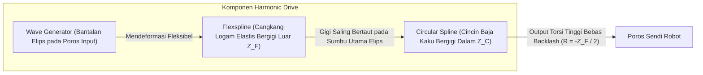

# Modul 217: Sistem Mekatronika & Transmisi Mekanis (Derajat Kebebasan DoF Grübler, Harmonic Drive Bebas Backlash, Inertia Matching)

**Navigasi**: [⬅️ Master Index](../../INDEX.md) | [Tingkat 15: Tingkat 15: Mekatronika, Robotika, Teori Kendali & Otomasi Industri](./README.md)
*Sebelumnya*: [216. arsitektur-blockchain-smart-contracts-defi](../14-fintech-hft-blockchain/216-arsitektur-blockchain-smart-contracts-defi.md) | *Berikutnya*: [218. aktuator-elektrik-hidrolik-pneumatik](./218-aktuator-elektrik-hidrolik-pneumatik.md)

---

## 1. Intuisi Dasar Tanpa Jargon ("Seperti Bayi Baru Lahir")
Sebuah robot bukan sekadar komputer yang diberi roda. Robot adalah jembatan fisik antara kode perangkat lunak digital dengan hukum fisika dunia nyata. Jika Anda memprogram sebuah lengan robot industri untuk mengelas bodi mobil dengan presisi 0,1 milimeter, tetapi roda gigi sambungan lengannya memiliki kelonggaran (*backlash*) 1 milimeter, kode terpintar di dunia pun tidak akan bisa mengelas mobil dengan rapi ([Craig - Introduction to Robotics: Mechanics and Control](https://www.pearson.com/en-us/subject-catalog/p/introduction-to-robotics-mechanics-and-control/P200000003314)).

Inilah ranah **Sistem Mekatronika & Transmisi Mekanis**:
1. **Derajat Kebebasan (Degrees of Freedom / DoF)**: Berapa banyak arah independen yang bisa digerakkan oleh sendi robot? Rumus Grübler menghitungnya secara eksak.
2. **Harmonic Drive (Strain Wave Gear)**: Roda gigi elastis khusus tanpa celah longgar (*zero backlash*) yang digunakan pada sendi robot humanoid dan lengan penjelajah Mars NASA ([Harmonic Drive Technology Principles](https://www.harmonicdrive.net/technology)).
3. **Inertia Matching**: Memilih rasio gigi yang tepat agar motor listrik tidak kepayahan atau bergetar liar saat memutar beban mekanis yang berat ([Spong, Hutchinson, Vidyasagar - Robot Modeling and Control](https://www.wiley.com/en-us/Robot+Modeling+and+Control%2C+2nd+Edition-p-9781119523994)).

## 2. Fondasi Teoretis & Aksiomatik / Matematis
Formulasi Matematis Mekanika Robotika & Transmisi:

1. **Kriteria Mobilitas Grübler-Kutzbach (Derajat Kebebasan Mekanisme Spasial 3D)**:
Untuk mekanisme spasial dengan $N$ tautan kaku (*links*, termasuk rangka dasar/ground) dan $J$ sambungan sendi (*joints*), di mana sendi ke-$i$ memiliki $f_i$ derajat kebebasan gerak:
$$M = 6(N - 1 - J) + \sum_{i=1}^J f_i$$
Untuk mekanisme planar 2D: $M = 3(N - 1 - J) + \sum f_i$.
Jika $M = 0$, struktur adalah statis kaku (*truss*); jika $M < 0$, struktur mengalami overconstrained statis tak tentu ([Norton - Design of Machinery](https://www.mheducation.com/highered/product/design-machinery-norton/M9781260113310.html)).

2. **Prinsip Reduksi Roda Gigi & Inertia Matching**:
Sebuah transmisi roda gigi dengan rasio reduksi $N = \frac{\omega_{\text{in}}}{\omega_{\text{out}}} = \frac{\tau_{\text{out}}}{\tau_{\text{in}}} > 1$:
Momen inersia beban $J_L$ yang dipantulkan kembali ke poros motor listrik tereduksi secara kuadratik terhadap rasio gigi:
$$J_{\text{reflected}} = \frac{J_L}{N^2}$$
*Kondisi Akselerasi Sudut Maksimum (Inertia Matching)*: Akselerasi beban $\alpha_L$ termaksimalkan ketika inersia rotor motor $J_m$ persis menyamai inersia pantulan beban:
$$J_m = \frac{J_L}{N^2} \implies N_{\text{optimal}} = \sqrt{\frac{J_L}{J_m}}$$

3. **Kinematika Transmisi Harmonic Drive (Strain Wave Gearing)**:
Terdiri dari 3 komponen: Wave Generator elips, Flexspline fleksibel bergigi luar ($Z_F$), dan Circular Spline kaku bergigi dalam ($Z_C = Z_F + 2$):
Rasio reduksi dengan Circular Spline terkunci:
$$R = -\frac{Z_F}{Z_C - Z_F} = -\frac{Z_F}{2}$$
Torsi tinggi, rasio transmisi masif dalam satu tahap ($50:1$ hingga $160:1$), dan bebas backlash karena kontak gigi simultan di dua sisi elips berlawanan ([Harmonic Drive Engineering Standards](https://www.harmonicdrive.net/technology)).

## 3. Anatomi Teknis & Cara Kerja Internal
Anatomi mekanis transmisi Harmonic Drive (Strain Wave Gear) bebas backlash:



Karena tautan gigi terjadi secara elastis dan simultan di puluhan gigi sekaligus, Harmonic Drive memiliki kekakuan torsi tinggi (*torsional stiffness*) dan menghilangkan celah mekanis (*backlash* $\approx 0$ arcsec), menjadikannya standar mutlak pada sendi robot kolaboratif (Cobot) ([Craig Robotics Chapter 8](https://www.pearson.com/en-us/subject-catalog/p/introduction-to-robotics-mechanics-and-control/P200000003314)).

## 4. Implementasi Praktis & Kode / Simulasi Riil
```python
import numpy as np

# 1. Perhitungan Kriteria Mobilitas Grübler untuk Manipulator Robot
def calculate_grubler_dof(n_links, joints_dof_list, spatial=True):
    # n_links mencakup link dasar (ground)
    n = n_links
    j = len(joints_dof_list)
    lambda_space = 6 if spatial else 3 # 6 untuk 3D, 3 untuk planar
    
    total_joint_dof = sum(joints_dof_list)
    dof = lambda_space * (n - 1 - j) + total_joint_dof
    return dof

# Contoh: Lengan Robot Industri 6-DoF Standar (7 link termasuk base, 6 sendi revolute 1-DoF)
dof_6axis = calculate_grubler_dof(n_links=7, joints_dof_list=[1, 1, 1, 1, 1, 1], spatial=True)
print(f"Mobilitas Lengan 6-Axis Robot: {dof_6axis} DoF (Tepat untuk posisi dan orientasi 3D lengkap)")

# 2. Desain Rasio Reduksi Roda Gigi Optimal (Inertia Matching)
def optimal_gear_ratio(motor_inertia, load_inertia):
    # N_opt = sqrt(J_L / J_m)
    return np.sqrt(load_inertia / motor_inertia)

J_motor = 0.0002 # kg*m^2 (Inersia rotor motor elektrik kecil)
J_load = 0.8     # kg*m^2 (Inersia lengan robot + beban kerja)

n_opt = optimal_gear_ratio(J_motor, J_load)
j_ref = J_load / (n_opt ** 2)

print(f"\nInersia Beban Mekanis   : {J_load} kg*m^2")
print(f"Inersia Rotor Motor     : {J_motor} kg*m^2")
print(f"Rasio Transmisi Optimal : {n_opt:.1f}:1")
print(f"Inersia Pantulan Beban  : {j_ref:.4f} kg*m^2 (Sempurna seimbang dengan rotor motor!)")
```

## 5. Miskonsepsi & Jebakan Industri
*Resonansi Mekanis Torsional (Mechanical Resonance)*: Memasang transmisi fleksibel (seperti Harmonic Drive) pada motor berkekuatan tinggi menciptakan sistem pegas-massa elastis. Jika loop kendali frekuensi tinggi (PID) membangkitkan frekuensi resonansi alami poros ($\omega_n = \sqrt{K_{\text{torsion}} / J_L}$), sendi robot akan mulai bergetar hebat (*ringing/hunting*), merusak motor dan merontokkan gigi transmisi. Terapkan filter penakik digital (*Notch Filter*) pada loop kendali arus untuk memotong frekuensi resonansi mekanis tersebut ([Ellis - Observers in Control Systems](https://www.sciencedirect.com/book/9780122374722/observers-in-control-systems)).

## 6. Proyek Latihan & Rubrik Penilaian Mandiri
### Level 1 (Pemula)
Gunakan rumus Grübler untuk menghitung derajat kebebasan mekanisme planar 4-batang (*Four-Bar Linkage*: 4 links, 4 sendi revolute 1-DoF), dan verifikasi bahwa mobilitas sistem tepat 1 DoF.
*Rubrik*: Langkah perhitungan $M = 3(4 - 1 - 4) + 4 = 1$ terbukti benar.

### Level 2 (Menengah)
Bangun simulator dinamika sistem transmisi roda gigi elastis dengan backlash di Python: modelkan gesekan Coulomb-Viscous dan celah celah mati (*deadband gap* $\pm \delta$), lalu simulasikan respons posisi sudut beban terhadap pembalikan arah putaran motor listrik.
*Rubrik*: Grafik respons menunjukkan fenomena penundaan sudut saat motor membalik arah melintasi zona mati backlash.

### Level 3 (Mahir)
Rancang perhitungan dimensi mekanis transmisi Harmonic Drive: tentukan jumlah gigi Flexspline ($Z_F = 160$) dan Circular Spline ($Z_C = 162$), hitung deformasi radial gelombang elastis $\Delta r = \frac{d}{2} \cdot m$ (di mana $m$ modul gigi), verifikasi tegangan lelah lentur siklik material baja paduan Flexspline agar tahan terhadap $10^8$ siklus putaran tanpa mengalami *fatigue fracture*.
*Rubrik*: Perhitungan rasio reduksi $80:1$ dan evaluasi batas kelelahan material tegangan von Mises.

## 7. Rekomendasi Sumber Belajar Standar Emas
| Sumber Pembelajaran | Penulis / Institusi | Tautan Langsung | Fokus Materi |
| :--- | :--- | :--- | :--- |
| Introduction to Robotics: Mechanics and Control (4th Ed.) | John J. Craig (Stanford University) | [Pearson Education](https://www.pearson.com/en-us/subject-catalog/p/introduction-to-robotics-mechanics-and-control/P200000003314) | Teori Derajat Kebebasan, Tautan Mekanis, Transmisi Sendi |
| Robot Modeling and Control (2nd Ed.) | Mark W. Spong, Seth Hutchinson, M. Vidyasagar | [Wiley Portal](https://www.wiley.com/en-us/Robot+Modeling+and+Control%2C+2nd+Edition-p-9781119523994) | Dinamika Mekatronika Lanjut, Parameter Inersia Sendi |
| Harmonic Drive Technology Technical Principles | Harmonic Drive LLC Engineering Team | [Harmonic Drive Official Guide](https://www.harmonicdrive.net/technology) | Prinsip Strain Wave Gearing, Zero Backlash, Analisis Torsi |
| Design of Machinery (6th Ed.) | Robert L. Norton (Worcester Polytechnic Institute) | [McGraw-Hill Education](https://www.mheducation.com/highered/product/design-machinery-norton/M9781260113310.html) | Kinematika Mekanisme Kutzbach-Grübler, Roda Gigi |

---
*Navigasi Cepat*: [Ke Tingkat 15](./README.md) | [Ke Master Index](../../INDEX.md) | *Sebelumnya*: [216. arsitektur-blockchain-smart-contracts-defi](../14-fintech-hft-blockchain/216-arsitektur-blockchain-smart-contracts-defi.md) | *Berikutnya*: [218. aktuator-elektrik-hidrolik-pneumatik](./218-aktuator-elektrik-hidrolik-pneumatik.md)
