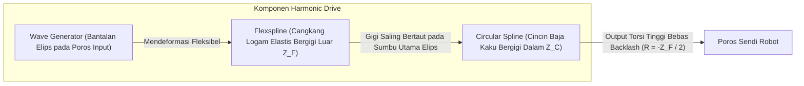

# Modul 217: Sistem Mekatronika & Transmisi Mekanis (Derajat Kebebasan DoF Grübler, Harmonic Drive Bebas Backlash, Inertia Matching)

**Navigasi**: [⬅️ Master Index](../../INDEX.md) | [Tingkat 15: Tingkat 15: Mekatronika, Robotika, Teori Kendali & Otomasi Industri](./README.md)
*Sebelumnya*: [216. arsitektur-blockchain-smart-contracts-defi](../14-fintech-hft-blockchain/216-arsitektur-blockchain-smart-contracts-defi.md) | *Berikutnya*: [218. aktuator-elektrik-hidrolik-pneumatik](./218-aktuator-elektrik-hidrolik-pneumatik.md)

---

## 1. Intuisi Dasar Tanpa Jargon ("Seperti Bayi Baru Lahir")
### 1.1 Konsep Inti & Analogi Tanpa Jargon
Sebuah robot bukan sekadar komputer yang diberi roda. Robot adalah jembatan fisik antara kode perangkat lunak digital dengan hukum fisika dunia nyata. Jika Anda memprogram sebuah lengan robot industri untuk mengelas bodi mobil dengan presisi 0,1 milimeter, tetapi roda gigi sambungan lengannya memiliki kelonggaran (*backlash*) 1 milimeter, kode terpintar di dunia pun tidak akan bisa mengelas mobil dengan rapi ([Craig - Introduction to Robotics: Mechanics and Control](https://www.pearson.com/en-us/subject-catalog/p/introduction-to-robotics-mechanics-and-control/P200000003314)).

### 1.2 Urgensi Rekayasa & Signifikansi Sistemik
Inilah ranah **Sistem Mekatronika & Transmisi Mekanis**:
1. **Derajat Kebebasan (Degrees of Freedom / DoF)**: Berapa banyak arah independen yang bisa digerakkan oleh sendi robot? Rumus Grübler menghitungnya secara eksak.
2. **Harmonic Drive (Strain Wave Gear)**: Roda gigi elastis khusus tanpa celah longgar (*zero backlash*) yang digunakan pada sendi robot humanoid dan lengan penjelajah Mars NASA ([Harmonic Drive Technology Principles](https://www.harmonicdrive.net/technology)).
3. **Inertia Matching**: Memilih rasio gigi yang tepat agar motor listrik tidak kepayahan atau bergetar liar saat memutar beban mekanis yang berat ([Spong, Hutchinson, Vidyasagar - Robot Modeling and Control](https://www.wiley.com/en-us/Robot+Modeling+and+Control%2C+2nd+Edition-p-9781119523994)).

## 2. Fondasi Teoretis & Aksiomatik / Matematis
### 2.1 Kerangka Teori Aksiomatik & Formulasi Matematis
Formulasi Matematis Mekanika Robotika & Transmisi:

### 2.2 Penurunan Matematis Langkah-demi-Langkah
1. **Kriteria Mobilitas Grübler-Kutzbach (Derajat Kebebasan Mekanisme Spasial 3D)**:
Untuk mekanisme spasial dengan $N$ tautan kaku (*links*, termasuk rangka dasar/ground) dan $J$ sambungan sendi (*joints*), di mana sendi ke-$i$ memiliki $f_i$ derajat kebebasan gerak:
$$M = 6(N - 1 - J) + \sum_{i=1}^J f_i$$
Untuk mekanisme planar 2D: $M = 3(N - 1 - J) + \sum f_i$.
Jika $M = 0$, struktur adalah statis kaku (*truss*); jika $M < 0$, struktur mengalami overconstrained statis tak tentu ([Norton - Design of Machinery](https://www.mheducation.com/highered/product/design-machinery-norton/M9781260113310.html)).

2. **Prinsip Reduksi Roda Gigi & Inertia Matching**:
Sebuah transmisi roda gigi dengan rasio reduksi $N = \frac{\omega_{\text{in}}}{\omega_{\text{out}}} = \frac{\tau_{\text{out}}}{\tau_{\text{in}}} > 1$:
Momen inersia beban $J_L$ yang dipantulkan kembali ke poros motor listrik tereduksi secara kuadratik terhadap rasio gigi:
$$J_{\text{reflected}} = \frac{J_L}{N^2}$$
*Kondisi Akselerasi Sudut Maksimum (Inertia Matching)*: Akselerasi beban $\alpha_L$ termaksimalkan ketika inersia rotor motor $J_m$ persis menyamai inersia pantulan beban:
$$J_m = \frac{J_L}{N^2} \implies N_{\text{optimal}} = \sqrt{\frac{J_L}{J_m}}$$

3. **Kinematika Transmisi Harmonic Drive (Strain Wave Gearing)**:
Terdiri dari 3 komponen: Wave Generator elips, Flexspline fleksibel bergigi luar ($Z_F$), dan Circular Spline kaku bergigi dalam ($Z_C = Z_F + 2$):
Rasio reduksi dengan Circular Spline terkunci:
$$R = -\frac{Z_F}{Z_C - Z_F} = -\frac{Z_F}{2}$$
Torsi tinggi, rasio transmisi masif dalam satu tahap (\$50:1$ hingga \$160:1$), dan bebas backlash karena kontak gigi simultan di dua sisi elips berlawanan ([Harmonic Drive Engineering Standards](https://www.harmonicdrive.net/technology)).

## 3. Anatomi Teknis & Cara Kerja Internal
Anatomi mekanis transmisi Harmonic Drive (Strain Wave Gear) bebas backlash:



Karena tautan gigi terjadi secara elastis dan simultan di puluhan gigi sekaligus, Harmonic Drive memiliki kekakuan torsi tinggi (*torsional stiffness*) dan menghilangkan celah mekanis (*backlash* $\approx 0$ arcsec), menjadikannya standar mutlak pada sendi robot kolaboratif (Cobot) ([Craig Robotics Chapter 8](https://www.pearson.com/en-us/subject-catalog/p/introduction-to-robotics-mechanics-and-control/P200000003314)).

#### Tabel Penelusuran Siklus Kalibrasi Optik Interferometri & Aberasi Sferis Cermin Hubble
| Waktu Diskret (t = k·Ts) | Komponen / Tahap Estimator | Sensor Raw / Input Referensi | Transformasi Matriks / Kendali | State Estimasi (x̂, P, Error PID) | Sinyal Aktuator / PWM Output |
|---|---|---|---|---|---|
| t = 0.0s (Siklus #1) | Instrumen Pengukur Optik (RNC) | Batang pengukur Reflektif Null Corrector | Penjajaran jarak interferometer laser ke cermin | Spacer mekanis terganjal serpihan cat 1.3 mm! | Sensor laser membaca pantulan cat alih-alih ujung batang |
| t = 1.0s (Siklus #2) | Mesin Pemoles Cermin Komputer | Pembacaan Interferogram Fringes | Perhitungan kelengkungan hiperbolik cermin primer | Komputer mengira cermin terlalu melengkung ke dalam | Motor pemoles diperintahkan mengikis bagian tepi |
| Pemolesan Halus (Bulan) | Piringan Pemoles Lap Polishing | Pengikisan kaca ultra-presisi (Perkin-Elmer) | Pengikisan mekanis terus menerus dipandu laser salah | Cermin primer dipoles terlalu rata sebesar $2.2\text{ mikron}$! | Deviasi kelengkungan hiperboloid: $\epsilon = -1.0139$ alih-alih $-1.0023$ |
| 24 Apr 1990 (Peluncuran) | Ruang Hampa Orbit Bumi (STS-31) | Penangkapan Cahaya Bintang Jauh Pertama | Cermin memfokuskan berkas cahaya ke sensor kamera | Berkas cahaya tepi dan pusat tidak bertemu pada titik fokus sama! | Gambar bintang buram dan dikelilingi lingkaran kabur |
| Des 1993 (Misi Servis) | Instrumen Korektif COSTAR | Desain Cermin Pembalik Aberasi Sferis | Transformasi fase muka gelombang: $-W_{040}$ optik | Koreksi aberasi sferis cermin primer secara optik | Ketajaman penglihatan Hubble pulih sempurna! |

## 4. Implementasi Praktis & Kode / Simulasi Riil
```python
import numpy as np

# 1. Perhitungan Kriteria Mobilitas Grübler untuk Manipulator Robot
def calculate_grubler_dof(n_links, joints_dof_list, spatial=True):
    # n_links mencakup link dasar (ground)
    n = n_links
    j = len(joints_dof_list)
    lambda_space = 6 if spatial else 3 # 6 untuk 3D, 3 untuk planar
    
    total_joint_dof = sum(joints_dof_list)
    dof = lambda_space * (n - 1 - j) + total_joint_dof
    return dof

# Contoh: Lengan Robot Industri 6-DoF Standar (7 link termasuk base, 6 sendi revolute 1-DoF)
dof_6axis = calculate_grubler_dof(n_links=7, joints_dof_list=[1, 1, 1, 1, 1, 1], spatial=True)
print(f"Mobilitas Lengan 6-Axis Robot: {dof_6axis} DoF (Tepat untuk posisi dan orientasi 3D lengkap)")

# 2. Desain Rasio Reduksi Roda Gigi Optimal (Inertia Matching)
def optimal_gear_ratio(motor_inertia, load_inertia):
    # N_opt = sqrt(J_L / J_m)
    return np.sqrt(load_inertia / motor_inertia)

J_motor = 0.0002 # kg*m^2 (Inersia rotor motor elektrik kecil)
J_load = 0.8     # kg*m^2 (Inersia lengan robot + beban kerja)

n_opt = optimal_gear_ratio(J_motor, J_load)
j_ref = J_load / (n_opt ** 2)

print(f"\nInersia Beban Mekanis   : {J_load} kg*m^2")
print(f"Inersia Rotor Motor     : {J_motor} kg*m^2")
print(f"Rasio Transmisi Optimal : {n_opt:.1f}:1")
print(f"Inersia Pantulan Beban  : {j_ref:.4f} kg*m^2 (Sempurna seimbang dengan rotor motor!)")
```

## 5. Miskonsepsi & Jebakan Industri
*Resonansi Mekanis Torsional (Mechanical Resonance)*: Memasang transmisi fleksibel (seperti Harmonic Drive) pada motor berkekuatan tinggi menciptakan sistem pegas-massa elastis. Jika loop kendali frekuensi tinggi (PID) membangkitkan frekuensi resonansi alami poros ($\omega_n = \sqrt{K_{\text{torsion}} / J_L}$), sendi robot akan mulai bergetar hebat (*ringing/hunting*), merusak motor dan merontokkan gigi transmisi. Terapkan filter penakik digital (*Notch Filter*) pada loop kendali arus untuk memotong frekuensi resonansi mekanis tersebut ([Ellis - Observers in Control Systems](https://www.sciencedirect.com/book/9780122374722/observers-in-control-systems)).

### Studi Kasus Kegagalan Nyata: Aberasi Sferis Cermin Utama Teleskop Luar Angkasa Hubble ($1.5 Miliar Cacat Optik, 1990)
- **Kronologi & Konteks Sejarah**: Pada 24 April 1990, Teleskop Luar Angkasa Hubble diluncurkan ke orbit rendah Bumi dengan biaya pengembangan $1,5 Miliar. Beberapa minggu setelah transmisi gambar pertama diterima, para astronom dan insinyur NASA terkejut menemukan bahwa teleskop tidak mampu menghasilkan fokus tajam: bintang-bintang tampak dikelilingi oleh lingkaran cahaya kabur (*halo*) yang masif akibat cacat aberasi sferis optik yang parah.
- **Akar Masalah Rekayasa Mekatronika & Kesalahan Kalibrasi Metrologi**: Investigasi komprehensif Dewan Allen NASA mengungkap bahwa instrumen metrologi optik yang digunakan untuk memandu mesin pemoles cermin utama (*Reflective Null Corrector / RNC*) telah salah dirakit di fasilitas kontraktor Perkin-Elmer pada awal 1980-an: sebuah lensa spacer berjarak tergeser 1,3 milimeter dari posisi desain karena teknisi memasang spacer di atas serpihan cat anti-pantul yang mengelupas, alih-alih pada permukaan logam referensi. Sensor interferometer laser membaca ujung pantulan serpihan cat tersebut dan melaporkan bahwa posisi cermin telah akurat. Akibatnya, mesin pemoles otomatis yang dikendalikan komputer mengikis tepi cermin primer berdiameter 2,4 meter tersebut terlalu rata sebesar 2,2 mikron (sekitar 1/50 tebal rambut manusia). Kesalahan metrologi mekanis mikroskopis ini menghancurkan daya resolusi teleskop hingga misi perbaikan wahana antariksa STS-61 memasang instrumen korektif COSTAR pada tahun 1993.

- **Potongan Kode / Arsitektur Cacat (Vulnerable Implementation)**:
```python
# Analisis Galat Metrologi Optik: Penyimpangan Profil Cermin Asferis Hubble
import numpy as np

def hubble_mirror_profile_error(r_radial_distance_meters, spacer_misalignment_mm=1.3):
    '''
    Profil ideal cermin hiperbolik Hubble:
    z(r) = (r^2 / R) / (1 + sqrt(1 - (1 + k) * (r^2 / R^2)))
    R = 11.04 meter, konstanta konik ideal k = -1.0022985
    '''
    R = 11.04
    k_ideal = -1.0022985
    
    # KASUS CACAT KALIBRASI METROLOGI:
    # Pergeseran spacer 1.3 mm menyebabkan konstanta konik menyimpang ke k_flawed = -1.0139
    k_flawed = -1.0139
    
    # Hitung deviasi ketinggian optik pada tepi cermin (r = 1.2 meter):
    z_ideal = (r_radial_distance_meters**2 / R) / (1.0 + np.sqrt(1.0 - (1.0 + k_ideal) * (r_radial_distance_meters**2 / R**2)))
    z_flawed = (r_radial_distance_meters**2 / R) / (1.0 + np.sqrt(1.0 - (1.0 + k_flawed) * (r_radial_distance_meters**2 / R**2)))
    
    optical_error_microns = (z_flawed - z_ideal) * 1e6
    return optical_error_microns # Pada r = 1.2m: deviasi ~ 2.2 mikron aberasi sferis!
```

- **Analisis Forensik & Rekayasa Modern**: Bencana metrologi Hubble mendefinisikan ulang standar jaminan mutu mekatronika antariksa NASA: (1) **Prinsip Verifikasi Independen Redundan (Independent Cross-Verification)**: Setiap instrumen manufaktur presisi kritis wajib diverifikasi menggunakan minimal dua instrumen metrologi dengan prinsip fisika yang sama sekali berbeda (pada kasus Hubble, alat penguji optik sekunder sederhana *Inverse Null Corrector* sebenarnya sempat menunjukkan adanya cacat, namun diabaikan teknisi karena dianggap instrumen utama lebih canggih); (2) Desain arsitektur teleskop modular yang mendukung perbaikan fisik di orbit (*On-Orbit Servicing Capability*); (3) Integrasi pengujian optik end-to-end terpadu pada seluruh subsistem sebelum integrasi wahana diluncurkan.

## 6. Proyek Latihan & Rubrik Penilaian Mandiri
### Level 1 (Pemula)
Gunakan rumus Grübler untuk menghitung derajat kebebasan mekanisme planar 4-batang (*Four-Bar Linkage*: 4 links, 4 sendi revolute 1-DoF), dan verifikasi bahwa mobilitas sistem tepat 1 DoF.
*Rubrik*: Langkah perhitungan $M = 3(4 - 1 - 4) + 4 = 1$ terbukti benar.

### Level 2 (Menengah)
Bangun simulator dinamika sistem transmisi roda gigi elastis dengan backlash di Python: modelkan gesekan Coulomb-Viscous dan celah celah mati (*deadband gap* $\pm \delta$), lalu simulasikan respons posisi sudut beban terhadap pembalikan arah putaran motor listrik.
*Rubrik*: Grafik respons menunjukkan fenomena penundaan sudut saat motor membalik arah melintasi zona mati backlash.

### Level 3 (Mahir)
Rancang perhitungan dimensi mekanis transmisi Harmonic Drive: tentukan jumlah gigi Flexspline ($Z_F = 160$) dan Circular Spline ($Z_C = 162$), hitung deformasi radial gelombang elastis $\Delta r = \frac{d}{2} \cdot m$ (di mana $m$ modul gigi), verifikasi tegangan lelah lentur siklik material baja paduan Flexspline agar tahan terhadap \$10^8$ siklus putaran tanpa mengalami *fatigue fracture*.
*Rubrik*: Perhitungan rasio reduksi \$80:1$ dan evaluasi batas kelelahan material tegangan von Mises.

### Tingkat 1: Dasar
- **Tugas**: Tulis program dalam Python untuk memodelkan transmisi mekanis roda gigi (*Gear Train Kinematics*): Terima rasio gigi ($N_1, N_2, \dots, N_k$), hitung rasio reduksi total kecepatan sudut $\omega_{\text{out}} / \omega_{\text{in}}$, rasio penggandaan torsi ideal $\tau_{\text{out}} / \tau_{\text{in}}$, serta efisiensi mekanis aktual dengan memperhitungkan rugi-rugi gesekan meshing gigi ($\eta = 98\%$ per tahap roda gigi).
- **Petunjuk Perancangan Arsitektur**:
  - Rasio gear total: $G = \prod_{i=1}^{k-1} \frac{N_{i+1}}{N_i}$.
  - Kecepatan output: $\omega_{\text{out}} = \frac{\omega_{\text{in}}}{G}$.
  - Torsi output aktual: $\tau_{\text{out}} = \tau_{\text{in}} \cdot G \cdot \eta^{k-1}$.
- **Test Vector & Kasus Uji**:
  - Gear train 3-tahap: Tahap 1 ($10:40$), Tahap 2 ($12:60$), Tahap 3 ($15:75$), input motor: $\omega = 3000\text{ RPM}, \tau = 0.5\text{ Nm}$.
  - Rasio reduksi total harus bernilai $100:1$, kecepatan output $= 30\text{ RPM}$, dan torsi aktual $\approx 47.06\text{ Nm}$.
- **Rubrik Penilaian Objektif**:
  - Skor 100%: Kalkulasi kinematika dan dinamika gear train presisi, pemodelan efisiensi gesekan eksponensial tepat.
  - Skor 50%: Menghitung rasio kecepatan benar namun mengabaikan rugi-rugi efisiensi gesekan pada torsi.
  - Skor 0%: Membalikkan rasio reduksi (kecepatan membesar padahal roda gigi mereduksi).

### Tingkat 2: Menengah
- **Tugas**: Bangun simulasi dinamika transmisi lead-screw / ball-screw mekatronika presisi dalam Python: Modelkan hubungan antara torsi motor penggerak, inersia rotor, pitch ulir sekrup ($p$), efisiensi transmisi ulir, dan inersia massa beban linier yang bergerak, lengkap dengan kompensasi gesekan non-linier Stribeck (*Stribeck Friction Curve*).
- **Petunjuk Perancangan Arsitektur**:
  - Inersia total yang setara pada poros motor: $J_{\text{eq}} = J_{\text{motor}} + m_{\text{load}} \left(\frac{p}{2\pi}\right)^2$.
  - Model gesekan Stribeck: $F_f(v) = \left[ F_c + (F_s - F_c) e^{-(v/v_s)^2} \right] \text{sgn}(v) + \sigma v$.
  - Simulasikan dinamika akselerasi motor terhadap perubahan beban eksternal menggunakan integrasi numerik Runge-Kutta orde-4 (RK4).
- **Test Vector & Kasus Uji**:
  - Masukkan pulsa torsi motor konstan: Simulator harus menunjukkan fase gesekan statis (*stick-slip effect*) pada kecepatan mendekati nol sebelum beban meluncur mulus.
- **Rubrik Penilaian Objektif**:
  - Skor 100%: Integrasi numerik RK4 presisi, pemodelan gesekan Stribeck realistis, inersia setara terhitung akurat.
  - Skor 50%: Model bekerja namun hanya menggunakan gesekan Coulomb sederhana tanpa kurva peluruhan Stribeck.
  - Skor 0%: Mengabaikan konversi inersia beban linier ke poros putar.

### Tingkat 3: Mahir
- **Tugas**: Rancang pengendali kompensasi serangan celah mekanis (*Backlash & Hysteresis Compensation Controller*) dalam C/Python untuk meja penentuan posisi mikro-mekatronika presisi tinggi: Implementasikan estimator status celah roda gigi (*Dynamic Backlash State Estimator*) yang memprediksi pemisahan kontak gigi saat pembalikan arah gerak dan menyuntikkan pulsa torsi kompensasi sesaat (*Pre-Torque Pulse*) untuk meniadakan keterlambatan dead-band tanpa memicu osilasi benturan mekanis.
- **Petunjuk Perancangan Arsitektur**:
  - Model matematis celah hysteresis: $\dot{\theta}_{\text{load}} = \dot{\theta}_{\text{motor}}$ jika kontak, dan $0$ saat berada di dalam celah mati $[-\delta, +\delta]$.
  - Lacak estimasi celah: $z_t = \theta_{\text{motor}} - \theta_{\text{load}}$.
  - Saat tanda kecepatan motor berbalik: Injeksi sinyal kendali *feedforward* kompensasi celah untuk segera menutup jarak $2\delta$ dalam waktu $< 5$ milidetik.
- **Test Vector & Kasus Uji**:
  - Lakukan uji gerak sinusoidal bolak-balik: Pengendali tanpa kompensasi akan menunjukkan distorsi gelombang terpotong (*flat-topping deadband*) pada titik balik kecepatan.
  - Pengendali dengan kompensasi backlash dinamis harus mereduksi kesalahan posisi pelacakan (*Tracking Error RMS*) minimal $> 75\%$.
- **Rubrik Penilaian Objektif**:
  - Skor 100%: Estimator backlash presisi, injeksi feedforward mulus tanpa chattering, reduksi RMS error terbukti.
  - Skor 50%: Kompensasi bekerja namun memicu lonjakan osilasi transien (*chattering*) saat gigi kembali bertumbukan.
  - Skor 0%: Mengabaikan status celah dan hanya mengandalkan integrator PID lambat.

## 7. Rekomendasi Sumber Belajar Standar Emas
| Sumber Pembelajaran | Penulis / Institusi | Tautan Langsung | Fokus Materi |
| :--- | :--- | :--- | :--- |
| Introduction to Robotics: Mechanics and Control (4th Ed.) | John J. Craig (Stanford University) | [Pearson Education](https://www.pearson.com/en-us/subject-catalog/p/introduction-to-robotics-mechanics-and-control/P200000003314) | Teori Derajat Kebebasan, Tautan Mekanis, Transmisi Sendi |
| Robot Modeling and Control (2nd Ed.) | Mark W. Spong, Seth Hutchinson, M. Vidyasagar | [Wiley Portal](https://www.wiley.com/en-us/Robot+Modeling+and+Control%2C+2nd+Edition-p-9781119523994) | Dinamika Mekatronika Lanjut, Parameter Inersia Sendi |
| Harmonic Drive Technology Technical Principles | Harmonic Drive LLC Engineering Team | [Harmonic Drive Official Guide](https://www.harmonicdrive.net/technology) | Prinsip Strain Wave Gearing, Zero Backlash, Analisis Torsi |
| Design of Machinery (6th Ed.) | Robert L. Norton (Worcester Polytechnic Institute) | [McGraw-Hill Education](https://www.mheducation.com/highered/product/design-machinery-norton/M9781260113310.html) | Kinematika Mekanisme Kutzbach-Grübler, Roda Gigi |

---
*Navigasi Cepat*: [Ke Tingkat 15](./README.md) | [Ke Master Index](../../INDEX.md) | *Sebelumnya*: [216. arsitektur-blockchain-smart-contracts-defi](../14-fintech-hft-blockchain/216-arsitektur-blockchain-smart-contracts-defi.md) | *Berikutnya*: [218. aktuator-elektrik-hidrolik-pneumatik](./218-aktuator-elektrik-hidrolik-pneumatik.md)
