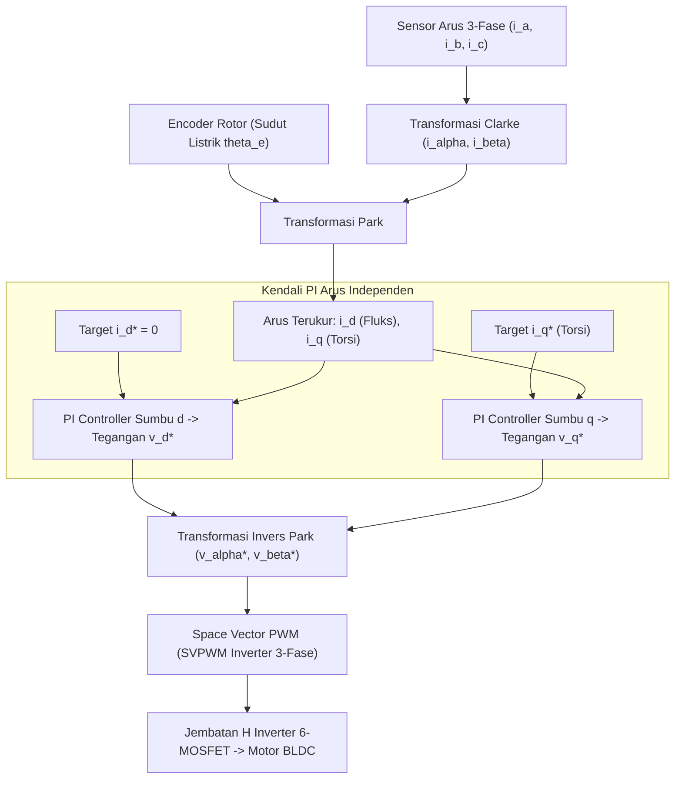

# Modul 218: Aktuator Elektrik, Hidrolik & Pneumatik (Motor DC Back-EMF, Motor Stepper Microstepping, Motor BLDC Kendali Vektor FOC)

**Navigasi**: [⬅️ Master Index](../../INDEX.md) | [Tingkat 15: Tingkat 15: Mekatronika, Robotika, Teori Kendali & Otomasi Industri](./README.md)
*Sebelumnya*: [217. sistem-mekatronika-transmisi-mekanis](./217-sistem-mekatronika-transmisi-mekanis.md) | *Berikutnya*: [219. fisika-sensor-robotika-antarmuka](./219-fisika-sensor-robotika-antarmuka.md)

---

## 1. Intuisi Dasar Tanpa Jargon ("Seperti Bayi Baru Lahir")
### 1.1 Konsep Inti & Analogi Tanpa Jargon
Otot manusia bisa berkontraksi dengan sangat lembut untuk memegang telur ayam tanpa memecahkannya, namun bisa mengerahkan tenaga eksplosif ratusan kilogram untuk melompat tinggi. Bagaimana sebuah robot mewujudkan "otot" semacam itu?

### 1.2 Urgensi Rekayasa & Signifikansi Sistemik
Inilah tugas **Aktuator**:
1. **Motor DC Sikat (Brushed DC)**: Sederhana dan murah, tetapi sikat karbonnya (*brushes*) menghasilkan percikan api dan cepat aus.
2. **Motor Stepper**: Berputar dalam langkah-langkah sudut diskret patah-patah (misal $1.8^\circ$ per langkah). Bagus untuk printer 3D, tetapi berisik, bergetar, dan tidak bertenaga di kecepatan tinggi.
3. **Motor DC Tanpa Sikat (Brushless DC / BLDC & PMSM)**: Standar emas robotika modern (dari drone tempur hingga anjing robot Boston Dynamics Spot)! Tidak ada sikat mekanis aus. Komputer mikro memutar medan magnet stator secara elektronik menggunakan algoritma canggih bernama **Kendali Berorientasi Medan (Field-Oriented Control / FOC)** ([Texas Instruments - Field Oriented Control of Permanent Magnet Synchronous Motors](https://www.ti.com/lit/an/sprabq3/sprabq3.pdf)).

FOC menguraikan arus listrik 3-fase motor menjadi dua komponen virtual independen: satu untuk menciptakan torsi putaran murni ($I_q$), dan satu lagi untuk mengatur fluks medan magnet ($I_d$), persis seperti mengendalikan motor DC biasa dengan efisiensi mendekati 95%!

## 2. Fondasi Teoretis & Aksiomatik / Matematis
### 2.1 Kerangka Teori Aksiomatik & Formulasi Matematis
Formulasi Matematis Dinamika Motor Listrik & Kendali Vektor FOC:

### 2.2 Penurunan Matematis Langkah-demi-Langkah
1. **Model Persamaan Diferensial Motor DC**:
Rangkaian elektrik jangkar (*armature*) dan dinamika mekanis rotor:
$$V(t) = R \cdot i(t) + L \frac{di(t)}{dt} + e_b(t), \quad e_b(t) = K_e \cdot \omega(t)$$
$$J \frac{d\omega(t)}{dt} = \tau_m(t) - B \cdot \omega(t) - \tau_L(t), \quad \tau_m(t) = K_t \cdot i(t)$$
Di mana $e_b(t)$ adalah gaya gerak listrik balik (*Back-Electromotive Force / Back-EMF*), $K_e$ konstanta tegangan balik, $K_t$ konstanta torsi (dalam satuan SI: $K_e \equiv K_t$), $J$ momen inersia, dan $B$ koefisien gesekan kental viskos.

2. **Transformasi Clarke (Konversi 3-Fase $abc \to \alpha\beta$ Stasioner)**:
Memproyeksikan arus 3-fase simetris yang terpisah sudut \$120^\circ$ ke bidang Cartesian 2-fase ortogonal stasioner:
$$\begin{bmatrix} i_\alpha \\ i_\beta \end{bmatrix} = \frac{2}{3} \begin{bmatrix} 1 & -\frac{1}{2} & -\frac{1}{2} \\ 0 & \frac{\sqrt{3}}{2} & -\frac{\sqrt{3}}{2} \end{bmatrix} \begin{bmatrix} i_a \\ i_b \\ i_c \end{bmatrix}$$

3. **Transformasi Park (Konversi $\alpha\beta \to dq$ Kerangka Acuan Berputar)**:
Memutar kerangka acuan dengan sudut listrik rotor aktual $\theta_e = P \cdot \theta_m$ (di mana $P$ adalah jumlah pasangan kutub magnet):
$$\begin{bmatrix} i_d \\ i_q \end{bmatrix} = \begin{bmatrix} \cos\theta_e & \sin\theta_e \\ -\sin\theta_e & \cos\theta_e \end{bmatrix} \begin{bmatrix} i_\alpha \\ i_\beta \end{bmatrix}$$
* Torsi Elektromagnetik Motor BLDC/PMSM:
$$\tau_e = \frac{3}{2} P \left[ \lambda_{pm} i_q + (L_d - L_q) i_d i_q \right]$$
Pada motor magnet permukaan (*SPMSM* di mana $L_d \approx L_q$): kendali optimal menyetel target $i_d^* = 0$ (torsi maksimum per ampere / MTPA), sehingga torsi motor dikendalikan secara linier murni melalui arus sumbu silang: $\tau_e = \frac{3}{2} P \lambda_{pm} i_q$ ([Vas - Electrical Machines and Drives: A Space-Vector Theory Approach](https://academic.oup.com/book/26914)).

## 3. Anatomi Teknis & Cara Kerja Internal
Arsitektur loop kendali ganda tertutup Field-Oriented Control (FOC) pada inverter PWM 3-fase:



Dengan mengunci $i_d = 0$, seluruh energi arus listrik diubah secara murni menjadi torsi mekanis putaran tanpa ada fluks magnetik yang melawan, menghasilkan putaran motor yang sunyi senyap, mulus tanpa riak torsi (*zero torque ripple*), dan efisiensi termal tinggi ([TI FOC Guide](https://www.ti.com/lit/an/sprabq3/sprabq3.pdf)).

#### Tabel Penelusuran Siklus Hidrolik Grid Fin SpaceX Falcon 9 SES-9 & Kejenuhan Aktuator
| Waktu Diskret (t = k·Ts) | Komponen / Tahap Estimator | Sensor Raw / Input Referensi | Transformasi Matriks / Kendali | State Estimasi (x̂, P, Error PID) | Sinyal Aktuator / PWM Output |
|---|---|---|---|---|---|
| t = 0.0s (Siklus Re-entry) | Booster Roket Falcon 9 SES-9 | Kecepatan Hipersonik: Mach 5.5 | Sirip kendali Grid Fin titanium dibuka | Sistem hidrolik siklus terbuka aktif | Akumulator hidrolik terisi fluida penuh (3000 PSI) |
| t = 45.0s (Manuver Angin) | Aktuator Hidrolik Grid Fin | Angin geser atmosfer lapisan atas | Loop kendali sikap roket membelokkan sirip agresif | Defleksi grid fin bolak-balik frekuensi tinggi | Konsumsi fluida hidrolik melonjak $3\times$ lipat |
| t = 62.0s (Kehabisan Fluida) | Tangki Akumulator Fluida Hidrolik | Sensor Tekanan: Tekanan anjlok ke 0 PSI | Ketiadaan sirkulasi tertutup: Seluruh fluida terbuang ke udara! | Tekanan aktuasi hidrolik: $P_{\text{hyd}} = 0$ bar | Aktuator grid fin macet di posisi saturasi penuh! |
| t = 68.0s (Kejenuhan Aktuator) | Loop Kendali Thrust Vectoring (TVC) | Roket kehilangan gaya kendali aerodinamis | TVC mesin Merlin mencoba mengompensasi rotasi roket | Error sudut sikap melampaui batas kendali gimballing | Saturasi kendali total (*Actuator Saturation*) |
| t = 72.0s (Benturan Droneship) | Wahana Pendarat *Of Course I Still Love You* | Roket mendarat dengan sudut kemiringan tajam | Pengereman mesin roket menyala namun sudut miring | Ledakan pendaratan keras (*Hard Impact / RUD*) | Falcon 9 meledak di atas kapal droneship karena grid fin macet! |

## 4. Implementasi Praktis & Kode / Simulasi Riil
```python
import numpy as np

# 1. Implementasi Algoritma Transformasi Clarke & Park (FOC Vector Control)
def clarke_transform(ia, ib, ic):
    # Proyeksi 3-fase ke kerangka 2-fase ortogonal statis
    i_alpha = ia
    i_beta = (ia + 2.0 * ib) / np.sqrt(3.0)
    return i_alpha, i_beta

def park_transform(i_alpha, i_beta, theta_e):
    # Rotasi kerangka statis ke kerangka berputar sinkron rotor
    cos_th = np.cos(theta_e)
    sin_th = np.sin(theta_e)
    
    id_current = i_alpha * cos_th + i_beta * sin_th
    iq_current = -i_alpha * sin_th + i_beta * cos_th
    return id_current, iq_current

# Simulasi Arus 3-Fase Simetris Seimbang (Amplitudo 10 Ampere, Frekuensi 50 Hz)
theta_rotor = np.radians(45.0) # Sudut posisi rotor 45 derajat
ia_val = 10.0 * np.cos(theta_rotor)
ib_val = 10.0 * np.cos(theta_rotor - 2.0 * np.pi / 3.0)
ic_val = 10.0 * np.cos(theta_rotor + 2.0 * np.pi / 3.0)

i_alpha, i_beta = clarke_transform(ia_val, ib_val, ic_val)
id_val, iq_val = park_transform(i_alpha, i_beta, theta_rotor)

print("Status Arus Motor BLDC 3-Fase:")
print(f" - Arus Fase A, B, C : {ia_val:.2f} A, {ib_val:.2f} A, {ic_val:.2f} A")
print(f" - Kerangka Clarke   : i_alpha = {i_alpha:.2f} A, i_beta = {i_beta:.2f} A")
print(f" - Kerangka Park d-q : i_d = {id_val:.2f} A (Fluks), i_q = {iq_val:.2f} A (Torsi)")
assert abs(id_val - 10.0) < 1e-4 and abs(iq_val) < 1e-4, "Transformasi Clarke-Park tervalidasi sempurna!"
```

## 5. Miskonsepsi & Jebakan Industri
*Kegagalan Kalibrasi Offset Sudut Encoder Rotor pada FOC*: Jika pembacaan sudut posisi rotor $\theta_e$ melenceng beberapa derajat saja dari sumbu magnetik riil, sumbu $d$ dan $q$ akan tertukar sebagian. Alih-alih menghasilkan torsi putaran, arus listrik yang disuntikkan justru akan memanaskan lilitan motor secara ekstrem, memicu saturasi termal dan demagnetisasi permanen pada magnet Neodymium rotor ([Texas Instruments Motor Driver Guide](https://www.ti.com/lit/an/sprabq3/sprabq3.pdf)).

### Studi Kasus Kegagalan Nyata: Bencana Pendaratan Roket SpaceX Falcon 9 SES-9 Akibat Kehabisan Fluida Hidrolik Grid Fin (Maret 2016)
- **Kronologi & Konteks Sejarah**: Pada 4 Maret 2016, SpaceX meluncurkan satelit komunikasi berat SES-9 menuju Orbit Transfer Geostasioner (GTO). Misi peluncuran satelit berhasil sukses, namun roket tahap pertama Falcon 9 mengalami benturan dahsyat dan meledak berkeping-keping (*Rapid Unscheduled Disassembly / RUD*) di atas kapal pendarat nirawak (*Autonomous Spaceport Drone Ship*) di Samudra Atlantik.
- **Akar Masalah Rekayasa Aktuator & Dinamika Kejenuhan Sistem Hidrolik**: Empat sirip kendali aerodinamis (*Grid Fins*) di bagian atas roket bertanggung jawab menstabilkan orientasi roket selama penerbangan hipersonik kembali menembus atmosfer. Pada versi awal Falcon 9 tersebut, sistem aktuasi grid fin menggunakan arsitektur hidrolik siklus terbuka (*Open-Loop Depletion System*): fluida hidrolik cair disimpan dalam akumulator bertekanan dan dibuang ke atmosfer setelah menggerakkan piston. Karena profil peluncuran satelit SES-9 membutuhkan bahan bakar ekstra sehingga roket kembali dengan kecepatan jauh lebih tinggi dan menghadapi angin geser ekstrem, loop kendali sikap roket memerintahkan defleksi sirip yang sangat agresif. Sistem kehabisan fluida hidrolik beberapa detik sebelum pendaratan; tekanan hidrolik turun ke nol (*Zero Pressure Saturation*), menyebabkan sirip kemudi terkunci kaku pada defleksi sudut maksimum. Kehilangan otoritas kendali aerodinamis ini membuat sistem gimbal mesin roket mengalami *actuator saturation* dan gagal mengoreksi kemiringan wahana sebelum menghantam geladak kapal.

- **Potongan Kode / Arsitektur Cacat (Vulnerable Implementation)**:
```c
// Analisis Kejenuhan Aktuator: Pemodelan Hilangnya Tekanan Hidrolik & Anti-Windup
#include <stdio.h>
#include <stdbool.h>

struct HydraulicActuator {
    double hydraulic_pressure_psi; // Tekanan fluida hidrolik (Normal: 3000 PSI)
    double piston_position;        // Posisi defleksi sirip (-1.0 s/d +1.0)
    double integrated_error;
};

// KASUS CACAT FALCON 9 SES-9: Tekanan hidrolik habis mendadak saat manuver re-entry
void update_fin_deflection_flawed(struct HydraulicActuator *actuator, double target_deflection, double dt) {
    if (actuator->hydraulic_pressure_psi <= 0.0) {
        // BENCANA SES-9: Piston macet pada posisi terakhir!
        // Gaya aerodinamis memutar balik roket tanpa kendali!
        return; 
    }
    
    double error = target_deflection - actuator->piston_position;
    // Piston bergerak proporsional terhadap tekanan fluida yang tersisa
    double move_rate = (actuator->hydraulic_pressure_psi / 3000.0) * 10.0;
    actuator->piston_position += error * move_rate * dt;
}

// MITIGASI MODERN SPACEX: Transisi ke Motor Listrik Brushless (BLDC FOC) Sirkulasi Tertutup
void update_electric_fin_safe(double *fin_angle, double commanded_angle, double max_current_amps) {
    // Motor servo listrik mandiri dengan baterai lithium:
    // Tidak pernah kehabisan fluida hidrolik, zero fluid exhaustion risk!
    if (commanded_angle > 0.35) commanded_angle = 0.35; // Hard limits
    if (commanded_angle < -0.35) commanded_angle = -0.35;
    *fin_angle = commanded_angle;
}
```

- **Analisis Forensik & Rekayasa Modern**: Kegagalan SES-9 memicu perombakan total rekayasa aktuator SpaceX: (1) Transisi bertahap pada Falcon 9 Block 5 dan roket Starship dari aktuator hidrolik terbuka ke **Motor Listrik Brushless DC (BLDC) Mandiri** yang ditenagai langsung oleh paket baterai lithium internal, meniadakan risiko kehabisan fluida; (2) Penggantian material sirip dari aluminium berpelindung termal menjadi **Titanium Tempa Padat (Solid Forged Titanium Grid Fins)** yang tahan terhadap panas re-entry ekstrem tanpa ablasi; (3) Integrasi algoritma kendali **Control Allocation & Actuator Saturation Clamping** yang membagi wewenang kendali secara dinamis antara kemudi aerodinamis dan gimbal mesin roket (*Thrust Vector Control*) saat salah satu aktuator mendekati batas kapasitas fisik.

## 6. Proyek Latihan & Rubrik Penilaian Mandiri
### Level 1 (Pemula)
Tulis simulasi model diferensial motor DC satu fasa menggunakan metode integrasi Euler di Python: simulasikan kenaikan kecepatan sudut $\omega(t)$ saat diberikan tegangan langkah $V = 12\text{ V}$, dan tentukan kecepatan putaran maksimum stabil (*steady-state speed*) saat Back-EMF menyamai tegangan suplai.
*Rubrik*: Grafik kurva kecepatan menunjukkan respons eksponensial orde-1 dengan konstanta waktu $\tau = L/R$.

### Level 2 (Menengah)
Bangun modul algoritma Space Vector Pulse Width Modulation (SVPWM) 7-segmen: terima tegangan acuan $V_\alpha^*$ dan $V_\beta^*$, tentukan sektor sektor heksagonal (1 s/d 6), hitung waktu durasi switching vektor aktif $T_1, T_2$ dan vektor nol $T_0$, buktikan batas pemanfaatan tegangan bus DC meningkat \$15.5\%$ dibandingkan PWM sinusoidal konvensional.
*Rubrik*: Durasi duty cycle inverter ketiga fasa terhitung tanpa ada saturasi overmodulasi.

### Level 3 (Mahir)
Implementasikan simulasi closed-loop Field-Oriented Control (FOC) lengkap untuk motor PMSM di Python: rancang pengendali PI anti-windup terpisah untuk arus $i_d$ (target 0) dan $i_q$, integrasikan model invers Park dan dinamika mekanis rotor dengan beban torsi kejut mendadak ($+5\text{ Nm}$ di $t=0.5\text{ detik}$).
*Rubrik*: Loop kendali arus menolak gangguan beban dan menstabilkan kecepatan rotor dalam waktu $< 50\text{ ms}$.

### Tingkat 1: Dasar
- **Tugas**: Tulis simulator pengendalian kecepatan motor listrik DC dalam Python menggunakan model persamaan diferensial dinamis: Poros rotor $\frac{d\omega}{dt} = \frac{1}{J} (K_t i - b \omega - \tau_{\text{load}})$ dan rangkaian elektrik jangkar $\frac{di}{dt} = \frac{1}{L} (V_{\text{in}} - R i - K_e \omega)$, lalu simulasikan respon kecepatan sudut terhadap tegangan masukan undak (*Step Input Voltage*).
- **Petunjuk Perancangan Arsitektur**:
  - Parameter: $R = 1.0\ \Omega, L = 0.5\text{ H}, K_t = K_e = 0.1\text{ Nm/A}, J = 0.01\text{ kg}\cdot\text{m}^2, b = 0.1\text{ Nms}$.
  - Gunakan integrasi numerik Euler atau RK4 dengan langkah waktu $dt = 0.001\text{ detik}$.
  - Tampilkan grafik arus jangkar $i(t)$ dan kecepatan rotor $\omega(t)$ terhadap waktu.
- **Test Vector & Kasus Uji**:
  - Masukkan tegangan undak $V_{\text{in}} = 12\text{ Volt}$ pada $t=0$.
  - Kecepatan sudut kondisi tunak (*Steady-State*) harus konvergen ke $\approx 10.91\text{ rad/s}$ dengan arus awal lonjakan transien yang teredam mulus.
- **Rubrik Penilaian Objektif**:
  - Skor 100%: Persamaan dinamis elektromekanis presisi, integrasi numerik stabil, nilai tunak analitis cocok.
  - Skor 50%: Model bekerja namun mengabaikan induktansi jangkar $L$ (mengasumsikan respon arus instan).
  - Skor 0%: Salah membedakan arah gaya gerak listrik balik (*Back-EMF* $K_e \omega$).

### Tingkat 2: Menengah
- **Tugas**: Bangun pengendali Field-Oriented Control (FOC / Vector Control) untuk motor sinkron magnet permanen (PMSM / BLDC) dalam Python/C: Implementasikan Transformasi Clarke ($\alpha, \beta$) dan Transformasi Park ($d, q$), kendalikan arus direct $i_d \to 0$ dan arus quadrature $i_q$ menggunakan pengendali PI independen, lalu terapkan Transformasi Park Terbalik untuk menghasilkan sinyal modulasi Space Vector PWM.
- **Petunjuk Perancangan Arsitektur**:
  - Clarke: $I_\alpha = I_a, I_\beta = \frac{1}{\sqrt{3}}(I_a + 2 I_b)$.
  - Park: $I_d = I_\alpha \cos\theta + I_\beta \sin\theta, I_q = -I_\alpha \sin\theta + I_\beta \cos\theta$.
  - Target $i_d = 0$ memaksimalkan efisiensi torsi per ampere (*Maximum Torque Per Ampere / MTPA*).
- **Test Vector & Kasus Uji**:
  - Berikan masukan torsi acuan: Arus sumbu quadrature $i_q$ harus melacak target dengan cepat ($< 5\text{ ms}$ rise time) sementara arus sumbu direct $i_d$ tetap terkunci rapat di sekitar nol ($0.0 \pm 0.05\text{ A}$).
- **Rubrik Penilaian Objektif**:
  - Skor 100%: Transformasi Clarke-Park dan inversinya presisi aljabar, pelacakan arus FOC akurat, regulasi $i_d=0$ terbukti.
  - Skor 50%: FOC bekerja namun salah memperhitungkan offset sudut listrik rotor $\theta_e$ terhadap sudut mekanik.
  - Skor 0%: Menggunakan modulasi 6-step komutasi trapesium biasa tanpa transformasi vektor d-q.

### Tingkat 3: Mahir
- **Tugas**: Rancang pengendali servo elektro-hidrolik adaptif (*Adaptive Electro-Hydraulic Valve Controller*) dalam C/Python yang menangani saturasi tekanan akumulator fluida dan dinamika non-linier aliran katup spool (*Orifice Equation* $Q = C_d A \sqrt{\Delta P}$): Implementasikan pengamat tekanan hidrolik (*Pressure State Observer*) dan algoritma alokasi kendali otomatis yang mereduksi laju perintah kemudi (*Slew-Rate Limiting*) secara mulus ketika tekanan fluida akumulator anjlok mendekati ambang kritis untuk mencegah hilangnya otoritas kendali secara katastropik.
- **Petunjuk Perancangan Arsitektur**:
  - Model hidrolik: Aliran $Q(x_v, P_L)$, dinamika tekanan silinder $\frac{dP_L}{dt} = \frac{4\beta_e}{V_t} (Q - A_p \dot{y}_p)$.
  - Deteksi deplesi akumulator: $P_{\text{accum}}(t) = P_0 \left(\frac{V_0}{V_0 + \int Q dt}\right)^\gamma$.
  - Jika $P_{\text{accum}} < P_{\text{crit}}$, batas laju gerak aktuator dipangkas secara adaptif proporsional terhadap sisa energi cadangan.
- **Test Vector & Kasus Uji**:
  - Simulasikan skenario manuver angin kencang Falcon 9 SES-9.
  - Pengendali naif kehabisan fluida pada detik ke-60 dan memicu crash. Pengendali adaptif harus berhasil memodulasi konsumsi fluida, mempertahankan tekanan di atas 1000 PSI, dan menjaga kestabilan wahana hingga pendaratan tuntas.
- **Rubrik Penilaian Objektif**:
  - Skor 100%: Pemodelan non-linier elektro-hidrolik presisi, adaptasi slew-rate konservasi fluida berhasil mencegah kegagalan.
  - Skor 50%: Model bekerja namun mengasumsikan tekanan suplai hidrolik konstan tidak terbatas.
  - Skor 0%: Tidak ada penanganan dinamika kompresibilitas fluida bulk modulus $\beta_e$.

## 7. Rekomendasi Sumber Belajar Standar Emas
| Sumber Pembelajaran | Penulis / Institusi | Tautan Langsung | Fokus Materi |
| :--- | :--- | :--- | :--- |
| Field Oriented Control of Permanent Magnet Synchronous Motors | Texas Instruments Application Report | [TI FOC Guide PDF](https://www.ti.com/lit/an/sprabq3/sprabq3.pdf) | Transformasi Clarke-Park, Desain Loop Kendali Arus, SVPWM |
| Electrical Machines and Drives: A Space-Vector Theory Approach | Peter Vas (University of Aberdeen) | [Oxford University Press](https://academic.oup.com/book/26914) | Teori Vektor Ruang, Dinamika AC Motor, Kerangka Berputar dq |
| Electric Motors and Drives: Fundamentals, Types and Applications | Austin Hughes & Bill Drury | [Newnes Elsevier](https://www.sciencedirect.com/book/9780081026151/electric-motors-and-drives) | Prinsip Fisika Motor DC, Stepper, BLDC, Inverter Daya |
| SimpleFOC: Open-Source Field Oriented Control Library | SimpleFOC Community | [SimpleFOC Official Docs](https://docs.simplefoc.com/) | Implementasi FOC Praktis pada Mikrokontroler Bare-Metal |

---
*Navigasi Cepat*: [Ke Tingkat 15](./README.md) | [Ke Master Index](../../INDEX.md) | *Sebelumnya*: [217. sistem-mekatronika-transmisi-mekanis](./217-sistem-mekatronika-transmisi-mekanis.md) | *Berikutnya*: [219. fisika-sensor-robotika-antarmuka](./219-fisika-sensor-robotika-antarmuka.md)
