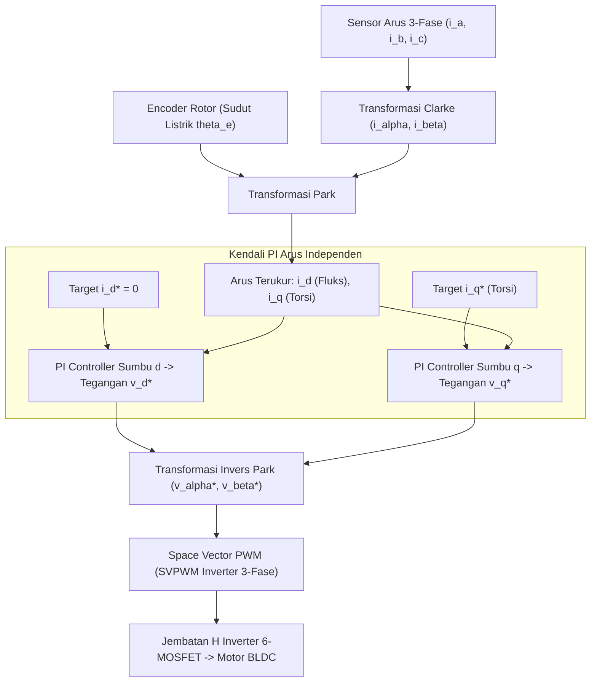

# Modul 218: Aktuator Elektrik, Hidrolik & Pneumatik (Motor DC Back-EMF, Motor Stepper Microstepping, Motor BLDC Kendali Vektor FOC)

**Navigasi**: [⬅️ Master Index](../../INDEX.md) | [Tingkat 15: Tingkat 15: Mekatronika, Robotika, Teori Kendali & Otomasi Industri](./README.md)
*Sebelumnya*: [217. sistem-mekatronika-transmisi-mekanis](./217-sistem-mekatronika-transmisi-mekanis.md) | *Berikutnya*: [219. fisika-sensor-robotika-antarmuka](./219-fisika-sensor-robotika-antarmuka.md)

---

## 1. Intuisi Dasar Tanpa Jargon ("Seperti Bayi Baru Lahir")
Otot manusia bisa berkontraksi dengan sangat lembut untuk memegang telur ayam tanpa memecahkannya, namun bisa mengerahkan tenaga eksplosif ratusan kilogram untuk melompat tinggi. Bagaimana sebuah robot mewujudkan "otot" semacam itu?

Inilah tugas **Aktuator**:
1. **Motor DC Sikat (Brushed DC)**: Sederhana dan murah, tetapi sikat karbonnya (*brushes*) menghasilkan percikan api dan cepat aus.
2. **Motor Stepper**: Berputar dalam langkah-langkah sudut diskret patah-patah (misal $1.8^\circ$ per langkah). Bagus untuk printer 3D, tetapi berisik, bergetar, dan tidak bertenaga di kecepatan tinggi.
3. **Motor DC Tanpa Sikat (Brushless DC / BLDC & PMSM)**: Standar emas robotika modern (dari drone tempur hingga anjing robot Boston Dynamics Spot)! Tidak ada sikat mekanis aus. Komputer mikro memutar medan magnet stator secara elektronik menggunakan algoritma canggih bernama **Kendali Berorientasi Medan (Field-Oriented Control / FOC)** ([Texas Instruments - Field Oriented Control of Permanent Magnet Synchronous Motors](https://www.ti.com/lit/an/sprabq3/sprabq3.pdf)).

FOC menguraikan arus listrik 3-fase motor menjadi dua komponen virtual independen: satu untuk menciptakan torsi putaran murni ($I_q$), dan satu lagi untuk mengatur fluks medan magnet ($I_d$), persis seperti mengendalikan motor DC biasa dengan efisiensi mendekati 95%!

## 2. Fondasi Teoretis & Aksiomatik / Matematis
Formulasi Matematis Dinamika Motor Listrik & Kendali Vektor FOC:

1. **Model Persamaan Diferensial Motor DC**:
Rangkaian elektrik jangkar (*armature*) dan dinamika mekanis rotor:
$$V(t) = R \cdot i(t) + L \frac{di(t)}{dt} + e_b(t), \quad e_b(t) = K_e \cdot \omega(t)$$
$$J \frac{d\omega(t)}{dt} = \tau_m(t) - B \cdot \omega(t) - \tau_L(t), \quad \tau_m(t) = K_t \cdot i(t)$$
Di mana $e_b(t)$ adalah gaya gerak listrik balik (*Back-Electromotive Force / Back-EMF*), $K_e$ konstanta tegangan balik, $K_t$ konstanta torsi (dalam satuan SI: $K_e \equiv K_t$), $J$ momen inersia, dan $B$ koefisien gesekan kental viskos.

2. **Transformasi Clarke (Konversi 3-Fase $abc \to \alpha\beta$ Stasioner)**:
Memproyeksikan arus 3-fase simetris yang terpisah sudut $120^\circ$ ke bidang Cartesian 2-fase ortogonal stasioner:
$$\begin{bmatrix} i_\alpha \\ i_\beta \end{bmatrix} = \frac{2}{3} \begin{bmatrix} 1 & -\frac{1}{2} & -\frac{1}{2} \\ 0 & \frac{\sqrt{3}}{2} & -\frac{\sqrt{3}}{2} \end{bmatrix} \begin{bmatrix} i_a \\ i_b \\ i_c \end{bmatrix}$$

3. **Transformasi Park (Konversi $\alpha\beta \to dq$ Kerangka Acuan Berputar)**:
Memutar kerangka acuan dengan sudut listrik rotor aktual $\theta_e = P \cdot \theta_m$ (di mana $P$ adalah jumlah pasangan kutub magnet):
$$\begin{bmatrix} i_d \\ i_q \end{bmatrix} = \begin{bmatrix} \cos\theta_e & \sin\theta_e \\ -\sin\theta_e & \cos\theta_e \end{bmatrix} \begin{bmatrix} i_\alpha \\ i_\beta \end{bmatrix}$$
* Torsi Elektromagnetik Motor BLDC/PMSM:
$$\tau_e = \frac{3}{2} P \left[ \lambda_{pm} i_q + (L_d - L_q) i_d i_q \right]$$
Pada motor magnet permukaan (*SPMSM* di mana $L_d \approx L_q$): kendali optimal menyetel target $i_d^* = 0$ (torsi maksimum per ampere / MTPA), sehingga torsi motor dikendalikan secara linier murni melalui arus sumbu silang: $\tau_e = \frac{3}{2} P \lambda_{pm} i_q$ ([Vas - Electrical Machines and Drives: A Space-Vector Theory Approach](https://academic.oup.com/book/26914)).

## 3. Anatomi Teknis & Cara Kerja Internal
Arsitektur loop kendali ganda tertutup Field-Oriented Control (FOC) pada inverter PWM 3-fase:



Dengan mengunci $i_d = 0$, seluruh energi arus listrik diubah secara murni menjadi torsi mekanis putaran tanpa ada fluks magnetik yang melawan, menghasilkan putaran motor yang sunyi senyap, mulus tanpa riak torsi (*zero torque ripple*), dan efisiensi termal tinggi ([TI FOC Guide](https://www.ti.com/lit/an/sprabq3/sprabq3.pdf)).

## 4. Implementasi Praktis & Kode / Simulasi Riil
```python
import numpy as np

# 1. Implementasi Algoritma Transformasi Clarke & Park (FOC Vector Control)
def clarke_transform(ia, ib, ic):
    # Proyeksi 3-fase ke kerangka 2-fase ortogonal statis
    i_alpha = ia
    i_beta = (ia + 2.0 * ib) / np.sqrt(3.0)
    return i_alpha, i_beta

def park_transform(i_alpha, i_beta, theta_e):
    # Rotasi kerangka statis ke kerangka berputar sinkron rotor
    cos_th = np.cos(theta_e)
    sin_th = np.sin(theta_e)
    
    id_current = i_alpha * cos_th + i_beta * sin_th
    iq_current = -i_alpha * sin_th + i_beta * cos_th
    return id_current, iq_current

# Simulasi Arus 3-Fase Simetris Seimbang (Amplitudo 10 Ampere, Frekuensi 50 Hz)
theta_rotor = np.radians(45.0) # Sudut posisi rotor 45 derajat
ia_val = 10.0 * np.cos(theta_rotor)
ib_val = 10.0 * np.cos(theta_rotor - 2.0 * np.pi / 3.0)
ic_val = 10.0 * np.cos(theta_rotor + 2.0 * np.pi / 3.0)

i_alpha, i_beta = clarke_transform(ia_val, ib_val, ic_val)
id_val, iq_val = park_transform(i_alpha, i_beta, theta_rotor)

print("Status Arus Motor BLDC 3-Fase:")
print(f" - Arus Fase A, B, C : {ia_val:.2f} A, {ib_val:.2f} A, {ic_val:.2f} A")
print(f" - Kerangka Clarke   : i_alpha = {i_alpha:.2f} A, i_beta = {i_beta:.2f} A")
print(f" - Kerangka Park d-q : i_d = {id_val:.2f} A (Fluks), i_q = {iq_val:.2f} A (Torsi)")
assert abs(id_val - 10.0) < 1e-4 and abs(iq_val) < 1e-4, "Transformasi Clarke-Park tervalidasi sempurna!"
```

## 5. Miskonsepsi & Jebakan Industri
*Kegagalan Kalibrasi Offset Sudut Encoder Rotor pada FOC*: Jika pembacaan sudut posisi rotor $\theta_e$ melenceng beberapa derajat saja dari sumbu magnetik riil, sumbu $d$ dan $q$ akan tertukar sebagian. Alih-alih menghasilkan torsi putaran, arus listrik yang disuntikkan justru akan memanaskan lilitan motor secara ekstrem, memicu saturasi termal dan demagnetisasi permanen pada magnet Neodymium rotor ([Texas Instruments Motor Driver Guide](https://www.ti.com/lit/an/sprabq3/sprabq3.pdf)).

## 6. Proyek Latihan & Rubrik Penilaian Mandiri
### Level 1 (Pemula)
Tulis simulasi model diferensial motor DC satu fasa menggunakan metode integrasi Euler di Python: simulasikan kenaikan kecepatan sudut $\omega(t)$ saat diberikan tegangan langkah $V = 12\text{ V}$, dan tentukan kecepatan putaran maksimum stabil (*steady-state speed*) saat Back-EMF menyamai tegangan suplai.
*Rubrik*: Grafik kurva kecepatan menunjukkan respons eksponensial orde-1 dengan konstanta waktu $\tau = L/R$.

### Level 2 (Menengah)
Bangun modul algoritma Space Vector Pulse Width Modulation (SVPWM) 7-segmen: terima tegangan acuan $V_\alpha^*$ dan $V_\beta^*$, tentukan sektor sektor heksagonal (1 s/d 6), hitung waktu durasi switching vektor aktif $T_1, T_2$ dan vektor nol $T_0$, buktikan batas pemanfaatan tegangan bus DC meningkat $15.5\%$ dibandingkan PWM sinusoidal konvensional.
*Rubrik*: Durasi duty cycle inverter ketiga fasa terhitung tanpa ada saturasi overmodulasi.

### Level 3 (Mahir)
Implementasikan simulasi closed-loop Field-Oriented Control (FOC) lengkap untuk motor PMSM di Python: rancang pengendali PI anti-windup terpisah untuk arus $i_d$ (target 0) dan $i_q$, integrasikan model invers Park dan dinamika mekanis rotor dengan beban torsi kejut mendadak ($+5\text{ Nm}$ di $t=0.5\text{ detik}$).
*Rubrik*: Loop kendali arus menolak gangguan beban dan menstabilkan kecepatan rotor dalam waktu $< 50\text{ ms}$.

## 7. Rekomendasi Sumber Belajar Standar Emas
| Sumber Pembelajaran | Penulis / Institusi | Tautan Langsung | Fokus Materi |
| :--- | :--- | :--- | :--- |
| Field Oriented Control of Permanent Magnet Synchronous Motors | Texas Instruments Application Report | [TI FOC Guide PDF](https://www.ti.com/lit/an/sprabq3/sprabq3.pdf) | Transformasi Clarke-Park, Desain Loop Kendali Arus, SVPWM |
| Electrical Machines and Drives: A Space-Vector Theory Approach | Peter Vas (University of Aberdeen) | [Oxford University Press](https://academic.oup.com/book/26914) | Teori Vektor Ruang, Dinamika AC Motor, Kerangka Berputar dq |
| Electric Motors and Drives: Fundamentals, Types and Applications | Austin Hughes & Bill Drury | [Newnes Elsevier](https://www.sciencedirect.com/book/9780081026151/electric-motors-and-drives) | Prinsip Fisika Motor DC, Stepper, BLDC, Inverter Daya |
| SimpleFOC: Open-Source Field Oriented Control Library | SimpleFOC Community | [SimpleFOC Official Docs](https://docs.simplefoc.com/) | Implementasi FOC Praktis pada Mikrokontroler Bare-Metal |

---
*Navigasi Cepat*: [Ke Tingkat 15](./README.md) | [Ke Master Index](../../INDEX.md) | *Sebelumnya*: [217. sistem-mekatronika-transmisi-mekanis](./217-sistem-mekatronika-transmisi-mekanis.md) | *Berikutnya*: [219. fisika-sensor-robotika-antarmuka](./219-fisika-sensor-robotika-antarmuka.md)
