# Modul 219: Fisika Sensor Robotika & Antarmuka (Encoder Optik Kuadratur, IMU MEMS 6-DoF, Sensor Jarak LiDAR Point Cloud, Kamera RGB-D)

**Navigasi**: [⬅️ Master Index](../../INDEX.md) | [Tingkat 15: Tingkat 15: Mekatronika, Robotika, Teori Kendali & Otomasi Industri](./README.md)
*Sebelumnya*: [218. aktuator-elektrik-hidrolik-pneumatik](./218-aktuator-elektrik-hidrolik-pneumatik.md) | *Berikutnya*: [220. representasi-spasial-3d-kinematika](./220-representasi-spasial-3d-kinematika.md)

---

## 1. Intuisi Dasar Tanpa Jargon ("Seperti Bayi Baru Lahir")
Bagaimana seorang manusia bisa berjalan di dalam ruangan yang gelap gulita tanpa menabrak dinding? Tangan kita meraba-raba ke depan (sensor jarak), telinga dalam di kepala kita menjaga keseimbangan tubuh agar tidak limbung (sensor orientasi / vestibular), dan otot-otot kaki kita merasakan berapa langkah yang sudah diambil (sensor posisi persendian).

Bagi sebuah robot otonom, kumpulan indera tersebut diwujudkan oleh **Sensor Robotika**:
1. **Encoder Kuadratur Optik**: "Mata" mikro di poros motor yang menghitung setiap celah garis cahaya untuk mengetahui dengan presisi mikroskopis berapa putaran roda yang telah terjadi.
2. **Inertial Measurement Unit (IMU 6-DoF)**: Sensor silikon mikroskopis (**MEMS**) yang berisi akselerometer (mengukur gaya gravitasi dan percepatan) serta giroskop (mengukur kecepatan sudut putaran tubuh robot).
3. **LiDAR (Light Detection and Ranging)**: Menembakkan jutaan pulsa laser inframerah per detik ke segala arah dan menghitung waktu pantulannya kembali (**Time-of-Flight / ToF**), menciptakan awan titik 3D (**Point Cloud**) berpresisi tinggi dari seluruh ruangan di sekitarnya ([Siciliano & Khatib - Springer Handbook of Robotics](https://link.springer.com/book/10.1007/978-3-319-32552-1)).

## 2. Fondasi Teoretis & Aksiomatik / Matematis
Formulasi Fisika & Kalibrasi Sensor Robotika:

1. **Prinsip Time-of-Flight (ToF) Sensor LiDAR**:
Sebuah pemancar laser memancarkan pulsa foton cahaya pada kecepatan $c \approx 3 \times 10^8\text{ m/s}$. Jarak $d$ ke permukaan objek pemantul dihitung dari waktu tempuh bolak-balik $\Delta t$:
$$d = \frac{c \cdot \Delta t}{2}$$
Setiap titik dalam awan titik (*Point Cloud*) $\mathbf{p} = [x, y, z]^T$ dihitung dari jarak radial $r$, sudut azimuth horizontal $\theta$, dan sudut elevasi vertikal $\phi$:
$$x = r \cos\phi \cos\theta, \quad y = r \cos\phi \sin\theta, \quad z = r \sin\phi$$

2. **Model Galat Dinamika Sensor IMU MEMS (Akselerometer & Giroskop)**:
Pengukuran giroskop riil $\tilde{\omega}(t)$ dan akselerometer $\tilde{a}(t)$ terkorupsi oleh bias hanyut (*drift bias*) dan derau putih acak Gaussian:
$$\tilde{\omega}(t) = \omega(t) + b_g(t) + \eta_g(t), \quad \dot{b}_g(t) = \eta_{bg}(t)$$
$$\tilde{a}(t) = R^T (a(t) - g) + b_a(t) + \eta_a(t), \quad \dot{b}_a(t) = \eta_{ba}(t)$$
Di mana $g = [0, 0, -9.81]^T\text{ m/s}^2$ adalah vektor percepatan gravitasi, dan $b(t)$ mengikuti proses stokastik acak Brownian random-walk.

3. **Decoding Encoder Optik Kuadratur (Sinyal Kanal A & B)**:
Dua deret pulsa gelombang kotak terpisah fase sudut $90^\circ$ ($\frac{\pi}{2}$ rad).
Arah putaran ditentukan oleh transisi status logika bit:
* Jika Kanal A mendahului Kanal B (fase $+90^\circ$): Putaran Searah Jarum Jam (Clockwise / CW).
* Jika Kanal B mendahului Kanal A (fase $-90^\circ$): Putaran Berlawanan Jarum Jam (CCW).
Resolusi efektif meningkat $4\times$ via decoding transisi 4x (mendeteksi setiap tepi naik dan turun dari kedua kanal) ([Microchip Quadrature Encoder Manual](https://www.microchip.com/)).

## 3. Anatomi Teknis & Cara Kerja Internal
Arsitektur pemrosesan data sensor LiDAR Time-of-Flight (ToF) dan filter titik kotor (PCL):

```mermaid
flowchart LR
    LaserDiode["Laser Diode Array"] --> Mirror["Cermin Berputar 360 Derajat"]
    Mirror --> LaserBeam["Tembakan Laser Pulsa ToF (100.000 titik/detik)"]
    LaserBeam --> Photodiode["Detektor Avalanche Photodiode (APD)"]
    Photodiode --> TDC["Time-to-Digital Converter (Pikodetik Resolusi)"]
    TDC --> RawPoints["Raw Point Cloud XYZ + Intensitas Pantulan"]
    RawPoints --> VoxelFilter["Voxel Grid Downsampling Filter (PCL Library)"]
    VoxelFilter --> StatFilter["Statistical Outlier Removal Filter"]
    StatFilter --> CleanMap["Awan Titik 3D Bersih untuk Navigasi"]
```



Kalibrasi ekstrinsik (*Extrinsic Calibration*) menentukan matriks transformasi homogen transformasi spasial $T_{\text{camera}}^{\text{lidar}} \in SE(3)$ yang memproyeksikan setiap titik laser LiDAR ke bidang pixel sensor kamera RGB secara pixel-perfect ([Zhang & Pless - Extrinsic Calibration of a Camera and a 3D LiDAR](https://ieeexplore.ieee.org/document/1389810)).

## 4. Implementasi Praktis & Kode / Simulasi Riil
```python
import numpy as np

# 1. Konversi Koordinat Bola Sensor LiDAR (r, azimuth, elevation) ke Format Cartesian XYZ
def lidar_spherical_to_cartesian(ranges, azimuths_deg, elevations_deg):
    theta = np.radians(azimuths_deg)
    phi = np.radians(elevations_deg)
    
    x = ranges * np.cos(phi) * np.cos(theta)
    y = ranges * np.cos(phi) * np.sin(theta)
    z = ranges * np.sin(phi)
    
    point_cloud = np.column_stack([x, y, z])
    return point_cloud

# 2. Voxel Grid Filter Sederhana untuk Downsampling Point Cloud
def voxel_grid_downsample(points, voxel_size=0.1):
    # Hitung koordinat indeks grid voxel integer
    voxel_indices = np.floor(points / voxel_size).astype(int)
    
    # Kelompokkan titik yang berada dalam kotak voxel yang sama dan ambil rata-ratanya
    unique_voxels, inverse_indices = np.unique(voxel_indices, axis=0, return_inverse=True)
    downsampled_points = np.zeros((len(unique_voxels), 3))
    
    for i in range(len(unique_voxels)):
        downsampled_points[i] = np.mean(points[inverse_indices == i], axis=0)
        
    return downsampled_points

# Simulasi Pemindaian Laser LiDAR Sintetis
np.random.seed(42)
n_points = 1000
sim_ranges = np.random.uniform(2.0, 10.0, n_points)
sim_azimuths = np.random.uniform(-180, 180, n_points)
sim_elevations = np.random.uniform(-15, 15, n_points)

cloud_3d = lidar_spherical_to_cartesian(sim_ranges, sim_azimuths, sim_elevations)
filtered_cloud = voxel_grid_downsample(cloud_3d, voxel_size=0.5)

print(f"Jumlah Titik LiDAR Mentah : {len(cloud_3d)} titik")
print(f"Jumlah Titik Pasca-Voxel   : {len(filtered_cloud)} titik (Tereduksi rapi)")
print(f"Contoh Koordinat Titik 3D : X={filtered_cloud[0,0]:.2f}m, Y={filtered_cloud[0,1]:.2f}m, Z={filtered_cloud[0,2]:.2f}m")
```

## 5. Miskonsepsi & Jebakan Industri
*Akumulasi Galat Integrasi IMU (Drift Explosion)*: Menghitung posisi robot dengan mengintegrasikan sinyal akselerometer dua kali ($\iint a(t) dt^2$) tanpa referensi absolut luar (seperti GPS, roda encoder, atau visual landmark) adalah ilusi mematikan. Karena kesalahan bias kecil yang konstan terakumulasi secara kuadratik terhadap waktu ($e(t) \propto \frac{1}{2} b_a t^2$), estimasi posisi robot IMU akan melenceng hingga beberapa meter hanya dalam hitungan 10 detik! ([Woodman - An Introduction to Inertial Navigation](https://www.cl.cam.ac.uk/techreports/UCAM-CL-TR-696.pdf)).

## 6. Proyek Latihan & Rubrik Penilaian Mandiri
### Level 1 (Pemula)
Tulis mesin status *Quadrature Decoder* 4x di Python: terima urutan bit logika kanal A dan B pada setiap pulsa clock, tentukan apakah poros motor berputar CW atau CCW, dan perbarui nilai akumulator posisi sudut.
*Rubrik*: Menghasilkan 4 transisi hitungan untuk setiap siklus pulsa penuh.

### Level 2 (Menengah)
Bangun modul *Filter Komplementer (Complementary Filter)* di Python untuk mengestimasi sudut kemiringan pitch/roll robot beroda dua: gabungkan integrasi giroskop frekuensi tinggi dengan akselerometer frekuensi rendah menggunakan bobot:
$$\theta_t = \alpha (\theta_{t-1} + \omega \cdot \Delta t) + (1 - \alpha) \theta_{\text{acc}}, \quad \alpha \approx 0.98$$
*Rubrik*: Estimasi sudut kebal terhadap getaran jangka pendek akselerometer dan bebas hanyut giroskop.

### Level 3 (Mahir)
Implementasikan algoritma segmentasi bidang tanah (*RANSAC Ground Plane Segmentation*) untuk awan titik 3D LiDAR dari awal: pilih 3 titik acak secara iteratif untuk membuat persamaan bidang $ax + by + cz + d = 0$, hitung jarak ortogonal seluruh titik terhadap bidang, cari bidang dengan inlier terbanyak, dan pisahkan rintangan vertikal dari lantai tanah.
*Rubrik*: Mampu memisahkan permukaan jalan aspal dari objek mobil dan pohon dalam $< 50\text{ ms}$.

## 7. Rekomendasi Sumber Belajar Standar Emas
| Sumber Pembelajaran | Penulis / Institusi | Tautan Langsung | Fokus Materi |
| :--- | :--- | :--- | :--- |
| Springer Handbook of Robotics (2nd Ed.) | Bruno Siciliano & Oussama Khatib | [Springer Link Reference](https://link.springer.com/book/10.1007/978-3-319-32552-1) | Alkitab Sensorik Robotika, Persepsi LiDAR, Kamera RGB-D |
| An Introduction to Inertial Navigation | Oliver J. Woodman (University of Cambridge) | [Cambridge Tech Report](https://www.cl.cam.ac.uk/techreports/UCAM-CL-TR-696.pdf) | Analisis Galat IMU, Allan Variance, Dead-Reckoning Drift |
| Point Cloud Library (PCL) Architecture Guide | PCL Open Source Consortium | [PointClouds.org Portal](https://pointclouds.org/) | Algoritma Voxel Grid, Statistical Outlier, Estimasi Normal |
| Extrinsic Calibration of a Camera and a 3D LiDAR | Qilong Zhang & Robert Pless | [IEEE IROS Conference](https://ieeexplore.ieee.org/document/1389810) | Kalibrasi Spasial Fusi Sensor Kamera dan LiDAR |

---
*Navigasi Cepat*: [Ke Tingkat 15](./README.md) | [Ke Master Index](../../INDEX.md) | *Sebelumnya*: [218. aktuator-elektrik-hidrolik-pneumatik](./218-aktuator-elektrik-hidrolik-pneumatik.md) | *Berikutnya*: [220. representasi-spasial-3d-kinematika](./220-representasi-spasial-3d-kinematika.md)
