# Modul 219: Fisika Sensor Robotika & Antarmuka (Encoder Optik Kuadratur, IMU MEMS 6-DoF, Sensor Jarak LiDAR Point Cloud, Kamera RGB-D)

**Navigasi**: [⬅️ Master Index](../../INDEX.md) | [Tingkat 15: Tingkat 15: Mekatronika, Robotika, Teori Kendali & Otomasi Industri](./README.md)
*Sebelumnya*: [218. aktuator-elektrik-hidrolik-pneumatik](./218-aktuator-elektrik-hidrolik-pneumatik.md) | *Berikutnya*: [220. representasi-spasial-3d-kinematika](./220-representasi-spasial-3d-kinematika.md)

---

## 1. Intuisi Dasar Tanpa Jargon ("Seperti Bayi Baru Lahir")
### 1.1 Konsep Inti & Analogi Tanpa Jargon
Bagaimana seorang manusia bisa berjalan di dalam ruangan yang gelap gulita tanpa menabrak dinding? Tangan kita meraba-raba ke depan (sensor jarak), telinga dalam di kepala kita menjaga keseimbangan tubuh agar tidak limbung (sensor orientasi / vestibular), dan otot-otot kaki kita merasakan berapa langkah yang sudah diambil (sensor posisi persendian).

### 1.2 Urgensi Rekayasa & Signifikansi Sistemik
Bagi sebuah robot otonom, kumpulan indera tersebut diwujudkan oleh **Sensor Robotika**:
1. **Encoder Kuadratur Optik**: "Mata" mikro di poros motor yang menghitung setiap celah garis cahaya untuk mengetahui dengan presisi mikroskopis berapa putaran roda yang telah terjadi.
2. **Inertial Measurement Unit (IMU 6-DoF)**: Sensor silikon mikroskopis (**MEMS**) yang berisi akselerometer (mengukur gaya gravitasi dan percepatan) serta giroskop (mengukur kecepatan sudut putaran tubuh robot).
3. **LiDAR (Light Detection and Ranging)**: Menembakkan jutaan pulsa laser inframerah per detik ke segala arah dan menghitung waktu pantulannya kembali (**Time-of-Flight / ToF**), menciptakan awan titik 3D (**Point Cloud**) berpresisi tinggi dari seluruh ruangan di sekitarnya ([Siciliano & Khatib - Springer Handbook of Robotics](https://link.springer.com/book/10.1007/978-3-319-32552-1)).

## 2. Fondasi Teoretis & Aksiomatik / Matematis
### 2.1 Kerangka Teori Aksiomatik & Formulasi Matematis
Formulasi Fisika & Kalibrasi Sensor Robotika:

### 2.2 Penurunan Matematis Langkah-demi-Langkah
1. **Prinsip Time-of-Flight (ToF) Sensor LiDAR**:
Sebuah pemancar laser memancarkan pulsa foton cahaya pada kecepatan $c \approx 3 \times 10^8\text{ m/s}$. Jarak $d$ ke permukaan objek pemantul dihitung dari waktu tempuh bolak-balik $\Delta t$:
$$d = \frac{c \cdot \Delta t}{2}$$
Setiap titik dalam awan titik (*Point Cloud*) $\mathbf{p} = [x, y, z]^T$ dihitung dari jarak radial $r$, sudut azimuth horizontal $\theta$, dan sudut elevasi vertikal $\phi$:
$$x = r \cos\phi \cos\theta, \quad y = r \cos\phi \sin\theta, \quad z = r \sin\phi$$

2. **Model Galat Dinamika Sensor IMU MEMS (Akselerometer & Giroskop)**:
Pengukuran giroskop riil $\tilde{\omega}(t)$ dan akselerometer $\tilde{a}(t)$ terkorupsi oleh bias hanyut (*drift bias*) dan derau putih acak Gaussian:
$$\tilde{\omega}(t) = \omega(t) + b_g(t) + \eta_g(t), \quad \dot{b}_g(t) = \eta_{bg}(t)$$
$$\tilde{a}(t) = R^T (a(t) - g) + b_a(t) + \eta_a(t), \quad \dot{b}_a(t) = \eta_{ba}(t)$$
Di mana $g = [0, 0, -9.81]^T\text{ m/s}^2$ adalah vektor percepatan gravitasi, dan $b(t)$ mengikuti proses stokastik acak Brownian random-walk.

3. **Decoding Encoder Optik Kuadratur (Sinyal Kanal A & B)**:
Dua deret pulsa gelombang kotak terpisah fase sudut \$90^\circ$ ($\frac{\pi}{2}$ rad).
Arah putaran ditentukan oleh transisi status logika bit:
* Jika Kanal A mendahului Kanal B (fase $+90^\circ$): Putaran Searah Jarum Jam (Clockwise / CW).
* Jika Kanal B mendahului Kanal A (fase $-90^\circ$): Putaran Berlawanan Jarum Jam (CCW).
Resolusi efektif meningkat $4\times$ via decoding transisi 4x (mendeteksi setiap tepi naik dan turun dari kedua kanal) ([Microchip Quadrature Encoder Manual](https://www.microchip.com/)).

## 3. Anatomi Teknis & Cara Kerja Internal
Arsitektur pemrosesan data sensor LiDAR Time-of-Flight (ToF) dan filter titik kotor (PCL):

```mermaid
flowchart LR
    LaserDiode["Laser Diode Array"] --> Mirror["Cermin Berputar 360 Derajat"]
    Mirror --> LaserBeam["Tembakan Laser Pulsa ToF (100.000 titik/detik)"]
    LaserBeam --> Photodiode["Detektor Avalanche Photodiode (APD)"]
    Photodiode --> TDC["Time-to-Digital Converter (Pikodetik Resolusi)"]
    TDC --> RawPoints["Raw Point Cloud XYZ + Intensitas Pantulan"]
    RawPoints --> VoxelFilter["Voxel Grid Downsampling Filter (PCL Library)"]
    VoxelFilter --> StatFilter["Statistical Outlier Removal Filter"]
    StatFilter --> CleanMap["Awan Titik 3D Bersih untuk Navigasi"]
```



Kalibrasi ekstrinsik (*Extrinsic Calibration*) menentukan matriks transformasi homogen transformasi spasial $T_{\text{camera}}^{\text{lidar}} \in SE(3)$ yang memproyeksikan setiap titik laser LiDAR ke bidang pixel sensor kamera RGB secara pixel-perfect ([Zhang & Pless - Extrinsic Calibration of a Camera and a 3D LiDAR](https://ieeexplore.ieee.org/document/1389810)).

#### Tabel Penelusuran Sensor Kaki Mars Polar Lander & Pembacaan Derau Transien Fatal
| Waktu Diskret (t = k·Ts) | Komponen / Tahap Estimator | Sensor Raw / Input Referensi | Transformasi Matriks / Kendali | State Estimasi (x̂, P, Error PID) | Sinyal Aktuator / PWM Output |
|---|---|---|---|---|---|
| t = 0.0s (Ketinggian 40m) | Wahana Mars Polar Lander (MPL) | Parasut mengembang di atmosfer Mars | Komputer penerbangan memerintahkan membuka kaki pendarat | Ketinggian wahana: $h = 40\text{ meter}$, Kecepatan: $v = 13\text{ m/s}$ | Mesin pendorong pengereman retro-roket menyala |
| t = 0.2s (Getaran Mekanis) | Sakelar Hall-Effect Kaki Pendarat | Sentakan mekanis saat kaki mengunci | Sensor menghasilkan pulsa tegangan transien sesaat | Tegangan melompat singkat: $0\text{V} \to 5\text{V} \to 0\text{V}$ (Spike 15 ms) | Derau mekanis disalahartikan sebagai kontak tanah! |
| t = 0.25s (Loop Polling Naif) | Perangkat Lunak Penerbangan C | Pembacaan register pin GPIO sensor | Loop polling membaca nilai `1` tanpa filter debouncing! | Perangkat lunak menyimpulkan: *"Wahana sudah mendarat di Mars!"* | Flag pendaratan sukses: `TOUCHDOWN = TRUE`! |
| t = 0.3s (Matikan Mesin Darurat) | Kontroler Aktuator Retro-Roket | Perintah Mematikan Mesin Pendorong | Protokol pendaratan: Matikan mesin agar wahana tidak terbalik | Mesin roket dimatikan seketika di ketinggian 40 meter! | Dorongan pendorong menjadi nol ($F_{\text{thrust}} = 0$) |
| t = 5.5s (Jatuh Bebas & Hancur) | Gravitasi Mars ($g = 3.71\text{ m/s}^2$) | Jatuh bebas tanpa daya dorong dari 40m | Akselerasi gravitasi murni tanpa pengereman | Kecepatan benturan tanah mencapai $80\text{ km/jam}$ | Mars Polar Lander hancur berkeping-keping saat menghantam tanah! |

## 4. Implementasi Praktis & Kode / Simulasi Riil
```python
import numpy as np

# 1. Konversi Koordinat Bola Sensor LiDAR (r, azimuth, elevation) ke Format Cartesian XYZ
def lidar_spherical_to_cartesian(ranges, azimuths_deg, elevations_deg):
    theta = np.radians(azimuths_deg)
    phi = np.radians(elevations_deg)
    
    x = ranges * np.cos(phi) * np.cos(theta)
    y = ranges * np.cos(phi) * np.sin(theta)
    z = ranges * np.sin(phi)
    
    point_cloud = np.column_stack([x, y, z])
    return point_cloud

# 2. Voxel Grid Filter Sederhana untuk Downsampling Point Cloud
def voxel_grid_downsample(points, voxel_size=0.1):
    # Hitung koordinat indeks grid voxel integer
    voxel_indices = np.floor(points / voxel_size).astype(int)
    
    # Kelompokkan titik yang berada dalam kotak voxel yang sama dan ambil rata-ratanya
    unique_voxels, inverse_indices = np.unique(voxel_indices, axis=0, return_inverse=True)
    downsampled_points = np.zeros((len(unique_voxels), 3))
    
    for i in range(len(unique_voxels)):
        downsampled_points[i] = np.mean(points[inverse_indices == i], axis=0)
        
    return downsampled_points

# Simulasi Pemindaian Laser LiDAR Sintetis
np.random.seed(42)
n_points = 1000
sim_ranges = np.random.uniform(2.0, 10.0, n_points)
sim_azimuths = np.random.uniform(-180, 180, n_points)
sim_elevations = np.random.uniform(-15, 15, n_points)

cloud_3d = lidar_spherical_to_cartesian(sim_ranges, sim_azimuths, sim_elevations)
filtered_cloud = voxel_grid_downsample(cloud_3d, voxel_size=0.5)

print(f"Jumlah Titik LiDAR Mentah : {len(cloud_3d)} titik")
print(f"Jumlah Titik Pasca-Voxel   : {len(filtered_cloud)} titik (Tereduksi rapi)")
print(f"Contoh Koordinat Titik 3D : X={filtered_cloud[0,0]:.2f}m, Y={filtered_cloud[0,1]:.2f}m, Z={filtered_cloud[0,2]:.2f}m")
```

## 5. Miskonsepsi & Jebakan Industri
*Akumulasi Galat Integrasi IMU (Drift Explosion)*: Menghitung posisi robot dengan mengintegrasikan sinyal akselerometer dua kali ($\iint a(t) dt^2$) tanpa referensi absolut luar (seperti GPS, roda encoder, atau visual landmark) adalah ilusi mematikan. Karena kesalahan bias kecil yang konstan terakumulasi secara kuadratik terhadap waktu ($e(t) \propto \frac{1}{2} b_a t^2$), estimasi posisi robot IMU akan melenceng hingga beberapa meter hanya dalam hitungan 10 detik! ([Woodman - An Introduction to Inertial Navigation](https://www.cl.cam.ac.uk/techreports/UCAM-CL-TR-696.pdf)).

### Studi Kasus Kegagalan Nyata: Kehancuran Wahana NASA Mars Polar Lander Akibat Derau Transien Sensor Kaki Tanpa Debouncing (1999)
- **Kronologi & Konteks Sejarah**: Pada 3 Desember 1999, wahana antariksa NASA Mars Polar Lander (MPL) tiba di Mars untuk mendarat di wilayah kutub selatan planet merah tersebut. Setelah memasuki atmosfer Mars, seluruh komunikasi telemetri terputus total sesuai jadwal pendaratan, namun wahana tidak pernah mengirimkan sinyal konfirmasi pendaratan kembali ke Bumi dan dinyatakan hilang permanen.
- **Akar Masalah Rekayasa Sensor Fisika & Ketiadaan Perangkat Lunak Debouncing**: Dewan Penyelidikan Kegagalan JPL NASA mengungkap skenario kegagalan fatal yang sangat sederhana pada perangkat lunak antarmuka sensor: Masing-masing dari ketiga kaki pendarat wahana dilengkapi dengan sakelar efek Hall (*Hall-effect touchdown sensor*) yang dirancang untuk mendeteksi kontak fisik dengan permukaan Mars dan mematikan mesin retro-roket pengereman sesaat setelah mendarat agar wahana tidak terguling. Pada ketinggian sekitar 40 meter di atas permukaan tanah, ketiga kaki pendarat dibuka (*deployed*) dari posisi lipatnya. Pembukaan kaki pendarat ini memicu sentakan getaran mekanis (*deployment snap*) yang menghasilkan pulsa tegangan listrik transien sesaat pada sakelar Hall-effect. Perangkat lunak penerbangan membaca pin sensor tersebut melalui loop pemungutan suara (*polling loop*) sederhana tanpa filter peredam derau digital (*Debounce Filter*) dan tanpa memeriksa altimeter radar independen; kode langsung menyimpulkan bahwa wahana telah menyentuh tanah dan mematikan mesin pendorong di ketinggian 40 meter, menyebabkan wahana jatuh bebas dan hancur menghantam permukaan Mars pada kecepatan tinggi.

- **Potongan Kode / Arsitektur Cacat (Vulnerable Implementation)**:
```c
// Rekonstruksi Logika Cacat Sensor Mars Polar Lander (1999)
#include <stdbool.h>
#include <stdint.h>

// KASUS CACAT FATAL MPL: Polling instan tanpa filter debouncing atau konfirmasi radar
void evaluate_touchdown_sensor_flawed(uint8_t raw_leg_sensor_gpio, double radar_altitude_meters, bool *engine_shutdown) {
    // CACAT FATAL: Jika terbaca bit 1 sesaat akibat sentakan pembukaan kaki:
    if (raw_leg_sensor_gpio & 0x01) {
        // Langsung mematikan mesin roket tanpa memeriksa altimeter radar!
        // Mematikan pendorong di ketinggian 40 meter di atas tanah!
        *engine_shutdown = true; 
    }
}

// MITIGASI DEFENSIVE MODERN: Debounce Integrator + Fusi Sensor Ketinggian Radar
void evaluate_touchdown_sensor_safe(uint8_t raw_leg_gpio, double radar_alt, uint32_t *consecutive_ticks, bool *engine_shutdown) {
    // 1. Filter Debouncing: Sinyal wajib stabil bernilai 1 selama minimal 100 ms berturut-turut
    if (raw_leg_gpio & 0x01) {
        (*consecutive_ticks)++;
    } else {
        *consecutive_ticks = 0; // Reset jika hanya lonjakan transien sesaat
    }
    
    // 2. Pemeriksaan Silang Plausibilitas Sensor (Plausibility Cross-Check):
    // Sensor kaki HANYA boleh mematikan mesin jika radar mengonfirmasi ketinggian < 0.5 meter!
    if (*consecutive_ticks >= 10 && radar_alt < 0.5) {
        *engine_shutdown = true; // Pendaratan sah terverifikasi aman
    }
}
```

- **Analisis Forensik & Rekayasa Modern**: Kehilangan Mars Polar Lander merevolusi integrasi sensor dalam rekayasa antariksa dan robotika: (1) **Larangan Mutlak Single-Sensor Shutdown**: Sensor kontak mekanis dilarang keras menjadi pemicu tunggal tindakan irreversibel (seperti mematikan mesin); tindakan kritis wajib diverifikasi silang (*cross-validated*) dengan sensor independen (radar/LiDAR altimeter); (2) Penerapan **Digital Debouncing & Glitch Filtering** wajib pada seluruh antarmuka GPIO perangkat keras; (3) Prosedur pengujian perangkat keras dalam loop (*Hardware-In-The-Loop / HITL Testing*) yang menguji keseluruhan siklus dari deployment kaki hingga pendaratan dalam satu uji terpadu berkelanjutan.

## 6. Proyek Latihan & Rubrik Penilaian Mandiri
### Level 1 (Pemula)
Tulis mesin status *Quadrature Decoder* 4x di Python: terima urutan bit logika kanal A dan B pada setiap pulsa clock, tentukan apakah poros motor berputar CW atau CCW, dan perbarui nilai akumulator posisi sudut.
*Rubrik*: Menghasilkan 4 transisi hitungan untuk setiap siklus pulsa penuh.

### Level 2 (Menengah)
Bangun modul *Filter Komplementer (Complementary Filter)* di Python untuk mengestimasi sudut kemiringan pitch/roll robot beroda dua: gabungkan integrasi giroskop frekuensi tinggi dengan akselerometer frekuensi rendah menggunakan bobot:
$$\theta_t = \alpha (\theta_{t-1} + \omega \cdot \Delta t) + (1 - \alpha) \theta_{\text{acc}}, \quad \alpha \approx 0.98$$
*Rubrik*: Estimasi sudut kebal terhadap getaran jangka pendek akselerometer dan bebas hanyut giroskop.

### Level 3 (Mahir)
Implementasikan algoritma segmentasi bidang tanah (*RANSAC Ground Plane Segmentation*) untuk awan titik 3D LiDAR dari awal: pilih 3 titik acak secara iteratif untuk membuat persamaan bidang $ax + by + cz + d = 0$, hitung jarak ortogonal seluruh titik terhadap bidang, cari bidang dengan inlier terbanyak, dan pisahkan rintangan vertikal dari lantai tanah.
*Rubrik*: Mampu memisahkan permukaan jalan aspal dari objek mobil dan pohon dalam $< 50\text{ ms}$.

### Tingkat 1: Dasar
- **Tugas**: Tulis driver perangkat lunak peredam derau sakelar digital (*Digital Debounce Filter*) dalam C atau Python untuk pin mikrokontroler GPIO: Implementasikan mesin keadaan debouncing (*State Machine*) yang membaca pin sensor pada frekuensi 1 kHz, membutuhkan sinyal stabil selama $50\text{ milidetik}$ berturut-turut sebelum mengonfirmasi perubahan status penekanan tombol (*State Change*), dan abaikan derau osilasi kontak mekanis acak (*Contact Chattering*).
- **Petunjuk Perancangan Arsitektur**:
  - Variabel state: `current_state`, `debounced_state`, `consecutive_stable_samples`.
  - Jika `raw_input == debounced_state`: reset counter ke nol.
  - Jika `raw_input != debounced_state`: inkremen counter. Saat counter mencapai 50 sampel ($50\text{ ms}$), perbarui `debounced_state = raw_input` dan picu event `ON_PRESS` atau `ON_RELEASE`.
- **Test Vector & Kasus Uji**:
  - Masukkan sinyal masukan yang berosilasi liar (1-0-1-0-1) selama 20 milidetik sebelum menetap di nilai 1: Filter harus menyaring seluruh derau 20 ms pertama dan hanya memicu status stabil setelah 50 ms hening.
- **Rubrik Penilaian Objektif**:
  - Skor 100%: Filter debouncing presisi, penanganan chattering sempurna, nol false-positive trigger.
  - Skor 50%: Bekerja namun menggunakan fungsi sleep blocking thread (`delay_ms(50)`) yang membekukan mikrokontroler.
  - Skor 0%: Membaca status pin langsung tanpa counter stabilitas.

### Tingkat 2: Menengah
- **Tugas**: Bangun modul kalibrasi sensor inersia (Inertial Measurement Unit / IMU: Akselerometer 3-Sumbu & Giroskop 3-Sumbu) dalam Python: Terima aliran data pembacaan sensor mentah dalam kondisi diam, hitung matriks bias offset nol (*Zero-Rate Bias Offset*), faktor skala sensitivitas (*Scale Factor*), dan matriks ketidaksejajaran ortogonal sumbu (*Non-Orthogonality Matrix*), lalu lakukan kompensasi real-time untuk membersihkan data pengukuran.
- **Petunjuk Perancangan Arsitektur**:
  - Model kalibrasi: $\mathbf{a}_{\text{true}} = \mathbf{T} \mathbf{K} (\mathbf{a}_{\text{raw}} - \mathbf{b})$, di mana $\mathbf{b}$ adalah vektor bias offset, $\mathbf{K}$ adalah matriks skala diagonal, dan $\mathbf{T}$ adalah matriks rotasi misalignment.
  - Estimasi bias statis dengan merata-ratakan 1.000 sampel saat sensor diam di permukaan datar.
  - Hitung deviasi standar derau putih (*White Noise Std*) dan Random Walk menggunakan Allan Variance.
- **Test Vector & Kasus Uji**:
  - Masukkan data akselerometer dengan bias $+0.15\text{ m/s}^2$ pada sumbu Z dan drift giroskop $0.5^\circ/\text{s}$ pada sumbu yaw.
  - Modul kalibrasi harus menetralkan bias hingga norma gravitasi pada kondisi diam tepat bernilai $9.80665\text{ m/s}^2 \pm 0.005$.
- **Rubrik Penilaian Objektif**:
  - Skor 100%: Kalibrasi 6-parameter presisi aljabar, penanganan Allan variance akurat, kompensasi real-time bersih.
  - Skor 50%: Menghitung bias offset rata-rata namun mengabaikan koreksi matriks skala sensitivitas.
  - Skor 0%: Mengalikan data mentah dengan konstanta statis tanpa estimasi bias.

### Tingkat 3: Mahir
- **Tugas**: Rancang modul arbitrase fusi sensor keselamatan kritis berkecepatan tinggi (*Multi-Sensor Fault-Tolerant Arbiter*) dalam C/Python untuk pendarat otonom luar angkasa: Gabungkan 3 sensor jarak redundan (Radar Altimeter, Laser LiDAR Altimeter, dan Barometer/IMU Dead-Reckoning) menggunakan algoritma Marzullo (atau Fault-Tolerant Median Voting), deteksi dan isolasi instan jika salah satu sensor mengalami kegagalan transien atau saturasi (*Fault Detection and Isolation / FDI*), dan pastikan pemicuan retro-roket pendaratan tidak pernah terganggu oleh galat sensor tunggal.
- **Petunjuk Perancangan Arsitektur**:
  - Representasikan setiap pembacaan sensor sebagai interval keyakinan: $[v_i - \epsilon_i, v_i + \epsilon_i]$.
  - Algoritma Marzullo: Temukan interval tumpang-tindih tersempit yang didukung oleh minimal $M = N - f$ sensor (di mana $f=1$ adalah jumlah sensor rusak yang dapat ditoleransi).
  - Jika pembacaan satu sensor melompat keluar dari interval konsensus selama $> 3$ sampel berturut-turut, tandai sensor sebagai `ISOLATED_FAULT` dan bunyikan alarm telemetri.
- **Test Vector & Kasus Uji**:
  - Sensor A (Radar): $12.5\text{ m}$, Sensor B (LiDAR): $12.3\text{ m}$, Sensor C (Macet/Glitch): $0.0\text{ m}$ (mengirim kontak tanah prematur).
  - Arbiter harus mengisolasi Sensor C seketika, mengabaikan sinyal $0.0\text{ m}$, dan mengeluarkan estimasi jarak konsensus $12.4\text{ m}$, mencegah kecelakaan prematur ala Mars Polar Lander.
- **Rubrik Penilaian Objektif**:
  - Skor 100%: Implementasi algoritma Marzullo/Voting fault-tolerant presisi, isolasi sensor rusak seketika, integritas keselamatan terjamin.
  - Skor 50%: Arbiter hanya merata-ratakan ketiga sensor secara linier (sehingga nilai nol dari Sensor C menarik rata-rata ke bawah).
  - Skor 0%: Percaya secara membabi buta pada sensor pertama yang melaporkan nilai nol.

## 7. Rekomendasi Sumber Belajar Standar Emas
| Sumber Pembelajaran | Penulis / Institusi | Tautan Langsung | Fokus Materi |
| :--- | :--- | :--- | :--- |
| Springer Handbook of Robotics (2nd Ed.) | Bruno Siciliano & Oussama Khatib | [Springer Link Reference](https://link.springer.com/book/10.1007/978-3-319-32552-1) | Alkitab Sensorik Robotika, Persepsi LiDAR, Kamera RGB-D |
| An Introduction to Inertial Navigation | Oliver J. Woodman (University of Cambridge) | [Cambridge Tech Report](https://www.cl.cam.ac.uk/techreports/UCAM-CL-TR-696.pdf) | Analisis Galat IMU, Allan Variance, Dead-Reckoning Drift |
| Point Cloud Library (PCL) Architecture Guide | PCL Open Source Consortium | [PointClouds.org Portal](https://pointclouds.org/) | Algoritma Voxel Grid, Statistical Outlier, Estimasi Normal |
| Extrinsic Calibration of a Camera and a 3D LiDAR | Qilong Zhang & Robert Pless | [IEEE IROS Conference](https://ieeexplore.ieee.org/document/1389810) | Kalibrasi Spasial Fusi Sensor Kamera dan LiDAR |

---
*Navigasi Cepat*: [Ke Tingkat 15](./README.md) | [Ke Master Index](../../INDEX.md) | *Sebelumnya*: [218. aktuator-elektrik-hidrolik-pneumatik](./218-aktuator-elektrik-hidrolik-pneumatik.md) | *Berikutnya*: [220. representasi-spasial-3d-kinematika](./220-representasi-spasial-3d-kinematika.md)
