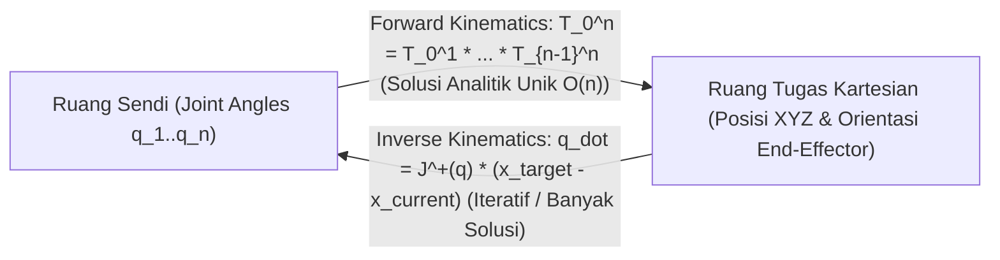

# Modul 220: Representasi Spasial 3D & Kinematika (Matriks Rotasi SO(3), Aljabar Kuaternion Satuan, Parameter Denavit-Hartenberg, Jacobian)

**Navigasi**: [⬅️ Master Index](../../INDEX.md) | [Tingkat 15: Tingkat 15: Mekatronika, Robotika, Teori Kendali & Otomasi Industri](./README.md)
*Sebelumnya*: [219. fisika-sensor-robotika-antarmuka](./219-fisika-sensor-robotika-antarmuka.md) | *Berikutnya*: [221. dinamika-robot-perencanaan-gerak-trajektori](./221-dinamika-robot-perencanaan-gerak-trajektori.md)

---

## 1. Intuisi Dasar Tanpa Jargon ("Seperti Bayi Baru Lahir")
Bagaimana sebuah lengan robot industri tahu dengan pasti di mana ujung jarinya (*End-Effector*) berada di ruang 3D hanya dengan membaca sudut putaran keenam motor sendinya? Dan bagaimana jika Anda ingin membalik pertanyaannya: *"Jika saya ingin ujung jari robot menyentuh cangkir kopi di koordinat $(X, Y, Z)$, berapa derajat sudut yang harus diputar oleh masing-masing motor?"*

Inilah jantung matematika robotika: **Kinematika Spasial 3D** ([Craig - Introduction to Robotics](https://www.pearson.com/en-us/subject-catalog/p/introduction-to-robotics-mechanics-and-control/P200000003314)).

Jika Anda merepresentasikan rotasi 3D menggunakan sudut Euler biasa (Roll, Pitch, Yaw), Anda akan menabrak fenomena bencana matematika bernama **Gimbal Lock**: ketika dua sumbu rotasi sejajar dan Anda kehilangan 1 derajat kebebasan gerak seketika!

Untuk menghindarinya, ilmuwan robotika menggunakan **Kuaternion Satuan (Quaternions)**: bilangan hiper-kompleks 4-dimensi ajaib yang dapat memutar objek di ruang 3D secara mulus tanpa pernah mengalami gimbal lock. Dan untuk merangkai sambungan sendi-sendi lengan robot dari pangkal hingga ke ujung, kita menggunakan konvensi standar internasional **Denavit-Hartenberg (DH Parameters)** ([Siciliano et al. - Robotics: Modelling, Planning and Control](https://link.springer.com/book/10.1007/978-1-84628-642-1)).

## 2. Fondasi Teoretis & Aksiomatik / Matematis
Formulasi Matematis Kinematika Robotika Spasial 3D:

1. **Grup Rotasi Khusus $SO(3)$ & Aljabar Kuaternion Satuan**:
Matriks rotasi ortogonal $R \in \mathbb{R}^{3 \times 3}$ memenuhi: $R^T R = I$ dan $\det(R) = +1$.
Kuaternion satuan $q = [w, x, y, z]^T = [w, \mathbf{v}]^T$ merepresentasikan rotasi sebesar sudut $\theta$ mengelilingi sumbu vektor satuan $\mathbf{u} \in \mathbb{R}^3$:
$$q = \left[ \cos\left(\frac{\theta}{2}\right), \, \mathbf{u} \sin\left(\frac{\theta}{2}\right) \right], \quad \|q\|_2^2 = w^2 + x^2 + y^2 + z^2 = 1$$
Rotasi vektor spasial $p \in \mathbb{R}^3$: $p' = q \otimes p \otimes q^*$ (bebas singularitas Gimbal Lock).

2. **Parameter Denavit-Hartenberg (DH) & Matriks Transformasi Homogen $SE(3)$**:
Transformasi homogen dari kerangka acuan $i-1$ ke $i$ dikarakterisasi oleh 4 parameter geometris:
$$T_{i-1}^i = \text{Rot}_z(\theta_i) \cdot \text{Trans}_z(d_i) \cdot \text{Trans}_x(a_i) \cdot \text{Rot}_x(\alpha_i)$$
$$T_{i-1}^i = \begin{bmatrix} \cos\theta_i & -\sin\theta_i \cos\alpha_i & \sin\theta_i \sin\alpha_i & a_i \cos\theta_i \\ \sin\theta_i & \cos\theta_i \cos\alpha_i & -\cos\theta_i \sin\alpha_i & a_i \sin\theta_i \\ 0 & \sin\alpha_i & \cos\alpha_i & d_i \\ 0 & 0 & 0 & 1 \end{bmatrix}$$
*Kinematika Maju (Forward Kinematics)*: $T_0^n = T_0^1 T_1^2 \dots T_{n-1}^n$.

3. **Matriks Jacobian Geometris Robotik $J(q)$**:
Memetakan kecepatan sudut sendi $\dot{q} \in \mathbb{R}^n$ ke kecepatan linier dan sudut ujung manipulator (*twist* $V \in \mathbb{R}^6$):
$$\begin{bmatrix} v \\ \omega \end{bmatrix} = J(q) \dot{q} = \begin{bmatrix} J_v \\ J_\omega \end{bmatrix} \dot{q}$$
Untuk sendi revolute ke-$i$: $J_{v, i} = z_{i-1} \times (o_n - o_{i-1})$ dan $J_{\omega, i} = z_{i-1}$.
*Singularitas Kinematika*: Terjadi jika $\det(J(q)) = 0$ (robot kehilangan kemampuan bergerak ke arah tertentu di ruang tugas kartesian) ([Spong et al. Robot Modeling and Control](https://www.wiley.com/en-us/Robot+Modeling+and+Control%2C+2nd+Edition-p-9781119523994)).

## 3. Anatomi Teknis & Cara Kerja Internal
Arsitektur perbandingan Forward Kinematics (FK) vs Inverse Kinematics (IK) berbasis Jacobian:



Inverse Kinematics (IK) umumnya diselesaikan via iterasi diferensial damped least-squares (*Levenberg-Marquardt*):
$$\Delta q = J^T (J J^T + \lambda^2 I)^{-1} e$$
Faktor peredam $\lambda^2$ mencegah nilai kecepatan sendi $\dot{q}$ meledak tak hingga saat lengan mendekati konfigurasi singularitas ([Siciliano Robotics Chapter 3](https://link.springer.com/book/10.1007/978-1-84628-642-1)).

## 4. Implementasi Praktis & Kode / Simulasi Riil
```python
import numpy as np

# 1. Matriks Transformasi Homogen 4x4 Standar Denavit-Hartenberg (DH)
def dh_matrix(theta, d, a, alpha):
    ct, st = np.cos(theta), np.sin(theta)
    ca, sa = np.cos(alpha), np.sin(alpha)
    return np.array([
        [ct, -st * ca,  st * sa, a * ct],
        [st,  ct * ca, -ct * sa, a * st],
        [0.0,      sa,       ca,      d],
        [0.0,     0.0,      0.0,    1.0]
    ])

# 2. Kinematika Maju Lengan Robot Planar 2-Link (Link L1=1.0m, L2=0.8m)
def forward_kinematics_2link(theta1, theta2, l1=1.0, l2=0.8):
    # Parameter DH [theta, d, a, alpha]
    T01 = dh_matrix(theta1, 0.0, l1, 0.0)
    T12 = dh_matrix(theta2, 0.0, l2, 0.0)
    T02 = np.dot(T01, T12) # Transformasi Total Base -> End-Effector
    
    pos_x = T02[0, 3]
    pos_y = T02[1, 3]
    return pos_x, pos_y, T02

# Uji Coba: Sendi 1 = 30 derajat, Sendi 2 = 45 derajat
th1 = np.radians(30.0)
th2 = np.radians(45.0)
x_ee, y_ee, T_full = forward_kinematics_2link(th1, th2)

# Validasi Trigonometri Analitik: x = L1*cos(th1) + L2*cos(th1+th2)
x_analytical = 1.0 * np.cos(th1) + 0.8 * np.cos(th1 + th2)
y_analytical = 1.0 * np.sin(th1) + 0.8 * np.sin(th1 + th2)

print(f"Posisi End-Effector via DH Matrix: X = {x_ee:.4f} m, Y = {y_ee:.4f} m")
print(f"Posisi End-Effector Analitik     : X = {x_analytical:.4f} m, Y = {y_analytical:.4f} m")
assert np.isclose(x_ee, x_analytical) and np.isclose(y_ee, y_analytical), "Hasil DH Matrix identik presisi!"
```

## 5. Miskonsepsi & Jebakan Industri
*Bencana Gimbal Lock pada Representasi Euler Angles*: Ketika sudut pitch mencapai $\pm 90^\circ$ ($\pm \frac{\pi}{2}$ rad), sumbu rotasi roll dan yaw bertepatan satu sama lain pada bidang yang sama. Matriks rotasi kehilangan satu rank matematika ($\det \to 0$), memicu hilangnya satu derajat kebebasan dan pergerakan tak terkendali (*singularity jerk*) pada autopilot wahana atau lengan robot. Jangan pernah menggunakan sudut Euler untuk komputasi internal kendali; selalu gunakan **Kuaternion Satuan** atau **Matriks Rotasi $SO(3)$** murni ([Kuipers - Quaternions and Rotation Sequences](https://www.princeton.edu/~wbialek/rome/refs/kuipers_99.pdf)).

## 6. Proyek Latihan & Rubrik Penilaian Mandiri
### Level 1 (Pemula)
Tulis kelas kuaternion kustom di Python yang mendukung perkalian Hamilton ($q_1 \otimes q_2$), konjugat kuaternion, normalisasi ke satuan, dan konversi kuaternion satuan menjadi matriks rotasi $3 \times 3$ $SO(3)$.
*Rubrik*: Perkalian kuaternion lolos pengujian rotasi ortogonal terhadap vektor acak 3D.

### Level 2 (Menengah)
Susun tabel parameter Denavit-Hartenberg (DH) lengkap untuk lengan robot SCARA 4-DoF (RRPR: 2 revolute planar, 1 prismatik vertikal, 1 revolute end-effector), implementasikan fungsi forward kinematics, dan buktikan titik koordinat end-effector sesuai dengan diagram skematik fisik.
*Rubrik*: Tabel DH 4 baris benar dan posisi akhir tervalidasi secara komputasional.

### Level 3 (Mahir)
Implementasikan pemecah Kinematika Balik (*Inverse Kinematics Solver*) menggunakan metode Damped Least-Squares (DLS / Levenberg-Marquardt) Jacobian numerik untuk manipulator 6-DoF: terima koordinat target 3D sembarang, hitung matriks Jacobian secara rekursif, perbarui sudut sendi dengan batasan sudut fisik (*joint limits*), dan buktikan konvergensi posisi dengan toleransi galat $\|e\| < 1\text{ mm}$.
*Rubrik*: Algoritma mampu menavigasi konfigurasi dekat singularitas tanpa lonjakan kecepatan sudut.

## 7. Rekomendasi Sumber Belajar Standar Emas
| Sumber Pembelajaran | Penulis / Institusi | Tautan Langsung | Fokus Materi |
| :--- | :--- | :--- | :--- |
| Introduction to Robotics: Mechanics and Control (4th Ed.) | John J. Craig | [Pearson Higher Ed](https://www.pearson.com/en-us/subject-catalog/p/introduction-to-robotics-mechanics-and-control/P200000003314) | Parameter Denavit-Hartenberg, Forward & Inverse Kinematics |
| Robotics: Modelling, Planning and Control | Bruno Siciliano, Lorenzo Sciavicco, Luigi Villani, Giuseppe Oriolo | [Springer Link](https://link.springer.com/book/10.1007/978-1-84628-642-1) | Alkitab Kinematika Diferensial, Jacobian Geometris, Singularitas |
| Quaternions and Rotation Sequences | Jack B. Kuipers | [Princeton University Press](https://www.princeton.edu/~wbialek/rome/refs/kuipers_99.pdf) | Panduan Komprehensif Matematika Kuaternion & Penghindaran Gimbal Lock |
| Modern Robotics: Mechanics, Planning, and Control | Kevin M. Lynch & Frank C. Park | [Cambridge University Press Portal](https://modernrobotics.northwestern.edu/) | Formulasi Teori Sekrup Modern (Screw Theory & Product of Exponentials) |

---
*Navigasi Cepat*: [Ke Tingkat 15](./README.md) | [Ke Master Index](../../INDEX.md) | *Sebelumnya*: [219. fisika-sensor-robotika-antarmuka](./219-fisika-sensor-robotika-antarmuka.md) | *Berikutnya*: [221. dinamika-robot-perencanaan-gerak-trajektori](./221-dinamika-robot-perencanaan-gerak-trajektori.md)
