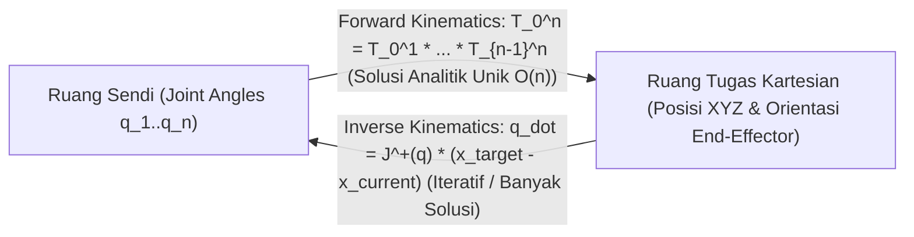

# Modul 220: Representasi Spasial 3D & Kinematika (Matriks Rotasi SO(3), Aljabar Kuaternion Satuan, Parameter Denavit-Hartenberg, Jacobian)

**Navigasi**: [⬅️ Master Index](../../INDEX.md) | [Tingkat 15: Tingkat 15: Mekatronika, Robotika, Teori Kendali & Otomasi Industri](./README.md)
*Sebelumnya*: [219. fisika-sensor-robotika-antarmuka](./219-fisika-sensor-robotika-antarmuka.md) | *Berikutnya*: [221. dinamika-robot-perencanaan-gerak-trajektori](./221-dinamika-robot-perencanaan-gerak-trajektori.md)

---

## 1. Intuisi Dasar Tanpa Jargon ("Seperti Bayi Baru Lahir")
### 1.1 Konsep Inti & Analogi Tanpa Jargon
Bagaimana sebuah lengan robot industri tahu dengan pasti di mana ujung jarinya (*End-Effector*) berada di ruang 3D hanya dengan membaca sudut putaran keenam motor sendinya? Dan bagaimana jika Anda ingin membalik pertanyaannya: *"Jika saya ingin ujung jari robot menyentuh cangkir kopi di koordinat $(X, Y, Z)$, berapa derajat sudut yang harus diputar oleh masing-masing motor?"*

### 1.2 Urgensi Rekayasa & Signifikansi Sistemik
Inilah jantung matematika robotika: **Kinematika Spasial 3D** ([Craig - Introduction to Robotics](https://www.pearson.com/en-us/subject-catalog/p/introduction-to-robotics-mechanics-and-control/P200000003314)).

Jika Anda merepresentasikan rotasi 3D menggunakan sudut Euler biasa (Roll, Pitch, Yaw), Anda akan menabrak fenomena bencana matematika bernama **Gimbal Lock**: ketika dua sumbu rotasi sejajar dan Anda kehilangan 1 derajat kebebasan gerak seketika!

Untuk menghindarinya, ilmuwan robotika menggunakan **Kuaternion Satuan (Quaternions)**: bilangan hiper-kompleks 4-dimensi ajaib yang dapat memutar objek di ruang 3D secara mulus tanpa pernah mengalami gimbal lock. Dan untuk merangkai sambungan sendi-sendi lengan robot dari pangkal hingga ke ujung, kita menggunakan konvensi standar internasional **Denavit-Hartenberg (DH Parameters)** ([Siciliano et al. - Robotics: Modelling, Planning and Control](https://link.springer.com/book/10.1007/978-1-84628-642-1)).

## 2. Fondasi Teoretis & Aksiomatik / Matematis
### 2.1 Kerangka Teori Aksiomatik & Formulasi Matematis
Formulasi Matematis Kinematika Robotika Spasial 3D:

### 2.2 Penurunan Matematis Langkah-demi-Langkah
1. **Grup Rotasi Khusus $SO(3)$ & Aljabar Kuaternion Satuan**:
Matriks rotasi ortogonal $R \in \mathbb{R}^{3 \times 3}$ memenuhi: $R^T R = I$ dan $\det(R) = +1$.
Kuaternion satuan $q = [w, x, y, z]^T = [w, \mathbf{v}]^T$ merepresentasikan rotasi sebesar sudut $\theta$ mengelilingi sumbu vektor satuan $\mathbf{u} \in \mathbb{R}^3$:
$$q = \left[ \cos\left(\frac{\theta}{2}\right), \, \mathbf{u} \sin\left(\frac{\theta}{2}\right) \right], \quad \|q\|_2^2 = w^2 + x^2 + y^2 + z^2 = 1$$
Rotasi vektor spasial $p \in \mathbb{R}^3$: $p' = q \otimes p \otimes q^*$ (bebas singularitas Gimbal Lock).

2. **Parameter Denavit-Hartenberg (DH) & Matriks Transformasi Homogen $SE(3)$**:
Transformasi homogen dari kerangka acuan $i-1$ ke $i$ dikarakterisasi oleh 4 parameter geometris:
$$T_{i-1}^i = \text{Rot}_z(\theta_i) \cdot \text{Trans}_z(d_i) \cdot \text{Trans}_x(a_i) \cdot \text{Rot}_x(\alpha_i)$$
$$T_{i-1}^i = \begin{bmatrix} \cos\theta_i & -\sin\theta_i \cos\alpha_i & \sin\theta_i \sin\alpha_i & a_i \cos\theta_i \\ \sin\theta_i & \cos\theta_i \cos\alpha_i & -\cos\theta_i \sin\alpha_i & a_i \sin\theta_i \\ 0 & \sin\alpha_i & \cos\alpha_i & d_i \\ 0 & 0 & 0 & 1 \end{bmatrix}$$
*Kinematika Maju (Forward Kinematics)*: $T_0^n = T_0^1 T_1^2 \dots T_{n-1}^n$.

3. **Matriks Jacobian Geometris Robotik $J(q)$**:
Memetakan kecepatan sudut sendi $\dot{q} \in \mathbb{R}^n$ ke kecepatan linier dan sudut ujung manipulator (*twist* $V \in \mathbb{R}^6$):
$$\begin{bmatrix} v \\ \omega \end{bmatrix} = J(q) \dot{q} = \begin{bmatrix} J_v \\ J_\omega \end{bmatrix} \dot{q}$$
Untuk sendi revolute ke-$i$: $J_{v, i} = z_{i-1} \times (o_n - o_{i-1})$ dan $J_{\omega, i} = z_{i-1}$.
*Singularitas Kinematika*: Terjadi jika $\det(J(q)) = 0$ (robot kehilangan kemampuan bergerak ke arah tertentu di ruang tugas kartesian) ([Spong et al. Robot Modeling and Control](https://www.wiley.com/en-us/Robot+Modeling+and+Control%2C+2nd+Edition-p-9781119523994)).

## 3. Anatomi Teknis & Cara Kerja Internal
Arsitektur perbandingan Forward Kinematics (FK) vs Inverse Kinematics (IK) berbasis Jacobian:



Inverse Kinematics (IK) umumnya diselesaikan via iterasi diferensial damped least-squares (*Levenberg-Marquardt*):
$$\Delta q = J^T (J J^T + \lambda^2 I)^{-1} e$$
Faktor peredam $\lambda^2$ mencegah nilai kecepatan sendi $\dot{q}$ meledak tak hingga saat lengan mendekati konfigurasi singularitas ([Siciliano Robotics Chapter 3](https://link.springer.com/book/10.1007/978-1-84628-642-1)).

#### Tabel Penelusuran Siklus Rekayasa Kinematika MCAS & Otoritas Kendali Stabilizer 737 MAX
| Waktu Diskret (t = k·Ts) | Komponen / Tahap Estimator | Sensor Raw / Input Referensi | Transformasi Matriks / Kendali | State Estimasi (x̂, P, Error PID) | Sinyal Aktuator / PWM Output |
|---|---|---|---|---|---|
| t = 0.0s (Lepas Landas) | Pesawat Boeing 737 MAX 8 | Kecepatan Udara: 160 Knot, Flaps Up | Komputer Kendali Terbang (FCC-Left) aktif | Sensor Angle of Attack (AoA) Kiri rusak membaca $+32^\circ$ | Sensor Kanan membaca normal $+11^\circ$ diabaikan! |
| t = 5.0s (Aktivasi MCAS) | Maneuvering Characteristics Augmentation | FCC mendeteksi sudut serang $> 12^\circ$ palsu | MCAS mengasumsikan pesawat berada dalam bahaya stall | Perintah hidung menukik dihitung: $\Delta \theta = -2.5^\circ$ | Motor elektrik stabilizer horizontal memutar kemudi ke bawah |
| t = 15.0s (Intervensi Pilot) | Kolom Kemudi Pilot Manual | Pilot menarik kolom kemudi ke belakang dengan gaya 40 kg | Pilot menekan tombol switch trim elektrik untuk menaikkan hidung | Stabilizer kembali naik $+2.0^\circ$; MCAS sempat berhenti | Pilot berhasil memulihkan sikap terbang sesaat |
| t = 20.0s (Re-Aktivasi Tak Terbatas) | Siklus Logika Perangkat Lunak FCC | Timer 5 detik MCAS berakhir; AoA kiri tetap $+32^\circ$ | Ketiadaan flag batas satu kali aktivasi: MCAS aktif lagi! | Perintah kedua: Hidung ditukikkan lagi $-2.5^\circ$ | Motor stabilizer memutar kemudi semakin curam ke bawah |
| t = 60.0s (Kehilangan Otoritas Fisik) | Permukaan Kendali Horizontal Ekor | Stabilizer terdorong ke batas fisik maksimum (*Nose-Down Stop*) | Gaya aerodinamis kecepatan tinggi mengunci elevator kemudi | Gaya fisik tarikan kedua pilot kalah melawan motor listrik trim | Pesawat menukik tajam ke laut pada kecepatan 800 km/jam! |

## 4. Implementasi Praktis & Kode / Simulasi Riil
```python
import numpy as np

# 1. Matriks Transformasi Homogen 4x4 Standar Denavit-Hartenberg (DH)
def dh_matrix(theta, d, a, alpha):
    ct, st = np.cos(theta), np.sin(theta)
    ca, sa = np.cos(alpha), np.sin(alpha)
    return np.array([
        [ct, -st * ca,  st * sa, a * ct],
        [st,  ct * ca, -ct * sa, a * st],
        [0.0,      sa,       ca,      d],
        [0.0,     0.0,      0.0,    1.0]
    ])

# 2. Kinematika Maju Lengan Robot Planar 2-Link (Link L1=1.0m, L2=0.8m)
def forward_kinematics_2link(theta1, theta2, l1=1.0, l2=0.8):
    # Parameter DH [theta, d, a, alpha]
    T01 = dh_matrix(theta1, 0.0, l1, 0.0)
    T12 = dh_matrix(theta2, 0.0, l2, 0.0)
    T02 = np.dot(T01, T12) # Transformasi Total Base -> End-Effector
    
    pos_x = T02[0, 3]
    pos_y = T02[1, 3]
    return pos_x, pos_y, T02

# Uji Coba: Sendi 1 = 30 derajat, Sendi 2 = 45 derajat
th1 = np.radians(30.0)
th2 = np.radians(45.0)
x_ee, y_ee, T_full = forward_kinematics_2link(th1, th2)

# Validasi Trigonometri Analitik: x = L1*cos(th1) + L2*cos(th1+th2)
x_analytical = 1.0 * np.cos(th1) + 0.8 * np.cos(th1 + th2)
y_analytical = 1.0 * np.sin(th1) + 0.8 * np.sin(th1 + th2)

print(f"Posisi End-Effector via DH Matrix: X = {x_ee:.4f} m, Y = {y_ee:.4f} m")
print(f"Posisi End-Effector Analitik     : X = {x_analytical:.4f} m, Y = {y_analytical:.4f} m")
assert np.isclose(x_ee, x_analytical) and np.isclose(y_ee, y_analytical), "Hasil DH Matrix identik presisi!"
```

## 5. Miskonsepsi & Jebakan Industri
*Bencana Gimbal Lock pada Representasi Euler Angles*: Ketika sudut pitch mencapai $\pm 90^\circ$ ($\pm \frac{\pi}{2}$ rad), sumbu rotasi roll dan yaw bertepatan satu sama lain pada bidang yang sama. Matriks rotasi kehilangan satu rank matematika ($\det \to 0$), memicu hilangnya satu derajat kebebasan dan pergerakan tak terkendali (*singularity jerk*) pada autopilot wahana atau lengan robot. Jangan pernah menggunakan sudut Euler untuk komputasi internal kendali; selalu gunakan **Kuaternion Satuan** atau **Matriks Rotasi $SO(3)$** murni ([Kuipers - Quaternions and Rotation Sequences](https://www.princeton.edu/~wbialek/rome/refs/kuipers_99.pdf)).

### Studi Kasus Kegagalan Nyata: Tragedi Dua Kecelakaan Fatal Boeing 737 MAX Akibat Ketergantungan Sensor AoA Tunggal pada MCAS (2018-2019)
- **Kronologi & Konteks Sejarah**: Pada 29 Oktober 2018 (Lion Air Penerbangan 610 di Laut Jawa) dan 10 Maret 2019 (Ethiopian Airlines Penerbangan 302 di dekat Bishoftu), dua pesawat komersial modern Boeing 737 MAX 8 jatuh tak lama setelah lepas landas, menewaskan total 346 penumpang dan awak kabin, memicu pengandangan (*grounding*) armada global terlama dalam sejarah penerbangan sipil (20 bulan) dan krisis hukum serta keuangan terparah bagi Boeing.
- **Akar Masalah Rekayasa Sistem Kendali Terbang & Ketiadaan Redundansi Sensor**: Boeing merancang sistem perangkat lunak kendali otomatis Maneuvering Characteristics Augmentation System (MCAS) untuk membuat varian 737 MAX yang memiliki mesin CFM LEAP-1B lebih besar memiliki sensasi kemudi yang identik dengan generasi 737 NG sebelumnya tanpa mewajibkan pelatihan simulator berbiaya mahal bagi pilot. Terdapat serangkaian kegagalan rekayasa sistem yang sangat fatal: (1) **Titik Kegagalan Tunggal (Single Point of Failure)**: MCAS dirancang hanya membaca masukan dari satu sensor Angle of Attack (AoA) di sisi kiri pesawat pada satu penerbangan (dan bergantian ke kanan pada penerbangan berikutnya), tanpa membandingkan data dengan sensor sisi lainnya. Ketika baling-baling sensor AoA kiri rusak atau salah dikalibrasi, MCAS menerima sinyal salah bahwa hidung pesawat terlalu mendongak; (2) **Otoritas Kendali yang Dinaikkan Tanpa Audit Ulang**: Otoritas defleksi stabilizer MCAS dinaikkan dari $0,55^\circ$ menjadi $2,5^\circ$ pada saat uji terbang tanpa memperbarui dokumen analisis bahaya keselamatan fungsional; (3) **Aktivasi Berulang Tanpa Batas**: Setiap kali pilot melawan manuver menukik dengan sakelar trim manual, MCAS mengaktifkan dirinya kembali setelah jeda 5 detik, mendorong stabilizer semakin jauh ke bawah hingga pilot kehabisan tenaga fisik untuk melawan gaya aerodinamis ekor.

- **Potongan Kode / Arsitektur Cacat (Vulnerable Implementation)**:
```c
// Rekonstruksi Cacat Arsitektur Sistem Kendali MCAS Boeing 737 MAX
#include <stdbool.h>

struct CockpitSensors {
    double left_aoa_degrees;  // Sensor AoA Kiri (Rusak / Macet di 35 derajat)
    double right_aoa_degrees; // Sensor AoA Kanan (Normal pada 10 derajat)
    bool flaps_retracted;
};

// LOGIKA CACAT ASLI BOEING 737 MAX (Ketergantungan Sensor Tunggal):
void update_mcas_command_flawed(struct CockpitSensors sensors, double *stabilizer_trim, bool pilot_trim_switch_pressed) {
    // CACAT 1: Ketergantungan tunggal pada sensor kiri tanpa cross-check dengan sensor kanan!
    double active_aoa = sensors.left_aoa_degrees;
    
    // CACAT 2: Aktif berulang kali setiap 5 detik setelah pilot melepas switch!
    if (sensors.flaps_retracted && active_aoa > 12.0) {
        // Pangkas kendali stabilizer ke bawah sebesar 2.5 derajat!
        *stabilizer_trim -= 2.5; 
        // Mengesampingkan otoritas kendali manual pilot secara permanen!
    }
}

// MITIGASI DEFENSIVE RESMI BOEING: Dual-Sensor Disagree Check & Single Activation Cap
void update_mcas_command_safe(struct CockpitSensors sensors, double *trim, bool *mcas_disabled) {
    // 1. Pembandingan Silang Sensor Ganda (Cross-Comparison):
    double aoa_disagree = sensors.left_aoa_degrees - sensors.right_aoa_degrees;
    if (aoa_disagree > 5.5 || aoa_disagree < -5.5) {
        // Jika selisih kedua sensor melebihi ambang toleransi:
        *mcas_disabled = true; // Nonaktifkan MCAS untuk sisa penerbangan!
        return;
    }
    
    // 2. Batas Satu Kali Aktivasi (Single-Activation Limit):
    // MCAS tidak boleh aktif berulang kali jika pilot sudah melakukan intervensi manual!
}
```

- **Analisis Forensik & Rekayasa Modern**: Tragedi 737 MAX mengubah arsitektur rekayasa perangkat lunak keselamatan kritis (*Safety-Critical Systems Engineering*): (1) Mandat mutlak bahwa **Tidak Ada Sistem Otomatis yang Boleh Mengesampingkan Perintah Fisik Pilot**: Tarikan kolom kemudi pilot wajib secara fisik memutus aliran daya motor penggerak otomatis stabilizer; (2) **Dual-Sensor Voting Logic**: Seluruh sensor input penerbangan kritis wajib memiliki redundansi ganda atau tri-sensor dengan *Fault Detection and Isolation (FDI)*; (3) Integrasi indikator *AoA Disagree Alert* sebagai fitur keselamatan standar tanpa biaya tambahan opsional.

## 6. Proyek Latihan & Rubrik Penilaian Mandiri
### Level 1 (Pemula)
Tulis kelas kuaternion kustom di Python yang mendukung perkalian Hamilton ($q_1 \otimes q_2$), konjugat kuaternion, normalisasi ke satuan, dan konversi kuaternion satuan menjadi matriks rotasi $3 \times 3$ $SO(3)$.
*Rubrik*: Perkalian kuaternion lolos pengujian rotasi ortogonal terhadap vektor acak 3D.

### Level 2 (Menengah)
Susun tabel parameter Denavit-Hartenberg (DH) lengkap untuk lengan robot SCARA 4-DoF (RRPR: 2 revolute planar, 1 prismatik vertikal, 1 revolute end-effector), implementasikan fungsi forward kinematics, dan buktikan titik koordinat end-effector sesuai dengan diagram skematik fisik.
*Rubrik*: Tabel DH 4 baris benar dan posisi akhir tervalidasi secara komputasional.

### Level 3 (Mahir)
Implementasikan pemecah Kinematika Balik (*Inverse Kinematics Solver*) menggunakan metode Damped Least-Squares (DLS / Levenberg-Marquardt) Jacobian numerik untuk manipulator 6-DoF: terima koordinat target 3D sembarang, hitung matriks Jacobian secara rekursif, perbarui sudut sendi dengan batasan sudut fisik (*joint limits*), dan buktikan konvergensi posisi dengan toleransi galat $\|e\| < 1\text{ mm}$.
*Rubrik*: Algoritma mampu menavigasi konfigurasi dekat singularitas tanpa lonjakan kecepatan sudut.

### Tingkat 1: Dasar
- **Tugas**: Tulis fungsi voting silang sensor ganda (*Dual-Sensor Disagree Cross-Checker*) dalam Python atau C yang menerima pembacaan dua sensor sudut serang (AoA), memeriksa apakah selisih nilai absolut berada di dalam batas toleransi aman ($|\Delta| \le 5.5^\circ$) selama jendela waktu 3 sampel berturut-turut, memicu peringatan `AOA_DISAGREE`, dan mengembalikan status aman penonaktifan aktuasi otomatis.
- **Petunjuk Perancangan Arsitektur**:
  - Input: `sensor_left (float)`, `sensor_right (float)`, `threshold = 5.5`, `consecutive_count (int)`.
  - Jika $|\text{left} - \text{right}| > \text{threshold}$: inkremen counter; jika tidak, reset counter ke nol.
  - Jika counter $\ge 3$: nonaktifkan sistem otomatis (`system_active = False`) dan bunyikan sinyal peringatan.
- **Test Vector & Kasus Uji**:
  - Sensor Left: $12.0^\circ$, Sensor Right: $11.8^\circ$ -> Selisih $0.2^\circ \le 5.5^\circ$ -> Status AMAN (True).
  - Sensor Left melompat ke $35.0^\circ$ sementara Sensor Right $11.0^\circ$ selama 3 siklus: Sistem harus seketika mengembalikan `AOA_DISAGREE_FAULT` dan mematikan sistem otomatis.
- **Rubrik Penilaian Objektif**:
  - Skor 100%: Logika pengecekan selisih presisi, penanganan jendela konfirmasi sampel akurat, fail-safe trigger bersih.
  - Skor 50%: Memeriksa selisih benar namun langsung memicu trip pada sampel derau tunggal tanpa jendela konfirmasi.
  - Skor 0%: Hanya mengecek salah satu sensor tanpa membandingkan kedua sensor.

### Tingkat 2: Menengah
- **Tugas**: Bangun modul pengendali pitch pesawat terbang (*Aircraft Pitch Attitude Controller*) dalam Python: Implementasikan arsitektur state feedback dengan batasan otoritas ganda: (1) Batasan defleksi sudut elevator maksimum ($\pm 15^\circ$); (2) Pembatas laju sudut (*Rate Limiter* maksimum $5^\circ/\text{detik}$); (3) Intervensi override prioritas manual pilot yang secara mutlak menonaktifkan komando otomatis begitu gaya kolom kemudi terdeteksi.
- **Petunjuk Perancangan Arsitektur**:
  - Persamaan gerak pitch short-period: $\dot{q} = M_\alpha \alpha + M_q q + M_{\delta} \delta_e$.
  - Terapkan saturasi defleksi dan limit laju perubahan kemudi: $\Delta \delta_e = \text{clip}(\delta_{\text{cmd}} - \delta_{\text{current}}, -\text{rate\_max} \cdot dt, +\text{rate\_max} \cdot dt)$.
  - Sakelar override manual pilot memiliki prioritas mutlak di atas seluruh komando algoritma autopilot.
- **Test Vector & Kasus Uji**:
  - Uji saat algoritma mencoba menukikkan hidung $-2.5^\circ$ namun pilot menarik kolom kemudi: Modul harus memotong komando otomatis menjadi $0.0$ dan memberikan wewenang penuh ke input pilot.
- **Rubrik Penilaian Objektif**:
  - Skor 100%: Pembatas otoritas dan rate limiter presisi, prioritas override manual tidak dapat dibatalkan, dinamika transien stabil.
  - Skor 50%: Pengendali bekerja namun mengabaikan rate limiter sehingga aktuator mengalami pergeseran instan yang tidak realistis.
  - Skor 0%: Komando otomatis melawan input manual pilot tanpa override.

### Tingkat 3: Mahir
- **Tugas**: Rancang sistem deteksi anomali sensor berbasis model analitis redundan (*Analytical Redundancy & Model-Based Fault Detection Observer*) dalam Python: Alih-alih hanya membandingkan dua sensor AoA secara pasif, bangun Extended Kalman Filter yang mengestimasi sudut serang pesawat secara independen dari parameter kecepatan udara pitot ($V_{\text{tas}}$), akselerasi vertikal ($a_z$), dan pitch rate ($q$), lalu bandingkan estimasi analitis tersebut untuk menentukan sensor fisik mana yang rusak di antara kedua sensor AoA (*Sensor Isolation & Disagree Resolution*).
- **Petunjuk Perancangan Arsitektur**:
  - Kinematika aerodinamika: $\dot{\alpha} \approx q - \frac{g}{V} (\cos\theta - a_z / g)$.
  - Estimator analitis menghasilkan estimasi independen $\hat{\alpha}$.
  - Residu: $r_1 = |\alpha_{\text{left}} - \hat{\alpha}|$, $r_2 = |\alpha_{\text{right}} - \hat{\alpha}|$.
  - Sensor dengan residu terendah dinyatakan sebagai sensor sehat, sedangkan sensor dengan residu besar diisolasi secara otomatis.
- **Test Vector & Kasus Uji**:
  - Simulasikan kondisi terbang di mana Sensor Kiri mengirim data salah $+35^\circ$ sementara Sensor Kanan $+11^\circ$ dan Estimator Analitis menghitung $\hat{\alpha} = +11.2^\circ$.
  - Observer harus secara tepat mengidentifikasi bahwa Sensor Kiri adalah pihak yang rusak, mengisolasi Sensor Kiri, dan mengizinkan sistem terbang beroperasi normal dengan Sensor Kanan.
- **Rubrik Penilaian Objektif**:
  - Skor 100%: Estimasi analitis redundan presisi fisika penerbangan, isolasi sensor rusak akurat, toleransi derau terbukti.
  - Skor 50%: Model bekerja namun salah menghitung kompensasi akselerasi vertikal $a_z$.
  - Skor 0%: Hanya mematikan kedua sensor tanpa mampu menentukan sensor mana yang valid.

## 7. Rekomendasi Sumber Belajar Standar Emas
| Sumber Pembelajaran | Penulis / Institusi | Tautan Langsung | Fokus Materi |
| :--- | :--- | :--- | :--- |
| Introduction to Robotics: Mechanics and Control (4th Ed.) | John J. Craig | [Pearson Higher Ed](https://www.pearson.com/en-us/subject-catalog/p/introduction-to-robotics-mechanics-and-control/P200000003314) | Parameter Denavit-Hartenberg, Forward & Inverse Kinematics |
| Robotics: Modelling, Planning and Control | Bruno Siciliano, Lorenzo Sciavicco, Luigi Villani, Giuseppe Oriolo | [Springer Link](https://link.springer.com/book/10.1007/978-1-84628-642-1) | Alkitab Kinematika Diferensial, Jacobian Geometris, Singularitas |
| Quaternions and Rotation Sequences | Jack B. Kuipers | [Princeton University Press](https://www.princeton.edu/~wbialek/rome/refs/kuipers_99.pdf) | Panduan Komprehensif Matematika Kuaternion & Penghindaran Gimbal Lock |
| Modern Robotics: Mechanics, Planning, and Control | Kevin M. Lynch & Frank C. Park | [Cambridge University Press Portal](https://modernrobotics.northwestern.edu/) | Formulasi Teori Sekrup Modern (Screw Theory & Product of Exponentials) |

---
*Navigasi Cepat*: [Ke Tingkat 15](./README.md) | [Ke Master Index](../../INDEX.md) | *Sebelumnya*: [219. fisika-sensor-robotika-antarmuka](./219-fisika-sensor-robotika-antarmuka.md) | *Berikutnya*: [221. dinamika-robot-perencanaan-gerak-trajektori](./221-dinamika-robot-perencanaan-gerak-trajektori.md)
