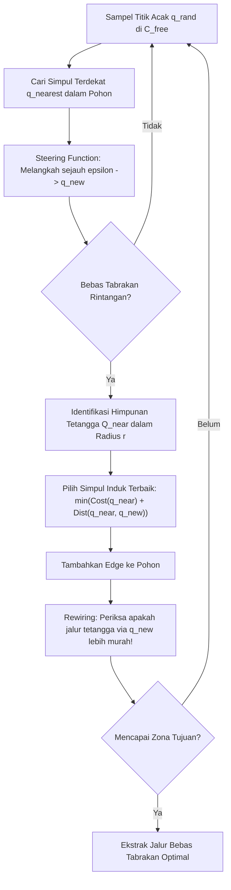

# Modul 221: Dinamika Robot, Perencanaan Gerak & Trajektori (Formulasi Dinamika Euler-Lagrange, Mobile Robot Kinematics, RRT* Planner)

**Navigasi**: [⬅️ Master Index](../../INDEX.md) | [Tingkat 15: Tingkat 15: Mekatronika, Robotika, Teori Kendali & Otomasi Industri](./README.md)
*Sebelumnya*: [220. representasi-spasial-3d-kinematika](./220-representasi-spasial-3d-kinematika.md) | *Berikutnya*: [222. teori-kendali-klasik](./222-teori-kendali-klasik.md)

---

## 1. Intuisi Dasar Tanpa Jargon ("Seperti Bayi Baru Lahir")
### 1.1 Konsep Inti & Analogi Tanpa Jargon
Mengetahui posisi sudut sendi robot (kinematika) barulah setengah cerita. Jika sebuah lengan robot memegang beban besi seberat 20 kg dan bergerak cepat, hukum inersia Newton dan gaya sentrifugal akan mencoba membengkokkan lengan tersebut ke samping. Berapa torsi motor yang harus dikerahkan oleh masing-masing sendi agar gerakan lengan tetap mulus dan tidak patah?

### 1.2 Urgensi Rekayasa & Signifikansi Sistemik
Inilah ranah **Dinamika Robot** ([Murray, Li, Sastry - A Mathematical Introduction to Robotic Manipulation](https://www.cse.lehigh.edu/~trac/teaching/cse360/MurrayLiSastry94.pdf)). Menggunakan persamaan mekanika analitik **Euler-Lagrange**, kita bisa memperhitungkan seluruh massa, inersia putaran, gaya Coriolis, dan gaya gravitasi di setiap milidetik lintasan.

Dan ketika robot mobil otonom (seperti robot pembersih lantai atau mobil tanpa supir) harus melintasi labirin kantor yang penuh kursi dan meja berantakan dari lobi ke ruang rapat, bagaimana ia merencanakan jalurnya?

Algoritma pencarian grid biasa akan meledak komputasinya di ruang berdimensi tinggi. Ilmuwan robotika menggunakan **Rapidly-exploring Random Trees (RRT / RRT\*)**: algoritma pencarian probabilistik yang menembakkan cabang-cabang pohon acak ke seluruh penjuru ruangan seperti jaring laba-laba, lalu menyambungkannya menjadi jalur terpendek bebas tabrakan dalam sekejap mata ([LaValle & Kuffner - Randomized Kinodynamic Planning](https://ieeexplore.ieee.org/document/925726)).

## 2. Fondasi Teoretis & Aksiomatik / Matematis
### 2.1 Kerangka Teori Aksiomatik & Formulasi Matematis
Formulasi Matematis Dinamika Manipulator & Perencanaan RRT\*:

### 2.2 Penurunan Matematis Langkah-demi-Langkah
1. **Persamaan Gerak Dinamika Manipulator Euler-Lagrange**:
Dituliskan dalam bentuk matriks kanonikal standar:
$$M(q) \ddot{q} + C(q, \dot{q}) \dot{q} + g(q) = \tau$$
Di mana:
* $q, \dot{q}, \ddot{q} \in \mathbb{R}^n$ adalah posisi, kecepatan, dan percepatan sudut sendi.
* $M(q) \in \mathbb{R}^{n \times n}$ adalah matriks inersia sendi yang simetris dan definit positif ($M(q) = M(q)^T > 0$).
* $C(q, \dot{q}) \in \mathbb{R}^{n \times n}$ adalah matriks gaya Coriolis dan sentrifugal (memenuhi sifat anti-simetris $\dot{M} - 2C = -(\dot{M} - 2C)^T$).
* $g(q) \in \mathbb{R}^n$ adalah vektor gaya torsi gravitasi: $g_i(q) = \frac{\partial V(q)}{\partial q_i}$.
* $\tau \in \mathbb{R}^n$ adalah vektor torsi aktuator pengendali ([Craig Robotics Chapter 6](https://www.pearson.com/en-us/subject-catalog/p/introduction-to-robotics-mechanics-and-control/P200000003314)).

2. **Kinematika Non-Holonomik Robot Bergerak Roda Diferensial**:
Robot bergerak dengan dua roda independen berjarak $L$ dan jari-jari roda $r$:
Kendali kecepatan maju linier $v$ dan kecepatan sudut belok $\omega$:
$$\begin{bmatrix} \dot{x} \\ \dot{y} \\ \dot{\theta} \end{bmatrix} = \begin{bmatrix} \cos\theta & 0 \\ \sin\theta & 0 \\ 0 & 1 \end{bmatrix} \begin{bmatrix} v \\ \omega \end{bmatrix}$$
Kendala non-holonomik murni (tidak ada slip lateral roda ke samping): $\dot{x}\sin\theta - \dot{y}\cos\theta = 0$.

3. **Algoritma Perencanaan Jalur Optimal Asimtotik RRT\***:
Secara iteratif mengambil sampel status acak $q_{\text{rand}} \in \mathcal{C}_{\text{free}}$, mencari simpul terdekat $q_{\text{nearest}}$, melangkah sejauh $\Delta t$ ke $q_{\text{new}}$.
*Koneksi Ulang Optimal (Rewiring Step)*: Memeriksa tetangga dalam radius bola $r = \gamma \left(\frac{\log n}{n}\right)^{1/d}$, menyambungkan simpul yang meminimalkan total biaya akumulasi jalur, menjamin konvergensi jalur optimal terpendek hampir pasti seiring $n \to \infty$ ([Karaman & Frazzoli - Sampling-based Algorithms for Optimal Motion Planning](https://arxiv.org/abs/1105.1186)).

## 3. Anatomi Teknis & Cara Kerja Internal
Arsitektur siklus pembaruan pohon probabilistik RRT\* dengan rewiring lokal:



Dengan langkah *Rewiring*, RRT\* terus-menerus meluruskan cabang-cabang pohon yang berkelok-kelok, membedakannya dari RRT biasa yang menghasilkan jalur zigzag yang kasar ([Karaman & Frazzoli 2011](https://arxiv.org/abs/1105.1186)).

#### Tabel Penelusuran Odometri Roda Mars Rover Opportunity & Jebakan Pasir Purgatory
| Waktu Diskret (t = k·Ts) | Komponen / Tahap Estimator | Sensor Raw / Input Referensi | Transformasi Matriks / Kendali | State Estimasi (x̂, P, Error PID) | Sinyal Aktuator / PWM Output |
|---|---|---|---|---|---|
| 26 Apr 2005 (Sol 446) | Rover Mars Opportunity | Target Navigasi: Melintasi Bukit Pasir | Algoritma navigasi blind drive mengandalkan encoder roda | Posisi awal: Bukit Pasir Purgatory Ripple | Motor roda enam penggerak DC diperintahkan maju |
| Putaran Roda Motorik | Encoder Optik Poros Roda | 6 Roda Berputar Sempurna 100 Putaran | Estimasi odometri roda murni: $x = \sum r \cdot \Delta \theta$ | Komputer rover mengira wahana sudah maju 25 meter! | Roda terus berputar mendorong butiran pasir halus |
| Fenomena Selip Roda (Slip) | Fisika Interaksi Ban & Tanah | Traksi tanah runtuh; Sudut kemiringan pasir curam | Rasio selip roda mencapai: $Slip = 1.0 - \frac{v_{\text{aktual}}}{v_{\text{teoretis}}} = 99.8\%$! | Posisi fisik aktual rover: Hanya maju 9 sentimeter! | Roda menggali pasir dan menenggelamkan diri! |
| Terjebak Hingga ke As Poros | Sensor Beban Arus Motor Roda | Seluruh 6 roda amblas terkubur hingga ke as poros | Peningkatan beban arus motor terabaikan oleh algoritma blind | Rover terjebak lumpuh di Purgatory Dune! | Bahaya kematian wahana permanen di Mars |
| Mitigasi Visual Odometry | Kamera Navigasi Depan (Navcam) | Pelacakan Fitur Visual Bebatuan Permukaan | Estimasi gerak optik independen (*Visual Odometry*) | Algoritma mendeteksi selip: Jika $Slip > 20\%$, hentikan gerak! | Misi penyelamatan 5 minggu: Rover berhasil diekstraksi mundur |

## 4. Implementasi Praktis & Kode / Simulasi Riil
```python
import numpy as np

# 1. Implementasi Sederhana Algoritma Rapidly-exploring Random Tree (RRT) 2D
class RRTPlanner:
    def __init__(self, start, goal, obstacles, bounds=(0, 100), step_size=5.0):
        self.start = np.array(start)
        self.goal = np.array(goal)
        self.obstacles = obstacles # List tuple: (x, y, radius)
        self.bounds = bounds
        self.step_size = step_size
        self.tree = [self.start]
        self.parent = {0: None}
        
    def plan(self, max_iter=1000):
        for i in range(max_iter):
            # 10% Goal-biased sampling
            if np.random.rand() < 0.1:
                q_rand = self.goal
            else:
                q_rand = np.random.uniform(self.bounds[0], self.bounds[1], size=2)
                
            # Cari simpul terdekat
            dists = [np.linalg.norm(q_rand - node) for node in self.tree]
            nearest_idx = np.argmin(dists)
            q_nearest = self.tree[nearest_idx]
            
            # Melangkah sejauh step_size
            diff = q_rand - q_nearest
            dist = np.linalg.norm(diff)
            if dist == 0:
                continue
            q_new = q_nearest + (diff / dist) * min(self.step_size, dist)
            
            # Pengecekan Tabrakan dengan Rintangan Lingkaran
            collision = False
            for ox, oy, r in self.obstacles:
                if np.linalg.norm(q_new - np.array([ox, oy])) <= r:
                    collision = True
                    break
                    
            if not collision:
                new_idx = len(self.tree)
                self.tree.append(q_new)
                self.parent[new_idx] = nearest_idx
                
                # Cek jika mencapai target
                if np.linalg.norm(q_new - self.goal) <= self.step_size:
                    # Rekonstruksi Jalur
                    path = [self.goal, q_new]
                    curr = nearest_idx
                    while curr is not None:
                        path.append(self.tree[curr])
                        curr = self.parent[curr]
                    return path[::-1]
        return None

# Uji Coba Perencanaan Jalur RRT
planner = RRTPlanner(
    start=(5, 5),
    goal=(90, 90),
    obstacles=[(40, 40, 15), (60, 70, 12)], # 2 Rintangan besar
    bounds=(0, 100),
    step_size=4.0
)

np.random.seed(42)
path = planner.plan(max_iter=2000)
print(f"Status Perencanaan Jalur: {'SUKSES DITEMUKAN' if path else 'GAGAL'}")
print(f"Jumlah Titik Lintasan   : {len(path)} waypoints")
print(f"Koordinat Awal: {path[0]} -> Koordinat Akhir: {path[-1]}")
```

## 5. Miskonsepsi & Jebakan Industri
*Inversi Matriks Inersia pada Komputasi Dinamika Maju*: Menghitung percepatan sendi $\ddot{q} = M(q)^{-1} (\tau - C\dot{q} - g)$ dengan melakukan invers matriks eksplisit berukuran $n \times n$ membutuhkan biaya $\mathcal{O}(n^3)$ yang sangat lambat untuk lengan dengan banyak derajat kebebasan. Gunakan algoritma rekursif **Recursive Newton-Euler Algorithm (RNEA)** untuk dinamika invers ($\mathcal{O}(n)$) dan **Articulated-Body Algorithm (ABA)** Roy Featherstone untuk dinamika maju ($\mathcal{O}(n)$ linier murni) ([Featherstone - Rigid Body Dynamics Algorithms](https://link.springer.com/book/10.1007/978-0-387-74315-8)).

### Studi Kasus Kegagalan Nyata: Terjebaknya Rover Mars Opportunity di Bukit Pasir Purgatory Akibat Kegagalan Odometri Roda (2005)
- **Kronologi & Konteks Sejarah**: Pada 26 April 2005 (Sol 446 misi), wahana penjelajah NASA Mars Exploration Rover *Opportunity* terjebak di bukit pasir halus bernama Purgatory Ripple di dataran Meridiani Planum. Seluruh enam roda rover amblas terkubur pasir hingga ke as poros (*hub-deep*), menghentikan operasi ilmiah selama lebih dari lima minggu sementara tim insinyur di Bumi melakukan uji coba penyelamatan menggunakan simulator pasir darurat.
- **Akar Masalah Rekayasa Dinamika Robotika & Odometri Roda Naif**: Algoritma navigasi otomatis rover saat itu beroperasi dalam mode "Blind Drive": komputer rover menghitung posisi perpindahan spasial (*Dead-Reckoning Position*) murni dari jumlah putaran motor roda yang dibaca oleh sensor encoder optik poros ($x = \sum r \cdot \Delta \theta$), dengan asumsi bahwa kontak roda dengan tanah bersifat kaku (*No-Slip Assumption*). Ketika rover mendaki bukit pasir yang sangat halus, koefisien gesekan traksi tanah runtuh; roda berputar 100%, namun rover hampir tidak bergerak maju sama sekali (tingkat selip roda mencapai 99,8%). Karena komputer mengira rover telah menempuh jarak 25 meter sesuai target, motor roda terus berputar dan menggali pasir, menenggelamkan sasis rover ke dalam jebakan pasir. Ketiadaan verifikasi visual odometry berbasis kamera independen selama blind drive hampir menewaskan misi tersebut.

- **Potongan Kode / Arsitektur Cacat (Vulnerable Implementation)**:
```python
# Analisis Dinamika Selip Robot Beroda: Wheel Odometry vs Visual Odometry
import numpy as np

# MODEL ODOMETRI CACAT: Mengasumsikan kontak roda tanpa selip (Wheel Odometry Murni)
def naive_wheel_odometry(wheel_radius_m, encoder_ticks_delta, ticks_per_rev=1024):
    distance_traveled = (encoder_ticks_delta / ticks_per_rev) * (2 * np.pi * wheel_radius_m)
    # CACAT PURGATORY: Jika roda berputar di pasir halus, rumus ini melaporkan 25 meter,
    # padahal rover hanya bergerak 9 sentimeter!
    return distance_traveled

# MITIGASI MODERN NASA: Penggabungan Odometri Visual dengan Slip-Check Safety
def robust_rover_trajectory_step(wheel_distance, visual_odometry_distance, max_allowed_slip=0.20):
    '''
    Rasio Selip Roda: Slip = (Wheel_Dist - Visual_Dist) / Wheel_Dist
    Jika selip melampaui 20%, hentikan manuver otomatis untuk mencegah amblas!
    '''
    if wheel_distance <= 0.001:
        return 0.0, False
        
    slip_ratio = (wheel_distance - visual_odometry_distance) / wheel_distance
    
    if slip_ratio > max_allowed_slip:
        # Hentikan motor seketika jika roda mengalami selip berlebihan!
        return visual_odometry_distance, True # Trigger: SLIP_HAZARD_HALT
        
    return visual_odometry_distance, False
```

- **Analisis Forensik & Rekayasa Modern**: Penyelamatan Opportunity merevolusi arsitektur navigasi robot bergerak otonom NASA (Curiosity dan Perseverance): (1) Penegakan wajib **Continuous Visual Odometry (VisO)**: Kamera stereo navigasi memetakan titik-titik fitur bebatuan alami setiap beberapa puluh sentimeter untuk memverifikasi pergerakan absolut terhadap permukaan tanah; (2) **Slip-Check Safety Interlocks**: Komputer penerbangan secara otomatis mematikan motor roda jika rasio selip roda terhadap visual odometry melampaui batas $20\%$; (3) Algoritma perencanaan jalur berbasis kelerengan terra-mekanika (*Terramechanics-Aware Path Planning*) yang menghindari gumuk pasir dengan kemiringan curam.

## 6. Proyek Latihan & Rubrik Penilaian Mandiri
### Level 1 (Pemula)
Tulis simulasi model kinematika diferensial robot mobil beroda dua (Unicycle Model) di Python: berikan input kecepatan maju konstan $v = 1.0\text{ m/s}$ dan kecepatan belok $\omega = 0.5\text{ rad/s}$ selama 10 detik, dan plot lintasan lingkaran sempurna yang terbentuk di bidang 2D.
*Rubrik*: Lintasan membentuk kurva lingkaran dengan radius $R = v / \omega = 2.0\text{ meter}$.

### Level 2 (Menengah)
Implementasikan perencana trajektori polinomial derajat-5 (*Quintic Polynomial Trajectory*) untuk pergerakan sendi tunggal yang menjamin percepatan awal dan akhir nol (menghilangkan sentakan jerk):
$$q(t) = a_0 + a_1 t + a_2 t^2 + a_3 t^3 + a_4 t^4 + a_5 t^5$$
Tentukan koefisien $a_0 \dots a_5$ dari kondisi batas posisi, kecepatan, dan percepatan awal/akhir.
*Rubrik*: Plot grafik posisi, kecepatan, dan percepatan mulus tanpa lonjakan diskontinu.

### Level 3 (Mahir)
Bangun implementasi algoritma RRT\* lengkap dengan fungsi pemilihan induk minimum dan rewiring lokal berjejari adaptif di Python: uji coba pada labirin dengan koridor sempit (*narrow passage*), bandingkan panjang jalur total terhadap RRT biasa, dan buktikan penurunan biaya jalur seiring bertambahnya iterasi.
*Rubrik*: Panjang lintasan RRT\* minimal \$15\%$ lebih pendek daripada RRT standar.

### Tingkat 1: Dasar
- **Tugas**: Implementasikan model kinematika gerak diferensial robot beroda dua (*Differential Drive Kinematics*) dalam Python: Terima kecepatan sudut roda kiri $\omega_L$ dan roda kanan $\omega_R$, radius roda $r$, dan jarak antar roda $L$, lalu hitung kecepatan linier $v$, kecepatan sudut robot $\omega$, serta pembaruan posisi koordinat 2D $(x, y, \theta)$ menggunakan integrasi numerik sudut Runge-Kutta.
- **Petunjuk Perancangan Arsitektur**:
  - Kecepatan linier: $v = \frac{r}{2} (\omega_R + \omega_L)$, Kecepatan sudut: $\omega = \frac{r}{L} (\omega_R - \omega_L)$.
  - Pembaruan posisi: $\Delta x = v \cos(\theta) \Delta t$, $\Delta y = v \sin(\theta) \Delta t$, $\Delta \theta = \omega \Delta t$.
- **Test Vector & Kasus Uji**:
  - Parameter: $r = 0.1\text{ m}, L = 0.5\text{ m}$. Roda berputar sama $\omega_L = \omega_R = 10\text{ rad/s}$ selama 1 detik: Robot harus bergerak lurus tepat sejauh $1.0\text{ meter}$ tanpa perubahan arah ($\theta = 0$).
  - Roda kiri diam ($\omega_L = 0$) dan roda kanan $\omega_R = 10\text{ rad/s}$ selama 1 detik: Robot berbelok dengan perubahan sudut $\Delta \theta = 2.0\text{ rad}$.
- **Rubrik Penilaian Objektif**:
  - Skor 100%: Kinematika diferensial presisi, integrasi orientasi sudut benar, penanganan limit sudut $[-\pi, +\pi]$ tepat.
  - Skor 50%: Gerak lurus benar namun salah menghitung kecepatan sudut berbelok (terbalik tanda kiri-kanan).
  - Skor 0%: Mengabaikan jarak sumbu roda $L$.

### Tingkat 2: Menengah
- **Tugas**: Bangun modul pelacakan fitur visual odometry 2D sederhana (*Monocular/Stereo Visual Odometry Matcher*) dalam Python menggunakan NumPy/OpenCV: Terima dua citra frame kamera berurutan ($I_t$ dan $I_{t+1}$), deteksi titik fitur Harris Corner atau FAST, lacak posisi pergeseran fitur menggunakan Optical Flow Lucas-Kanade, lalu estimasi vektor translasi dan rotasi robot menggunakan algoritma RANSAC untuk membuang pencilan titik selip.
- **Petunjuk Perancangan Arsitektur**:
  - Gunakan `cv2.goodFeaturesToTrack` untuk mengekstrak titik fitur permukaan tanah.
  - Gunakan `cv2.calcOpticalFlowPyrLK` untuk melacak vektor pergeseran piksel antar frame.
  - Terapkan RANSAC untuk menghitung matriks transformasi affine/homografi dominan dan ekstrak pergeseran translasi nyata $(\Delta x, \Delta y)$.
- **Test Vector & Kasus Uji**:
  - Masukkan dua frame citra permukaan tanah dengan pergeseran translasi murni $+20$ piksel dan 10 titik fitur pencilan (noise).
  - Algoritma RANSAC harus mengisolasi ke-10 titik pencilan dan mengembalikan estimasi translasi $+20\text{ piksel} \pm 0.5$.
- **Rubrik Penilaian Objektif**:
  - Skor 100%: Pipeline optical flow dan RANSAC presisi, pemfilteran pencilan efektif, estimasi pergeseran akurat.
  - Skor 50%: Bekerja untuk citra bersih namun gagal memfilter titik pencilan jika ada bayangan bergerak.
  - Skor 0%: Hanya merata-ratakan seluruh vektor piksel tanpa RANSAC.

### Tingkat 3: Mahir
- **Tugas**: Rancang perencana trajektori berbasis dinamika terramekanika tanah (*Terramechanics-Aware Trajectory Planner via D* Lite / RRT*)* dalam Python: Bangun peta biaya navigasi (*Costmap*) di mana biaya lintasan dihitung berdasarkan model penetrasi pasir Bekker-Wong (kemiringan lereng, kohesi tanah $c$, sudut gesek dalam $\phi$), dan cari trajektori optimal yang menghindari jalur dengan risiko selip kritis ($Slip > 20\%$) meskipun jarak tempuhnya lebih panjang.
- **Petunjuk Perancangan Arsitektur**:
  - Model traksi terramekanika: Tekanan tanah $p = \left(\frac{k_c}{b} + k_\phi\right) z^n$. Tahanan gelincir: $R = \mu_{\text{sand}}(\text{slope}) \cdot W$.
  - Fungsi biaya simpul: $\text{Cost}(u, v) = \text{Distance}(u, v) \times \left(1.0 + \alpha \cdot \text{SlipRisk}(v)\right)$.
  - Algoritma pencarian graf RRT* atau D* Lite mengarahkan rover melintasi batuan keras yang aman alih-alih jalan pintas bukit pasir berbahaya.
- **Test Vector & Kasus Uji**:
  - Peta lingkungan dengan lembah pasir curam langsung ke target vs jalan memutar di atas punggung bukit berbatu.
  - Planner harus secara otonom memilih rute memutar berbatu dan menolak rute langsung gumuk pasir, membuktikan mitigasi jebakan pasir ala Purgatory Dune.
- **Rubrik Penilaian Objektif**:
  - Skor 100%: Integrasi model terramekanika presisi, perencanaan graf RRT*/D* optimal, penghindaran selip terbukti.
  - Skor 50%: Algoritma graf bekerja namun hanya menghitung biaya jarak Euclidean tanpa bobot terramekanika.
  - Skor 0%: Menghasilkan jalur yang melintasi zona selip kritis.

## 7. Rekomendasi Sumber Belajar Standar Emas
| Sumber Pembelajaran | Penulis / Institusi | Tautan Langsung | Fokus Materi |
| :--- | :--- | :--- | :--- |
| Sampling-based Algorithms for Optimal Motion Planning (RRT*) | Sertac Karaman & Emilio Frazzoli (MIT) | [arXiv RRT* Paper](https://arxiv.org/abs/1105.1186) | Bukti Asimtotik Optimalitas RRT*, Rewiring Algoritma |
| Rigid Body Dynamics Algorithms | Roy Featherstone | [Springer Link Classic](https://link.springer.com/book/10.1007/978-0-387-74315-8) | Algoritma Dinamika Rekursif Newton-Euler RNEA & ABA O(n) |
| Planning Algorithms | Steven M. LaValle (UIUC) | [Cambridge Planning Algorithms Book](http://lavalle.pl/planning/) | Alkitab Perencanaan Gerak Robot, Ruang Konfigurasi C-Space |
| A Mathematical Introduction to Robotic Manipulation | Richard M. Murray, Zexiang Li, S. Shankar Sastry | [CRC Press Free PDF](https://www.cse.lehigh.edu/~trac/teaching/cse360/MurrayLiSastry94.pdf) | Formulasi Formal Dinamika Manipulator Euler-Lagrange |

---
*Navigasi Cepat*: [Ke Tingkat 15](./README.md) | [Ke Master Index](../../INDEX.md) | *Sebelumnya*: [220. representasi-spasial-3d-kinematika](./220-representasi-spasial-3d-kinematika.md) | *Berikutnya*: [222. teori-kendali-klasik](./222-teori-kendali-klasik.md)
