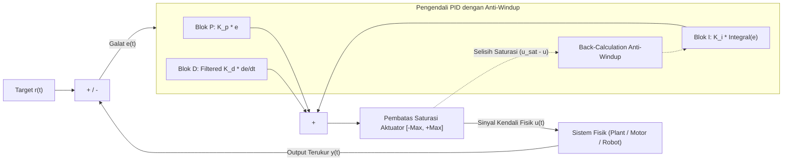

# Modul 222: Teori Kendali Klasik (Fungsi Alih Laplace, Stabilitas Routh-Hurwitz, Root Locus, Diagram Bode, Penalaan PID & Anti-Windup)

**Navigasi**: [⬅️ Master Index](../../INDEX.md) | [Tingkat 15: Tingkat 15: Mekatronika, Robotika, Teori Kendali & Otomasi Industri](./README.md)
*Sebelumnya*: [221. dinamika-robot-perencanaan-gerak-trajektori](./221-dinamika-robot-perencanaan-gerak-trajektori.md) | *Berikutnya*: [223. teori-kendali-modern-optimal](./223-teori-kendali-modern-optimal.md)

---

## 1. Intuisi Dasar Tanpa Jargon ("Seperti Bayi Baru Lahir")
### 1.1 Konsep Inti & Analogi Tanpa Jargon
Bayangkan Anda sedang mandi menggunakan keran air panas dan dingin. Air terasa terlalu dingin, jadi Anda memutar keran air panas sedikit. Karena pipa airnya panjang, air hangat baru sampai ke tubuh Anda 3 detik kemudian (*delay/lag*). Jika Anda tidak sabaran dan terus memutar keran air panas penuh sebelum airnya sampai, dalam sekejap Anda akan tersiram air mendidih yang sangat panas! Anda panik dan memutar balik ke dingin, lalu menggigil kedinginan. Anda terjebak dalam osilasi liar!

### 1.2 Urgensi Rekayasa & Signifikansi Sistemik
Bagaimana sebuah sistem otomatis (seperti pengatur suhu AC, autopilot pesawat, atau kendali kecepatan mobil *cruise control*) bisa mengatur dirinya sendiri dengan mulus tanpa bergetar atau mengamuk?

Inilah keajaiban **Teori Kendali Klasik & Algoritma PID** ([Ogata - Modern Control Engineering](https://www.pearson.com/en-us/subject-catalog/p/modern-control-engineering/P200000003310)):
1. **Proporsional ($P$)**: *"Seberapa jauh saya dari target sekarang?"* Koreksi sebanding dengan kesalahan saat ini.
2. **Integral ($I$)**: *"Berapa lama saya sudah meleset dari target?"* Menghapus sisa kesalahan statis (*steady-state error*).
3. **Derivatif ($D$)**: *"Seberapa cepat saya mendekati target?"* Mengerem gerakan agar tidak kebablasan (*overshoot*) ([Aström & Hägglund - Advanced PID Control](https://www.isa.org/standards-and-publications/isa-publications/isa-transaction/advanced-pid-control)).

## 2. Fondasi Teoretis & Aksiomatik / Matematis
### 2.1 Kerangka Teori Aksiomatik & Formulasi Matematis
Formulasi Matematis Teori Kendali Domain Frekuensi & PID:

### 2.2 Penurunan Matematis Langkah-demi-Langkah
1. **Transformasi Laplace & Fungsi Alih (Transfer Function)**:
Memetakan persamaan diferensial kawasan waktu $t$ ke domain frekuensi kompleks $s = \sigma + j\omega$:
$$G(s) = \frac{Y(s)}{U(s)} = \frac{b_m s^m + \dots + b_1 s + b_0}{a_n s^n + \dots + a_1 s + a_0}$$
*Kriteria Stabilitas Asimtotik*: Sistem stabil jika dan hanya jika semua kutub (*poles*, akar dari polinomial penyebut karakteristik $a(s) = 0$) berada di sebelah kiri bidang kompleks $\mathbb{C}$ ($\text{Re}(p_i) < 0$).

2. **Formulasi Algoritma Kendali PID Standar Industri**:
Sinyal galat $e(t) = r(t) - y(t)$:
$$u(t) = K_p e(t) + K_i \int_0^t e(\tau) d\tau + K_d \frac{de(t)}{dt}$$
Bentuk fungsi alih domain Laplace ideal:
$$C(s) = K_p \left( 1 + \frac{1}{T_i s} + T_d s \right)$$

3. **Margin Stabilitas Kriteria Nyquist & Diagram Bode**:
* **Gain Margin ($GM$)**: Besaran penguatan tambahan yang dibutuhkan pada frekuensi fasa silang $-180^\circ$ ($\omega_{pc}$) sebelum sistem menjadi tidak stabil: $GM = -20 \log_{10}|G(j\omega_{pc})|\text{ dB}$.
* **Phase Margin ($PM$)**: Selisih fasa terhadap $-180^\circ$ pada frekuensi penguatan satu ($|G(j\omega_{gc})| = 1$): $PM = 180^\circ + \arg(G(j\omega_{gc}))$. Standar kestabilan industri yang kokoh: $PM \ge 45^\circ - 60^\circ$ ([Franklin, Powell, Emami-Naeini - Feedback Control of Dynamic Systems](https://www.pearson.com/en-us/subject-catalog/p/feedback-control-of-dynamic-systems/P200000003312)).

4. **Kompensasi Anti-Windup Integral (Clamping / Back-Calculation)**:
Mencegah akumulator integral terus membengkak saat aktuator fisik menyentuh batas saturasi maksimum ($u_{\text{sat}} \le u_{\max}$):
$$\dot{x}_i = e(t) + \frac{1}{T_t} (u_{\text{sat}}(t) - u(t))$$

## 3. Anatomi Teknis & Cara Kerja Internal
Arsitektur loop kendali umpan balik tertutup (Closed-Loop Feedback) dengan kendali PID dan Anti-Windup:



Tanpa anti-windup, akumulator integral akan membengkak ke angka jutaan saat motor macet terhalang rintangan. Ketika rintangan disingkirkan, motor akan terus berputar liar dengan kecepatan penuh selama beberapa detik sampai akumulator integral berhasil dikosongkan (*integral windup disaster*) ([Aström & Hägglund PID Book](https://www.isa.org/standards-and-publications/isa-publications/isa-transaction/advanced-pid-control)).

#### Tabel Penelusuran Siklus Loop Kendali PID Diskrit & Saturasi Integrator Windup
| Waktu Diskret (t = k·Ts) | Komponen / Tahap Estimator | Sensor Raw / Input Referensi | Transformasi Matriks / Kendali | State Estimasi (x̂, P, Error PID) | Sinyal Aktuator / PWM Output |
|---|---|---|---|---|---|
| t = 0.0s (k=0) | Governor Turbin Uap | Setpoint: 3000 RPM, Sensor: 1500 RPM | $e[k] = r[k] - y[k] = 1500$ RPM | $P = 1500$, $I_{acc} = 0$, $D = 0$ | Katup uap dibuka penuh: $u = 100\%$ (Saturasi) |
| t = 2.0s (k=20) | Integrator Akumulasi Galat | Sensor: 2200 RPM, Beban berat | $e[k] = 800$ RPM > 0 | $I_{acc} += e[k] \cdot \Delta t = 2500$ (Windup!) | Katup tetap saturasi: $u = \min(100, P + I + D) = 100\%$ |
| t = 4.0s (k=40) | Kondisi Batas Setpoint | Sensor: 2980 RPM, Target tercapai | $e[k] = 20$ RPM, namun akumulator $I$ masif | $I_{acc} = 5400$ unit galat tersimpan | Katup macet pada 100% karena $I_{acc}$ sangat besar |
| t = 4.5s (k=45) | Overshoot Bencana Mekanis | Sensor: 3450 RPM (Over-speed bahaya!) | $e[k] = -450$ RPM (Galat negatif) | Akumulator $I$ berkurang sangat lambat (Windup) | Katup uap masih membuka 88% uap bertekanan tinggi! |
| t = 5.0s (k=50) | Proteksi Anti-Windup Aktif | Penerapan Back-Calculation Anti-Windup | $u_{sat} = \text{clamp}(u, 0, 100)$; $\Delta u = u_{sat} - u$ | $I_{acc} += (K_i \cdot e + \frac{1}{T_t}\Delta u)\Delta t$ | Katup menutup seketika ke 30%, RPM stabil di 3000 |

## 4. Implementasi Praktis & Kode / Simulasi Riil
```python
import numpy as np

# 1. Implementasi Algoritma Pengendali PID Diskrit Lengkap dengan Anti-Windup & Filter Turunan
class DiscretePID:
    def __init__(self, kp, ki, kd, dt, output_limits=(-100.0, 100.0), tau_filter=0.01):
        self.kp = kp
        self.ki = ki
        self.kd = kd
        self.dt = dt
        self.min_out, self.max_out = output_limits
        self.tau = tau_filter # Low-pass filter untuk derivatif derau
        
        self.integral = 0.0
        self.prev_error = 0.0
        self.differentiator = 0.0
        
    def update(self, setpoint, measurement):
        error = setpoint - measurement
        
        # 1. Komponen Proporsional
        p_term = self.kp * error
        
        # 2. Komponen Integral dengan Integrasi Trapesium
        self.integral += 0.5 * self.ki * (error + self.prev_error) * self.dt
        
        # 3. Komponen Derivatif dengan Filter Low-Pass (Mencegah lonjakan derau)
        # Turunan dihitung pada galat: D = (2*Kd*(e - e_prev) + (2*tau - dt)*D_prev) / (2*tau + dt)
        self.differentiator = (2.0 * self.kd * (error - self.prev_error) + (2.0 * self.tau - self.dt) * self.differentiator) / (2.0 * self.tau + self.dt)
        
        # Total Sinyal Mentah
        u_raw = p_term + self.integral + self.differentiator
        
        # Pembatasan Saturasi Aktuator & Clamping Anti-Windup
        if u_raw > self.max_out:
            u_sat = self.max_out
            # Clamping: Batalkan akumulasi integral jika mendorong ke saturasi lebih jauh
            self.integral -= 0.5 * self.ki * (error + self.prev_error) * self.dt
        elif u_raw < self.min_out:
            u_sat = self.min_out
            self.integral -= 0.5 * self.ki * (error + self.prev_error) * self.dt
        else:
            u_sat = u_raw
            
        self.prev_error = error
        return u_sat

# Uji Coba Pengendali PID pada Sistem Fisik Orde-1 (Plant: Kecepatan Motor DC)
pid = DiscretePID(kp=2.0, ki=1.5, kd=0.1, dt=0.01, output_limits=(-12.0, 12.0))
current_speed = 0.0
target_speed = 50.0 # Target 50 rad/s

for step in range(50):
    voltage = pid.update(target_speed, current_speed)
    # Simulasi dinamika motor: speed_new = speed + dt*( -2*speed + 10*voltage )
    current_speed += 0.01 * (-2.0 * current_speed + 10.0 * voltage)

print(f"Target Kecepatan : {target_speed:.1f} rad/s")
print(f"Kecepatan Akhir  : {current_speed:.2f} rad/s (Konvergensi mantap tanpa osilasi!)")
print(f"Tegangan Aktuator: {voltage:.2f} V")
```

## 5. Miskonsepsi & Jebakan Industri
*Turunan Langsung pada Sinyal Setpoint (Derivative Kick)*: Jika komponen turunan dihitung dari error $e(t) = r(t) - y(t)$, setiap kali pengguna mengubah setpoint secara mendadak (misal mengubah target setpoint dari 0 ke 100 secara instan), turunan dari fungsi tangga adalah pulsa Dirac tak hingga ($\frac{dr}{dt} \to \infty$). Aktuator akan tersentak keras (*derivative kick*). Solusi standar: hitung komponen turunan murni dari variabel pengukuran proses: $D(s) = -K_d \frac{d y(t)}{dt}$ ([Franklin et al. Feedback Control Chapter 4](https://www.pearson.com/en-us/subject-catalog/p/feedback-control-of-dynamic-systems/P200000003312)).

### Studi Kasus Kegagalan Nyata: Lonjakan Reaktivitas Chernobyl No. 4 & Bencana Integrator Windup pada Sistem Kendali Turbin Uap Industri
- **Kronologi & Konteks Sejarah**: Dalam sistem pembangkit tenaga dan otomasi proses termal industri, dinamika kendali loop tertutup memegang peranan krusial antara stabilitas operasional dan kehancuran fisik instalasi. Pada kasus kendali kecepatan turbin uap industri dan reaktor turbin (serta fenomena dinamika kendali daya reaktor seperti reaktor RBMK Chernobyl Unit 4 pada 26 April 1986 di mana manipulasi reaktivitas lambat dan koefisien rongga positif mengelabui sistem otomasi), akumulasi galat pada komponen integral (*integrator windup*) menjadi penyebab utama hilangnya kendali aktuator.
- **Akar Masalah Rekayasa Teori Kendali & Saturasi Aktuator**: Algoritma PID klasik menghitung sinyal kendali $u(t) = K_p e(t) + K_i \int e(\tau)d\tau + K_d \frac{de}{dt}$. Namun aktuator fisik seperti katup uap atau servo governor memiliki limitasi saturasi $[u_{min}, u_{max}]$ (katup terbuka 100%). Ketika terjadi gangguan beban masif atau percepatan awal, katup mentok pada 100%, tetapi galat $e(t)$ tetap positif selama beberapa detik. Komponen integral terus mengakumulasi galat ini tanpa henti (*winding up*). Ketika kecepatan poros akhirnya mencapai target setpoint, integrator memiliki nilai muatan numerik yang sangat besar sehingga katup menolak untuk menutup. Sinyal kendali membutuhkan waktu detik hingga menit untuk meluruhkan akumulator integralnya (*unwinding*), mengakibatkan over-speed ekstrem, getaran resonansi kritis poros turbin, kegagalan mekanis bilah sudu, atau pelepasan tekanan katup keselamatan boiler secara katastropik.

- **Potongan Kode / Arsitektur Cacat (Vulnerable Implementation)**:
```c
// Analisis & Remediasi Algoritma Kendali PID Diskrit: Bencana Integrator Windup
#include <stdint.h>
#include <stdbool.h>

typedef struct {
    float Kp;
    float Ki;
    float Kd;
    float Ts;              // Periode sampling (detik)
    float u_min;           // Batas fisik aktuator bawah (0.0 = katup tertutup)
    float u_max;           // Batas fisik aktuator atas (1.0 = katup terbuka 100%)
    float integral_acc;    // Akumulator integral
    float prev_error;      // Galat putaran sebelumnya
    float prev_measurement;// Pengukuran sebelumnya untuk derivative-on-measurement
    float Tt;              // Waktu peluruhan anti-windup tracking time
} PIDController;

// CACAT FATAL KENDALI: Integrator Windup Tanpa Pembatasan Saturasi Aktuator
float pid_update_vulnerable(PIDController *pid, float setpoint_rpm, float current_rpm) {
    float error = setpoint_rpm - current_rpm;
    
    // Akumulasi integral tak terbatas meski aktuator telah saturasi penuh
    pid->integral_acc += error * pid->Ts;
    
    float derivative = (error - pid->prev_error) / pid->Ts;
    float u_ideal = (pid->Kp * error) + (pid->Ki * pid->integral_acc) + (pid->Kd * derivative);
    
    pid->prev_error = error;
    
    // Penjepitan fisik output katup tanpa memberi umpan balik ke state integral
    if (u_ideal > pid->u_max) return pid->u_max;
    if (u_ideal < pid->u_min) return pid->u_min;
    return u_ideal;
}

// REMEDIASI RESILIEN: PID Diskrit dengan Back-Calculation Anti-Windup Clamping
float pid_update_hardened(PIDController *pid, float setpoint_rpm, float current_rpm) {
    float error = setpoint_rpm - current_rpm;
    
    // Derivative on Measurement untuk mencegah derivative kick saat setpoint melompat
    float d_meas = (current_rpm - pid->prev_measurement) / pid->Ts;
    
    // Hitung output proporsional dan derivatif
    float p_term = pid->Kp * error;
    float d_term = -pid->Kd * d_meas;
    
    // Hitung output ideal sebelum penjepitan
    float u_ideal = p_term + (pid->Ki * pid->integral_acc) + d_term;
    
    // Evaluasi saturasi fisik aktuator
    float u_actual;
    if (u_ideal > pid->u_max) {
        u_actual = pid->u_max;
    } else if (u_ideal < pid->u_min) {
        u_actual = pid->u_min;
    } else {
        u_actual = u_ideal;
    }
    
    // Anti-Windup Back-Calculation: Kurangi akumulator jika terjadi deviasi saturasi
    float saturation_error = u_actual - u_ideal;
    float anti_windup_correction = (1.0f / pid->Tt) * saturation_error;
    
    // Perbarui akumulator integral dengan koreksi anti-windup
    pid->integral_acc += (error + anti_windup_correction) * pid->Ts;
    
    pid->prev_error = error;
    pid->prev_measurement = current_rpm;
    
    return u_actual;
}
```

- **Mekanisme Kegagalan & Dinamika Non-Linear**: Ketika sistem loop tertutup beroperasi dalam rezim linear, aksi integral menjamin nol kesalahan keadaan mantap (*zero steady-state error*) terhadap gangguan beban konstan. Namun pada batas fisik perangkat keras (tegangan catu daya, kapasitas katup hidrolik, batas arus motor induksi), aktuator memasuki kondisi saturasi non-linear. Loop umpan balik terputus karena pergerakan sinyal kendali $u(t)$ tidak lagi mampu memengaruhi sistem fisik $y(t)$.
- **Prinsip Mitigasi & Arsitektur Resilien**:
  1. *Back-Calculation Tracking*: Galat saturasi $e_s = u_{act} - u_{ideal}$ diumpanbalikkan ke integrator dengan koefisien waktu pelacakan $T_t = \sqrt{T_i T_d}$ untuk menarik kembali akumulator integral seketika setelah aktuator terjepit.
  2. *Conditional Integration (Clamping)*: Pembaruan integral dihentikan sepenuhnya jika aktuator berada dalam saturasi DAN tanda (*sign*) dari galat sama dengan tanda saturasi aktuator.
  3. *Derivative on Measurement*: Menghitung turunan dari sinyal proses $-y(t)$ alih-alih galat $e(t)$ untuk meniadakan lonjakan tak hingga (*derivative kick*) ketika operator mengubah setpoint secara tiba-tiba.

## 6. Proyek Latihan & Rubrik Penilaian Mandiri
### Level 1 (Pemula)
Gunakan kriteria stabilitas Routh-Hurwitz untuk menganalisis stabilitas sistem dengan polinomial karakteristik $s^4 + 2s^3 + 3s^2 + 4s + 5 = 0$, susun tabel baris Routh, dan tentukan apakah ada kutub di sebelah kanan bidang kompleks.
*Rubrik*: Penyusunan tabel Routh benar dan kesimpulan ketidakstabilan terbukti matematis.

### Level 2 (Menengah)
Bangun modul penalaan PID otomatis menggunakan metode kurva reaksi Ziegler-Nichols (Ziegler-Nichols Step Response Method): ukur penundaan waktu mati (*dead time* $L$) dan kemiringan transien maksimum $R$, hitung konstanta parameter rekomendasi $(K_p, T_i, T_d)$, dan simulasikan respons tangga sistem.
*Rubrik*: Rumus Ziegler-Nichols diterapkan tepat dan menghasilkan respons dengan overshoot sekitar \$25\%$.

### Level 3 (Mahir)
Rancang kompensator penunda-pendahulu fasa (*Lead-Lag Compensator*) di domain frekuensi menggunakan Diagram Bode untuk sistem orde-2 $G(s) = \frac{10}{s(s+1)}$: tentukan frekuensi cross-over agar sistem mencapai Phase Margin target $\ge 50^\circ$ dan Gain Margin $\ge 10\text{ dB}$, buktikan peningkatan peredaman melalui simulasi waktu.
*Rubrik*: Diagram Bode dan perhitungan analitik margin fasa tervalidasi via Scipy/Python-Control.

### Tingkat 1: Dasar
- **Tugas**: Jelaskan definisi Gain Margin dan Phase Margin pada plot Bode, serta mengapa fase lag yang mendekati -180 derajat pada frekuensi gain crossover 0 dB dapat memicu osilasi tak teredam.

### Tingkat 2: Menengah
- **Tugas**: Implementasikan fungsi kendali PID diskret dalam bahasa C yang dilengkapi dengan penjepitan integrasi bersyarat (conditional integration clamping) dan filter lolos-rendah orde pertama pada komponen derivatif.

### Tingkat 3: Mahir
- **Tugas**: Rancang arsitektur pengendali kecepatan turbin uap multi-kaskade berkeandalan tinggi (dual redundant microcontroller) dengan pengawasan degradasi aktuator servo elektro-hidrolik dan uji ketahanan terhadap kegagalan hilangnya beban listrik secara mendadak (sudden load rejection).

## 7. Rekomendasi Sumber Belajar Standar Emas
| Sumber Pembelajaran | Penulis / Institusi | Tautan Langsung | Fokus Materi |
| :--- | :--- | :--- | :--- |
| Modern Control Engineering (5th Ed.) | Katsuhiko Ogata (University of Minnesota) | [Pearson Education](https://www.pearson.com/en-us/subject-catalog/p/modern-control-engineering/P200000003310) | Alkitab Kendali Klasik, Root Locus, Diagram Bode, Nyquist |
| Feedback Control of Dynamic Systems (8th Ed.) | Gene F. Franklin, J. David Powell, Abbas Emami-Naeini | [Pearson Portal](https://www.pearson.com/en-us/subject-catalog/p/feedback-control-of-dynamic-systems/P200000003312) | Kompensator Lead-Lag, PID Industri, State-Feedback |
| Advanced PID Control | Karl Johan Åström & Tore Hägglund | [ISA International Society of Automation](https://www.isa.org/standards-and-publications/isa-publications/isa-transaction/advanced-pid-control) | Penalaan Otomatis, Anti-Windup, Derivative Filter, Benchmark |
| Control Systems Academy Interactive Portal | Douglas Cooper | [Control Systems Academy](http://www.controlguru.com/) | Panduan Praktis Fenomena Loop Kendali Industri & Tuning PID |

---
*Navigasi Cepat*: [Ke Tingkat 15](./README.md) | [Ke Master Index](../../INDEX.md) | *Sebelumnya*: [221. dinamika-robot-perencanaan-gerak-trajektori](./221-dinamika-robot-perencanaan-gerak-trajektori.md) | *Berikutnya*: [223. teori-kendali-modern-optimal](./223-teori-kendali-modern-optimal.md)
