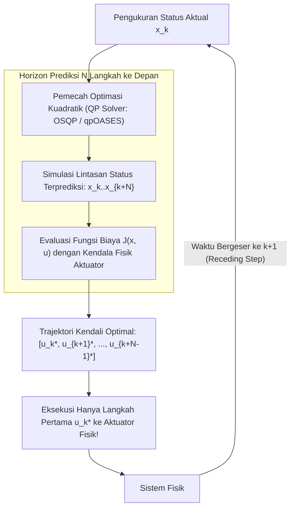

# Modul 223: Teori Kendali Modern & Optimal (State-Space Representation, Pole Placement, Linear Quadratic Regulator / LQR, MPC, Lyapunov)

**Navigasi**: [⬅️ Master Index](../../INDEX.md) | [Tingkat 15: Tingkat 15: Mekatronika, Robotika, Teori Kendali & Otomasi Industri](./README.md)
*Sebelumnya*: [222. teori-kendali-klasik](./222-teori-kendali-klasik.md) | *Berikutnya*: [224. fusi-sensor-estimasi-status-slam](./224-fusi-sensor-estimasi-status-slam.md)

---

## 1. Intuisi Dasar Tanpa Jargon ("Seperti Bayi Baru Lahir")
Kendali PID klasik sangat hebat untuk sistem sederhana dengan satu input dan satu output (seperti mengendalikan kecepatan satu motor). Namun, bagaimana jika Anda harus mengendalikan roket Falcon 9 milik SpaceX yang sedang mendarat tegak di atas kapal tongkang di tengah laut berombak?

Roket memiliki banyak variabel yang saling mengunci: sudut kemiringan, kecepatan vertikal, kecepatan angin samping, tekanan bahan bakar, dan orientasi sirip kisi (*grid fins*). Mengubah satu motor akan memengaruhi sepuluh variabel lainnya sekaligus (**MIMO - Multi-Input Multi-Output**).

Teori kendali klasik tidak sanggup menanganinya. Kita beralih ke **Teori Kendali Modern & Optimal**:
1. **Representasi Ruang Status (State-Space)**: Membungkus seluruh dinamika sistem ke dalam satu vektor status $\mathbf{x}(t)$ dan sistem matriks linier $\dot{\mathbf{x}} = A\mathbf{x} + B\mathbf{u}$ ([Kalman - On the General Theory of Control Systems](https://archive.org/details/on-the-general-theory-of-control-systems)).
2. **Linear Quadratic Regulator (LQR)**: Komputer menghitung aksi kendali optimal yang menyeimbangkan antara mencapai target secepat mungkin dengan menghemat bahan bakar seminimal mungkin.
3. **Model Predictive Control (MPC)**: Sang grandmaster catur kendali modern! Di setiap langkah waktu, MPC mensimulasikan masa depan roket untuk 5 detik ke depan di dalam memorinya, mencari manuver terbaik dengan memperhitungkan batasan fisik (seperti sudut kemiringan roket tidak boleh melebihi $15^\circ$), mengeksekusi langkah pertama, lalu mengulangi simulasi tersebut setiap milidetik ([Borrelli, Bemporad, Morari - Predictive Control for Linear and Hybrid Systems](https://www.cambridge.org/core/books/predictive-control-for-linear-and-hybrid-systems/8EEFF4B4BB08B2A10AEF39DCE9119B4C)).

## 2. Fondasi Teoretis & Aksiomatik / Matematis
Formulasi Matematis Kendali Modern Ruang Status & Optimasi:

1. **Representasi Ruang Status (State-Space Model)**:
Sistem dinamik linier invarian waktu (LTI):
$$\dot{x}(t) = A x(t) + B u(t), \quad y(t) = C x(t) + D u(t)$$
Di mana $x \in \mathbb{R}^n$ vektor status, $u \in \mathbb{R}^m$ vektor input kendali, $y \in \mathbb{R}^p$ vektor output.
*Kriteria Keterkendalian Kalman (Controllability Matrix)*: Sistem dapat dikendalikan penuh jika dan hanya jika matriks kontroabilitas memiliki rank penuh $n$:
$$\mathcal{C} = \begin{bmatrix} B & AB & A^2 B & \dots & A^{n-1} B \end{bmatrix}, \quad \text{rank}(\mathcal{C}) = n$$

2. **Linear Quadratic Regulator (LQR Optimal Control)**:
Mencari hukum kendali umpan balik status $u(t) = -K x(t)$ yang meminimalkan fungsi biaya kuadratik waktu tak hingga:
$$J = \int_0^\infty \left( x(t)^T Q x(t) + u(t)^T R u(t) \right) dt, \quad Q = Q^T \ge 0, \quad R = R^T > 0$$
Matriks penguatan optimal $K = R^{-1} B^T P$, di mana $P$ adalah solusi simetris definit positif dari **Persamaan Aljabar Riccati (Continuous-Time Algebraic Riccati Equation / CARE)**:
$$A^T P + P A - P B R^{-1} B^T P + Q = 0$$

3. **Model Predictive Control (MPC) Horizon Bergerak**:
Pada setiap interval diskret $k$, menyelesaikan masalah optimasi kuadratik (*Quadratic Programming / QP*) pada horizon prediksi $N$:
$$\min_{\{u_k, \dots, u_{k+N-1}\}} \sum_{i=0}^{N-1} \left( x_{k+i|k}^T Q x_{k+i|k} + u_{k+i|k}^T R u_{k+i|k} \right) + x_{k+N|k}^T P_f x_{k+N|k}$$
Subjek kendala ketat aktuator fisik dan status:
$$u_{\min} \le u_{k+i} \le u_{\max}, \quad x_{\min} \le x_{k+i} \le x_{\max}, \quad x_{k+i+1} = A x_{k+i} + B u_{k+i}$$
Hanya input pertama $u_k^*$ yang dieksekusi ke aktuator riil (*receding horizon principle*).

4. **Teori Stabilitas Non-Linier Lyapunov**:
Sistem dinamik otonom $\dot{x} = f(x)$ stabil asimtotik jika terdapat fungsi skalar skalar definit positif $V(x) > 0$ ($\forall x \neq 0, V(0) = 0$) sedemikian sehingga turunan waktunya definit negatif sepanjang lintasan:
$$\dot{V}(x) = \nabla V(x) \cdot f(x) < 0, \quad \forall x \neq 0$$

## 3. Anatomi Teknis & Cara Kerja Internal
Arsitektur eksekusi siklus berulang Receding Horizon pada Model Predictive Control (MPC):



Keunggulan mutlak MPC dibanding seluruh metode kendali lainnya adalah kemampuannya yang tak tertandingi untuk menangani **kendala ketat fisik (*hard constraints*)** secara eksplisit (seperti batas sudut kemiringan kemudi atau kapasitas torsi motor) ([Borrelli et al. MPC Textbook](https://www.cambridge.org/core/books/predictive-control-for-linear-and-hybrid-systems/8EEFF4B4BB08B2A10AEF39DCE9119B4C)).

## 4. Implementasi Praktis & Kode / Simulasi Riil
```python
import numpy as np
from scipy import linalg

# 1. Penyelesaian Kendali Optimal Linear Quadratic Regulator (LQR)
def solve_lqr(A, B, Q, R):
    # Menyelesaikan Continuous-time Algebraic Riccati Equation (CARE): A^T P + P A - P B R^-1 B^T P + Q = 0
    P = linalg.solve_continuous_are(A, B, Q, R)
    # Menghitung Gain Matriks K = R^-1 B^T P
    K = np.linalg.inv(R) @ (B.T @ P)
    return K, P

# Model Sistem Bandul Terbalik di Atas Kereta (Inverted Pendulum on a Cart)
# Vektor Status: [posisi_kereta, kecepatan_kereta, sudut_bandul, kecepatan_sudut_bandul]^T
A = np.array([
    [0.0, 1.0, 0.0,  0.0],
    [0.0, -0.1, 2.7, 0.0],
    [0.0, 0.0, 0.0,  1.0],
    [0.0, -0.2, 30.0, 0.0]
])
B = np.array([[0.0], [0.9], [0.0], [2.5]])

# Matriks Penalti Biaya Status (Q) dan Biaya Gaya Kendali (R)
Q = np.diag([10.0, 1.0, 100.0, 10.0]) # Penalti sangat berat pada deviasi sudut bandul!
R = np.array([[0.1]])                 # Biaya input kendali aktuator

# 2. Periksa Matriks Kontrolabilitas Kalman
C_kalman = np.hstack([B, A @ B, A @ A @ B, A @ A @ A @ B])
rank_c = np.linalg.matrix_rank(C_kalman)
print(f"Dimensi Status: {A.shape[0]} | Rank Matriks Kontrolabilitas: {rank_c}")
assert rank_c == A.shape[0], "Sistem harus terkendali penuh (Fully Controllable)!"

K_opt, P_sol = solve_lqr(A, B, Q, R)
print("Matriks Gain Umpan Balik Status LQR Optimal (K):")
print(f"K = {K_opt[0]}")

# Verifikasi Nilai Eigen Loop Tertutup (A - B*K) Harus Semua Negatif Riil
A_closed = A - B @ K_opt
eigenvalues = np.linalg.eigvals(A_closed)
print("\nKutub Loop Tertutup (Closed-Loop Poles):")
for pole in eigenvalues:
    print(f" - {pole:.3f}")
assert np.all(np.real(eigenvalues) < 0), "Sistem loop tertutup dijamin stabil asimtotik!"
```

## 5. Miskonsepsi & Jebakan Industri
*Waktu Eksekusi Solver QP yang Melebihi Batas Sampling pada MPC (Real-Time Violation)*: Menyelesaikan masalah pemrograman kuadratik (QP) secara numerik pada setiap siklus loop $10\text{ ms}$ dapat gagal konvergen tepat waktu jika jumlah variabel status dan horizon prediksi terlalu panjang. Aktuator tidak akan menerima sinyal kendali baru, menyebabkan sistem crash. Solusi modern: gunakan algoritma **Explicit MPC** (menghitung solusi fungsi piece-wise affine secara offline) atau pemecah first-order berbasis operator splitting berkecepatan mikrodetik (seperti OSQP) ([Stellato et al. - OSQP: An Operator Splitting Solver for Quadratic Programs](https://arxiv.org/abs/1711.08013)).

## 6. Proyek Latihan & Rubrik Penilaian Mandiri
### Level 1 (Pemula)
Gunakan rumus Pole Placement Ackerman di Python (`scipy.signal.place_poles`) untuk merancang matriks gain umpan balik status $K$ dari sistem osilator harmonik teredam sehingga kutub loop tertutup berada di $s = -3 \pm 4j$.
*Rubrik*: Nilai eigen matriks loop tertutup $(A - BK)$ terbukti identik dengan kutub target.

### Level 2 (Menengah)
Bangun simulator Model Predictive Control (MPC) linear tak berkendala untuk sistem navigasi kendaraan 1D menggunakan library optimasi `scipy.optimize.minimize`: rumuskan matriks prediksi multi-langkah $H$ langkah ke depan, integrasikan batas penalti kecepatan, dan bandingkan kualitas tracking terhadap pengendali LQR.
*Rubrik*: Respon kendali MPC mendekati solusi LQR pada kondisi tanpa kendala aktif.

### Level 3 (Mahir)
Implementasikan analisis stabilitas non-linier menggunakan fungsi kandidat Lyapunov $V(x) = \frac{1}{2} x_1^2 + \frac{1}{2} x_2^2$ pada sistem bandul non-linier $\dot{x}_1 = x_2, \dot{x}_2 = -\sin(x_1) - b x_2 + u$: rancang hukum kendali pembatalan non-linier (*Feedback Linearization*) $u = \sin(x_1) - k x_1$, buktikan $\dot{V}(x) \le 0$, dan tentukan wilayah daya tarik (*Region of Attraction / RoA*) secara numerik.
*Rubrik*: Bukti kestabilan global LaSalle Invariance Principle terpenuhi sempurna.

## 7. Rekomendasi Sumber Belajar Standar Emas
| Sumber Pembelajaran | Penulis / Institusi | Tautan Langsung | Fokus Materi |
| :--- | :--- | :--- | :--- |
| Predictive Control for Linear and Hybrid Systems | Francesco Borrelli, Alberto Bemporad, Manfred Morari | [Cambridge University Press](https://www.cambridge.org/core/books/predictive-control-for-linear-and-hybrid-systems/8EEFF4B4BB08B2A10AEF39DCE9119B4C) | Alkitab Model Predictive Control (MPC), Algoritma QP |
| Linear Optimal Control | Brian D. O. Anderson & John B. Moore | [Prentice-Hall Classic](https://store.doverpublications.com/products/9780486457666) | Teori Aljabar Riccati, LQR, LQG, Sifat Robustness Kalman |
| Non-linear Systems (3rd Ed.) | Hassan K. Khalil (Michigan State University) | [Pearson Higher Ed](https://www.pearson.com/en-us/subject-catalog/p/nonlinear-systems/P200000003318) | Teori Stabilitas Lyapunov, Input-Output Linearization |
| Underactuated Robotics: Algorithms for Walking, Running, Swimming, Flying | Russ Tedrake (MIT CSAIL) | [MIT Underactuated Course Portal](https://underactuated.csail.mit.edu/) | Kendali LQR/Trajektori Dinamika Robot Humanoid & Kaki |

---
*Navigasi Cepat*: [Ke Tingkat 15](./README.md) | [Ke Master Index](../../INDEX.md) | *Sebelumnya*: [222. teori-kendali-klasik](./222-teori-kendali-klasik.md) | *Berikutnya*: [224. fusi-sensor-estimasi-status-slam](./224-fusi-sensor-estimasi-status-slam.md)
