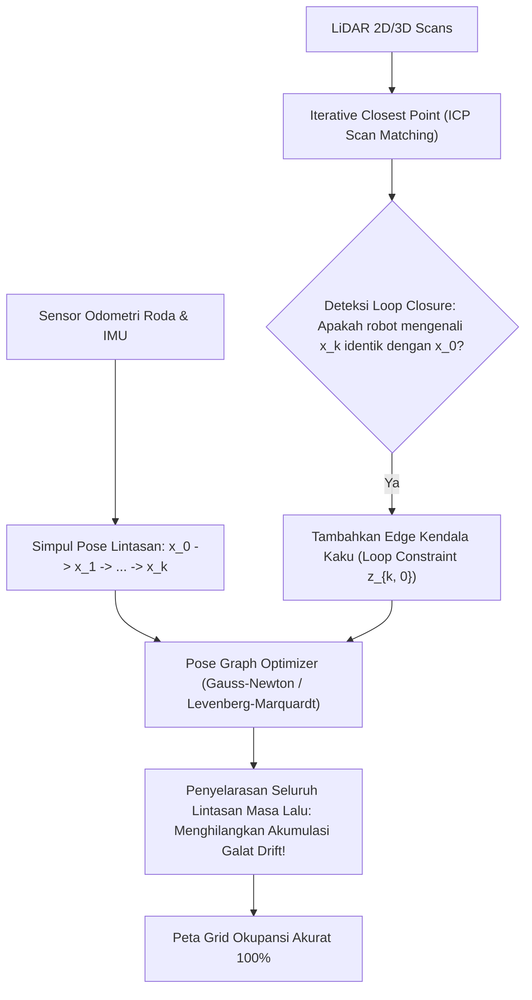

# Modul 224: Fusi Sensor, Estimasi Status & SLAM (Filter Kalman Linier, EKF Non-Linier, UKF, Particle Filter, Occupancy Grid, Graph-SLAM)

**Navigasi**: [⬅️ Master Index](../../INDEX.md) | [Tingkat 15: Tingkat 15: Mekatronika, Robotika, Teori Kendali & Otomasi Industri](./README.md)
*Sebelumnya*: [223. teori-kendali-modern-optimal](./223-teori-kendali-modern-optimal.md) | *Berikutnya*: [225. arsitektur-perangkat-lunak-robotika-ros-2](./225-arsitektur-perangkat-lunak-robotika-ros-2.md)

---

## 1. Intuisi Dasar Tanpa Jargon ("Seperti Bayi Baru Lahir")
### 1.1 Konsep Inti & Analogi Tanpa Jargon
Bayangkan Anda terbangun di dalam sebuah labirin gua raksasa yang gelap gulita dan belum pernah dipetakan oleh manusia. Anda tidak memiliki peta gua, dan Anda bahkan tidak tahu di mana posisi Anda saat ini!

### 1.2 Urgensi Rekayasa & Signifikansi Sistemik
Setiap kali Anda melangkah ke depan, Anda membuat peta kasar dari dinding gua di sekitar Anda berdasarkan apa yang bisa disentuh tangan Anda; dan saat peta itu mulai terbentuk, Anda menggunakan peta tersebut untuk mencari tahu di mana posisi tubuh Anda. Ini adalah masalah paradoks ayam-dan-telur klasik: *"Untuk membuat peta lingkungan, saya harus tahu posisi saya; namun untuk mengetahui posisi saya, saya harus memiliki peta lingkungan!"*

Dalam dunia robotika otonom, masalah legendaris ini disebut **SLAM (Simultaneous Localization and Mapping)** ([Durrant-Whyte & Bailey - Simultaneous Localization and Mapping: Part I](https://ieeexplore.ieee.org/document/1638022)).

Sensor robot tidak pernah ada yang sempurna: roda encoder mengalami slip, IMU melayang hanyut (*drift*), dan sensor kamera terganggu cahaya. Dengan memadukan seluruh data sensor yang cacat tersebut melalui algoritma probabilitas **Filter Kalman Lanjutan (EKF, UKF, Particle Filter)** dan **Graph-SLAM**, robot secara bersamaan dapat merekonstruksi peta ruangan digital sekaligus menentukan koordinat lokasinya hingga ketelitian sentimeter ([Thrun, Burgard, Fox - Probabilistic Robotics](https://www.probabilistic-robotics.org/)).

## 2. Fondasi Teoretis & Aksiomatik / Matematis
### 2.1 Kerangka Teori Aksiomatik & Formulasi Matematis
Formulasi Matematis Fusi Sensor Probabilistik & SLAM:

### 2.2 Penurunan Matematis Langkah-demi-Langkah
1. **Extended Kalman Filter (EKF) untuk Sistem Non-Linier**:
Model transisi status non-linier $f$ dan model pengukuran non-linier $h$:
$$x_k = f(x_{k-1}, u_k) + w_k, \quad z_k = h(x_k) + v_k, \quad w_k \sim \mathcal{N}(0, Q_k), \quad v_k \sim \mathcal{N}(0, R_k)$$
Linearisasi Taylor orde-1 pada estimasi terbaik saat ini:
$$F_k = \left. \frac{\partial f}{\partial x} \right|_{\hat{x}_{k-1|k-1}, u_k}, \quad H_k = \left. \frac{\partial h}{\partial x} \right|_{\hat{x}_{k|k-1}}$$
*Tahap Prediksi*:
$$\hat{x}_{k|k-1} = f(\hat{x}_{k-1|k-1}, u_k), \quad P_{k|k-1} = F_k P_{k-1|k-1} F_k^T + Q_k$$
*Tahap Pembaruan*:
$$K_k = P_{k|k-1} H_k^T (H_k P_{k|k-1} H_k^T + R_k)^{-1}$$
$$\hat{x}_{k|k} = \hat{x}_{k|k-1} + K_k (z_k - h(\hat{x}_{k|k-1})), \quad P_{k|k} = (I - K_k H_k) P_{k|k-1}$$

2. **Unscented Kalman Filter (UKF) & Transformasi Unscented**:
Menghindari linearisasi Jacobian dengan menyebarkan himpunan titik sampel deterministik (*Sigma Points* $2n + 1$) secara langsung menembus fungsi non-linier asli:
$$\chi^{(0)} = \bar{x}, \quad \chi^{(i)} = \bar{x} \pm \left( \sqrt{(n + \lambda) P} \right)_i$$
Mampu menangkap rata-rata dan kovarians hingga presisi Taylor orde ketiga ([Julier & Uhlmann - Unscented Filtering and Nonlinear Estimation](https://ieeexplore.ieee.org/document/1271397)).

3. **Formulasi Graph-SLAM (Pose-Graph Optimization)**:
Memodelkan lintasan robot sebagai graf faktor di mana simpul (*nodes*) adalah pose robot $x_i \in SE(2)$ atau $SE(3)$, dan sisi (*edges*) adalah kendala spasial relatif dari odometri $z_{ij}^{\text{odo}}$ atau penutupan loop (*Loop Closure* $z_{ij}^{\text{loop}}$):
$$\min_{x} \sum_{i, j} e_{ij}(x_i, x_j)^T \Omega_{ij} e_{ij}(x_i, x_j), \quad e_{ij} = z_{ij} - h(x_i, x_j)$$
Dipecahkan menggunakan metode kuadrat terkecil non-linier Gauss-Newton / Levenberg-Marquardt dengan matriks informasi sparse $\Omega$ via solver g2o atau Ceres Solver ([Grisetti et al. - A Tutorial on Graph-Based SLAM](https://ieeexplore.ieee.org/document/5681215)).

## 3. Anatomi Teknis & Cara Kerja Internal
Arsitektur fusi sensor Graph-SLAM dengan deteksi penutupan loop (Loop Closure Constraint):



Ketika *Loop Closure* terdeteksi (robot kembali ke titik awal yang pernah dikunjungi 1 jam lalu), sistem memasang pegas koreksi matematis yang menarik seluruh lintasan historis yang melenceng kembali ke posisi sejati, menghapus seluruh akumulasi *dead-reckoning drift* seketika ([Grisetti et al. 2010](https://ieeexplore.ieee.org/document/5681215)).

#### Tabel Penelusuran Siklus Estimasi Status EKF & Saturasi Sensor Inersia Schiaparelli
| Waktu Diskret (t = k·Ts) | Komponen / Tahap Estimator | Sensor Raw / Input Referensi | Transformasi Matriks / Kendali | State Estimasi (x̂, P, Error PID) | Sinyal Aktuator / PWM Output |
|---|---|---|---|---|---|
| t = 0.0s (Entry) | IMU Ketinggian Parasut Mars | Altimeter radar: $h = 4200$ m, Gyro: $\omega_y = 12^\circ$/s | Propagasi kovariansi: $P_{k|k-1} = F P F^T + Q$ | Ketinggian $h = 4198$ m, Kecepatan $v = -85$ m/s | Parasut supersonik mengembang sempurna |
| t = 0.5s (Osilasi) | Parasut Berayun Hebat | Gyro laju sudut mengukur osilasi ekstrem | Kecepatan sudut riil: $\omega_y = 380^\circ$/s | Ambang batas perangkat keras IMU saturasi pada $300^\circ$/s | Sensor IMU mengunci output pada batas maksimum $300^\circ$/s |
| t = 1.0s (Saturasi) | Integrator Estimasi Sikap EKF | Pembacaan IMU saturasi konstan 1 detik | Integrasi orientasi: $\theta = \int \omega_{sat} dt$ | Estimasi sudut orientasi berputar terbalik $180^\circ$! | Komputer mengira wahana sedang menghadap terbalik ke atas |
| t = 1.2s (Proyeksi Kosinus) | Fusi Altimeter & Orientasi | Altimeter radar: Jarak pantul 3700 meter | Proyeksi ketinggian: $h_{est} = z_{radar} \cdot \cos(\theta_{est})$ | $\cos(180^\circ) = -1 \implies h_{est} = -50$ meter! | Komputer menyimpulkan wahana telah berada di bawah permukaan tanah! |
| t = 1.3s (Dampak Bencana) | Modul Logika Pendaratan | Logika: "Jika $h_{est} \le 0$, lepaskan parasut & mesin" | Perintah aktivasi pemotongan kabel parasut darurat | Parasut dilepas pada ketinggian riil 3.7 km di atas tanah | Mesin pendorong menyala hanya 3 detik alih-alih 30 detik; crash 540 km/jam! |

## 4. Implementasi Praktis & Kode / Simulasi Riil
```python
import numpy as np

# 1. Extended Kalman Filter (EKF) untuk Robot Mobil 2D (x, y, theta)
class RobotEKF:
    def __init__(self, init_state, init_cov):
        self.x = np.array(init_state, dtype=float) # [x, y, theta]^T
        self.P = np.array(init_cov, dtype=float)
        
    def predict(self, v, omega, dt, Q):
        theta = self.x[2]
        # Model Kinematika Non-Linier: x_k = f(x_{k-1}, u)
        dx = v * np.cos(theta) * dt
        dy = v * np.sin(theta) * dt
        dtheta = omega * dt
        self.x += np.array([dx, dy, dtheta])
        
        # Matriks Jacobian df/dx
        F = np.array([
            [1.0, 0.0, -v * np.sin(theta) * dt],
            [0.0, 1.0,  v * np.cos(theta) * dt],
            [0.0, 0.0, 1.0]
        ])
        self.P = F @ self.P @ F.T + Q
        return self.x, self.P
        
    def update_gps(self, z_gps, R):
        # Pengukuran GPS langsung mengukur posisi Cartesius [x, y]
        H = np.array([
            [1.0, 0.0, 0.0],
            [0.0, 1.0, 0.0]
        ])
        z_pred = H @ self.x
        residual = z_gps - z_pred
        
        S = H @ self.P @ H.T + R
        K = self.P @ H.T @ np.linalg.inv(S) # Kalman Gain
        
        self.x += K @ residual
        self.P = (np.eye(3) - K @ H) @ self.P
        return self.x, self.P

# Simulasi Fusi Odometri + GPS
ekf = RobotEKF(init_state=[0.0, 0.0, 0.0], init_cov=np.eye(3)*0.1)
Q_noise = np.diag([0.01, 0.01, 0.005]) # Derau Proses Odometri
R_noise = np.diag([0.5, 0.5])          # Derau Pengukuran GPS (Kasaran)

# Prediksi 1 langkah odometri maju (v=2m/s, belok 0.1 rad/s, dt=0.5s)
state_pred, cov_pred = ekf.predict(v=2.0, omega=0.1, dt=0.5, Q=Q_noise)
print(f"Prediksi Odometri (Sebelum Sensor Update): X={state_pred[0]:.2f}m, Y={state_pred[1]:.2f}m")

# Update dengan Pengukuran GPS Kasar
gps_reading = np.array([0.95, 0.08])
state_est, cov_est = ekf.update_gps(gps_reading, R=R_noise)
print(f"Estimasi Fusi EKF Akhir (Setelah Update) : X={state_est[0]:.2f}m, Y={state_est[1]:.2f}m")
print(f"Ketidakpastian Kovarians P (Tereduksi)  : Var(X)={cov_est[0,0]:.4f}")
```

## 5. Miskonsepsi & Jebakan Industri
*Inkonsistensi Estimasi & Overconfidence pada EKF-SLAM*: Pada EKF-SLAM, matriks kovarians $P$ sering kali mengalami *overconfidence* (nilai varians mengecil mendekati nol secara semu padahal galat posisi riil masih besar) akibat aproksimasi linearisasi Taylor orde-1 yang membuang suku-suku non-linieritas tinggi sudut rotasi $\theta$. Jika filter menjadi overconfident, ia akan mengabaikan pengukuran sensor baru dan menolak koreksi loop closure. Gunakan pendekatan **Graph-SLAM modern berbasis faktor non-linier** untuk mengeliminasi inkonsistensi ini secara permanen ([Huang et al. - Convergence and Consistency Analysis for Metrics in SLAM](https://ieeexplore.ieee.org/document/4209562)).

### Studi Kasus Kegagalan Nyata: Bencana Saturasi Sensor IMU Wahana Pendarat Mars Schiaparelli EDM (European Space Agency, 2016)
- **Kronologi & Konteks Sejarah**: Pada 19 Oktober 2016, wahana pendarat Schiaparelli Entry, Descent, and Landing Demonstrator Module (EDM) milik European Space Agency (ESA) dan Roscosmos memasuki atmosfer Mars dalam misi ExoMars. Setelah perlambatan aerodinamis berhasil dan parasut supersonik dikembangkan pada ketinggian sekitar 12 kilometer, wahana mengalami osilasi mekanis yang hebat saat kanopi parasut berayun di atmosfer tipis Mars.
- **Akar Masalah Rekayasa Fusi Sensor & Saturasi Inersia EKF**: Ketika parasut berayun, kecepatan sudut wahana melampaui batas pengukuran maksimum sensor *Inertial Measurement Unit* (IMU). Sensor saturasi pada batas perangkat kerasnya selama sekitar satu detik penuh. Komputer pemandu menggunakan algoritma *Extended Kalman Filter* (EKF) untuk mengintegrasikan laju putaran sudut menjadi orientasi spasial wahana tanpa memvalidasi apakah sensor mengalami saturasi atau menerapkan batas kelayakan fisika (*plausibility checks*). Akibat integrasi nilai saturasi tersebut, estimasi orientasi sudut wahana melompat salah hingga $165^\circ$, membuat komputer mempercayai bahwa wahana terbalik menghadap ke atas. Ketika radar altimeter Doppler mengukur jarak ke permukaan tanah sebesar 3,7 kilometer, sistem memproyeksikan jarak ini menggunakan sudut orientasi yang salah ($h = d \cdot \cos\theta$), menghasilkan estimasi ketinggian negatif (di bawah permukaan Mars). Perangkat lunak penerbangan secara otomatis memutuskan bahwa wahana telah mendarat dengan aman, memutuskan kabel parasut, mematikan roket pendorong setelah hanya membakar bahan bakar selama 3 detik, dan menjatuhkan modul pendarat dalam gaya bebas hingga hancur berkeping-keping di dataran Meridiani Planum pada kecepatan 540 km/jam.

- **Potongan Kode / Arsitektur Cacat (Vulnerable Implementation)**:
```python
# Analisis Galat Fusi Sensor EKF: Kegagalan Saturasi Sensor IMU & Penolakan Outlier
import numpy as np

class SchiaparelliNavigationFilter:
    def __init__(self):
        self.altitude = 4000.0        # Ketinggian riil (meter)
        self.velocity = -80.0         # Kecepatan vertikal (m/s)
        self.attitude_pitch = 0.0     # Estimasi sudut pitch (radian)
        self.imu_max_rate = np.radians(300.0) # Batas fisik saturasi giroskop (300 deg/s)

    def update_vulnerable(self, raw_gyro_rate, radar_range_measurement, dt=0.05):
        '''EKF RENTAN: Mengintegrasikan sensor jenuh tanpa validasi batas saturasi'''
        # Sensor saturasi pada nilai maksimumnya
        measured_rate = np.clip(raw_gyro_rate, -self.imu_max_rate, self.imu_max_rate)
        
        # Integrasi murni orientasi tanpa uji plausibilitas fisika
        self.attitude_pitch += measured_rate * dt
        
        # Proyeksi jarak radar ke sumbu vertikal menggunakan estimasi orientasi
        # BENCANA: Jika attitude_pitch menyimpang mendekati pi (180 deg), cosinus bernilai negatif!
        estimated_altitude = radar_range_measurement * np.cos(self.attitude_pitch)
        self.altitude = estimated_altitude
        
        # Logika pendaratan otomatis cacat: Mematikan mesin jika ketinggian <= 0
        if self.altitude <= 0.0:
            return "CUT_PARACHUTE_AND_SHUTDOWN_ENGINES" # Fatal crash dari 3.7 km!
        return "DECELERATING_NORMAL"

    def update_hardened(self, raw_gyro_rate, radar_range_measurement, dt=0.05):
        '''EKF RESILIEN: Deteksi Saturasi, Residual Chi-Square Gating & Sanity Bounds'''
        # 1. Deteksi Saturasi Sensor Perangkat Keras
        is_saturated = abs(raw_gyro_rate) >= self.imu_max_rate
        
        if is_saturated:
            # Tingkatkan kovariansi derau R secara masif atau abaikan update IMU ini
            effective_rate = 0.0 # Jangan integrasikan laju saat sensor kehilangan linearitas
        else:
            effective_rate = raw_gyro_rate
            
        self.attitude_pitch += effective_rate * dt
        
        # 2. Batas Fisika Realistis (Sanity Bound): Wahana parasut tidak mungkin terbalik 180 deg
        self.attitude_pitch = np.clip(self.attitude_pitch, np.radians(-45.0), np.radians(45.0))
        
        # 3. Proyeksi dengan jaminan non-negatif
        projected_altitude = radar_range_measurement * np.cos(self.attitude_pitch)
        
        # 4. Gating Konsistensi Kecepatan vs Ketinggian
        expected_altitude = self.altitude + self.velocity * dt
        if projected_altitude < 0.0 or abs(projected_altitude - expected_altitude) > 500.0:
            # Tolak pengukuran radar yang melanggar hukum gravitasi / kontinuitas fisika
            self.altitude = expected_altitude
        else:
            self.altitude = 0.8 * expected_altitude + 0.2 * projected_altitude
            
        return "DECELERATING_NORMAL"
```

- **Mekanisme Kegagalan & Propagasi Non-Linear Sikap Pesawat**: Dalam sistem navigasi inersia strapdown (*Strapdown Inertial Navigation System*), orientasi matriks rotasi $C_b^n$ diperoleh melalui integrasi persamaan diferensial kinematik kuaternion $\dot{q} = \frac{1}{2} q \otimes \omega$. Ketika giroskop saturasi, nilai integral $\int (\omega_{riil} - \omega_{sat}) dt$ bertindak sebagai drift sudut tak terbatas. Proyeksi vektor jarak radar altimeter dari kerangka bodi wahana (*body frame*) ke kerangka inersia lokal (*navigation frame*) sangat bergantung pada cosinus kuaternion sikap. Kesalahan sudut $>90^\circ$ secara matematis membalikkan tanda komponen vertikal, mengubah jarak positif menjadi negatif.
- **Prinsip Mitigasi & Arsitektur Resilien**:
  1. *Saturation Flagging & Covariance Inflation*: Sensor pintar harus mengeluarkan bit status saturasi perangkat keras (*hardware clipping flag*). Saat flag aktif, filter estimasi harus mendiskontokan bobot inovasi atau menolak sampel sepenuhnya.
  2. *Innovation Gating (Chi-Square Residual Test)*: Menolak pengukuran sensor jika jarak Mahalanobis $d^2 = \nu^T S^{-1} \nu > \gamma_{threshold}$, mencegah injeksi data yang tidak konsisten dengan batas sebaran kovariansi estimasi.
  3. *State Sanity Check Assertions*: Logika misi tingkat tinggi (*mission executive logic*) dilarang keras mengeksekusi aksi kritis yang tidak dapat dibatalkan (melepaskan parasut pendarat) semata-mata berdasarkan keluaran satu estimator status tanpa konfirmasi silang multi-sensor independen.

## 6. Proyek Latihan & Rubrik Penilaian Mandiri
### Level 1 (Pemula)
Bangun simulator pemetaan *Occupancy Grid Mapping* 2D di Python: terima data sudut dan jarak pulsa laser LiDAR, perbarui nilai log-odds okupansi sel grid menggunakan model sensor invers Bresenham ray-casting:
$$l_{t, i} = l_{t-1, i} + \text{inv\_sensor}(z_t) - l_0$$
*Rubrik*: Menghasilkan visualisasi matriks peta biner (putih = ruang kosong, hitam = dinding rintangan).

### Level 2 (Menengah)
Implementasikan algoritma pelacakan lokasi berbasis partikel (*Monte Carlo Localization / Particle Filter*) untuk robot di bidang 2D: inisialisasi 1.000 partikel acak, terapkan model gerak probabilistik pada partikel, beri bobot partikel berdasarkan kecocokan pengukuran jarak sensor terhadap peta grid okupansi, dan terapkan teknik *Low-Variance Resampling*.
*Rubrik*: Partikel yang awalnya tersebar di seluruh ruangan mengelompok (*konvergen*) ke koordinat posisi sejati robot.

### Level 3 (Mahir)
Bangun solver optimasi graf pose (*Pose-Graph SLAM*) 2D mini dari awal: formulasikan vektor galat residual relatif $e_{ij} \in \mathbb{R}^3$ antar pose simpul $SE(2)$, hitung matriks Jacobian non-linier analitik, selesaikan sistem persamaan linier normal $H \Delta x = -b$ via metode Gauss-Newton iteratif, dan buktikan penutupan loop berhasil meratakan galat drift lintasan lingkaran 100 meter.
*Rubrik*: Solver mereduksi galat residual graf lebih dari \$95\%$ dalam 5 iterasi.

### Tingkat 1: Dasar
- **Tugas**: Jelaskan tahapan algoritma Extended Kalman Filter (Prediksi Status, Propagasi Kovariansi, Perhitungan Gain Kalman, dan Pembaruan Status) serta perbedaan utamanya dibandingkan Kalman Filter Linier standar.

### Tingkat 2: Menengah
- **Tugas**: Implementasikan skrip Python yang menerapkan Extended Kalman Filter 2D untuk fusi sensor odometri roda dan IMU, lengkap dengan uji Chi-Square Innovation Gating untuk menolak derau lonjakan impuls.

### Tingkat 3: Mahir
- **Tugas**: Rancang arsitektur perangkat lunak estimasi status wahana otonom luar angkasa dengan redundansi heterogen (IMU optik laser, radar altimeter gelombang mikro, dan kamera navigasi visual SLAM) yang tahan terhadap kebutaan sensor optik akibat debu permukaan.

## 7. Rekomendasi Sumber Belajar Standar Emas
| Sumber Pembelajaran | Penulis / Institusi | Tautan Langsung | Fokus Materi |
| :--- | :--- | :--- | :--- |
| Probabilistic Robotics | Sebastian Thrun, Wolfram Burgard, Dieter Fox | [Probabilistic Robotics Official](https://www.probabilistic-robotics.org/) | Alkitab SLAM, EKF, UKF, Particle Filter, Occupancy Grid |
| A Tutorial on Graph-Based SLAM | Giorgio Grisetti, Rainer Kümmerle, Cyrill Stachniss, Wolfram Burgard | [IEEE Intelligent Transportation Systems](https://ieeexplore.ieee.org/document/5681215) | Formulasi Formal Graph-SLAM, Pose Graph, Optimasi Non-Linier |
| Simultaneous Localization and Mapping: Part I & II | Hugh Durrant-Whyte & Tim Bailey | [IEEE Robotics & Automation Magazine](https://ieeexplore.ieee.org/document/1638022) | Tinjauan Klasik Teori SLAM, Struktur Informasi Kovarians |
| Ceres Solver: A Large Scale Non-linear Optimization Library | Sameer Agarwal, Keir Mierle (Google) | [Ceres Solver Documentation](http://ceres-solver.org/) | Pemecah Kuadrat Terkecil Non-Linier Skala Besar untuk SLAM |

---
*Navigasi Cepat*: [Ke Tingkat 15](./README.md) | [Ke Master Index](../../INDEX.md) | *Sebelumnya*: [223. teori-kendali-modern-optimal](./223-teori-kendali-modern-optimal.md) | *Berikutnya*: [225. arsitektur-perangkat-lunak-robotika-ros-2](./225-arsitektur-perangkat-lunak-robotika-ros-2.md)
