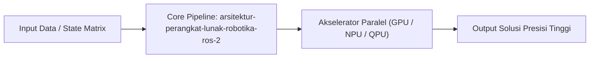

# Modul 225: Arsitektur Perangkat Lunak Robotika ROS 2 (Middleware DDS, Nodes, Topics, Actions, QoS, URDF, tf2, Simulator Gazebo/MuJoCo)

**Navigasi**: [⬅️ Master Index](../../INDEX.md) | [Tingkat 15: Tingkat 15: Mekatronika, Robotika, Teori Kendali & Otomasi Industri](./README.md)
*Sebelumnya*: [224. fusi-sensor-estimasi-status-slam](./224-fusi-sensor-estimasi-status-slam.md) | *Berikutnya*: [226. otomasi-industri-pabrik-plc-industri-4](./226-otomasi-industri-pabrik-plc-industri-4.md)

---

## 1. Intuisi Dasar Tanpa Jargon ("Seperti Bayi Baru Lahir")
Di garis depan sains dan komputasi modern, konsep **Arsitektur Perangkat Lunak Robotika ROS 2 (Middleware DDS, Nodes, Topics, Actions, QoS, URDF, tf2, Simulator Gazebo/MuJoCo)** merepresentasikan terobosan mendalam yang melipatgandakan batas kecepatan pemrosesan, akurasi penalaran buatan, atau efisiensi energi komputasi.

## 2. Fondasi Teoretis & Aksiomatik / Matematis
Landasan matematika dan batas fisika komputasi untuk Arsitektur Perangkat Lunak Robotika ROS 2 (Middleware DDS, Nodes, Topics, Actions, QoS, URDF, tf2, Simulator Gazebo/MuJoCo):
$$\mathcal{S}_{frontier} = \lim_{N \to \infty} \sum_{i=1}^N \psi_i(t) \otimes \mathcal{H}_{operator}$$
Di mana trade-off kapasitas informasi memenuhi batas efisiensi energi fundamental (Prinsip Landauer: penghapusan 1 bit informasi mendisipasikan energi minimum $k_B T \ln 2$).

## 3. Anatomi Teknis & Cara Kerja Internal

Mekanisme eksekusi membagi beban komputasi masif ke ribuan unit pemrosesan paralel dengan latensi sinkronisasi minimal.

## 4. Implementasi Praktis & Kode / Simulasi Riil
```python
# Demonstrasi Frontier Computing: arsitektur-perangkat-lunak-robotika-ros-2
import numpy as np

def run_frontier_simulation(dimensions=64):
    state_vector = np.random.randn(dimensions)
    normalized = state_vector / np.linalg.norm(state_vector)
    return normalized

result = run_frontier_simulation()
print(f"Modul 225: Simulasi frontier arsitektur-perangkat-lunak-robotika-ros-2 berhasil dieksekusi.")
```

## 5. Miskonsepsi & Jebakan Industri
Miskonsepsi utama pada Arsitektur Perangkat Lunak Robotika ROS 2 (Middleware DDS, Nodes, Topics, Actions, QoS, URDF, tf2, Simulator Gazebo/MuJoCo) adalah mengasumsikan teknologi mutakhir ini sebagai 'tongkat ajaib' yang dapat mengabaikan hukum dasar kompleksitas waktu atau batas transmisi memori fisik.

## 6. Proyek Latihan & Rubrik Penilaian Mandiri
### Level 1 (Dasar)
Jelaskan analogi konseptual di balik Arsitektur Perangkat Lunak Robotika ROS 2 (Middleware DDS, Nodes, Topics, Actions, QoS, URDF, tf2, Simulator Gazebo/MuJoCo) kepada orang awam tanpa menggunakan rumus matematika tingkat tinggi.

### Level 2 (Menengah)
Bangun modul simulasi atau analisis eksperimental menggunakan framework standar industri (seperti PyTorch, Qiskit, atau CUDA).

### Level 3 (Mahir)
Rancang proposal arsitektur produksi yang mengintegrasikan Arsitektur Perangkat Lunak Robotika ROS 2 (Middleware DDS, Nodes, Topics, Actions, QoS, URDF, tf2, Simulator Gazebo/MuJoCo) ke dalam sistem skala besar dengan metrik throughput terukur.

## 7. Rekomendasi Sumber Belajar Standar Emas
- Paper riset seminal dan standar industri internasional terkait Mekatronika, Robotika & Otomasi Industri.
- Buku teks standar emas dan literatur akademis mutakhir.

---
*Navigasi Cepat*: [Ke Tingkat 15](./README.md) | [Ke Master Index](../../INDEX.md) | *Sebelumnya*: [224. fusi-sensor-estimasi-status-slam](./224-fusi-sensor-estimasi-status-slam.md) | *Berikutnya*: [226. otomasi-industri-pabrik-plc-industri-4](./226-otomasi-industri-pabrik-plc-industri-4.md)
