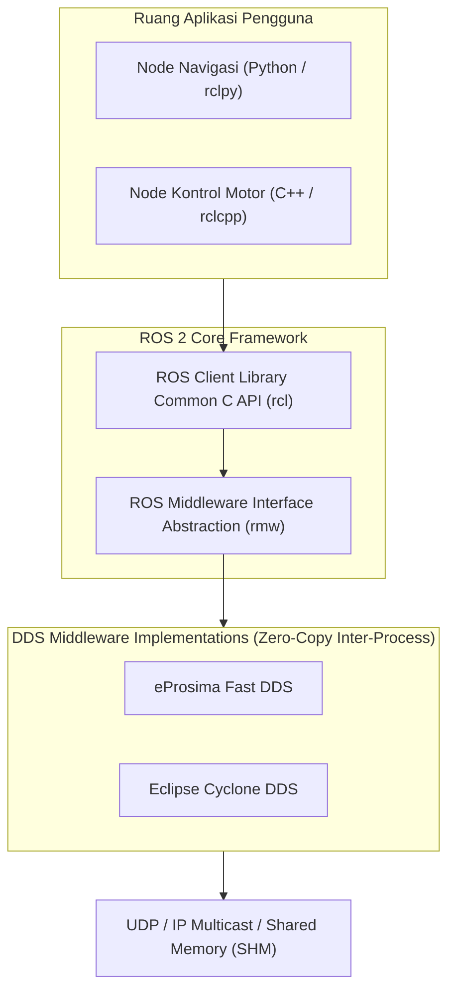

# Modul 225: Arsitektur Perangkat Lunak Robotika ROS 2 (Middleware DDS, Nodes, Topics, Actions, QoS, URDF, tf2, Simulator Gazebo/MuJoCo)

**Navigasi**: [⬅️ Master Index](../../INDEX.md) | [Tingkat 15: Tingkat 15: Mekatronika, Robotika, Teori Kendali & Otomasi Industri](./README.md)
*Sebelumnya*: [224. fusi-sensor-estimasi-status-slam](./224-fusi-sensor-estimasi-status-slam.md) | *Berikutnya*: [226. otomasi-industri-pabrik-plc-industri-4](./226-otomasi-industri-pabrik-plc-industri-4.md)

---

## 1. Intuisi Dasar Tanpa Jargon ("Seperti Bayi Baru Lahir")
Sebuah mobil otonom atau robot penjelajah memiliki puluhan subsistem yang harus bekerja bersamaan: kamera membaca marka jalan (30 frame per detik), sensor LiDAR memindai rintangan (10 kali per detik), algoritma AI memutuskan arah kemudi, dan motor listrik memutar roda.

Bagaimana jika program kamera ditulis dengan Python, program navigasi AI ditulis dengan PyTorch C++, dan program aktuator motor ditulis dengan C tingkat rendah di mikrokontroler? Bagaimana semua program yang berjalan di prosesor berbeda ini bisa bertukar data tanpa saling mengunci (*deadlock*) atau mengalami keterlambatan (*lag*)?

Jawabannya adalah **Robot Operating System 2 (ROS 2)** ([Macenski et al. - Robot Operating System 2: Design, Architecture, and Uses](https://www.science.org/doi/10.1126/scirobotics.abm6074)).

ROS 2 bukanlah sistem operasi seperti Windows atau Linux; ROS 2 adalah kerangka kerja perangkat lunak terdistribusi (*middleware*) berstandar industri. Setiap tugas dijalankan sebagai program independen (**Node**). Node-node ini saling mengobrol melalui jalan tol data berkecepatan tinggi bernama **DDS (Data Distribution Service)** menggunakan model berlangganan (**Publish-Subscribe / Topics**), permintaan dua arah (**Services**), dan tugas jangka panjang yang bisa dibatalkan (**Actions**) ([ROS 2 Official Documentation](https://docs.ros.org/en/rolling/)).

## 2. Fondasi Teoretis & Aksiomatik / Matematis
Arsitektur Middleware ROS 2 & Standar Komunikasi OMG DDS:

1. **Standar Komunikasi Data Distribution Service (OMG DDS)**:
Arsitektur terdesentralisasi tanpa broker pusat (*peer-to-peer / brokerless*), mengandalkan protokol penemuan dinamis otomatis (*Simple Participant Discovery Protocol / SPDP*):
* Global Data Space (GDS): Ruang pertukaran pesan global berbasis tipe data terstruktur IDL (*Interface Definition Language*).
* Kebijakan Kualitas Layanan (**Quality of Service / QoS Policies**):
  - *Reliability*: `BEST_EFFORT` (Kirim tanpa konfirmasi ACK, ideal untuk data kamera/LiDAR bervolume tinggi) vs `RELIABLE` (Garansi pengiriman paket tanpa hilang, wajib untuk perintah kendali darurat).
  - *Durability*: `VOLATILE` (Pesan tidak disimpan) vs `TRANSIENT_LOCAL` (Menyimpan pesan terakhir di memori untuk node baru yang baru bergabung / *late joiners*).
  - *History & Depth*: Batas ukuran antrean buffer pesan ($N$ sampel).

2. **Pohon Transformasi Spasial tf2 (Spatial Frame Tree Architecture)**:
Menjaga graf acyclic terarah (DAG) dari seluruh sistem koordinat frame robot:
$$T_{\text{world}}^{\text{gripper}}(t) = T_{\text{world}}^{\text{base}}(t) \cdot T_{\text{base}}^{\text{wrist}}(t) \cdot T_{\text{wrist}}^{\text{gripper}}(t)$$
Mendukung interpolasi temporal dinamis: tf2 dapat menghitung posisi ujung lengan robot pada saat sensor kamera menangkap gambar 50 milidetik yang lalu via interpolasi linear/kuaternion SLERP ([Foote - tf: The Transform Library](https://ieeexplore.ieee.org/document/6696500)).

3. **Unified Robot Description Format (URDF) & SDF**:
Format pemodelan XML standar untuk merepresentasikan struktur kinematika, geometri visual, geometri tabrakan, dan sifat inersia dinamik ($m, I_{xx}, I_{yy}, I_{zz}$) seluruh link dan joint robot.

## 3. Anatomi Teknis & Cara Kerja Internal
Arsitektur tumpukan perangkat lunak berlapis ROS 2 (Client Library, RMW, dan DDS Vendors):



Dengan lapisan abstraksi *ROS Middleware (RMW)*, pengguna dapat mengganti vendor DDS di bawahnya tanpa mengubah satu baris pun kode aplikasi robotika mereka, serta memanfaatkan komunikasi memori bersama (*Shared Memory / SHM*) untuk mentransfer frame video resolusi 4K dengan latensi sub-milidetik bebas penyalinan buffer (*Zero-Copy*) ([Macenski et al. Science Robotics 2022](https://www.science.org/doi/10.1126/scirobotics.abm6074)).

## 4. Implementasi Praktis & Kode / Simulasi Riil
```python
# Kerangka Konseptual Node ROS 2 Publisher & Subscriber Berbasis rclpy
# (Simulasi Logika Eksekusi Node ROS 2 Terdistribusi)

class MockPublisher:
    def __init__(self, topic_name, msg_type):
        self.topic_name = topic_name
        self.msg_type = msg_type
        print(f"[ROS 2] Publisher aktif pada topik '{topic_name}' [{msg_type}]")
        
    def publish(self, data):
        # Mengirimkan pesan melalui middleware DDS
        return f"Pub: {data} -> DDS Multicast"

class MockSubscriber:
    def __init__(self, topic_name, callback_fn):
        self.topic_name = topic_name
        self.callback = callback_fn
        print(f"[ROS 2] Subscriber mendengarkan topik '{topic_name}'")

# Definisi Pesan Odometri Standar (nav_msgs/msg/Odometry)
class MockOdometryMsg:
    def __init__(self, x, y, theta):
        self.x = x
        self.y = y
        self.theta = theta

# Node Kontrol Sederhana
def odom_callback(msg: MockOdometryMsg):
    print(f"[Node Navigasi] Menerima Odometri: X={msg.x:.2f}m, Y={msg.y:.2f}m")

pub = MockPublisher("/odom", "nav_msgs/msg/Odometry")
sub = MockSubscriber("/odom", odom_callback)

# Simulasi Penerbitan Telemetri dari Sensor
msg = MockOdometryMsg(x=12.5, y=3.4, theta=0.785)
pub.publish(msg)
sub.callback(msg)
```

## 5. Miskonsepsi & Jebakan Industri
*Inkompatibilitas Profil QoS (QoS Incompatibility Failure)*: Salah satu sumber kutukan terbesar bagi insinyur robotika di ROS 2 adalah kegagalan komunikasi diam-diam (*silent failure*): Subscriber tidak menerima data sama sekali dari Publisher tanpa ada pesan galat yang muncul di terminal! Hal ini terjadi jika Publisher disetel dengan durabilitas `VOLATILE` sementara Subscriber meminta `TRANSIENT_LOCAL`, atau Publisher disetel `BEST_EFFORT` sementara Subscriber meminta `RELIABLE`. Aturan baku DDS: *Profil QoS Publisher harus sama atau lebih ketat dari profil yang diminta Subscriber* ([ROS 2 QoS Compatibility Guidelines](https://docs.ros.org/en/rolling/Concepts/Intermediate/About-Quality-of-Service-Settings.html)).

## 6. Proyek Latihan & Rubrik Penilaian Mandiri
### Level 1 (Pemula)
Tulis file deskripsi robot berformat Unified Robot Description Format (URDF) XML untuk robot beroda 2 sederhana: definisikan link rangka dasar (`base_link`), dua roda revolute (`wheel_left`, `wheel_right`), sifat inersia dasar, dan warna geometri visual.
*Rubrik*: Dokumen XML valid dan lolos verifikasi sintaksis parser `check_urdf`.

### Level 2 (Menengah)
Bangun Node ROS 2 (Python `rclpy` atau C++ `rclcpp`) yang bertindak sebagai Server Aksi (*Action Server* `/rotate_robot`): terima target sudut rotasi, lakukan kalkulasi perputaran inkremental, kirim umpan balik (*Feedback*) persentase penyelesaian setiap 100 ms, dukung pembatalan aksi (*Cancel Request*) dari klien, dan kembalikan status keberhasilan akhir (*Result*).
*Rubrik*: Server aksi menangani siklus hidup lengkap (Goal -> Accept -> Feedback -> Succeeded/Cancelled).

### Level 3 (Mahir)
Rancang arsitektur Pohon Transformasi Koordinat Spatial `tf2` lengkap untuk robot bergerak dengan lengan 3-DoF dan sensor kamera stereo: bangun broadcaster transform statis (`base_link -> camera_link`), broadcaster transform dinamis odometri (`odom -> base_link`), dan tulis node listener yang mengonversi koordinat titik target objek yang terdeteksi kamera di `camera_frame` langsung ke sistem koordinat absolut `map_frame` via interpolasi waktu.
*Rubrik*: Transformasi koordinat terhitung presisi bebas kesalahan orientasi matrix.

## 7. Rekomendasi Sumber Belajar Standar Emas
| Sumber Pembelajaran | Penulis / Institusi | Tautan Langsung | Fokus Materi |
| :--- | :--- | :--- | :--- |
| Robot Operating System 2: Design, Architecture, and Uses | Steven Macenski et al. (Open Robotics) | [Science Robotics 2022](https://www.science.org/doi/10.1126/scirobotics.abm6074) | Arsitektur Resmi ROS 2, Desain Middleware DDS, Real-Time |
| ROS 2 Official Documentation & Tutorials | Open Robotics Community | [ROS 2 Rolling Portal](https://docs.ros.org/en/rolling/) | Panduan Resmi Nodes, Topics, Services, Actions, QoS, URDF |
| tf: The Transform Library | Tully Foote (Willow Garage) | [IEEE Technologies for Practical Robot Applications](https://ieeexplore.ieee.org/document/6696500) | Matematika Pohon Koordinat tf2, Interpolasi Temporal Slerp |
| Nav2: Production-Grade Mobile Robot Navigation for ROS 2 | Steven Macenski et al. | [arXiv Nav2 Paper](https://arxiv.org/abs/2304.14360) | Arsitektur Behavior Tree Navigation, Costmaps, Planners |

---
*Navigasi Cepat*: [Ke Tingkat 15](./README.md) | [Ke Master Index](../../INDEX.md) | *Sebelumnya*: [224. fusi-sensor-estimasi-status-slam](./224-fusi-sensor-estimasi-status-slam.md) | *Berikutnya*: [226. otomasi-industri-pabrik-plc-industri-4](./226-otomasi-industri-pabrik-plc-industri-4.md)
