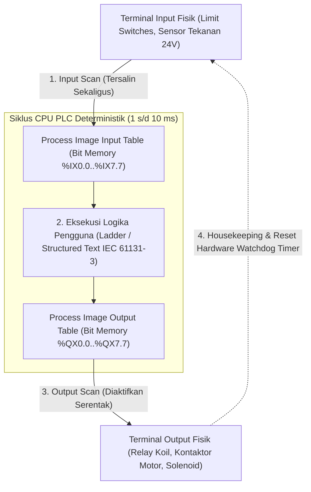

# Modul 226: Otomasi Industri Pabrik, PLC & Standar Industri 4.0 (Piramida ISA-95, Siklus Scan PLC, Standar Pemrograman IEC 61131-3, SCADA)

**Navigasi**: [⬅️ Master Index](../../INDEX.md) | [Tingkat 15: Tingkat 15: Mekatronika, Robotika, Teori Kendali & Otomasi Industri](./README.md)
*Sebelumnya*: [225. arsitektur-perangkat-lunak-robotika-ros-2](./225-arsitektur-perangkat-lunak-robotika-ros-2.md) | *Berikutnya*: [227. grafika-komputer-rendering](../16-hpc-multimedia-kuantum/227-grafika-komputer-rendering.md)

---

## 1. Intuisi Dasar Tanpa Jargon ("Seperti Bayi Baru Lahir")
### 1.1 Konsep Inti & Analogi Tanpa Jargon
Jika komputer laptop Anda mengalami *crash* atau *blue screen*, Anda cukup menekan tombol restart dan kehilangan dokumen pengetikan yang belum disimpan. Namun, bagaimana jika komputer yang mengendalikan katup reaktor nuklir, lengan robot perakitan pabrik mobil, atau sistem pengolahan air bersih kota mengalami *freeze* selama 2 detik saja? Pabrik bisa meledak, mobil cacat menabrak pekerja, dan ribuan orang keracunan!

### 1.2 Urgensi Rekayasa & Signifikansi Sistemik
Di dunia industri manufaktur dan pabrik kimia, komputer biasa tidak boleh digunakan. Mereka menggunakan komputer khusus anti-banting bernama **Programmable Logic Controller (PLC)** ([Petruzella - Programmable Logic Controllers](https://www.mheducation.com/highered/product/programmable-logic-controllers-petruzella/M9780073510880.html)).

PLC dirancang untuk hidup di lingkungan pabrik yang panas, berdebu, terkena cipratan oli, dan dihujani interferensi elektromagnetik petir mesin industri. Berbeda dengan PC yang mengeksekusi program secara acak berdasarkan sistem operasi, PLC bekerja dalam siklus waktu pasti tanpa henti (**Siklus Scan Deterministik**): **Baca Semua Input Sensor -> Eksekusi Logika -> Tulis Semua Output Motor/Katup** dalam waktu kurang dari 5 milidetik!

Seluruh pabrik pintar modern dihubungkan dalam hierarki piramida otomasi standar global **ISA-95** dan dikendalikan dari ruang monitor kendali jarak jauh bernama **SCADA** ([Boyer - SCADA: Supervisory Control and Data Acquisition](https://www.isa.org/standards-and-publications/isa-publications/isa-transaction/scada-supervisory-control-and-data-acquisition)).

## 2. Fondasi Teoretis & Aksiomatik / Matematis
### 2.1 Kerangka Teori Aksiomatik & Formulasi Matematis
Formulasi Otomasi Industri & Standar IEC 61131-3:

### 2.2 Penurunan Matematis Langkah-demi-Langkah
1. **Siklus Scan Deterministik PLC (Deterministic PLC Scan Cycle)**:
Waktu siklus total scan $T_{\text{scan}} = T_{\text{read}} + T_{\text{logic}} + T_{\text{write}} + T_{\text{diag}} \le T_{\text{watchdog}}$:
* **Fase 1: Input Scan**: Membaca status tegangan listrik seluruh terminal input fisik (\$24\text{ V DC}$) dan menyimpannya ke tabel memori bayangan (*Input Image Table / Process Image Inputs*).
* **Fase 2: Logic Execution**: Mengeksekusi instruksi program secara sekuensial dari atas ke bawah hanya berdasarkan data tabel bayangan input.
* **Fase 3: Output Scan**: Menyalin hasil memori tabel bayangan output (*Output Image Table*) secara serempak ke terminal relay/transistor output fisik.
* **Fase 4: Housekeeping & Diagnostik**: Komunikasi jaringan industri dan reset timer watchdog hardware ([Bolton - Programmable Logic Controllers](https://www.sciencedirect.com/book/9780128029299/programmable-logic-controllers)).

2. **Lima Bahasa Pemrograman Standar IEC 61131-3**:
* **Ladder Diagram (LD)**: Representasi grafis diagram tangga relai listrik kontak NO/NC dan koil.
* **Function Block Diagram (FBD)**: Blok fungsi aliran data grafis (timer TON/TOF, counter CTU, pengatur PID).
* **Structured Text (ST)**: Bahasa tingkat tinggi mirip Pascal untuk kalkulasi matematika kompleks, array, dan loop `FOR/WHILE`.
* **Sequential Function Chart (SFC)**: Mesin status (*State Machine*) grafis berbasis Grafcet Petri-net untuk proses sekuensial bertahap.
* **Instruction List (IL)**: Bahasa mirip assembly (telah didepresiasi pada edisi ketiga).

3. **Piramida Hierarki Otomasi Pabrik Standar ISA-95**:
* **Level 0 (Production Process)**: Fisik mesin, sensor limit switch, pemancar suhu, aktuator silinder pneumatik.
* **Level 1 (Sensing & Manipulation)**: PLC, Pengendali Loop Tunggal, Modul I/O Terdistribusi.
* **Level 2 (Monitoring & Supervisory)**: Perangkat Lunak SCADA (Supervisory Control and Data Acquisition) & Panel Layar Sentuh HMI (Human-Machine Interface).
* **Level 3 (Manufacturing Operations Management / MES)**: Pelacakan jadwal produksi batch, manajemen kualitas, Work-In-Progress (WIP).
* **Level 4 (Business Planning & Logistics / ERP)**: Sistem ERP (SAP / Oracle), manajemen inventaris gudang dan keuangan rantai pasok ([ANSI/ISA-95 Enterprise-Control System Integration](https://www.isa.org/standards-and-publications/isa-standards/isa-standards-committees/isa95)).

## 3. Anatomi Teknis & Cara Kerja Internal
Arsitektur siklus eksekusi memori Process Image pada PLC industri:



Pemisahan memori *Process Image* menjamin bahwa nilai sinyal input tidak akan berubah di tengah-tengah eksekusi baris logika program yang sama, mencegah perilaku balapan logika tak tentu (*logic race hazard*) ([Petruzella PLC Chapter 2](https://www.mheducation.com/highered/product/programmable-logic-controllers-petruzella/M9780073510880.html)).

#### Tabel Penelusuran Siklus Pindai PLC (Scan Cycle) & Sabotase Frekuensi Stuxnet
| Waktu Diskret (t = k·Ts) | Komponen / Tahap Estimator | Sensor Raw / Input Referensi | Transformasi Matriks / Kendali | State Estimasi (x̂, P, Error PID) | Sinyal Aktuator / PWM Output |
|---|---|---|---|---|---|
| t = 0.0s (Siklus Normal) | CPU S7-300 PLC (OB1) | Frekuensi motor sentrifus: 1064 Hz | Siklus pindai PLC: Baca Input $\to$ Logika $\to$ Tulis Output | Kecepatan stabil di batas desain rotor aluminium | VFD diperintahkan frekuensi 1064 Hz (Aman) |
| t = 10.0s (Injeksi Blok) | Malware Stuxnet (OB35 Intercept) | Intersepsi panggilan blok organisasi OB35 | Pengecekan ID perangkat keras: Profibus CP-342-5 | Stuxnet menyisipkan kode rootkit ke blok DB89 | PLC tetap melaporkan ke SCADA: "Semua Sistem Normal" |
| t = 20.0s (Manipulasi VFD) | Rutin Sabotase Frekuensi | Pembacaan sensor riil disamarkan | Frekuensi inverter dinaikkan paksa ke 1410 Hz! | Rotor sentrifus memasuki mode resonansi harmonik getaran kritis | Arus motor melonjak, bantalan magnet mengalami keausan geser |
| t = 35.0s (Pemalsuan SCADA) | Replay Telemetri Palsu | Data riil: Tekanan rotor 2.4 bar (Bahaya) | Replay rekaman data 21 detik siklus normal sebelumnya | Operator di ruang kendali melihat grafik tekanan stabil 1.0 bar | Alarm darurat SCADA ditindih oleh bit palsu Stuxnet |
| t = 50.0s (Kehancuran Rotor) | Integritas Fisik Sentrifus | Rotor UF6 berputar pada 1410 Hz melampaui batas lelah bahan | Kerusakan mekanis katastropik: Rotor membentur dinding selongsong | Sentrifus meledak fisik tanpa peringatan dini | PLC baru diperintahkan Stuxnet kembali ke 1064 Hz seolah tak terjadi apa-apa |

## 4. Implementasi Praktis & Kode / Simulasi Riil
```python
# Simulasi Mesin Scan Deterministik PLC Sederhana (Ladder Logic Emulation)

class MockPLC:
    def __init__(self):
        # Process Image Tables (Memori Bayangan Input & Output)
        self.inputs = {"START_BUTTON": False, "STOP_BUTTON": True, "SAFETY_CURTAIN": True}
        self.outputs = {"MOTOR_RUN": False, "ALARM_LAMP": False}
        self.memory_bits = {"RUN_LATCH": False}
        
    def scan_cycle(self, raw_sensor_readings):
        # 1. Input Scan Phase: Salin status fisik ke tabel bayangan
        self.inputs.update(raw_sensor_readings)
        
        # 2. Program Execution Phase (Rangkaian Rung Ladder Diagram Kontak Listrik):
        # Rung 1: Motor Seal-in Circuit (Start/Stop Latch dengan Tirai Keselamatan)
        # Sinyal STOP dan SAFETY bertipe Normal-Closed (NC = True saat kondisi aman)
        start = self.inputs["START_BUTTON"]
        stop = self.inputs["STOP_BUTTON"]
        safety = self.inputs["SAFETY_CURTAIN"]
        motor = self.outputs["MOTOR_RUN"]
        
        # Logika Ladder Rung 1: (Start OR Motor_Latch) AND Stop AND Safety -> Motor_Run
        if (start or motor) and stop and safety:
            self.outputs["MOTOR_RUN"] = True
            self.outputs["ALARM_LAMP"] = False
        else:
            self.outputs["MOTOR_RUN"] = False
            if not safety:
                self.outputs["ALARM_LAMP"] = True # Lampu alarm menyala jika tirai bahaya putus
                
        # 3. Output Scan Phase: Sinyal dikirim serentak ke koil kontaktor
        return self.outputs

# Simulasi Siklus Operasional Pabrik
plc = MockPLC()
print("Siklus 1: Kondisi Istirahat (Belum Ditekan Tombol Start)")
res1 = plc.scan_cycle({"START_BUTTON": False, "STOP_BUTTON": True, "SAFETY_CURTAIN": True})
print(f"Status Output: Motor={res1['MOTOR_RUN']}, Alarm={res1['ALARM_LAMP']}")

print("\nSiklus 2: Operator Menekan Tombol START (Pulsa Sesaat)")
res2 = plc.scan_cycle({"START_BUTTON": True, "STOP_BUTTON": True, "SAFETY_CURTAIN": True})
print(f"Status Output: Motor={res2['MOTOR_RUN']}, Alarm={res2['ALARM_LAMP']}")

print("\nSiklus 3: Operator Melepas Tombol START (Sirkuit Mengunci Sendiri / Self-Latching)")
res3 = plc.scan_cycle({"START_BUTTON": False, "STOP_BUTTON": True, "SAFETY_CURTAIN": True})
print(f"Status Output: Motor={res3['MOTOR_RUN']} (Motor Tetap Berputar!)")

print("\nSiklus 4: Terjadi Keadaan Darurat (Tirai Sensor Keselamatan Terpotong Tangan Pekerja)")
res4 = plc.scan_cycle({"START_BUTTON": False, "STOP_BUTTON": True, "SAFETY_CURTAIN": False})
print(f"Status Output: Motor={res4['MOTOR_RUN']} (MOTOR MATI SEKETIKA!), Alarm={res4['ALARM_LAMP']}")
```

## 5. Miskonsepsi & Jebakan Industri
*Mengabaikan Kawat Keras Tombol Darurat E-Stop (Software E-Stop Violation)*: Mengandalkan logika perangkat lunak PLC untuk mematikan motor saat tombol darurat *Emergency Stop (E-Stop)* ditekan adalah pelanggaran keselamatan industri yang berbahaya. Jika prosesor PLC mengalami freeze, kartu output korsleting (*shorted transistor*), atau terjadi bug memori, motor akan tetap menyala dan mencelakai operator. Standar keselamatan internasional (ISO 13849-1 / IEC 62061) mewajibkan tombol E-Stop diputus melalui kabel keras fisik (*Hardwired Safety Relay*) yang memutus daya kontaktor motor secara mekanis langsung terlepas dari kondisi PLC ([Safety of Machinery - ISO 13849-1](https://www.iso.org/standard/69883.html)).

### Studi Kasus Kegagalan Nyata: Sabotase Sentrifugasi Nuklir Natanz oleh Malware Stuxnet Melalui Manipulasi Siklus Pindai S7-300 PLC (2010)
- **Kronologi & Konteks Sejarah**: Pada tahun 2009 hingga 2010, fasilitas pengayaan uranium Natanz di Iran mengalami kerusakan fisik misterius pada sekitar 1.000 unit sentrifus gas IR-1. Investigasi keamanan siber internasional pada tahun 2010 mengungkap keberadaan cacing komputer militer canggih bernama Stuxnet—senjata siber terarah pertama di dunia yang dirancang secara spesifik untuk menghancurkan infrastruktur fisik industri (*Operational Technology / OT*).
- **Akar Masalah Rekayasa Otomasi Industri & Manipulasi Scan Cycle PLC**: Stuxnet menyusup ke workstation rekayasa melalui celah keamanan zero-day Windows, kemudian mengganti pustaka DLL komunikasi Siemens STEP 7 (`s7otbxdx.dll`). Ketika insinyur pabrik membuka proyek PLC di perangkat lunak SCADA, rootkit Stuxnet mencegat lalu lintas dan menyuntikkan kode berbahaya langsung ke memori kontroler mikro Siemens S7-300 (menginfeksi blok organisasi sistemik `OB1` dan `OB35`). Stuxnet secara diam-diam memanipulasi frekuensi kerja konverter frekuensi variabel (*Variable Frequency Drive / VFD*) Fararo Paya dan Vacon yang menggerakkan motor sentrifus: frekuensi dinaikkan secara bertahap dari 1.064 Hz ke 1.410 Hz (melewati batas resonansi harmonik rotor) selama 15 menit, lalu diturunkan secara drastis ke 2 Hz (menghancurkan bantalan akibat tegangan geser). Pada saat yang bersamaan, Stuxnet merekam data sinyal input sensor normal selama 21 detik dan memutarnya kembali secara berulang (*replay attack*) ke memori antarmuka operator SCADA WinCC, sehingga layar ruang kendali menampilkan grafik tekanan dan getaran yang sepenuhnya normal saat mesin-mesin di lantai pabrik meledak secara fisik.

- **Potongan Kode / Arsitektur Cacat (Vulnerable Implementation)**:
```c
// Analisis & Remediasi Kerentanan PLC: Serangan Intersepsi Siklus Pindai & Pemalsuan Telemetri
#include <stdint.h>
#include <stdbool.h>
#include <string.h>

typedef struct {
    float actual_frequency_hz;   // Frekuensi fisik aktual ke inverter motor
    float reported_frequency_hz; // Frekuensi yang dilaporkan ke SCADA HMI
    float vibration_mm_s;        // Tingkat getaran mekanis
    bool emergency_stop_trip;    // Interlock pengaman perangkat keras
} CentrifugeTelemetry;

// SIMULASI SERANGAN STUXNET: Intersepsi Siklus Pindai PLC & Penipuan Operator
void plc_scan_cycle_compromised(CentrifugeTelemetry *telemetry, bool stuxnet_active) {
    // 1. Tahap Pembacaan Input (Physical Inputs Image)
    float raw_sensor_freq = telemetry->actual_frequency_hz;
    
    // 2. Tahap Eksekusi Program Logika (OB1 / OB35)
    if (stuxnet_active) {
        // Sabotase Tersembunyi: Naikkan frekuensi aktuator fisik ke zona resonansi destruktif
        telemetry->actual_frequency_hz = 1410.0f; // Batas kritis lelah material rotor
        telemetry->vibration_mm_s = 48.5f;        // Getaran merusak struktur bantalan
        
        // Pemalsuan Telemetri (Replay Attack): Kirim data palsu yang aman ke antarmuka SCADA
        telemetry->reported_frequency_hz = 1064.0f; // Nilai normal desain
        
        // Blokir bit alarm keselamatan agar tidak memicu trip sistem
        telemetry->emergency_stop_trip = false; 
    } else {
        telemetry->reported_frequency_hz = raw_sensor_freq;
    }
    
    // 3. Tahap Penulisan Output (Process Output Image Table)
    // Sinyal aktual 1410 Hz dikirim ke drive VFD motor fisik!
}

// REMEDIASI RESILIEN OT/ICS: Tanda Tangan Kriptografis Siklus Pindai & Interlock Perangkat Keras
typedef struct {
    uint32_t firmware_checksum;
    bool hardware_safety_relay_state;
} SafetySystemGuard;

bool verify_plc_integrity_hardened(CentrifugeTelemetry *telemetry, SafetySystemGuard *guard) {
    // 1. Sensor Getaran Terhubung Langsung ke Relai Keselamatan Elektromekanis Mandiri (Bukan via PLC)
    // Interlock fisik independen: jika getaran > 10 mm/s, putus catu daya VFD secara elektrik
    if (telemetry->vibration_mm_s > 10.0f) {
        guard->hardware_safety_relay_state = false; // Putus kontak pemutus daya (Hardwired Circuit)
        return false; // Trip darurat independen dari perangkat lunak
    }
    
    // 2. Verifikasi Integritas Blok Kode PLC via Hash Kriptografis Hardware Secure Boot
    const uint32_t AUTHORIZED_BLOCK_HASH = 0xA4F2B890;
    if (guard->firmware_checksum != AUTHORIZED_BLOCK_HASH) {
        // Terdeteksi modifikasi blok program OB1/OB35 yang tidak sah!
        guard->hardware_safety_relay_state = false;
        return false;
    }
    
    return true;
}
```

- **Mekanisme Kegagalan & Arsitektur Siklus Pindai Terbuka**: Pengontrol logika terprogram (PLC) mengeksekusi instruksi secara deterministik siklis (*Deterministic Cyclic Execution*): *Input Scan $\to$ Program Execution $\to$ Output Scan $\to$ Housekeeping*. Arsitektur PLC klasik tidak memiliki isolasi memori virtual antar-blok program (*flat memory space*) dan tidak memverifikasi integritas kriptografis kode yang dimuat ke RAM eksekusi. Ketika malware menyusup pada level driver STEP 7, malware dapat memodifikasi *Process Image Output* (PIQ) sebelum instruksi fisik dikirim ke bus Profibus/Profinet, serta memanipulasi *Process Image Input* (PII) sebelum dibaca oleh SCADA.
- **Prinsip Mitigasi & Arsitektur Resilien**:
  1. *Hardwired Independent Safety Instrumented Systems (SIS)*: Fungsi keselamatan kritis (IEC 61508 / IEC 61511) harus diimplementasikan pada relai keselamatan elektro-mekanis terpisah atau Safety PLC terisolasi (SIL-3) yang independen secara fisik dari kontroler proses utama.
  2. *Cryptographic Firmware & Logic Attestation*: Mengadopsi PLC modern dengan modul keamanan perangkat keras (Secure Element / TPM) yang memvalidasi tanda tangan digital setiap blok program (*signed logic download*) sebelum eksekusi.
  3. *Out-of-Band Process Anomaly Detection*: Sensor telemetri industri fisik (sensor getaran nirkabel berfrekuensi tinggi atau analisis arus motor) yang langsung terhubung ke sistem deteksi anomali mandiri tanpa melalui jaringan kontroler PLC.

## 6. Proyek Latihan & Rubrik Penilaian Mandiri
### Level 1 (Pemula)
Tulis program Structured Text (IEC 61131-3) untuk mengendalikan lampu lalu lintas 4-arah: gunakan blok fungsi timer on-delay `TON` untuk mengatur durasi lampu hijau (30 detik), kuning (5 detik), dan merah (35 detik) dengan siklus berulang tak hingga.
*Rubrik*: Kode ST terstruktur benar dengan deklarasi variabel `VAR` dan `VAR_OUTPUT`.

### Level 2 (Menengah)
Rancang diagram Sequential Function Chart (SFC / Grafcet) untuk mesin pencampur batch cairan kimia: Langkah 1 (Buka katup air hingga sensor level tinggi aktif), Langkah 2 (Nyalakan pemanas dan motor pengaduk selama 15 menit), Langkah 3 (Buka katup pengurasan hingga kosong), kembali ke Langkah Awal.
*Rubrik*: Diagram SFC mencantumkan status transisi kondisi boolean dan aksi kualifikator yang tepat.

### Level 3 (Mahir)
Implementasikan simulator server protokol industri **Modbus TCP** (Port 502) dari awal di Python: tangani fungsi membaca status koil (*Read Coils Function Code 0x01*) dan menulis register analog (*Write Single Register Function Code 0x06*), hubungkan dengan klien SCADA simulasi untuk memonitor telemetri suhu tangki kimia secara real-time.
*Rubrik*: Paket biner MBAP Header Modbus TCP terurai dan direspons dengan kode sukses yang valid.

### Tingkat 1: Dasar
- **Tugas**: Jelaskan siklus eksekusi deterministik sebuah Programmable Logic Controller (PLC) yang mencakup Input Scan, Program Execution, Output Scan, dan Housekeeping, serta implikasinya terhadap responsivitas kendali real-time.

### Tingkat 2: Menengah
- **Tugas**: Tuliskan implementasi logika otomasi dalam Structured Text (ST) atau C yang mengontrol konverter frekuensi variabel (VFD) dengan pengecekan batas laju perubahan frekuensi (slew-rate limiting) dan interlock suhu bantalan motor.

### Tingkat 3: Mahir
- **Tugas**: Rancang arsitektur keamanan pertahanan berlapis (Defense-in-Depth) untuk fasilitas pabrik Industri 4.0 sesuai standar ISA/IEC 62443, mencakup segmentasi zona/saluran (Purdue Model), otentikasi protokol OT, dan pengawasan integritas firmware PLC secara terpusat.

## 7. Rekomendasi Sumber Belajar Standar Emas
| Sumber Pembelajaran | Penulis / Institusi | Tautan Langsung | Fokus Materi |
| :--- | :--- | :--- | :--- |
| Programmable Logic Controllers (5th Ed.) | Frank D. Petruzella | [McGraw-Hill Education](https://www.mheducation.com/highered/product/programmable-logic-controllers-petruzella/M9780073510880.html) | Alkitab Pemrograman PLC Industri, Ladder Logic, Rangkaian Relay |
| IEC 61131-3: Programmable Controllers - Part 3: Programming Languages | International Electrotechnical Commission | [IEC Webstore Standard](https://webstore.iec.ch/publication/4552) | Standar Internasional Bahasa Pemrograman PLC (LD, FBD, ST, SFC) |
| SCADA: Supervisory Control and Data Acquisition (4th Ed.) | Stuart A. Boyer | [ISA International Society of Automation](https://www.isa.org/standards-and-publications/isa-publications/isa-transaction/scada-supervisory-control-and-data-acquisition) | Desain Arsitektur SCADA, RTU, Komunikasi Industri Modbus |
| ANSI/ISA-95 Enterprise-Control System Integration | International Society of Automation | [ISA-95 Standards Committee](https://www.isa.org/standards-and-publications/isa-standards/isa-standards-committees/isa95) | Piramida Otomasi Manufaktur Level 0 s/d Level 4 |

---
*Navigasi Cepat*: [Ke Tingkat 15](./README.md) | [Ke Master Index](../../INDEX.md) | *Sebelumnya*: [225. arsitektur-perangkat-lunak-robotika-ros-2](./225-arsitektur-perangkat-lunak-robotika-ros-2.md) | *Berikutnya*: [227. grafika-komputer-rendering](../16-hpc-multimedia-kuantum/227-grafika-komputer-rendering.md)
