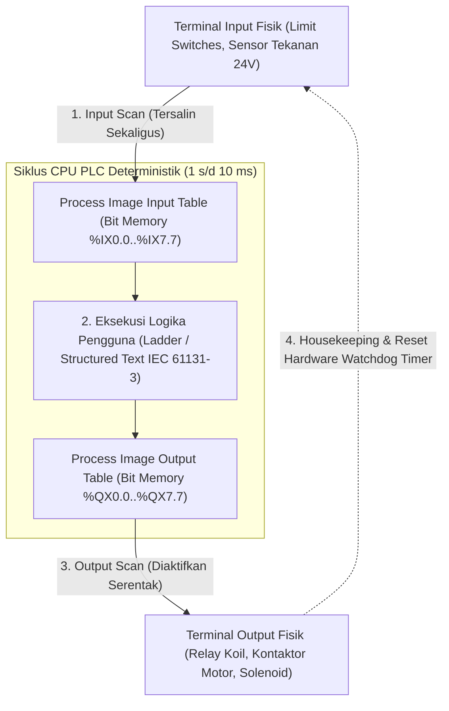

# Modul 226: Otomasi Industri Pabrik, PLC & Standar Industri 4.0 (Piramida ISA-95, Siklus Scan PLC, Standar Pemrograman IEC 61131-3, SCADA)

**Navigasi**: [⬅️ Master Index](../../INDEX.md) | [Tingkat 15: Tingkat 15: Mekatronika, Robotika, Teori Kendali & Otomasi Industri](./README.md)
*Sebelumnya*: [225. arsitektur-perangkat-lunak-robotika-ros-2](./225-arsitektur-perangkat-lunak-robotika-ros-2.md) | *Berikutnya*: [227. grafika-komputer-rendering](../16-hpc-multimedia-kuantum/227-grafika-komputer-rendering.md)

---

## 1. Intuisi Dasar Tanpa Jargon ("Seperti Bayi Baru Lahir")
Jika komputer laptop Anda mengalami *crash* atau *blue screen*, Anda cukup menekan tombol restart dan kehilangan dokumen pengetikan yang belum disimpan. Namun, bagaimana jika komputer yang mengendalikan katup reaktor nuklir, lengan robot perakitan pabrik mobil, atau sistem pengolahan air bersih kota mengalami *freeze* selama 2 detik saja? Pabrik bisa meledak, mobil cacat menabrak pekerja, dan ribuan orang keracunan!

Di dunia industri manufaktur dan pabrik kimia, komputer biasa tidak boleh digunakan. Mereka menggunakan komputer khusus anti-banting bernama **Programmable Logic Controller (PLC)** ([Petruzella - Programmable Logic Controllers](https://www.mheducation.com/highered/product/programmable-logic-controllers-petruzella/M9780073510880.html)).

PLC dirancang untuk hidup di lingkungan pabrik yang panas, berdebu, terkena cipratan oli, dan dihujani interferensi elektromagnetik petir mesin industri. Berbeda dengan PC yang mengeksekusi program secara acak berdasarkan sistem operasi, PLC bekerja dalam siklus waktu pasti tanpa henti (**Siklus Scan Deterministik**): **Baca Semua Input Sensor -> Eksekusi Logika -> Tulis Semua Output Motor/Katup** dalam waktu kurang dari 5 milidetik!

Seluruh pabrik pintar modern dihubungkan dalam hierarki piramida otomasi standar global **ISA-95** dan dikendalikan dari ruang monitor kendali jarak jauh bernama **SCADA** ([Boyer - SCADA: Supervisory Control and Data Acquisition](https://www.isa.org/standards-and-publications/isa-publications/isa-transaction/scada-supervisory-control-and-data-acquisition)).

## 2. Fondasi Teoretis & Aksiomatik / Matematis
Formulasi Otomasi Industri & Standar IEC 61131-3:

1. **Siklus Scan Deterministik PLC (Deterministic PLC Scan Cycle)**:
Waktu siklus total scan $T_{\text{scan}} = T_{\text{read}} + T_{\text{logic}} + T_{\text{write}} + T_{\text{diag}} \le T_{\text{watchdog}}$:
* **Fase 1: Input Scan**: Membaca status tegangan listrik seluruh terminal input fisik ($24\text{ V DC}$) dan menyimpannya ke tabel memori bayangan (*Input Image Table / Process Image Inputs*).
* **Fase 2: Logic Execution**: Mengeksekusi instruksi program secara sekuensial dari atas ke bawah hanya berdasarkan data tabel bayangan input.
* **Fase 3: Output Scan**: Menyalin hasil memori tabel bayangan output (*Output Image Table*) secara serempak ke terminal relay/transistor output fisik.
* **Fase 4: Housekeeping & Diagnostik**: Komunikasi jaringan industri dan reset timer watchdog hardware ([Bolton - Programmable Logic Controllers](https://www.sciencedirect.com/book/9780128029299/programmable-logic-controllers)).

2. **Lima Bahasa Pemrograman Standar IEC 61131-3**:
* **Ladder Diagram (LD)**: Representasi grafis diagram tangga relai listrik kontak NO/NC dan koil.
* **Function Block Diagram (FBD)**: Blok fungsi aliran data grafis (timer TON/TOF, counter CTU, pengatur PID).
* **Structured Text (ST)**: Bahasa tingkat tinggi mirip Pascal untuk kalkulasi matematika kompleks, array, dan loop `FOR/WHILE`.
* **Sequential Function Chart (SFC)**: Mesin status (*State Machine*) grafis berbasis Grafcet Petri-net untuk proses sekuensial bertahap.
* **Instruction List (IL)**: Bahasa mirip assembly (telah didepresiasi pada edisi ketiga).

3. **Piramida Hierarki Otomasi Pabrik Standar ISA-95**:
* **Level 0 (Production Process)**: Fisik mesin, sensor limit switch, pemancar suhu, aktuator silinder pneumatik.
* **Level 1 (Sensing & Manipulation)**: PLC, Pengendali Loop Tunggal, Modul I/O Terdistribusi.
* **Level 2 (Monitoring & Supervisory)**: Perangkat Lunak SCADA (Supervisory Control and Data Acquisition) & Panel Layar Sentuh HMI (Human-Machine Interface).
* **Level 3 (Manufacturing Operations Management / MES)**: Pelacakan jadwal produksi batch, manajemen kualitas, Work-In-Progress (WIP).
* **Level 4 (Business Planning & Logistics / ERP)**: Sistem ERP (SAP / Oracle), manajemen inventaris gudang dan keuangan rantai pasok ([ANSI/ISA-95 Enterprise-Control System Integration](https://www.isa.org/standards-and-publications/isa-standards/isa-standards-committees/isa95)).

## 3. Anatomi Teknis & Cara Kerja Internal
Arsitektur siklus eksekusi memori Process Image pada PLC industri:



Pemisahan memori *Process Image* menjamin bahwa nilai sinyal input tidak akan berubah di tengah-tengah eksekusi baris logika program yang sama, mencegah perilaku balapan logika tak tentu (*logic race hazard*) ([Petruzella PLC Chapter 2](https://www.mheducation.com/highered/product/programmable-logic-controllers-petruzella/M9780073510880.html)).

## 4. Implementasi Praktis & Kode / Simulasi Riil
```python
# Simulasi Mesin Scan Deterministik PLC Sederhana (Ladder Logic Emulation)

class MockPLC:
    def __init__(self):
        # Process Image Tables (Memori Bayangan Input & Output)
        self.inputs = {"START_BUTTON": False, "STOP_BUTTON": True, "SAFETY_CURTAIN": True}
        self.outputs = {"MOTOR_RUN": False, "ALARM_LAMP": False}
        self.memory_bits = {"RUN_LATCH": False}
        
    def scan_cycle(self, raw_sensor_readings):
        # 1. Input Scan Phase: Salin status fisik ke tabel bayangan
        self.inputs.update(raw_sensor_readings)
        
        # 2. Program Execution Phase (Rangkaian Rung Ladder Diagram Kontak Listrik):
        # Rung 1: Motor Seal-in Circuit (Start/Stop Latch dengan Tirai Keselamatan)
        # Sinyal STOP dan SAFETY bertipe Normal-Closed (NC = True saat kondisi aman)
        start = self.inputs["START_BUTTON"]
        stop = self.inputs["STOP_BUTTON"]
        safety = self.inputs["SAFETY_CURTAIN"]
        motor = self.outputs["MOTOR_RUN"]
        
        # Logika Ladder Rung 1: (Start OR Motor_Latch) AND Stop AND Safety -> Motor_Run
        if (start or motor) and stop and safety:
            self.outputs["MOTOR_RUN"] = True
            self.outputs["ALARM_LAMP"] = False
        else:
            self.outputs["MOTOR_RUN"] = False
            if not safety:
                self.outputs["ALARM_LAMP"] = True # Lampu alarm menyala jika tirai bahaya putus
                
        # 3. Output Scan Phase: Sinyal dikirim serentak ke koil kontaktor
        return self.outputs

# Simulasi Siklus Operasional Pabrik
plc = MockPLC()
print("Siklus 1: Kondisi Istirahat (Belum Ditekan Tombol Start)")
res1 = plc.scan_cycle({"START_BUTTON": False, "STOP_BUTTON": True, "SAFETY_CURTAIN": True})
print(f"Status Output: Motor={res1['MOTOR_RUN']}, Alarm={res1['ALARM_LAMP']}")

print("\nSiklus 2: Operator Menekan Tombol START (Pulsa Sesaat)")
res2 = plc.scan_cycle({"START_BUTTON": True, "STOP_BUTTON": True, "SAFETY_CURTAIN": True})
print(f"Status Output: Motor={res2['MOTOR_RUN']}, Alarm={res2['ALARM_LAMP']}")

print("\nSiklus 3: Operator Melepas Tombol START (Sirkuit Mengunci Sendiri / Self-Latching)")
res3 = plc.scan_cycle({"START_BUTTON": False, "STOP_BUTTON": True, "SAFETY_CURTAIN": True})
print(f"Status Output: Motor={res3['MOTOR_RUN']} (Motor Tetap Berputar!)")

print("\nSiklus 4: Terjadi Keadaan Darurat (Tirai Sensor Keselamatan Terpotong Tangan Pekerja)")
res4 = plc.scan_cycle({"START_BUTTON": False, "STOP_BUTTON": True, "SAFETY_CURTAIN": False})
print(f"Status Output: Motor={res4['MOTOR_RUN']} (MOTOR MATI SEKETIKA!), Alarm={res4['ALARM_LAMP']}")
```

## 5. Miskonsepsi & Jebakan Industri
*Mengabaikan Kawat Keras Tombol Darurat E-Stop (Software E-Stop Violation)*: Mengandalkan logika perangkat lunak PLC untuk mematikan motor saat tombol darurat *Emergency Stop (E-Stop)* ditekan adalah pelanggaran keselamatan industri yang berbahaya. Jika prosesor PLC mengalami freeze, kartu output korsleting (*shorted transistor*), atau terjadi bug memori, motor akan tetap menyala dan mencelakai operator. Standar keselamatan internasional (ISO 13849-1 / IEC 62061) mewajibkan tombol E-Stop diputus melalui kabel keras fisik (*Hardwired Safety Relay*) yang memutus daya kontaktor motor secara mekanis langsung terlepas dari kondisi PLC ([Safety of Machinery - ISO 13849-1](https://www.iso.org/standard/69883.html)).

## 6. Proyek Latihan & Rubrik Penilaian Mandiri
### Level 1 (Pemula)
Tulis program Structured Text (IEC 61131-3) untuk mengendalikan lampu lalu lintas 4-arah: gunakan blok fungsi timer on-delay `TON` untuk mengatur durasi lampu hijau (30 detik), kuning (5 detik), dan merah (35 detik) dengan siklus berulang tak hingga.
*Rubrik*: Kode ST terstruktur benar dengan deklarasi variabel `VAR` dan `VAR_OUTPUT`.

### Level 2 (Menengah)
Rancang diagram Sequential Function Chart (SFC / Grafcet) untuk mesin pencampur batch cairan kimia: Langkah 1 (Buka katup air hingga sensor level tinggi aktif), Langkah 2 (Nyalakan pemanas dan motor pengaduk selama 15 menit), Langkah 3 (Buka katup pengurasan hingga kosong), kembali ke Langkah Awal.
*Rubrik*: Diagram SFC mencantumkan status transisi kondisi boolean dan aksi kualifikator yang tepat.

### Level 3 (Mahir)
Implementasikan simulator server protokol industri **Modbus TCP** (Port 502) dari awal di Python: tangani fungsi membaca status koil (*Read Coils Function Code 0x01*) dan menulis register analog (*Write Single Register Function Code 0x06*), hubungkan dengan klien SCADA simulasi untuk memonitor telemetri suhu tangki kimia secara real-time.
*Rubrik*: Paket biner MBAP Header Modbus TCP terurai dan direspons dengan kode sukses yang valid.

## 7. Rekomendasi Sumber Belajar Standar Emas
| Sumber Pembelajaran | Penulis / Institusi | Tautan Langsung | Fokus Materi |
| :--- | :--- | :--- | :--- |
| Programmable Logic Controllers (5th Ed.) | Frank D. Petruzella | [McGraw-Hill Education](https://www.mheducation.com/highered/product/programmable-logic-controllers-petruzella/M9780073510880.html) | Alkitab Pemrograman PLC Industri, Ladder Logic, Rangkaian Relay |
| IEC 61131-3: Programmable Controllers - Part 3: Programming Languages | International Electrotechnical Commission | [IEC Webstore Standard](https://webstore.iec.ch/publication/4552) | Standar Internasional Bahasa Pemrograman PLC (LD, FBD, ST, SFC) |
| SCADA: Supervisory Control and Data Acquisition (4th Ed.) | Stuart A. Boyer | [ISA International Society of Automation](https://www.isa.org/standards-and-publications/isa-publications/isa-transaction/scada-supervisory-control-and-data-acquisition) | Desain Arsitektur SCADA, RTU, Komunikasi Industri Modbus |
| ANSI/ISA-95 Enterprise-Control System Integration | International Society of Automation | [ISA-95 Standards Committee](https://www.isa.org/standards-and-publications/isa-standards/isa-standards-committees/isa95) | Piramida Otomasi Manufaktur Level 0 s/d Level 4 |

---
*Navigasi Cepat*: [Ke Tingkat 15](./README.md) | [Ke Master Index](../../INDEX.md) | *Sebelumnya*: [225. arsitektur-perangkat-lunak-robotika-ros-2](./225-arsitektur-perangkat-lunak-robotika-ros-2.md) | *Berikutnya*: [227. grafika-komputer-rendering](../16-hpc-multimedia-kuantum/227-grafika-komputer-rendering.md)
