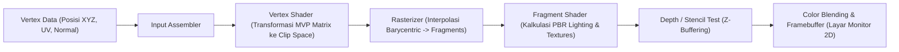

# Modul 227: Grafika Komputer 2D/3D & Rendering (Pipeline Grafis Hardware, Physically Based Rendering / PBR, Ray Tracing, Vulkan, Shaders)

**Navigasi**: [⬅️ Master Index](../../INDEX.md) | [Tingkat 16: Tingkat 16: Komputasi Performa Tinggi, Multimedia & Komputasi Kuantum](./README.md)
*Sebelumnya*: [226. otomasi-industri-pabrik-plc-industri-4](../15-mekatronika-robotika-kendali/226-otomasi-industri-pabrik-plc-industri-4.md) | *Berikutnya*: [228. arsitektur-mesin-game-simulasi-fisika](./228-arsitektur-mesin-game-simulasi-fisika.md)

---

## 1. Intuisi Dasar Tanpa Jargon ("Seperti Bayi Baru Lahir")
Bagaimana sebuah kartu grafis (GPU) bisa menggambar dunia 3D yang sangat memukau di layar monitor Anda—lengkap dengan kilau pantulan air, bayangan pohon yang lembut, dan debu yang beterbangan—pada kecepatan 144 kali setiap detik?

Layar komputer Anda hanyalah selembar kanvas datar 2D yang terdiri dari jutaan titik lampu kecil berwarna merah, hijau, dan biru (**Pixel**).

Untuk mengubah model 3D di dalam memori menjadi pixel di layar, GPU menjalankan **Pipeline Grafis Perangkat Keras**:
1. Menghubungkan titik-titik koordinat 3D segitiga (*Vertices*).
2. Memutar dan memproyeksikan segitiga tersebut ke lensa kamera virtual (**Vertex Shader**).
3. Memotong-motong permukaan segitiga menjadi jutaan calon pixel (**Rasterization**).
4. Menghitung pantulan cahaya fisik (*Physically Based Rendering / PBR*) pada setiap pixel (**Fragment/Pixel Shader**) ([Akenine-Möller et al. - Real-Time Rendering](https://www.realtimerendering.com/)).

Dan puncak tertinggi grafika modern adalah **Ray Tracing**: menembakkan jutaan sinar foton cahaya virtual dari mata penonton, memantulkannya ke cermin, menembuskannya ke kaca, dan mengumpulkan bias cahaya persis seperti hukum fisika optik di dunia nyata ([Pharr, Jakob, Humphreys - Physically Based Rendering: From Theory to Implementation](https://pbr-book.org/)).

## 2. Fondasi Teoretis & Aksiomatik / Matematis
Formulasi Matematis Optik Grafis & Persamaan Rendering:

1. **Persamaan Rendering Kajiya (The Rendering Equation 1986)**:
Keseimbangan radiometrik fluks cahaya keluar $L_o$ dari titik permukaan $\mathbf{x}$ ke arah pandang $\omega_o$ ([Kajiya - The Rendering Equation](https://dl.acm.org/doi/10.1145/15922.15902)):
$$L_o(\mathbf{x}, \omega_o) = L_e(\mathbf{x}, \omega_o) + \int_{\Omega} f_r(\mathbf{x}, \omega_i, \omega_o) L_i(\mathbf{x}, \omega_i) (\mathbf{n} \cdot \omega_i) d\omega_i$$
Di mana $L_e$ adalah radiansi emisi sendiri, $\Omega$ belahan bola atas hemisfer, $L_i$ radiansi datang dari arah $\omega_i$, $\mathbf{n}$ vektor normal permukaan, dan $f_r$ adalah fungsi distribusi reflektansi dwiarah (**BRDF**).

2. **Model BRDF Mikrofasit Cook-Torrance (PBR Standar Industri)**:
$$f_r(\omega_i, \omega_o) = k_d f_{\text{Lambert}} + k_s \frac{D(\mathbf{h}) F(\omega_i, \mathbf{h}) G(\omega_i, \omega_o, \mathbf{h})}{4 (\mathbf{n} \cdot \omega_i) (\mathbf{n} \cdot \omega_o)}$$
Di mana $\mathbf{h} = \frac{\omega_i + \omega_o}{\|\omega_i + \omega_o\|}$ adalah vektor setengah (halfway vector), $D$ adalah distribusi mikrofasit GGX Trowbridge-Reitz, $F$ aproksimasi Fresnel Schlick:
$$F(\theta) = F_0 + (1 - F_0)(1 - \cos\theta)^5$$
Dan $G$ adalah fungsi bayangan geometri Smith (*geometric shadowing factor*) ([Karis - Real Shading in Unreal Engine 4](https://cdn2.unrealengine.com/Resources/files/2013SiggraphPresentationsNotes-26914738.pdf)).

3. **Pipeline Grafis API Tingkat Rendah Vulkan / DirectX 12**:
Arsitektur stateless eksplisit: Aplikasi mengelola alokasi memori GPU secara manual, menyusun perintah rendering ke dalam buffer perintah multi-thread (*Command Buffers*), menyinkronkan memori via hambatan pipa (*Pipeline Barriers*), dan mengompilasi shader menjadi format biner menengah standar **SPIR-V** ([Khronos Group - Vulkan Specification](https://registry.khronos.org/vulkan/specs/1.3/html/)).

## 3. Anatomi Teknis & Cara Kerja Internal
Arsitektur eksekusi pipeline grafis perangkat keras pada GPU modern:



Dengan API Vulkan, *Command Buffer* dapat dibangun secara paralel di 16 core CPU sekaligus tanpa saling mengunci, menghilangkan hambatan driver monolitik OpenGL masa lalu dan melipatgandakan panggilan gambar (*Draw Calls*) dari puluhan ribu menjadi jutaan objek per detik ([Vulkan Architecture](https://registry.khronos.org/vulkan/specs/1.3/html/)).

## 4. Implementasi Praktis & Kode / Simulasi Riil
```python
import numpy as np

# 1. Perhitungan Aproksimasi Pantulan Fresnel Schlick (PBR)
def fresnel_schlick(cos_theta, F0):
    # F(theta) = F0 + (1 - F0) * (1 - cos(theta))^5
    return F0 + (1.0 - F0) * ((1.0 - np.clip(cos_theta, 0.0, 1.0)) ** 5)

# 2. Distribusi Normal Mikrofasit GGX / Trowbridge-Reitz
def distribution_ggx(N_dot_H, roughness):
    alpha = roughness ** 2
    alpha2 = alpha ** 2
    denom = (N_dot_H ** 2) * (alpha2 - 1.0) + 1.0
    return alpha2 / (np.pi * (denom ** 2))

# Uji Coba: Material Logam Besi (F0 = 0.56) vs Dielektrik Plastik (F0 = 0.04)
# Sudut pandang grazing angle (sudut datang 80 derajat terhadap normal)
cos_angle = np.cos(np.radians(80.0))

fresnel_iron = fresnel_schlick(cos_angle, F0=0.56)
fresnel_plastic = fresnel_schlick(cos_angle, F0=0.04)

# Evaluasi Distribusi GGX pada pantulan langsung (N dot H = 1.0)
d_smooth = distribution_ggx(N_dot_H=1.0, roughness=0.1) # Permukaan sangat halus
d_rough = distribution_ggx(N_dot_H=1.0, roughness=0.8)  # Permukaan kasar

print("Hasil Perhitungan Fisika Cahaya PBR (Physically Based Rendering):")
print(f" - Pantulan Fresnel Besi pada Sudut Miring    : {fresnel_iron*100:.1f}% cahaya terpantul")
print(f" - Pantulan Fresnel Plastik pada Sudut Miring : {fresnel_plastic*100:.1f}% cahaya terpantul (Semua material memantul tajam saat miring!)")
print(f" - Konsentrasi Kilau GGX Halus (Roughness 0.1): {d_smooth:.2f} (Kilau tajam terkonsentrasi)")
print(f" - Konsentrasi Kilau GGX Kasar (Roughness 0.8): {d_rough:.2f} (Cahaya tersebar buram)")
```

## 5. Miskonsepsi & Jebakan Industri
*Z-Fighting pada Kedalaman Ruang (Depth Precision Loss)*: Menggunakan rentang kedalaman standar linier dengan rasio jarak dekat (*Near Plane*) dan jauh (*Far Plane*) yang terlalu ekstrem ($Near = 0.01$, $Far = 10.000$) menyebabkan sebagian besar bit presisi format float Z-Buffer terbuang pada jarak mikro di depan kamera, sementara objek di kejauhan berbagi nilai kedalaman yang identik. Permukaan dinding yang berdekatan akan berkedip-kedip berantakan (*Z-fighting*). Solusi modern: gunakan **Reversed-Z Floating Point Buffer** (memetakan $Near \to 1.0$ dan $Far \to 0.0$ dengan buffer 32-bit float) ([Humphreys - Depth Precision Visualized](https://developer.nvidia.com/content/depth-precision-visualized)).

## 6. Proyek Latihan & Rubrik Penilaian Mandiri
### Level 1 (Pemula)
Tulis shader GLSL/SPIR-V Vertex Shader sederhana: terima posisi atribut 3D `in_position`, kalikan dengan matriks transformasi gabungan $MVP = P \cdot V \cdot M$, dan keluarkan posisi ruang klip `gl_Position`.
*Rubrik*: Kode shader GLSL valid secara sintaksis dan melakukan perkalian matriks-vektor 4D.

### Level 2 (Menengah)
Bangun modul perangkat lunak *Software Rasterizer* di Python murni: terima 3 titik koordinat segitiga 2D di layar, tentukan koordinat kotak pembatas (*bounding box*), hitung koordinat barisentrik (*Barycentric Coordinates* $\lambda_1, \lambda_2, \lambda_3$) untuk setiap pixel di dalam kotak, dan warnai pixel yang memenuhi $\lambda_i \ge 0$.
*Rubrik*: Menghasilkan file gambar bitmap BMP/PNG segitiga terisi warna solid.

### Level 3 (Mahir)
Implementasikan mesin pelacak sinar (*Ray Tracer*) dari nol di C++ atau Python: tembakkan sinar dari kamera, deteksi perpotongan sinar terhadap bola analitik via persamaan kuadrat $t^2(\mathbf{d}\cdot\mathbf{d}) + 2t\mathbf{d}\cdot(\mathbf{o}-\mathbf{c}) + \|\mathbf{o}-\mathbf{c}\|^2 - R^2 = 0$, tembakkan sinar bayangan sekunder (*shadow rays*) ke sumber cahaya, dan hitung pantulan cermin rekursif hingga kedalaman 3 pantulan.
*Rubrik*: Menghasilkan render bola kaca kristal fotorealistik dengan bayangan tajam dan pantulan specular.

## 7. Rekomendasi Sumber Belajar Standar Emas
| Sumber Pembelajaran | Penulis / Institusi | Tautan Langsung | Fokus Materi |
| :--- | :--- | :--- | :--- |
| Physically Based Rendering: From Theory to Implementation (4th Ed.) | Matt Pharr, Wenzel Jakob, Greg Humphreys | [PBRT Official Free Book](https://pbr-book.org/) | Alkitab Ray Tracing, Radiometri, Monte Carlo Integrator |
| Real-Time Rendering (4th Ed.) | Tomas Akenine-Möller, Eric Haines, Naty Hoffman | [Real-Time Rendering Portal](https://www.realtimerendering.com/) | Standar Industri Pipeline Grafis GPU, Shaders, PBR |
| Vulkan 1.3 Specification & Architecture Guide | Khronos Group | [Vulkan Registry Documentation](https://registry.khronos.org/vulkan/specs/1.3/html/) | Spesifikasi API Grafis Tingkat Rendah, Sinkronisasi Memori GPU |
| Learn OpenGL: An In-depth Guide to Modern OpenGL | Joey de Vries | [LearnOpenGL Portal](https://learnopengl.com/) | Panduan Praktis Step-by-Step Shader, Textures, Model Loading |

---
*Navigasi Cepat*: [Ke Tingkat 16](./README.md) | [Ke Master Index](../../INDEX.md) | *Sebelumnya*: [226. otomasi-industri-pabrik-plc-industri-4](../15-mekatronika-robotika-kendali/226-otomasi-industri-pabrik-plc-industri-4.md) | *Berikutnya*: [228. arsitektur-mesin-game-simulasi-fisika](./228-arsitektur-mesin-game-simulasi-fisika.md)
