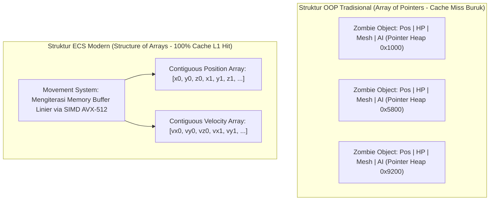

# Modul 228: Arsitektur Mesin Game & Simulasi Fisika (Game Loop, Entity-Component-System ECS Ramah-Cache, Collision Narrow-Phase GJK)

**Navigasi**: [⬅️ Master Index](../../INDEX.md) | [Tingkat 16: Tingkat 16: Komputasi Performa Tinggi, Multimedia & Komputasi Kuantum](./README.md)
*Sebelumnya*: [227. grafika-komputer-rendering](./227-grafika-komputer-rendering.md) | *Berikutnya*: [229. rekayasa-komputasi-spasial-vr-ar-xr](./229-rekayasa-komputasi-spasial-vr-ar-xr.md)

---

## 1. Intuisi Dasar Tanpa Jargon ("Seperti Bayi Baru Lahir")
### 1.1 Konsep Inti & Analogi Tanpa Jargon
Bayangkan Anda sedang memainkan game aksi 3D dengan 10.000 monster zombi yang mengejar pemain di layar. Jika game tersebut ditulis menggunakan pemrograman berorientasi objek (OOP) biasa, setiap monster adalah sebuah objek terpisah di memori komputer yang berisi variabel kesehatan, koordinat posisi 3D, animasi tulang, suara geraman, dan kecerdasan buatan.

### 1.2 Urgensi Rekayasa & Signifikansi Sistemik
Ketika komputer ingin memperbarui posisi 10.000 monster tersebut, CPU harus melompat ke 10.000 lokasi memori acak yang berbeda di seluruh RAM. Cache prosesor Anda akan jebol berulang kali (**Cache Thrashing**), dan frame rate game Anda akan anjlok menjadi 5 frame per detik yang patah-patah!

Inilah mengapa arsitektur mesin game modern (seperti Unreal Engine, Unity DOTS, atau mesin game kustom) membuang hierarki OOP klasik dan beralih ke **Entity-Component-System (ECS)** ([Nystrom - Game Programming Patterns](https://gameprogrammingpatterns.com/)):
1. **Entity**: Hanyalah sebuah angka ID unik sederhana (misal Zombie #402).
2. **Component**: Data angka murni tanpa logika, disimpan dalam larik memori berdampingan (*contiguous arrays*) yang ramah cache CPU.
3. **System**: Kode logika murni yang menyapu array komponen tersebut dengan kecepatan kilat memanfaatkan instruksi vektor SIMD!

Dan ketika dua pedang bertabrakan, bagaimana komputer tahu keduanya bersentuhan? Algoritma geometri **Gilbert-Johnson-Keerthi (GJK)** menghitung tabrakan objek cembung non-lingkaran dalam hitungan mikrodetik ([Ericson - Real-Time Collision Detection](https://www.routledge.com/Real-Time-Collision-Detection/Ericson/p/book/9781558607323)).

## 2. Fondasi Teoretis & Aksiomatik / Matematis
### 2.1 Kerangka Teori Aksiomatik & Formulasi Matematis
Formulasi Arsitektur Game & Deteksi Tabrakan Fisika:

### 2.2 Penurunan Matematis Langkah-demi-Langkah
1. **Siklus Loop Game Deterministik (Fixed-Timestep Game Loop)**:
Memisahkan waktu pembaruan fisika deterministik ($\Delta t_{\text{fixed}}$) dari waktu render frame layar variabel ($\Delta t_{\text{frame}}$) menggunakan akumulator waktu (*accumulator*) ([Glenn Fiedler - Fix Your Timestep!](https://gafferongames.com/post/fix_your_timestep/)):
$$\text{accumulator} \leftarrow \text{accumulator} + \Delta t_{\text{frame}}$$
$$\text{While } \text{accumulator} \ge \Delta t_{\text{fixed}}: \quad \text{PhysicsUpdate}(\Delta t_{\text{fixed}}), \quad \text{accumulator} \leftarrow \text{accumulator} - \Delta t_{\text{fixed}}$$
Faktor interpolasi render: $\alpha = \frac{\text{accumulator}}{\Delta t_{\text{fixed}}}$, Posisi render: $x = \alpha x_{\text{current}} + (1 - \alpha) x_{\text{prev}}$.

2. **Diferensiasi Ruang Minkowski & Teorema Tabrakan GJK**:
Selisih Minkowski antara dua himpunan bentuk geometris cembung (*convex sets*) $A, B \subset \mathbb{R}^3$:
$$A \ominus B = \{a - b \mid a \in A, b \in B\}$$
*Teorema Kontak*: Dua objek cembung bertabrakan ($A \cap B \neq \emptyset$) jika dan hanya jika titik asal origin $\mathbf{0}$ berada di dalam selisih Minkowski ($0 \in A \ominus B$).
Algoritma GJK mencari simpleks 4-titik (tetrahedron di 3D) di dalam $A \ominus B$ yang melingkupi titik $\mathbf{0}$ menggunakan fungsi pemetaan pendukung (*Support Function*):
$$S_{A \ominus B}(\mathbf{d}) = S_A(\mathbf{d}) - S_B(-\mathbf{d}), \quad S_A(\mathbf{d}) = \arg\max_{a \in A} (a \cdot \mathbf{d})$$
Kompleksitas konvergensi sub-linier independen dari jumlah vertex ([Gilbert, Johnson, Keerthi - IEEE RA 1988](https://ieeexplore.ieee.org/document/2083)).

3. **Integrator Fisika Verlet vs Symplectic Euler**:
Integrator posisi Verlet menjaga kekekalan energi (*symplectic property*) tanpa drift energi numerik:
$$x_{t+\Delta t} = 2x_t - x_{t-\Delta t} + a_t (\Delta t)^2 + \mathcal{O}((\Delta t)^4)$$

## 3. Anatomi Teknis & Cara Kerja Internal
Arsitektur Memori Berorientasi Data (Data-Oriented Design) Entity-Component-System (ECS):



Dengan ECS, seluruh komponen posisi 10.000 entitas tersusun rapat berdampingan di memori RAM, memungkinkan CPU memuat puluhan posisi zombi sekaligus ke dalam cache L1 dalam satu instruksi prefetch, meningkatkan throughput komputasi hingga ratusan persen ([Data-Oriented Design by Richard Fabian](https://www.dataorienteddesign.com/dodbook/)).

#### Tabel Penelusuran Siklus Fisika Game & Bug Tunneling Deteksi Tabrakan
| Siklus / Tahap Pipeline | Komponen / Level Memori | Data Masuk / Vektor Keadaan | Operasi Paralel / Uniter (U) | Status Register / Buffer GPU/Qubit | Keluaran / Framebuffer / Hasil Ukur |
|---|---|---|---|---|---|
| Step t=0 (k=0) | Posisi Objek Proyektil | Posisi $x_0 = 10.0$ m, Kecepatan $v = 800$ m/s | Integrasi diskret Euler: $x_{k+1} = x_k + v \Delta t$ | Dinding statis di posisi $x = 15.0$ m (tebal 0.2 m) | Proyektil berada 5 meter sebelum dinding |
| Step t=1 (k=1) | Integrasi Timestep Kasar | Timestep $\Delta t = 0.0166$ s (60 Hz) | Perpindahan langkah: $\Delta x = 800 \times 0.0166 = 13.28$ m | Posisi baru: $x_1 = 10.0 + 13.28 = 23.28$ m | Proyektil berpindah jauh ke balik dinding |
| Evaluasi Tabrakan | Modul Deteksi Tabrakan Diskret | Kotak pembatas (AABB): $[23.2, 23.3]$ vs $[15.0, 15.2]$ | Uji tumpang tindih diskret: Apakah AABB beririsan? | Intersection test = FALSE (Tidak ada kontak!) | Objek menembus dinding padat tanpa interaksi fisika! (Tunneling) |
| Bug Eksploitasi | Game Mechanics Engine | Pemain menembus dinding benteng musuh | Integrasi status fisika tanpa koreksi raycast | State pemain tercatat sah di balik tembok | Integritas kompetitif game hancur |
| Step CCD Aktif | Continuous Collision Detection | Vektor lintasan dinamis: Ruang sapuan silinder | Sapuan raycast/swept sphere: Irisan $[x_0, x_1]$ dan bidang | Titik kontak terdeteksi pada $t_{hit} = 0.00625$ s | Proyektil berhenti tepat pada permukaan dinding $x = 15.0$ m |

## 4. Implementasi Praktis & Kode / Simulasi Riil
```python
import numpy as np

# 1. Implementasi Arsitektur Entity-Component-System (ECS) Berorientasi Data Sederhana
class MovementSystem:
    def __init__(self, capacity=10_000):
        # Struktur Array Berdampingan Kontigu (SoA - Structure of Arrays)
        self.positions = np.zeros((capacity, 2), dtype=np.float32)
        self.velocities = np.zeros((capacity, 2), dtype=np.float32)
        self.active_count = 0
        
    def spawn_entity(self, x, y, vx, vy):
        idx = self.active_count
        self.positions[idx] = [x, y]
        self.velocities[idx] = [vx, vy]
        self.active_count += 1
        return idx
        
    def update(self, dt):
        # Update Posisi 10.000 Entitas Sekaligus via Operasi Vektor SIMD NumPy
        # pos = pos + vel * dt (Sapu Memori Kontigu Linear Murni!)
        self.positions[:self.active_count] += self.velocities[:self.active_count] * dt

# 2. Uji Diferensiasi Minkowski Sederhana (Konsep Fondasi GJK)
def check_aabb_collision(box_a_min, box_a_max, box_b_min, box_b_max):
    # Selisih Minkowski untuk kotak 2D sejajar sumbu (AABB)
    diff_min = box_a_min - box_b_max
    diff_max = box_a_max - box_b_min
    # Tabrakan terjadi jika titik (0, 0) berada di dalam interval [diff_min, diff_max]
    collides = np.all(diff_min <= 0) and np.all(diff_max >= 0)
    return collides

# Uji Coba ECS
ecs = MovementSystem(capacity=1000)
for _ in range(500):
    ecs.spawn_entity(x=np.random.rand(), y=np.random.rand(), vx=1.5, vy=-0.5)

print(f"Total Entitas Aktif dalam ECS: {ecs.active_count}")
ecs.update(dt=0.016) # Update 1 frame pada 60 FPS (16 ms)
print(f"Posisi Entitas #0 Pasca-Update: {ecs.positions[0]}")

# Uji Deteksi Kontak Minkowski
box1_min, box1_max = np.array([0.0, 0.0]), np.array([2.0, 2.0])
box2_min, box2_max = np.array([1.5, 1.5]), np.array([3.0, 3.0])
is_hit = check_aabb_collision(box1_min, box1_max, box2_min, box2_max)
print(f"Deteksi Tabrakan Ruang Minkowski: {'TABRAKAN TERDETEKSI' if is_hit else 'BEBAS'}")
```

## 5. Miskonsepsi & Jebakan Industri
*Masalah Penembusan Objek Cepat (Bullet Through Paper / Tunneling)*: Jika sebuah peluru bergerak dengan kecepatan $1.000\text{ m/s}$ dan simulasi fisika diperbarui setiap $\Delta t = 16\text{ ms}$, peluru akan melompat sejauh 16 meter dalam satu frame tunggal. Jika ada tembok tipis setebal 0,2 meter di antara posisi frame $t$ dan frame $t+1$, algoritma deteksi tabrakan diskret biasa tidak akan pernah mendeteksi tabrakan (peluru menembus tembok seperti hantu!). Terapkan **Continuous Collision Detection (CCD)** berbasis ray-casting segmen lintasan spasial atau volume sapuan (*Swept Volumes*) ([Ericson Collision Book Chapter 5](https://www.routledge.com/Real-Time-Collision-Detection/Ericson/p/book/9781558607323)).

### Studi Kasus Kegagalan Nyata: Cacat Tunneling Deteksi Tabrakan Fisika ('Bullet Through Paper Bug') pada Mesin Game Real-Time
- **Kronologi & Konteks Sejarah**: Dalam sejarah pengembangan mesin permainan interaktif (dari era *Quake*, *Unreal Engine*, hingga *Source Engine* pada game seperti *Counter-Strike*), pemain dan penguji sering kali menemukan fenomena anomali mekanika di mana peluru berkecepatan tinggi, granat, kendaraan berakselerasi ekstrem, atau bahkan avatar karakter dapat menembus dinding tipis, lantai, atau pintu yang tertutup rapat tanpa memicu deteksi kontak apa pun.
- **Akar Masalah Rekayasa Mesin Fisika & Deteksi Tabrakan Diskret**: Mesin fisika game konvensional menggunakan algoritma deteksi tabrakan diskret (*Discrete Collision Detection / DCD*). Pada setiap langkah waktu simulasi (*physics tick* berjarak $\Delta t$), sistem menghitung posisi baru objek $x(t + \Delta t) = x(t) + v \cdot \Delta t$ dan kemudian melakukan uji tumpang tindih volumetrik geometris (*Overlap Test* seperti AABB, OBB, atau GJK) pada posisi akhir tersebut. Jika kecepatan objek sangat tinggi atau ketebalan rintangan sangat tipis sehingga perpindahan dalam satu tick melampaui ketebalan rintangan ($v \cdot \Delta t > \text{thickness}$), objek melompat dari posisi sebelum rintangan langsung ke posisi di belakang rintangan dalam satu langkah. Karena pada saat sampling $t$ dan $t + \Delta t$ objek tidak pernah berpotongan langsung dengan rintangan, algoritma diskret menyimpulkan bahwa tidak terjadi tabrakan sama sekali. Fenomena yang dikenal sebagai *tunneling* ini memungkinkan eksploitasi tembus dinding (*wall-hack / clipping exploit*) dan merusak kredibilitas simulasi fisika permainan.

- **Potongan Kode / Arsitektur Cacat (Vulnerable Implementation)**:
```cpp
// Analisis & Remediasi Mesin Fisika: Deteksi Tabrakan Diskret vs Swept Continuous Collision
#include <iostream>
#include <algorithm>

struct Vector3 { float x, y, z; };
struct AABB { Vector3 min_pt; Vector3 max_pt; };

// SIMULASI CACAT: Deteksi Tabrakan Diskret (Rentan Terhadap Fenomena Tunneling)
bool check_collision_discrete(Vector3 current_pos, Vector3 velocity, float dt, const AABB &wall) {
    // 1. Integrasi posisi diskret
    Vector3 next_pos = {
        current_pos.x + velocity.x * dt,
        current_pos.y + velocity.y * dt,
        current_pos.z + velocity.z * dt
    };

    // 2. Evaluasi tumpang tindih HANYA pada titik akhir next_pos
    bool overlaps_x = (next_pos.x >= wall.min_pt.x && next_pos.x <= wall.max_pt.x);
    bool overlaps_y = (next_pos.y >= wall.min_pt.y && next_pos.y <= wall.max_pt.y);
    bool overlaps_z = (next_pos.z >= wall.min_pt.z && next_pos.z <= wall.max_pt.z);

    // KASUS TUNNELING: Jika peluru melompat dari x=10m ke x=23m sedangkan dinding di x=15m (tebal 0.2m),
    // next_pos (23m) berada di luar batas dinding, sehingga tabrakan DIABAIKAN!
    return (overlaps_x && overlaps_y && overlaps_z);
}

// REMEDIASI RESILIEN: Continuous Collision Detection (CCD) via Raycast Swept-Volume
struct Ray { Vector3 origin; Vector3 direction; };

bool check_collision_ccd(Vector3 current_pos, Vector3 velocity, float dt, const AABB &wall, float &t_hit) {
    Vector3 displacement = { velocity.x * dt, velocity.y * dt, velocity.z * dt };
    
    // Algoritma Swept Slab Test untuk mendeteksi irisan sinar linier sepanjang lintasan
    float t_min = 0.0f;
    float t_max = 1.0f; // Parameter terstandardisasi t dalam interval [0, 1]

    // Evaluasi sumbu X
    if (displacement.x != 0.0f) {
        float tx1 = (wall.min_pt.x - current_pos.x) / displacement.x;
        float tx2 = (wall.max_pt.x - current_pos.x) / displacement.x;
        t_min = std::max(t_min, std::min(tx1, tx2));
        t_max = std::min(t_max, std::max(tx1, tx2));
    } else {
        if (current_pos.x < wall.min_pt.x || current_pos.x > wall.max_pt.x) return false;
    }

    // Evaluasi tabrakan kontinu
    if (t_max >= t_min && t_min <= 1.0f && t_max >= 0.0f) {
        t_hit = std::max(0.0f, t_min); // Titik kontak waktu fraksional pertama
        return true; // Tabrakan terdeteksi sepanjang lintasan gerak!
    }

    return false;
}
```

- **Mekanisme Kegagalan & Batasan Ruang Sampel Temporal**: Pendekatan diskret memandang waktu sebagai serangkaian foto statis terpisah (*discrete snapshots*). Pada laju sampling tetap 60 Hz ($\Delta t \approx 16.6\text{ ms}$), sebuah proyektil berkecepatan $900\text{ m/s}$ menempuh jarak $15\text{ meter}$ dalam satu frame. Jika tebal dinding rintangan hanya $0,2\text{ meter}$, terdapat probabilitas $>98\%$ bahwa posisi sampel awal dan akhir sama sekali tidak memotong volume dinding, menjadikan rintangan secara komputasional tak kasat mata bagi detektor diskret.
- **Prinsip Mitigasi & Arsitektur Resilien**:
  1. *Swept Volume Collision (CCD)*: Menghitung volume ruang yang disapu oleh bentuk objek sepanjang vektor translasi gerak (misalnya *Swept Sphere* atau *Swept Capsule* versus *Slab Intersection*).
  2. *Sub-stepping (Adaptive Micro-Ticks)*: Ketika kecepatan objek melampaui rasio rasional terhadap ukuran kotak pembatas ($v \cdot \Delta t > 0.5 \cdot \text{size}$), mesin fisika secara otomatis membagi langkah simulasi objek tersebut menjadi $N$ sub-langkah kecil (*micro-steps*).
  3. *Speculative Contacts*: Menghasilkan batasan kontak berspekulasi (*speculative contact constraints*) sebelum tabrakan fisik terjadi untuk mencegah integrasi posisi melompati permukaan penghalang.

## 6. Proyek Latihan & Rubrik Penilaian Mandiri
### Level 1 (Pemula)
Tulis simulasi loop game deterministik dengan akumulator waktu (*Fix Your Timestep loop*) di Python: simulasikan laju frame render yang berfluktuasi liar (\$20\text{ FPS}$ hingga \$120\text{ FPS}$), buktikan bahwa langkah pembaruan status fisika tetap dieksekusi tepat pada interval \$60\text{ Hz}$ konstan.
*Rubrik*: Jumlah langkah fisika per detik terhitung stabil tanpa dipengaruhi variasi frame render.

### Level 2 (Menengah)
Bangun implementasi algoritma deteksi tabrakan poligon cembung 2D menggunakan metode *Separating Axis Theorem (SAT)* dari nol: proyeksikan seluruh titik sudut kedua poligon ke setiap vektor normal tepi, cari overlap interval proyeksi, dan laporkan vektor penetrasi minimum (*Minimum Translation Vector / MTV*).
*Rubrik*: Algoritma mendeteksi kontak dan mengembalikan vektor kedalaman penetrasi yang tepat.

### Level 3 (Mahir)
Implementasikan algoritma Gilbert-Johnson-Keerthi (GJK) lengkap untuk deteksi tabrakan dua objek cembung 3D (antara bola dan kubus): definisikan support function analitik untuk masing-masing geometri primitif, kelola simpleks (titik, segmen garis, segitiga, tetrahedron), lakukan evaluasi Voronoi feature region untuk menentukan arah pencarian titik origin $\mathbf{0}$, dan buktikan konvergensi dalam $< 6$ iterasi.
*Rubrik*: Deteksi tabrakan tervalidasi tepat terhadap objek yang saling beririsan dan yang saling menjauh.

### Tingkat 1: Dasar
- **Tugas**: Jelaskan prinsip pembaruan loop fisika dengan Fixed Timestep menggunakan akumulator waktu (pattern 'Fix Your Timestep' oleh Glenn Fiedler) dan mengapa integrasi dengan variable timestep menyebabkan simulasi tidak deterministik.

### Tingkat 2: Menengah
- **Tugas**: Implementasikan fungsi deteksi tabrakan Continuous Collision Detection (CCD) dalam C++ untuk swept-sphere terhadap segitiga 3D menggunakan kalkulasi jarak terpendek segmen garis ke segitiga.

### Tingkat 3: Mahir
- **Tugas**: Rancang arsitektur mesin simulasi fisika partikel dan benda tegar (Rigid Body) berskala besar yang memanfaatkan hierarki batas volume (Bounding Volume Hierarchy / BVH) dinamis pada GPU compute shader dengan resolusi kontak berbasis constraint solver Projected Gauss-Seidel.

## 7. Rekomendasi Sumber Belajar Standar Emas
| Sumber Pembelajaran | Penulis / Institusi | Tautan Langsung | Fokus Materi |
| :--- | :--- | :--- | :--- |
| Real-Time Collision Detection | Christer Ericson (Sony Interactive Entertainment) | [Routledge CRC Press](https://www.routledge.com/Real-Time-Collision-Detection/Ericson/p/book/9781558607323) | Alkitab Algoritma Tabrakan Fisika, GJK, BVH Trees, SAT |
| Game Programming Patterns | Robert Nystrom (Electronic Arts) | [Game Programming Patterns Web](https://gameprogrammingpatterns.com/) | Pola Desain Game Loop, Component Pattern, Object Pool |
| A Fast Procedure for Computing the Distance Between Objects (GJK) | E. G. Gilbert, D. W. Johnson, S. S. Keerthi | [IEEE Robotics and Automation 1988](https://ieeexplore.ieee.org/document/2083) | Makalah Penemuan Asli Algoritma Deteksi Tabrakan GJK |
| Fix Your Timestep! | Glenn Fiedler (Gaffer on Games) | [Gaffer on Games Classic Article](https://gafferongames.com/post/fix_your_timestep/) | Standar Emas Industri Desain Loop Game Fisika Deterministik |

---
*Navigasi Cepat*: [Ke Tingkat 16](./README.md) | [Ke Master Index](../../INDEX.md) | *Sebelumnya*: [227. grafika-komputer-rendering](./227-grafika-komputer-rendering.md) | *Berikutnya*: [229. rekayasa-komputasi-spasial-vr-ar-xr](./229-rekayasa-komputasi-spasial-vr-ar-xr.md)
