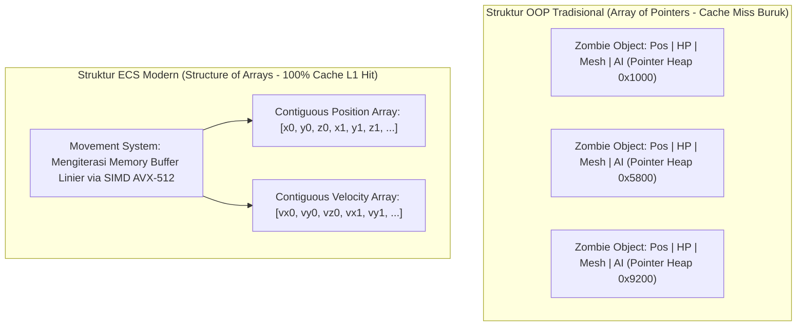

# Modul 228: Arsitektur Mesin Game & Simulasi Fisika (Game Loop, Entity-Component-System ECS Ramah-Cache, Collision Narrow-Phase GJK)

**Navigasi**: [⬅️ Master Index](../../INDEX.md) | [Tingkat 16: Tingkat 16: Komputasi Performa Tinggi, Multimedia & Komputasi Kuantum](./README.md)
*Sebelumnya*: [227. grafika-komputer-rendering](./227-grafika-komputer-rendering.md) | *Berikutnya*: [229. rekayasa-komputasi-spasial-vr-ar-xr](./229-rekayasa-komputasi-spasial-vr-ar-xr.md)

---

## 1. Intuisi Dasar Tanpa Jargon ("Seperti Bayi Baru Lahir")
Bayangkan Anda sedang memainkan game aksi 3D dengan 10.000 monster zombi yang mengejar pemain di layar. Jika game tersebut ditulis menggunakan pemrograman berorientasi objek (OOP) biasa, setiap monster adalah sebuah objek terpisah di memori komputer yang berisi variabel kesehatan, koordinat posisi 3D, animasi tulang, suara geraman, dan kecerdasan buatan.

Ketika komputer ingin memperbarui posisi 10.000 monster tersebut, CPU harus melompat ke 10.000 lokasi memori acak yang berbeda di seluruh RAM. Cache prosesor Anda akan jebol berulang kali (**Cache Thrashing**), dan frame rate game Anda akan anjlok menjadi 5 frame per detik yang patah-patah!

Inilah mengapa arsitektur mesin game modern (seperti Unreal Engine, Unity DOTS, atau mesin game kustom) membuang hierarki OOP klasik dan beralih ke **Entity-Component-System (ECS)** ([Nystrom - Game Programming Patterns](https://gameprogrammingpatterns.com/)):
1. **Entity**: Hanyalah sebuah angka ID unik sederhana (misal Zombie #402).
2. **Component**: Data angka murni tanpa logika, disimpan dalam larik memori berdampingan (*contiguous arrays*) yang ramah cache CPU.
3. **System**: Kode logika murni yang menyapu array komponen tersebut dengan kecepatan kilat memanfaatkan instruksi vektor SIMD!

Dan ketika dua pedang bertabrakan, bagaimana komputer tahu keduanya bersentuhan? Algoritma geometri **Gilbert-Johnson-Keerthi (GJK)** menghitung tabrakan objek cembung non-lingkaran dalam hitungan mikrodetik ([Ericson - Real-Time Collision Detection](https://www.routledge.com/Real-Time-Collision-Detection/Ericson/p/book/9781558607323)).

## 2. Fondasi Teoretis & Aksiomatik / Matematis
Formulasi Arsitektur Game & Deteksi Tabrakan Fisika:

1. **Siklus Loop Game Deterministik (Fixed-Timestep Game Loop)**:
Memisahkan waktu pembaruan fisika deterministik ($\Delta t_{\text{fixed}}$) dari waktu render frame layar variabel ($\Delta t_{\text{frame}}$) menggunakan akumulator waktu (*accumulator*) ([Glenn Fiedler - Fix Your Timestep!](https://gafferongames.com/post/fix_your_timestep/)):
$$\text{accumulator} \leftarrow \text{accumulator} + \Delta t_{\text{frame}}$$
$$\text{While } \text{accumulator} \ge \Delta t_{\text{fixed}}: \quad \text{PhysicsUpdate}(\Delta t_{\text{fixed}}), \quad \text{accumulator} \leftarrow \text{accumulator} - \Delta t_{\text{fixed}}$$
Faktor interpolasi render: $\alpha = \frac{\text{accumulator}}{\Delta t_{\text{fixed}}}$, Posisi render: $x = \alpha x_{\text{current}} + (1 - \alpha) x_{\text{prev}}$.

2. **Diferensiasi Ruang Minkowski & Teorema Tabrakan GJK**:
Selisih Minkowski antara dua himpunan bentuk geometris cembung (*convex sets*) $A, B \subset \mathbb{R}^3$:
$$A \ominus B = \{a - b \mid a \in A, b \in B\}$$
*Teorema Kontak*: Dua objek cembung bertabrakan ($A \cap B \neq \emptyset$) jika dan hanya jika titik asal origin $\mathbf{0}$ berada di dalam selisih Minkowski ($0 \in A \ominus B$).
Algoritma GJK mencari simpleks 4-titik (tetrahedron di 3D) di dalam $A \ominus B$ yang melingkupi titik $\mathbf{0}$ menggunakan fungsi pemetaan pendukung (*Support Function*):
$$S_{A \ominus B}(\mathbf{d}) = S_A(\mathbf{d}) - S_B(-\mathbf{d}), \quad S_A(\mathbf{d}) = \arg\max_{a \in A} (a \cdot \mathbf{d})$$
Kompleksitas konvergensi sub-linier independen dari jumlah vertex ([Gilbert, Johnson, Keerthi - IEEE RA 1988](https://ieeexplore.ieee.org/document/2083)).

3. **Integrator Fisika Verlet vs Symplectic Euler**:
Integrator posisi Verlet menjaga kekekalan energi (*symplectic property*) tanpa drift energi numerik:
$$x_{t+\Delta t} = 2x_t - x_{t-\Delta t} + a_t (\Delta t)^2 + \mathcal{O}((\Delta t)^4)$$

## 3. Anatomi Teknis & Cara Kerja Internal
Arsitektur Memori Berorientasi Data (Data-Oriented Design) Entity-Component-System (ECS):



Dengan ECS, seluruh komponen posisi 10.000 entitas tersusun rapat berdampingan di memori RAM, memungkinkan CPU memuat puluhan posisi zombi sekaligus ke dalam cache L1 dalam satu instruksi prefetch, meningkatkan throughput komputasi hingga ratusan persen ([Data-Oriented Design by Richard Fabian](https://www.dataorienteddesign.com/dodbook/)).

## 4. Implementasi Praktis & Kode / Simulasi Riil
```python
import numpy as np

# 1. Implementasi Arsitektur Entity-Component-System (ECS) Berorientasi Data Sederhana
class MovementSystem:
    def __init__(self, capacity=10_000):
        # Struktur Array Berdampingan Kontigu (SoA - Structure of Arrays)
        self.positions = np.zeros((capacity, 2), dtype=np.float32)
        self.velocities = np.zeros((capacity, 2), dtype=np.float32)
        self.active_count = 0
        
    def spawn_entity(self, x, y, vx, vy):
        idx = self.active_count
        self.positions[idx] = [x, y]
        self.velocities[idx] = [vx, vy]
        self.active_count += 1
        return idx
        
    def update(self, dt):
        # Update Posisi 10.000 Entitas Sekaligus via Operasi Vektor SIMD NumPy
        # pos = pos + vel * dt (Sapu Memori Kontigu Linear Murni!)
        self.positions[:self.active_count] += self.velocities[:self.active_count] * dt

# 2. Uji Diferensiasi Minkowski Sederhana (Konsep Fondasi GJK)
def check_aabb_collision(box_a_min, box_a_max, box_b_min, box_b_max):
    # Selisih Minkowski untuk kotak 2D sejajar sumbu (AABB)
    diff_min = box_a_min - box_b_max
    diff_max = box_a_max - box_b_min
    # Tabrakan terjadi jika titik (0, 0) berada di dalam interval [diff_min, diff_max]
    collides = np.all(diff_min <= 0) and np.all(diff_max >= 0)
    return collides

# Uji Coba ECS
ecs = MovementSystem(capacity=1000)
for _ in range(500):
    ecs.spawn_entity(x=np.random.rand(), y=np.random.rand(), vx=1.5, vy=-0.5)

print(f"Total Entitas Aktif dalam ECS: {ecs.active_count}")
ecs.update(dt=0.016) # Update 1 frame pada 60 FPS (16 ms)
print(f"Posisi Entitas #0 Pasca-Update: {ecs.positions[0]}")

# Uji Deteksi Kontak Minkowski
box1_min, box1_max = np.array([0.0, 0.0]), np.array([2.0, 2.0])
box2_min, box2_max = np.array([1.5, 1.5]), np.array([3.0, 3.0])
is_hit = check_aabb_collision(box1_min, box1_max, box2_min, box2_max)
print(f"Deteksi Tabrakan Ruang Minkowski: {'TABRAKAN TERDETEKSI' if is_hit else 'BEBAS'}")
```

## 5. Miskonsepsi & Jebakan Industri
*Masalah Penembusan Objek Cepat (Bullet Through Paper / Tunneling)*: Jika sebuah peluru bergerak dengan kecepatan $1.000\text{ m/s}$ dan simulasi fisika diperbarui setiap $\Delta t = 16\text{ ms}$, peluru akan melompat sejauh 16 meter dalam satu frame tunggal. Jika ada tembok tipis setebal 0,2 meter di antara posisi frame $t$ dan frame $t+1$, algoritma deteksi tabrakan diskret biasa tidak akan pernah mendeteksi tabrakan (peluru menembus tembok seperti hantu!). Terapkan **Continuous Collision Detection (CCD)** berbasis ray-casting segmen lintasan spasial atau volume sapuan (*Swept Volumes*) ([Ericson Collision Book Chapter 5](https://www.routledge.com/Real-Time-Collision-Detection/Ericson/p/book/9781558607323)).

## 6. Proyek Latihan & Rubrik Penilaian Mandiri
### Level 1 (Pemula)
Tulis simulasi loop game deterministik dengan akumulator waktu (*Fix Your Timestep loop*) di Python: simulasikan laju frame render yang berfluktuasi liar ($20\text{ FPS}$ hingga $120\text{ FPS}$), buktikan bahwa langkah pembaruan status fisika tetap dieksekusi tepat pada interval $60\text{ Hz}$ konstan.
*Rubrik*: Jumlah langkah fisika per detik terhitung stabil tanpa dipengaruhi variasi frame render.

### Level 2 (Menengah)
Bangun implementasi algoritma deteksi tabrakan poligon cembung 2D menggunakan metode *Separating Axis Theorem (SAT)* dari nol: proyeksikan seluruh titik sudut kedua poligon ke setiap vektor normal tepi, cari overlap interval proyeksi, dan laporkan vektor penetrasi minimum (*Minimum Translation Vector / MTV*).
*Rubrik*: Algoritma mendeteksi kontak dan mengembalikan vektor kedalaman penetrasi yang tepat.

### Level 3 (Mahir)
Implementasikan algoritma Gilbert-Johnson-Keerthi (GJK) lengkap untuk deteksi tabrakan dua objek cembung 3D (antara bola dan kubus): definisikan support function analitik untuk masing-masing geometri primitif, kelola simpleks (titik, segmen garis, segitiga, tetrahedron), lakukan evaluasi Voronoi feature region untuk menentukan arah pencarian titik origin $\mathbf{0}$, dan buktikan konvergensi dalam $< 6$ iterasi.
*Rubrik*: Deteksi tabrakan tervalidasi tepat terhadap objek yang saling beririsan dan yang saling menjauh.

## 7. Rekomendasi Sumber Belajar Standar Emas
| Sumber Pembelajaran | Penulis / Institusi | Tautan Langsung | Fokus Materi |
| :--- | :--- | :--- | :--- |
| Real-Time Collision Detection | Christer Ericson (Sony Interactive Entertainment) | [Routledge CRC Press](https://www.routledge.com/Real-Time-Collision-Detection/Ericson/p/book/9781558607323) | Alkitab Algoritma Tabrakan Fisika, GJK, BVH Trees, SAT |
| Game Programming Patterns | Robert Nystrom (Electronic Arts) | [Game Programming Patterns Web](https://gameprogrammingpatterns.com/) | Pola Desain Game Loop, Component Pattern, Object Pool |
| A Fast Procedure for Computing the Distance Between Objects (GJK) | E. G. Gilbert, D. W. Johnson, S. S. Keerthi | [IEEE Robotics and Automation 1988](https://ieeexplore.ieee.org/document/2083) | Makalah Penemuan Asli Algoritma Deteksi Tabrakan GJK |
| Fix Your Timestep! | Glenn Fiedler (Gaffer on Games) | [Gaffer on Games Classic Article](https://gafferongames.com/post/fix_your_timestep/) | Standar Emas Industri Desain Loop Game Fisika Deterministik |

---
*Navigasi Cepat*: [Ke Tingkat 16](./README.md) | [Ke Master Index](../../INDEX.md) | *Sebelumnya*: [227. grafika-komputer-rendering](./227-grafika-komputer-rendering.md) | *Berikutnya*: [229. rekayasa-komputasi-spasial-vr-ar-xr](./229-rekayasa-komputasi-spasial-vr-ar-xr.md)
